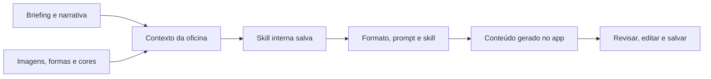

# Oficina em Prancha

Aplicativo desktop em **Electron** para construir a narrativa de uma palestra ou oficina com apoio visual e transformá-la em diferentes materiais.

Enquanto escreve, o usuário vê e escolhe imagens, formas e cores. O app guarda o contexto numa skill interna por oficina. Ao selecionar um formato — como pitch deck, post de LinkedIn ou carrossel de Instagram — o aplicativo usa esse contexto e um prompt + skill específicos para gerar o conteúdo. A revisão e a edição acontecem no próprio app.

**Estado em 20/10/2026:** repositório privado com specs e planos. Não há implementação, instalador, download, demo funcional ou oferta comercial. O autor pediu somente documentação.

O debate RCD propôs uma microconsultoria que vende oficinas de feedback para RH como primeiro caso de pesquisa. Depois, o autor pediu **investigar perfis que vendem produtos ou serviços e outros materiais comerciais**. Esse caso passa a ser controle; o público definitivo continua aberto. A ampliação é proposta de investigação, sem construir um produto para todos os vendedores.

O novo agente comparou branding, fotografia de alimentos, cerâmica para lojistas e templates digitais. Recomenda descoberta com **fotografia comercial** e **cerâmica como contraste de produto**, usando proposta/portfólio e catálogo/condições, sem impor posts. São hipóteses para pesquisa, com custos e disposição a pagar desconhecidos.

## Documentação curta

- [Orientações para a designer](docs/briefing-designer-primeira-versao.md): proposta de valor, fluxo, quatro telas e estados da primeira versão proposta.
- [Spec da experiência desktop](docs/specs/experiencia-desktop-oficina.md): 36 histórias preservadas e 14 complementos propostos, contratos e aceites.
- [Produto e fluxo](docs/produto.md): experiência, saídas e recorte inicial proposto.
- [Arquitetura inicial](docs/arquitetura.md): Electron, contexto interno e geração por formato.
- [Decisões e origem](docs/decisoes.md): escolhas do autor, histórico e pontos em aberto.

## Proposta de serviço e investigação

- [Variações do usuário e do que pretende vender/gerar](docs/servico/variacoes-escopo.md): proposta solicitada pelo autor e investigação de um novo agente.
- [Oferta e economia do caso P1](docs/servico/oferta-e-economia.md): unidade, limites e cenários; P1 não é público definitivo.
- [Go-to-market, vendas e validação](docs/servico/gtm-e-validacao.md): canais, mensagens, comparação e critérios de parada, sem execução.
- [Plano de implementação](docs/servico/plano-implementacao.md): marcos condicionais, dependências e capacidade desconhecida.
- [Debate completo e auditoria](docs/debate/2026-10-20-rcd/README.md): agentes, réplicas, fontes, rastreabilidade e limites.

**Recomendação atual: não vender.** Instalação, dados, capacidade, ganho frente às alternativas e margem não foram demonstrados. R$690 é estímulo hipotético, sem preço aprovado; a conta com dez entregas permanece negativa após desenvolvimento. A investigação adicional pode mudar nicho, material e recorte antes de construir.

Este é o repositório de construção. O [fork público do Projeto Ferramenta](https://github.com/MathBorgess/projeto-ferramenta-criacomp) preserva a caixa morfológica e o experimento que originaram a proposta. A skill de exploração `morphological-project-design`, no skills-catalog, tem outra função: organizar a seleção de projetos.

Planejamento comercial orientado por **Revenue-Centric Design, Richard (@richardrx)**. [Fonte fixada](https://github.com/heliocosta-dev/revenue-centric-design/tree/1942760c2242f609bf63ce2c97204f5a1791bd68), [termos próprios completos](docs/debate/2026-10-20-rcd/RCD-LICENSE.txt), separados da licença ainda não escolhida para o código futuro. Sem aplicação a apostas/cassinos/jogos de azar ou garantia de retorno financeiro.
