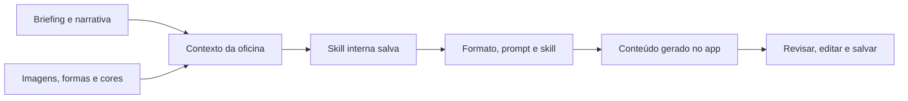

# Oficina em Prancha

Aplicativo desktop em **Electron** para construir a narrativa de uma palestra ou oficina com apoio visual e transformá-la em diferentes materiais.

Enquanto escreve, o usuário vê e escolhe imagens, formas e cores. O app guarda o contexto numa skill interna por oficina. Ao selecionar um formato — como pitch deck, post de LinkedIn ou carrossel de Instagram — o aplicativo usa esse contexto e um prompt + skill específicos para gerar o conteúdo. A revisão e a edição acontecem no próprio app.

**Estado em 20/10/2026:** repositório privado criado para a construção do produto. Esta primeira entrega contém a definição do app; ainda não há implementação, instalador ou download disponível.

## Documentação curta

- [Produto e fluxo](docs/produto.md): experiência, saídas e recorte inicial proposto.
- [Arquitetura inicial](docs/arquitetura.md): Electron, contexto interno e geração por formato.
- [Decisões e origem](docs/decisoes.md): escolhas do autor, histórico e pontos em aberto.

Este é o repositório de construção. O [fork público do Projeto Ferramenta](https://github.com/MathBorgess/projeto-ferramenta-criacomp) preserva a caixa morfológica e o experimento que originaram a proposta. A skill de exploração `morphological-project-design`, no skills-catalog, tem outra função: organizar a seleção de projetos.
