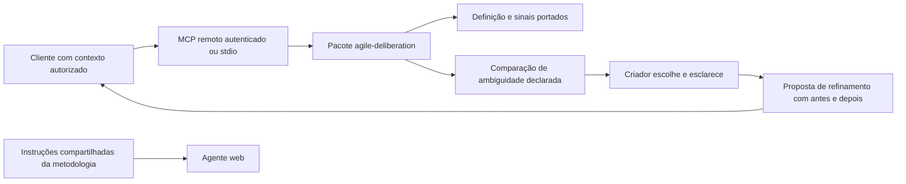

# Incorporação do Agile Deliberation

Registro de 05/11/2026. A origem é o [código publicado pelo Google Research](https://github.com/google-research/google-research/tree/d3a4bd8f0eceddda553e47085033b537935b283f/agile_deliberation), fixado em `d3a4bd8f0eceddda553e47085033b537935b283f`. O [ADR 0013](adr/0013-agile-deliberation-no-mcp.md) registra a decisão e suas alternativas.

## Mapa do método para o produto

| Parte original | Incorporação no Compor | Arquivo executável |
| --- | --- | --- |
| `Definition.copy`, `update_signals`, `collect_leaf_signals` em `definitions.py` | Port de árvore de sinais para valores JavaScript imutáveis. Mantém coleta recursiva de folhas e tipos necessário, positivo e negativo. Remove referências cíclicas de pai, imagens e IDs globais. | `packages/agile-deliberation/src/definition.js` |
| `Reflection.brainstorm_borderline_category` em `reflection.py` | Instruções adaptadas para explicitar fronteiras, evitar repetições e pedir exemplos comparáveis. Casos vêm do cliente; o pacote não os recupera nem inventa. | `packages/agile-deliberation/src/methodology.js` |
| `DefinitionRefiner.improve_definition` em `refine_definition.py` | Instruções para refinar a definição após esclarecimento. A ferramenta compara critério anterior e proposta recebida, sem aceitar ou aplicar a revisão. | `packages/agile-deliberation/src/methodology.js` e `index.js` |
| Notebook, busca CLIP/FAISS, classificação Gemini, seleção de candidatos por desempenho | Não incorporados. Nenhuma dependência desses componentes é instalada ou chamada pelo produto. | Não se aplica |
| Criador/destinatário, visual/mensagem, tensão com decisão humana, esclarecimento opcional | Extensões específicas do Compor, autorizadas em 05/11/2026. Não são resultados avaliados no artigo. | `packages/agile-deliberation/src/index.js` |

As três fontes Python integrais ficam em [third_party](../third_party/google-research/agile_deliberation/README.md). Cada arquivo mantém a licença e o copyright. Os arquivos derivados identificam a modificação e remetem à licença completa. Os hashes são verificados no teste `provenance.test.mjs`.

## Execução e autoridade

`prepare_deliberation` recebe objetivo, critérios e decisões reportadas. Cada critério identifica perspectiva, dimensão, declaração, exemplos, origem e eventual ambiguidade ou tensão. Os IDs devem ser únicos. Decisões órfãs ou duplicadas falham. A última decisão reportada controla se uma fronteira continua aberta; `reopen` permite retomá-la. O pacote não autentica a autoria humana de uma declaração enviada pelo cliente.

A ferramenta devolve definições com sinais e folhas, cobertura informativa e no máximo uma comparação sugerida. Um critério sem exemplo ou contraexemplo retorna `stage: scope`; com ambos, retorna `stage: reflect`. Sem ambiguidade ou tensão declarada aberta, `next` é `null`. Isso não concede autorização para gerar.

`propose_criterion_refinement` recebe o critério anterior, esclarecimento reportado, declaração proposta e sinais propostos. Devolve antes/depois e campos alterados, sempre com `accepted: false` e `persistsData: false`. O cliente mantém a decisão humana e atribui um novo identificador ao critério revisado, preservando o anterior.

As duas ferramentas são registradas em `packages/remote-mcp/src/index.js` e `prototypes/compor-mcp/src/server.ts`. O primeiro conserva autenticação por chamada e isolamento dos projetos. O segundo conserva sua identidade local. Nenhuma nova ferramenta acessa storage, perfil Phoenix ou serviços externos.

O export `@compor/agile-deliberation/methodology` oferece `methodologyInstructions` e `methodology`, com versão da adaptação e commit da origem. Ele não carrega bibliotecas de classificação nem exige chamada de modelo. O agente web inclui essas instruções em `packages/agents-api/src/studio-direction-instructions.mjs`, junto das regras de ferramenta e decisão humana do estúdio. A mesma versão da metodologia orienta os dois transportes MCP e a conversa web.

## Evidência de verificação

Os testes do pacote verificam fronteiras declaradas, exemplos ausentes, reabertura, preservação do critério anterior, limites e separação entre chamadas. O teste do MCP remoto usa cliente Streamable HTTP e revoga o acesso após uma chamada válida. O teste stdio negocia e executa ambas as ferramentas em um processo real do servidor.

Esses testes verificam contratos e comportamento determinístico. Não demonstram que o modelo esclarece as ambiguidades certas, que a persona representa compradores reais ou que uma imagem gerada ficou melhor. A avaliação visual e de uso permanece na demo.
