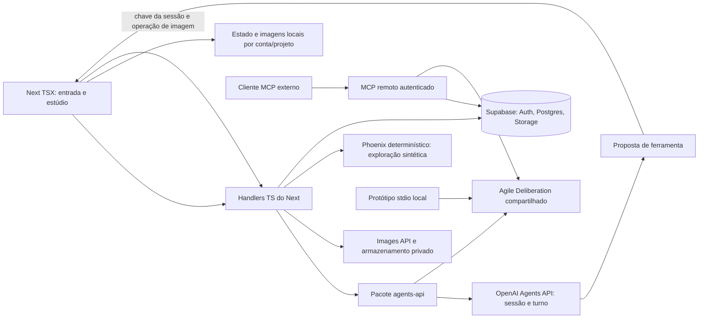

# Arquitetura implementada do Compor

Mapa do código em 06/11/2026, atualizado a pedido de Matheus. É o ponto de entrada para desenvolvimento. O [AGENTS.md](../AGENTS.md) registra as regras de contribuição; os [ADRs](adr/README.md) preservam decisões e seu estado. Este mapa descreve implementação, não comprova deploy ou aprovação formal de propostas antigas.

## Camadas e fluxo



O frontend exibe o estado e recebe decisões. Os handlers resolvem identidade, verificam escopo e conectam os pacotes. O loop do agente é gerenciado pela **Agents API**, acessada por HTTP em `packages/agents-api`. Não existe um loop Agents SDK no backend do estúdio. O SDK é dependência de experimentos no protótipo.

O estúdio usa function tools definidas em `studio-chat-tools.mjs` e executa ações locais pela ponte de ferramentas em `studio-tools.ts`. Operações duráveis continuam passando pelas rotas autenticadas. O MCP remoto expõe capacidades para clientes externos; o adaptador de agente em `/api/agent-mcp` acrescenta delegação por projeto quando configurado. Não confundir a ponte local do estúdio com um servidor MCP remoto, nem afirmar que toda mensagem do estúdio atravessa MCP.

## Estrutura de pastas

```text
apps/
  web/
    app/                 páginas, TSX e handlers HTTP do Next
    lib/                 domínio TS, schemas e adaptadores locais/servidor
    proxy.ts             entrada sem sessão em HTML sem JavaScript
    public/studio/       fontes e ativos oficiais da interface
    test/                contratos HTTP, estado e navegação
  site/                  site público Astro estático
packages/
  agents-api/            sessão/turno, ferramentas, autorizações e recuperação
  images-api/            chamada ao motor e validação da imagem
  private-images/        armazenamento, leitura e listagem privados
  remote-mcp/            transporte autenticado e delegação por projeto
  agile-deliberation/    critérios e instruções comuns à web e ao MCP
  attempt-metrics/       normalização e estimativas de consumo
prototypes/compor-mcp/   servidor stdio, Phoenix e experimentos locais
supabase/
  migrations/            mudanças ordenadas do esquema e políticas
  tests/                 verificações SQL e ferramentas de captura
third_party/            fontes externas, licenças e proveniência
scripts/quality/         testes e avaliadores dos gates
.github/workflows/      execução de CI
docs/adr/               decisões e supersessões
```

`apps/web` depende dos exports de `packages`; os pacotes não dependem de componentes de UI. A infraestrutura específica do Next é composta em `app/api` e nos adaptadores de `lib`. O diretório `lib` contém módulos de navegador e de servidor: sua presença nessa pasta não torna um módulo seguro para importar num componente `use client`. Hoje essa separação depende de revisão, além das restrições do build Next.

Os pacotes compartilhados continuam em JavaScript e publicam declarações `.d.ts` onde são consumidos pelo Next. A verificação estrita cobre o app TS/TSX; não converte essas implementações JavaScript em código estaticamente verificado. Os testes exercitam os contratos reais.

## Frontend

`page.tsx` abre sempre o estúdio atual. O caminho legado e seu seletor foram retirados por autorização de Matheus ([ADR 0036](adr/0036-remocao-da-interface-legada.md)). A entrada oferece Google. `workspace.tsx` verifica sessão e carrega o estúdio por importação dinâmica após autenticação. O símbolo usa os ativos da marca e respeita movimento reduzido.

Na primeira visita sem cookie de sessão do Supabase, com login configurado, `proxy.ts` responde `GET /` sem passar pelo App Router. `lib/light-entry.ts` gera HTML sem script externo, com a cópia de `lib/entry-content.ts` e os mesmos arquivos CSS, importados como texto por uma regra do Turbopack. Um script inline grava o rascunho com as chaves que `workspace.tsx` reivindica depois do login. Com cookie, sem login configurado ou com login local, `/` segue para `page.tsx`. Ver [ADR 0034](adr/0034-entrada-leve-sem-runtime.md) e, sobre o bundle, o [ADR 0033](adr/0033-turbopack-e-analise-do-bundle.md).

`studio-app.tsx` apresenta preparação guiada de projeto/contexto/IA/referências antes do pedido do post. `studio-guided.tsx` reutiliza os padrões visuais e compõe o estúdio com conversa à esquerda e criação à direita, divisão ajustável, áreas expansíveis e alternância compacta. As configurações do projeto reúnem contexto geral, IA, marca e materiais; as do post contêm objetivo, mensagem, ação opcional e critérios locais. Referências têm um painel único com alcance explícito, acessível também a partir de Materiais e versões; Posts do projeto organiza peças, seus rascunhos e versões. A ideia inicial é contexto, não uma mensagem aguardando reenvio. Criar/abrir projeto, escolher/conectar IA e recarregar não iniciam imagens: o pedido de exploração é explícito e fica restrito à área de referências. Selecionar continua orientando o gosto, sem aprovar todos os elementos; leituras e respostas rápidas ficam na conversa do projeto ou do post correspondente. O editor preserva arte integral, marcações, campos e imagem-base, com versões/variantes acessíveis junto ao post. Ver [ADR 0044](adr/0044-preparacao-guiada-e-estudio-por-post.md), [ADR 0045](adr/0045-conversas-isoladas-por-post.md) e [ADR 0046](adr/0046-contexto-e-referencias-por-post.md). Os ADRs 0023, 0031, 0037 e 0041 preservam o histórico das disposições substituídas. A inspeção técnica de um turno concluído só aparece com `COMPOR_DEVELOPER_MODE=true` em desenvolvimento; não altera a recuperação de pendências. A renomeação pelo chat e pelo menu atualiza também a lista de projetos no componente pai e sua revisão. Um projeto novo recebe como título provisório o começo da ideia, cortado numa palavra inteira com até 48 caracteres. O estado local validado registra `projectTitleProvisional=true` só nos projetos recém-criados pelo estúdio, sem comparar o nome com a primeira mensagem. Depois da primeira resposta, esse valor permite uma proposta de título curto com `compor_renomear_projeto`, que aceita até 48 caracteres; aceitar ou recusar a proposta e renomear pelo menu persistem `false`. Editar a ideia não cancela a oportunidade. Estados históricos sem o campo recebem `false`; uma revisão de projeto maior que 1 também impede a iniciativa, mesmo com texto igual. A renomeação pelo menu e o banco aceitam até 200. Uma ferramenta com argumentos inválidos encerra a tentativa antes de executar; um novo pedido explícito pode continuar em outra sessão. Ver [ADR 0035](adr/0035-titulo-provisorio-e-falha-de-ferramenta.md). A barra, os cartões e o menu cortam o título com reticências e mantêm o nome completo acessível. No chat e na ideia inicial, Enter envia e Shift+Enter quebra linha; em telas de toque, Enter continua quebrando linha. O [ADR 0023](adr/0023-referencias-e-conversa-flutuante.md) registra a revisão de hierarquia; os ADRs 0020 e 0021 preservam decisões anteriores.

A revisão apresenta a arte integral, o título do projeto e a legenda, com “Copiar legenda” e “Baixar PNG”. O download compõe no clique e usa `<título>-v<N>.png`; um rascunho ainda sem versão usa `v0`. O PNG de origem mantém seus bytes, e JPEG é convertido sem camadas de texto. Uma preparação pendente é descartada ao trocar a imagem, a versão ou sair da revisão. O envio de imagem-base fica no estúdio; a autorização e o salvamento do PNG no projeto ficam em Configurações do projeto → Materiais e versões. Exportar não salva, aprova ou publica. Ver [ADR 0031](adr/0031-faixa-de-contexto-publico-unico-e-revisao.md).

`studio-app.tsx` compõe conversa, quadro, referências e versões. `studio-state.ts` e `studio-domain.ts` definem o estado validado; `studio-post-context.ts` resolve contexto, direção e referências efetivos de cada conversa; `studio-state-writer.ts` coordena persistência com revisão esperada. `studio-storage.ts` conserva estado schema 3 e imagens locais por conta/projeto no IndexedDB versão 4, com arquivo transacional dos originais de schemas 1/2 na migração. Objetivo/mensagem/ação e referências próprias/excluídas ficam em `posts`; `projectReferenceIds` define as compartilhadas. Projeções por conversa selecionam o contexto efetivo e não são persistidas. Tentativas e versões novas congelam o contexto e as referências usados; aprovação não consulta a seleção atual. Sinais remotos possuem alcance opcional `piece_id`; leituras gerais excluem sinais locais e o histórico admite escolhas locais apenas depois de aprovação explícita vinculada. A migration 00029 é pré-requisito de publicação. Ver [ADR 0046](adr/0046-contexto-e-referencias-por-post.md). Conversas têm escopo de post ou referências; sessões e provas novas carregam esse vínculo. Compositores ficam segregados na sessão da aba, sem alterar a revisão criativa. Chave OpenAI não entra nesse estado.

No canvas, `studio-variants.ts` agrupa as versões da peça por dimensão criativa declarada e origem. `studio-variant-cards.tsx` mostra a última imagem de cada variante e oferece seu histórico, mantendo a versão escolhida no editor. As imagens carregam sob demanda por versão, primeiro do IndexedDB, com recuperação privada por escolha explícita quando a origem é desconhecida. A proposta de imagem aceita `changedDimension` (`style`, `composition`, `hook`); sem esse campo, é retoque. A preparação salva `operation` e a dimensão pela RPC `save_piece_version_v3`: variantes começam sem aprovação, retoques herdam a origem. A listagem v3 retorna os campos opcionais, enquanto as RPCs v2 continuam compatíveis. Conflito exige também igualdade de operação e dimensão, e “Novo post” continua criando outra peça. Ver [ADR 0030](adr/0030-variante-retoque-e-cards-no-canvas.md).

Briefing, persona e referências são progressivos. Critérios preservam origem, exemplos, contraexemplos e decisões separadas. Textos e campos próprios da peça instruem uma próxima geração; não alteram pixels da imagem já salva. A pessoa pode criar ou remover campos, e a IA pode propor rótulos vazios, sem inventar valores. Conteúdos históricos sem `fields` continuam legíveis; clientes de schema estrito anteriores não aceitam automaticamente o formato novo. Uma cópia local JPEG para transporte acima do limite é uma escolha explícita, com formato, dimensões e tamanho apresentados antes da confirmação. O original permanece intacto.

`/api/studio/decision` calcula exploração auxiliar de catálogo com o módulo TS puro `lib/phoenix`. A rota exige sessão verificada, origem e propriedade do projeto, limita o corpo a 8 KiB e retorna `referenceSummary` validável com origem sintética. O Next inclui todas as dependências no bundle: não há subprocesso, leitura de skills, import do servidor stdio, busca externa ou geração nessa rota. Os scores são heurísticas, não evidência humana ou calibração para aquela audiência. A [proveniência](../apps/web/lib/phoenix/PROVENANCE.md) e o [ADR 0019](adr/0019-phoenix-deterministico-no-bundle-web.md) registram o porte e seus limites.

A tela de referências sugere pins pela ideia do projeto depois do consentimento para a sessão da conta; sem ele, só consulta metadados do histórico próprio, sem carregar prévias externas. A busca visual consulta boards externos e devolve pins com origem e prévia, sem enviar o texto do briefing ao Pinterest. “Escolher mais referências” reabre essa tela e “Voltar ao post” preserva rascunho, imagem, versões e conversa. Um novo post explicitamente pedido, por chat ou botão, abre o editor; não reinicia a descoberta entre as ações do agente. Na composição com cards, a ação única de escolher mais referências fica no cabeçalho local anterior às variantes, fora do zoom, para continuar visível no mobile. A inicialização do projeto passa pela preparação guiada antes de criar o primeiro post. A ideia inicial fica em `projectIdea`, no estado local por conta e projeto; projetos já abertos não recebem o rascunho de outro projeto como fallback. A seleção de uma imagem adiciona cópia identificada ao contexto visual; não representa aprovação estética. O agente registra comentários literais associados a uma referência selecionada ou a uma imagem gerada apresentada e identificada de forma inequívoca. Sinais externos e gerados persistem em rotas separadas sob RLS. O Phoenix usa escolhas/rejeições recentes para ajustar boards; o planejador das próximas imagens recebe uma amostra limitada de sinais e comentários, com descrições de composição disponíveis. Isso é uma heurística, sem calibração estatística ou evidência de resposta do público. Ver [ADR 0022](adr/0022-busca-visual-e-sinais.md).

O público informado nas perguntas iniciais e em Configurações do projeto → Contexto é o mesmo valor e é o ponto de partida da persona compradora. O objetivo da divulgação também pode ser revisto nessa seção. As duas representações locais antigas são sincronizadas para compatibilidade: vazio cede ao valor existente, iguais se fundem, e diferentes são preservados até uma escolha explícita na interface. Enquanto houver conflito, a exploração não inicia uma imagem e o agente não escolhe o público por suposição. O planejador recebe um único `publico`; a seção Marca e direção mantém situação, necessidade, referências culturais, afirmações e critérios da persona.

`offerFacts` é uma lista local validada de fatos com rótulo, texto literal e estado `confirmed`, `pending` ou `omitted`. A faixa permite editar os fatos por teclado. Na primeira abertura, traz o registro de entrevista da própria conta/projeto preservando sua origem: informado vira confirmado, sugerido permanece pendente e uma escolha de pular permanece omitida. O campo de público não é mais interpretado como fato. O registro anterior de entrevista continua preservado; erro de leitura não inventa nem apaga seu conteúdo. O chat e o planejador recebem os estados dos fatos e não tratam uma pendência como confirmação nem incluem um fato omitido na arte. Editar o contexto orienta a próxima proposta, sem alterar pixels de uma imagem já criada. Hipóteses não comprovam resposta de público real; decisões aceitas e rejeitadas continuam orientando a proposta. Ver [ADR 0031](adr/0031-faixa-de-contexto-publico-unico-e-revisao.md).

O site Astro é uma saída estática independente. A página Next usa renderização sob demanda; dados privados não são convertidos em conteúdo estático nem cache compartilhado para melhorar métricas. Ver [ADR 0014](adr/0014-frontend-next-typescript.md).

## Backend e dados

A exceção administrativa delimitada é a leitura da padrão: `SUPABASE_SERVER_KEY`, exclusiva do servidor, chama `compor_default_openai_key` para obter somente `COMPOR_CIN_OPENAI`. A função não é executável por `PUBLIC`, `anon` ou `authenticated`. Esse privilégio não é usado para dados da pessoa. A integração depende de `COMPOR_DEFAULT_OPENAI_ENABLED=true`; indisponibilidade do Vault não bloqueia BYOK. Segredos não saem em status, provas, contexto, persistência ou logs.

As rotas Next são adaptadores HTTP. Validação de origem, sessão e propriedade ocorre antes de ler dados, executar ferramentas ou chamar fornecedores. Supabase Auth usa Google/PKCE; Postgres e Storage mantêm RLS junto da autorização por operação. O app usa a identidade da pessoa, sem substituir o token por uma chave administrativa.

Projetos, versões salvas, ativos privados e metadados técnicos de tentativas ficam no Supabase. Briefing, persona, referências e conversa do estúdio permanecem locais no primeiro marco. A OpenAI também pode reter a sessão e o conteúdo enviado para execução. Metadados de tentativa não são uma cópia completa do estado criativo local.

Reservas, vínculos assinados, versão esperada e recibos correlacionam operação, conta, projeto e peça. Resultado desconhecido é diferente de falha confirmada. Recuperação consulta o estado conhecido antes de considerar outra tentativa paga. Nada disso promete execução ou cobrança exatamente uma vez. Ver [ADR 0015](adr/0015-backend-dados-e-autorizacao.md).

## Agente e geração

O resultado de uma ferramenta do estúdio verifica os argumentos no mesmo domínio da prova assinada, incluindo a compatibilidade BYOK histórica. O domínio estável de digests de conteúdo e IDs de idempotência permanece separado; não é usado para comparar o `argsDigest` de uma prova vinculada à credencial. A validação ocorre antes de reservar o recibo ou enviar `tool_result`. O `actionDigest` do recibo usa o domínio estável, para que uma prova reemitida da mesma chamada repita o recibo existente em vez de conflitar. Ver [ADR 0040](adr/0040-validacao-argumentos-acoes-estudio.md) e seu adendo.

A aplicação web prepara duas fontes: BYOK conectada explicitamente e IA do Compor, com padrão do Supabase Vault somente no servidor. Sem própria, ações autorizadas podem usar a padrão; falha da própria nunca troca de fonte. Status global autenticado informa só disponibilidade e não exige projeto. Sua descoberta, abertura/reabertura ou recarga não autorizam a padrão, que exige intenção para o projeto. BYOK explícita mantém a autorização histórica por sessão. Troca após a primeira ativação pausa solicitações. Novas provas vinculam fonte e credencial, impedindo reutilização cruzada e downgrade; provas BYOK históricas mantêm o contrato legado. O [ADR 0038](adr/0038-chave-padrao-openai-no-vault.md) e o [procedimento](compor/chave-padrao-openai-vault.md) distinguem preparação, configuração e uso real.

`packages/agents-api` trata criação/continuação de sessões, leitura de itens, pedidos de ação, autorização e recuperação. A Agents API executa o turno; o backend não usa Agents SDK para replicar esse loop. O estúdio disponibiliza function tools de escopo local, com schemas e recibos. Conforme a decisão de 06/11, a chave conectada autoriza a geração guiada durante a sessão; não há confirmação por imagem. A proteção contra reenvio incerto continua necessária. As instruções tratam um fato da oferta declarado pela pessoa como obrigatório e uma sugestão de gosto como sinal que o agente pondera e pode contestar uma vez. Cinco segundos depois de a seleção de referências estabilizar, um turno automático sem ferramentas responde com um objeto JSON de leitura do gosto, recomendação e uma única pergunta. O servidor valida esse objeto e devolve o Markdown composto como fallback e um `reply` versionado com opções de uma lista fechada: “Concordo”, até duas alternativas de gosto descritas pelo modelo e “Quero ajustar”. Opções inválidas são descartadas sem invalidar a leitura; uma resposta fora da forma encerra o turno como falha `invalid_taste_reading`, sem nova tentativa. O cliente revalida a estrutura e a guarda num registro lateral do `localStorage`, ligado à mensagem e ao contexto da leitura. Escolher uma opção envia uma mensagem humana explícita pelo mesmo caminho do compositor, com `quickReply`; o servidor abre então um turno só de texto, sem ferramentas nem reaproveitamento de sessão. Ver [ADR 0042](adr/0042-leitura-estruturada-e-respostas-rapidas.md). A prova assinada da sessão registra a origem na seleção, então a consulta do turno não depende do navegador. Ver [ADR 0029](adr/0029-agente-opinativo-e-pergunta-unica.md).

A operação de imagem vincula prompt, textos literais, referência de origem e bytes das imagens. A arte vem completa do GPT Image, inclusive textos, e o resultado é salvo numa nova versão. Imagens de exploração usam reserva e armazenamento próprios, sem virar versões da peça. Na área de referências, a ideia inicial pode orientar o primeiro lote após pedido explícito, com a IA autorizada. O controlador solicita três imagens sequenciais por lote e aguarda 15 segundos antes do lote seguinte. Após dois lotes completos sem seleção ou comentário de suas imagens, uma trava no servidor impede novas gerações entre dispositivos e no MCP; o chat pergunta se a pessoa está satisfeita e só um pedido explícito retoma a exploração. Uma interação anterior ao limite reinicia a contagem, vinculada aos IDs das imagens. Depois da resposta do turno de seleção, o estúdio não inicia lote até haver mensagem da pessoa, nova imagem selecionada ou pedido de mais propostas. Editar o briefing, remover uma referência ou iniciar ou falhar outro turno automático preserva a pergunta pendente. Essa espera deriva das mensagens salvas no estado local e não usa a trava do servidor. A retomada explícita guarda o ID da pergunta por conta e projeto no navegador, para que a recarga não repita uma pergunta já liberada; uma nova pergunta volta a pausar. Ao sair da tela, o estúdio deixa de iniciar solicitações; uma requisição já enviada pode concluir. Resultado incerto interrompe novas solicitações. A galeria mostra o lote mais recente, mantém anteriores paginados e usa ordinal imutável. O planejamento é heurístico e não comprova aprendizado ou qualidade estética. Exportar PNG não acrescenta camadas textuais nem aprova a peça. Uso desconhecido permanece desconhecido, e as estimativas não equivalem à fatura.

Nas novas reservas de exploração, uma capacidade aleatória efêmera vincula a reserva à conclusão ou à recusa definitiva registrada pelo servidor. O banco recebe apenas o compromisso da capacidade ao reservar; o navegador não recebe a prova. A recusa de credenciais confirmada pelo fornecedor interrompe a exploração e permite retomada explícita após corrigir a chave; timeout e demais resultados inconclusivos continuam bloqueados. Reservas antigas sem essa prova não são liberadas automaticamente. A migração e a troca de versão exigem coordenação para não deixar processos antigos despacharem durante a transição. Ver [ADR 0025](adr/0025-prova-de-desfecho-da-exploracao.md).

O chat pode ler até três links HTTPS públicos fornecidos no turno, limitando tempo e tamanho e recusando endereços não públicos ou redirecionamentos para outra origem. O leitor não envia cookies nem a chave ao site. A página é tratada como conteúdo não confiável e o turno de leitura externa não recebe ferramentas para alterar o projeto. HTML e texto simples são suportados; páginas privadas, renderizadas por JavaScript ou em outros formatos podem não ser lidas. Ver [ADR 0024](adr/0024-exploracao-limitada-e-pecas-flexiveis.md).

A versão de peça salva usa o formato opcional `fields` para textos próprios, validado no estado, na API, no MCP e no SQL; os campos também compõem o vínculo da imagem. O formato legado permanece válido. O frontend normaliza metadados reais de aprovação e, ao encontrar 409, só recupera uma versão imediatamente seguinte quando sua base e conteúdo correspondem ao envio; em divergência preserva o rascunho para revisão. Não repete a geração automaticamente.

As instruções do Agile Deliberation são compartilhadas com o MCP. O agente esclarece ambiguidades; a pessoa decide os critérios. Fontes, hipóteses e decisões permanecem distinguíveis. Ver [ADRs 0012](adr/0012-arte-integral-e-deliberacao-adaptativa.md), [0013](adr/0013-agile-deliberation-no-mcp.md) e [0016](adr/0016-agente-api-e-ferramentas.md).

## MCP

`packages/remote-mcp` fornece o transporte HTTP autenticado. `/api/mcp` atende clientes autorizados; `/api/agent-mcp` usa uma credencial distinta e delegação limitada ao projeto. Autenticação e verificação de acesso por chamada continuam necessárias após a negociação MCP. OAuth/discovery depende da configuração do ambiente.

O MCP remoto também oferece geração e leitura de imagens exploratórias. A chave OpenAI é recebida em cabeçalho efêmero da requisição, fora dos argumentos da ferramenta; sua compatibilidade com um cliente MCP específico exige verificação separada.

`prototypes/compor-mcp` executa stdio com identidade e recursos locais. Phoenix, filesystem e experimentos desse servidor não são capacidades implicitamente disponíveis ao cliente remoto. Ambos usam `packages/agile-deliberation`; as ferramentas de deliberação são puras, não persistem uma aceitação humana nem consultam serviços externos. A [proveniência do código](agile-deliberation.md) identifica o que foi copiado e portado. Ver [ADR 0017](adr/0017-mcp-transportes-e-capacidades.md).

## Instalação e verificação

A [validação da preparação do Vault em 10/11](quality/default-openai-vault-2026-11-10.md) registra autenticação, separação de credenciais, SQL restrito, estados de interface, 357 testes web e o scan dos módulos privados nos bundles. O segredo informado é `COMPOR_CIN_OPENAI`; configuração remota e ativação continuam etapas distintas.

O [fechamento do feedback do Estúdio em 10/11](quality/feedback-estudio-final-2026-11-10.md) reúne os gates das issues #22–#27 e #33, as capturas aprovadas, o pacote de release e a liberação em produção ainda pendente.

Use Node 24, Python 3, cliente `psql`, `cwebp`/`dwebp` no `PATH` e histórico Git completo para reproduzir os jobs. No Ubuntu, o pacote `webp` fornece os dois binários de imagem. O repositório contém pacotes com dependências `file:`; instalar somente a raiz não instala todos eles. A partir da raiz:

```sh
npm ci --ignore-scripts
npm ci --ignore-scripts --prefix packages/agile-deliberation
npm ci --ignore-scripts --prefix packages/agents-api
npm ci --ignore-scripts --prefix packages/private-images
npm ci --ignore-scripts --prefix packages/remote-mcp
npm ci --ignore-scripts --prefix prototypes/compor-mcp
npm ci --ignore-scripts --prefix apps/web
npm ci --ignore-scripts --prefix apps/site
(cd apps/web && npx --no-install playwright-core install --with-deps chromium)
export BROWSER_EXECUTABLE_PATH="$(cd apps/web && node --input-type=module -e 'import {chromium} from "playwright-core"; process.stdout.write(chromium.executablePath())')"
```

No Ubuntu 24.04, o job de performance configura um perfil AppArmor para o executável exato do Chromium manter seu sandbox. Reproduza essa preparação do [workflow](../.github/workflows/quality.yml) nesse ambiente; não a aplique ao macOS.

```sh
npm run quality:lint
npm run quality:typecheck
npm run quality:test
npm run quality:unit
npm run quality:browser
npm run check --prefix apps/site
npm run build --prefix apps/site
npm run quality:build
npm run quality:performance
npm run quality:maintenance
```

Não rode browser e Lighthouse concorrentes ao medir performance. Os [gates](quality/gates.md) definem escopo, orçamentos e limites. O [ADR 0018](adr/0018-gates-qualidade-e-performance.md) distingue bloqueios automáticos, diagnósticos e revisão. O workflow Quality executa nos PRs e manualmente; por decisão de Matheus em 10/11/2026, não repete os checks no push da `main`. A execução manual mantém todas as áreas. Quality não faz deploy nem usa credenciais de geração. O empacotamento de deploy precisa acompanhar o grafo de dependências e a configuração TypeScript; build do checkout não comprova build do bundle de deploy.

O workflow separado [Supabase migrations](../.github/workflows/supabase-migrations.yml) é acionado em todo push na `main` ou manualmente na `main`. O preflight exige habilitação explícita e referências de projeto correspondentes. A trava transacional durável exige bootstrap separado, descrito no [ADR 0027](adr/0027-trava-automacao-migrations.md). Testes locais não comprovam identidade, histórico ou esquema do ambiente de produção.

O projeto piloto registra migrations em `compor_migration_audit.applied`, enquanto o histórico nativo Supabase é `supabase_migrations.schema_migrations`. A ausência do histórico nativo **não** significa que as migrations não foram aplicadas. Antes de habilitar, identifique o projeto de produção, inventarie os históricos e o esquema efetivo, confira hashes e ordem, ensaie em ambiente isolado e reconcilie divergências por procedimento revisado e autorizado. A evidência de inventário está em [migration-evidence](quality/migration-evidence.md). O workflow não corrige ou cria baseline automaticamente; variáveis são declarações operacionais, não prova de compatibilidade ou ausência de deriva. Matheus orientou não criar backup nesta operação.

O workflow usa o secret `SUPABASE_DB_PASSWORD` no ambiente GitHub `production`, e as variáveis de repositório `SUPABASE_PROJECT_REF`, `SUPABASE_MIGRATIONS_VERIFIED_PROJECT_REF`, `SUPABASE_DB_HOST` e `SUPABASE_MIGRATIONS_ENABLED`. Habilite apenas após revisar o destino e concluir os pré-requisitos de histórico e bootstrap. O runner do [ADR 0028](adr/0028-migracoes-atomicas-em-lote.md) aplica migrations pendentes e histórico em uma única transação, recusa divergências e só libera a trava após `COMMIT` confirmado. A confirmação perdida continua resultado incerto; efeitos externos ou de sequences não são revertidos. Uma execução manual está disponível em Actions → Supabase migrations → Run workflow na `main`. Os jobs são serializados e falham quando o SHA do evento já não corresponde à `main` verificada no checkout; uma execução mais recente enfileirada e bem-sucedida cobre as migrations pendentes.

A publicação usa a integração Git da Vercel ([ADR 0043](adr/0043-deploy-vercel-por-integracao-git.md)). O projeto `compor-marco0`, com Root Directory `apps/web`, cria um deployment de produção a cada push na `main` e um preview a cada PR. Em Deployment Checks, a produção só recebe os domínios depois do check `Apply migrations or initialize baseline`. Como esse job falha quando a `main` já avançou, um deployment antigo fica retido. A Vercel CI não é usada; Quality continua sendo o gate dos PRs. A conexão e os checks são configurados por Matheus no painel, seguindo o [roteiro](compor/deploy-vercel-git.md), e o repositório não comprova sozinho que isso foi feito. O [ADR 0039](adr/0039-publicacao-vercel-apos-migrations.md) preserva os caminhos anteriores. Publicar não habilita a chave padrão nem comprova login ou geração real.

A inicialização única da baseline nativa e da trava pode ser solicitada em Actions → Supabase migrations → Run workflow, selecionando `bootstrap` na `main`. Ela exige a variável de repositório `SUPABASE_MIGRATIONS_BOOTSTRAP_ENABLED=true`, o mesmo destino verificado e o secret do ambiente `production`. O SQL gerado do commit exato exige auditoria legada correspondente e recusa namespaces nativos ou da trava preexistentes. Push normal e a opção padrão `migrate` nunca executam o bootstrap. Após a inicialização confirmada, remova a variável ou defina-a como `false`; falha ou resposta incerta exige inspecionar o banco antes de repetir. Essa operação não cria backup.

`scripts/stage_vercel_web.py` servia ao envio do bundle pela CLI; a integração Git constrói o checkout e não depende dele. Ele prepara o bundle da Vercel a partir de um commit Git imutável. Copia somente fontes permitidas, inclui a configuração TypeScript e `proxy.ts` e confina dependências locais em `vendor`. O pacote de deliberação leva licença e proveniência da origem. A preparação recusa destinos dentro do repositório, arquivos sensíveis e caminhos de dependência fora desse grafo. Ela não executa deploy.

O workflow já executou no GitHub Actions; os ajustes necessários ao runner estão no [registro de portabilidade](quality/ci-portability-2026-11-05.md). Isso não concede aprovação a commits posteriores. Build, tipos e lint locais no macOS não comprovam o resultado do runner Linux. Os registros de verificação devem identificar o commit, ambiente e escopo de cada execução.

## Limites e histórico

Na busca de referências, a falha da consulta opcional ao histórico permite continuar pelo RSS. Origem, sessão, acesso ao projeto e leitura das decisões atuais continuam obrigatórios; erros do RSS ou da busca não são ocultados por esse fallback. A consulta dedicada ao histórico mantém seu erro de indisponibilidade.

O histórico de referências da [issue #33](https://github.com/MathBorgess/compor/issues/33) usa `reference_signals.reference_data` para metadados de pins escolhidos e `piece_version_reference_links` para ligar seleções reais às versões aprovadas. `POST /api/studio/references/history` lê somente a conta autenticada, sem acesso externo. A busca prioriza esse histórico, com versões explicitamente aprovadas antes de escolhas recentes. A rejeição só suprime histórico e RSS no projeto atual: seleções históricas com metadados e vínculos reais continuam candidatos nos outros projetos, sem veto ou score negativo global. `PATCH /api/pieces` aceita fontes opcionais do contexto; com elas, `approve_piece_version_with_references` mantém a aprovação principal e registra somente escolhas positivas comprovadas no mesmo projeto, capturadas antes da primeira aprovação explícita. Comentários são neutros; referências antigas sem sinal e referências recusadas não bloqueiam aprovação nem recebem vínculo. A aprendizagem usa subtransações isoladas, para que sua falha não transforme aprovação confirmada em erro ou crie crédito parcial. Reaprovar não credita seleções posteriores. A aprovação antiga continua compatível e não cria vínculos por inferência. Na composição com variantes, cada nova versão pode ter seu próprio snapshot de referências na primeira aprovação explícita; o retorno da aprovação mantém seu formato anterior e a listagem v3 recupera operação e dimensão para conservar os cards. URLs externas continuam dados não confiáveis e imagens não são hospedadas. A migration só chega à produção no merge final. Ver [ADR 0037](adr/0037-referencias-sugeridas-e-retorno-ao-post.md).

Evidências reais anteriores estão em [estúdio marco 0](compor/estudio-web-marco0.md) e [isolamento e proteção](compor/isolamento-e-protecao-dados-marco0.md), com seus escopos e pendências. Testes novos com fixtures não herdam a prova de uma execução anterior. A metodologia não comprova qualidade criativa nem representa audiência real.

O [ADR 0011](adr/0011-agents-api-e-mcp-remoto.md) permanece com status histórico `proposed`. Este mapa registra a Agents API observada na implementação, sem alterar aquela aprovação. A [arquitetura v0](arquitetura-v0.md) preserva a direção de 27/10/2026; os contratos atuais e suas diferenças estão neste guia e nos ADRs posteriores.

A lista inicial permite excluir projetos mediante confirmação. A exclusão lógica usa `DELETE /api/projects`, revisão esperada e a RPC autenticada `delete_project_from_list`; a listagem web filtra `deleted_at`. Posts, imagens, histórico e permissões anteriores são preservados. Ver [ADR 0047](adr/0047-exclusao-logica-de-projetos.md).
