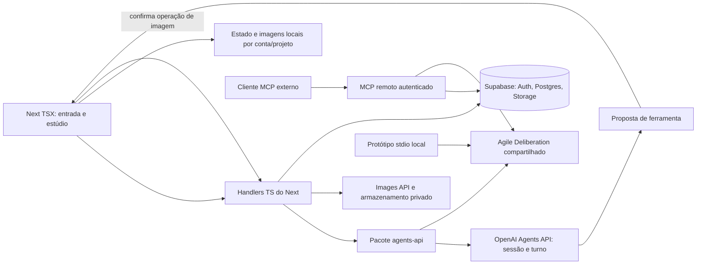

# Arquitetura implementada do Compor

Mapa do código em 05/11/2026, atualizado a pedido de Matheus. É o ponto de entrada para desenvolvimento. O [AGENTS.md](../AGENTS.md) registra as regras de contribuição; os [ADRs](adr/README.md) preservam decisões e seu estado. Este mapa descreve implementação, não comprova deploy ou aprovação formal de propostas antigas.

## Camadas e fluxo



O frontend exibe o estado e recebe decisões. Os handlers resolvem identidade, verificam escopo e conectam os pacotes. O loop do agente é gerenciado pela **Agents API**, acessada por HTTP em `packages/agents-api`. Não existe um loop Agents SDK no backend do estúdio. O SDK é dependência de experimentos no protótipo.

O estúdio usa function tools definidas em `studio-chat-tools.mjs` e executa ações locais pela ponte de ferramentas em `studio-tools.ts`. Operações duráveis continuam passando pelas rotas autenticadas. O MCP remoto expõe capacidades para clientes externos; o adaptador de agente em `/api/agent-mcp` acrescenta delegação por projeto quando configurado. Não confundir a ponte local do estúdio com um servidor MCP remoto, nem afirmar que toda mensagem do estúdio atravessa MCP.

## Estrutura de pastas

```text
apps/
  web/
    app/                 páginas, TSX e handlers HTTP do Next
    lib/                 domínio TS, schemas e adaptadores locais/servidor
    public/studio/       fontes e ativos oficiais da interface
    test/                contratos HTTP, estado e navegação
  site/                  site público Astro estático
packages/
  agents-api/            sessão/turno, ferramentas, autorizações e recuperação
  images-api/            chamada ao motor e validação da imagem
  private-images/        armazenamento, leitura e listagem privados
  remote-mcp/            transporte autenticado e delegação por projeto
  agile-deliberation/    critérios e instruções comuns à web e ao MCP
  attempt-metrics/       normalização e estimativas de consumo
prototypes/compor-mcp/   servidor stdio, Phoenix e experimentos locais
supabase/
  migrations/            mudanças ordenadas do esquema e políticas
  tests/                 verificações SQL e ferramentas de captura
third_party/            fontes externas, licenças e proveniência
scripts/quality/         testes e avaliadores dos gates
.github/workflows/      execução de CI
docs/adr/               decisões e supersessões
```

`apps/web` depende dos exports de `packages`; os pacotes não dependem de componentes de UI. A infraestrutura específica do Next é composta em `app/api` e nos adaptadores de `lib`. O diretório `lib` contém módulos de navegador e de servidor: sua presença nessa pasta não torna um módulo seguro para importar num componente `use client`. Hoje essa separação depende de revisão, além das restrições do build Next.

Os pacotes compartilhados continuam em JavaScript e publicam declarações `.d.ts` onde são consumidos pelo Next. A verificação estrita cobre o app TS/TSX; não converte essas implementações JavaScript em código estaticamente verificado. Os testes exercitam os contratos reais.

## Frontend

`page.tsx` escolhe o estúdio por padrão; `COMPOR_STUDIO_WEB_ENABLED=false` mantém o caminho legado como rollback explícito. A entrada oferece Google. `workspace.tsx` verifica sessão e carrega o estúdio por importação dinâmica após autenticação. O símbolo usa os ativos da marca e respeita movimento reduzido.

`studio-app.tsx` compõe conversa, quadro, referências e versões. `studio-state.ts` e `studio-domain.ts` definem o estado validado; `studio-state-writer.ts` coordena persistência com revisão esperada. `studio-storage.ts` conserva estado e imagens locais por conta e projeto no IndexedDB. Chave OpenAI não entra nesse estado.

Briefing, persona e referências são progressivos. Critérios preservam origem, exemplos, contraexemplos e decisões separadas. Atualizar título, preço ou data instrui uma próxima geração; não altera pixels da imagem já salva. Uma cópia local JPEG para transporte acima do limite é uma escolha explícita, com formato, dimensões e tamanho apresentados antes da confirmação. O original permanece intacto.

O site Astro é uma saída estática independente. A página Next usa renderização sob demanda; dados privados não são convertidos em conteúdo estático nem cache compartilhado para melhorar métricas. Ver [ADR 0014](adr/0014-frontend-next-typescript.md).

## Backend e dados

As rotas Next são adaptadores HTTP. Validação de origem, sessão e propriedade ocorre antes de ler dados, executar ferramentas ou chamar fornecedores. Supabase Auth usa Google/PKCE; Postgres e Storage mantêm RLS junto da autorização por operação. O app usa a identidade da pessoa, sem substituir o token por uma chave administrativa.

Projetos, versões salvas, ativos privados e metadados técnicos de tentativas ficam no Supabase. Briefing, persona, referências e conversa do estúdio permanecem locais no primeiro marco. A OpenAI também pode reter a sessão e o conteúdo enviado para execução. Metadados de tentativa não são uma cópia completa do estado criativo local.

Reservas, vínculos assinados, versão esperada e recibos correlacionam operação, conta, projeto e peça. Resultado desconhecido é diferente de falha confirmada. Recuperação consulta o estado conhecido antes de considerar outra tentativa paga. Nada disso promete execução ou cobrança exatamente uma vez. Ver [ADR 0015](adr/0015-backend-dados-e-autorizacao.md).

## Agente e geração

`packages/agents-api` trata criação/continuação de sessões, leitura de itens, pedidos de ação, autorização e recuperação. A Agents API executa o turno; o backend não usa Agents SDK para replicar esse loop. O estúdio disponibiliza function tools de escopo local, com schemas e recibos. `generate_image` produz uma proposta; só a confirmação concreta libera o handler da imagem.

A operação de imagem vincula prompt, textos literais, referência de origem e bytes das imagens. A Images API recebe a operação aprovada. A arte vem completa do GPT Image, inclusive textos, e o resultado é salvo numa nova versão. Exportar PNG não acrescenta camadas textuais nem aprova a peça. Uso desconhecido permanece desconhecido, e as estimativas não equivalem à fatura.

As instruções do Agile Deliberation são compartilhadas com o MCP. O agente esclarece ambiguidades; a pessoa decide os critérios. Fontes, hipóteses e decisões permanecem distinguíveis. Ver [ADRs 0012](adr/0012-arte-integral-e-deliberacao-adaptativa.md), [0013](adr/0013-agile-deliberation-no-mcp.md) e [0016](adr/0016-agente-api-e-ferramentas.md).

## MCP

`packages/remote-mcp` fornece o transporte HTTP autenticado. `/api/mcp` atende clientes autorizados; `/api/agent-mcp` usa uma credencial distinta e delegação limitada ao projeto. Autenticação e verificação de acesso por chamada continuam necessárias após a negociação MCP. OAuth/discovery depende da configuração do ambiente.

`prototypes/compor-mcp` executa stdio com identidade e recursos locais. Phoenix, filesystem e experimentos desse servidor não são capacidades implicitamente disponíveis ao cliente remoto. Ambos usam `packages/agile-deliberation`; as ferramentas de deliberação são puras, não persistem uma aceitação humana nem consultam serviços externos. A [proveniência do código](agile-deliberation.md) identifica o que foi copiado e portado. Ver [ADR 0017](adr/0017-mcp-transportes-e-capacidades.md).

## Instalação e verificação

Use Node 24, Python 3, cliente `psql` e histórico Git completo para reproduzir os jobs. O repositório contém pacotes com dependências `file:`; instalar somente a raiz não instala todos eles. A partir da raiz:

```sh
npm ci --ignore-scripts
npm ci --ignore-scripts --prefix packages/agile-deliberation
npm ci --ignore-scripts --prefix packages/agents-api
npm ci --ignore-scripts --prefix packages/private-images
npm ci --ignore-scripts --prefix packages/remote-mcp
npm ci --ignore-scripts --prefix prototypes/compor-mcp
npm ci --ignore-scripts --prefix apps/web
npm ci --ignore-scripts --prefix apps/site
(cd apps/web && npx --no-install playwright-core install --with-deps chromium)
export BROWSER_EXECUTABLE_PATH="$(cd apps/web && node --input-type=module -e 'import {chromium} from "playwright-core"; process.stdout.write(chromium.executablePath())')"
```

No Ubuntu 24.04, o job de performance configura um perfil AppArmor para o executável exato do Chromium manter seu sandbox. Reproduza essa preparação do [workflow](../.github/workflows/quality.yml) nesse ambiente; não a aplique ao macOS.

```sh
npm run quality:lint
npm run quality:typecheck
npm run quality:test
npm run quality:unit
npm run quality:browser
npm run check --prefix apps/site
npm run build --prefix apps/site
npm run quality:build
npm run quality:performance
npm run quality:maintenance
```

Não rode browser e Lighthouse concorrentes ao medir performance. Os [gates](quality/gates.md) definem escopo, orçamentos e limites. O [ADR 0018](adr/0018-gates-qualidade-e-performance.md) distingue bloqueios automáticos, diagnósticos e revisão. CI não faz deploy e não usa credenciais de geração. O empacotamento de deploy precisa acompanhar o grafo de dependências e a configuração TypeScript; build do checkout não comprova build do bundle de deploy.

Na redação deste mapa, a execução do novo workflow no GitHub Actions ainda não foi observada. Build, tipos e lint locais no macOS não comprovam o resultado do runner Linux. Os registros de verificação devem identificar o commit, ambiente e escopo de cada execução.

## Limites e histórico

Evidências reais anteriores estão em [estúdio marco 0](compor/estudio-web-marco0.md) e [isolamento e proteção](compor/isolamento-e-protecao-dados-marco0.md), com seus escopos e pendências. Testes novos com fixtures não herdam a prova de uma execução anterior. A metodologia não comprova qualidade criativa nem representa audiência real.

O [ADR 0011](adr/0011-agents-api-e-mcp-remoto.md) permanece com status histórico `proposed`. Este mapa registra a Agents API observada na implementação, sem alterar aquela aprovação. A [arquitetura v0](arquitetura-v0.md) preserva a direção de 27/10/2026; os contratos atuais e suas diferenças estão neste guia e nos ADRs posteriores.
