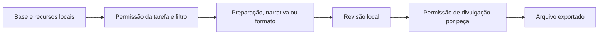

# Arquitetura inicial

**Confirmado:** aplicativo Electron, baixável para uso interno, com geração de conteúdo no próprio app. **Proposto:** a divisão abaixo, React/TypeScript na interface, persistência local de projetos e adaptadores por formato. Não há código implementado nem versões de dependências escolhidas.

## Componentes

| Parte | Responsabilidade proposta |
| --- | --- |
| Interface / renderer | Narrativa por blocos, painel de imagens/formas/cores, comparação e revisão das saídas |
| Main | Ciclo do aplicativo, acesso a arquivos, persistência e integração com o serviço de geração |
| Preload / IPC | Expor operações delimitadas entre interface e main, com entradas validadas |
| Contexto da oficina | Conteúdo, fatos/lacunas, decisões visuais, arquivos, permissões e versões aprovadas |
| Política de dados e divulgação | Separar envio ao provedor por tarefa de divulgação por peça; filtrar antes de enviar |
| Adaptadores | Compor contexto permitido + prompt + skill do formato + objetivo; registrar origem, custo e estado |
| Revisão de mudanças | Mostrar versões/diferenças e todas as peças; aplicar/rejeitar/desfazer por peça, preservando adaptações |
| Recuperação e saídas | Cópia com recursos, restauração, exportação e edição de trabalho existente sem nova inferência |

Essa separação segue o [modelo de processos do Electron](https://www.electronjs.org/docs/latest/tutorial/process-model), consultado em 20/10/2026. Para a implementação, manter isolamento de contexto e limitar as operações expostas à interface, conforme a [orientação de segurança](https://www.electronjs.org/docs/latest/tutorial/security). Credenciais de IA não fazem parte da skill, dos arquivos da oficina ou do repositório.

## Skill interna por oficina

Estrutura conceitual; os nomes e a persistência definitiva serão fechados na implementação:

```text
oficina/
  SKILL.md       instruções para trabalhar com o contexto aprovado
  context.json   briefing, narrativa, voz e escolhas visuais
  assets/        imagens e referências visuais
  versions/      histórico do contexto
  outputs/       materiais e versão de origem
```

A skill contém instruções; contexto e arquivos preservam o conteúdo. O histórico do chat não é a única memória. As imagens precisam continuar disponíveis, com suas relações aos blocos. Cada geração registra a versão do contexto e do adaptador utilizada; regenerar não deve apagar uma saída aprovada.

Fatos aprovados, lacunas, versão de origem e adaptações deliberadas são contratos propostos. Uma mudança cria nova base e proposta de atualização; não substitui silenciosamente peças aceitas. Mostrar todas as peças junto da mudança evita depender somente de uma detecção semântica falível. Distinguir usado, omitido deliberadamente e pendente de revisão.

A skill interna não é código para executar arbitrariamente. Arquivos/importações e respostas do modelo são conteúdo, sem autoridade para trocar regras, executar comandos ou ampliar acesso. Não foi escolhida integração obrigatória com outro agente/MCP.

## Duas permissões e fluxo completo de dados

Autorizar divulgação no deck para RH não autoriza automaticamente enviar à IA ou publicar no post. Proposta: permitir conteúdo somente local, conteúdo processável pelo provedor em uma tarefa autorizada e conteúdo divulgável em peças determinadas. Não reaproveitar silenciosamente permissão entre tarefas ou provedores. Sem autorização, bloquear a chamada externa e preservar o trabalho; inserção manual local pode continuar.



O fluxo inclui preparação/narrativa, deck, social, registros, atendimento e cópia/exportação. Filtrar somente o social não protege um dado enviado antes. Definir provedor, dados/imagens transmitidos, finalidade, retenção/exclusão e acesso do suporte antes de conteúdo real. Até verificar essas condições, usar apenas dados sintéticos. Credenciais ficam fora de contexto, prompts, cópias e logs; o material público não recebe automaticamente o pacote privado da oficina.

Testes futuros devem inspecionar entradas e saídas de todas as etapas usando marcadores sintéticos conhecidos. Revisão visual/factual complementa filtragem; não prova garantia geral de privacidade ou ausência de erro de IA.

## Recortes e domínios ainda em investigação

Para P1, os agentes propõem primeiro deck comercial PDF + LinkedIn texto/PNG, com templates limitados. Instagram permanece posterior; não anunciar escolha de social antes de ambos serem verificados. Falha/cancelamento não apaga conteúdo; repetição e custo precisam ser explícitos. Abrir, editar e exportar o material existente depois do serviço não deve depender de nova inferência ou renovação.

O autor pediu investigar vendedores de produtos/serviços e outras peças comerciais. Contexto por oferta, catálogo, proposta ou outro adaptador são **extensões propostas**, sem novo esquema ou integração aprovada. Reavaliar fatos, recursos, divulgação, formatos e custos para a combinação escolhida; não transportar o custo P1 nem construir um editor/CRM/loja genéricos por antecipação. [Investigação de variações](servico/variacoes-escopo.md).

## Desktop e distribuição

O usuário baixa, instala e abre o app. Sistemas-alvo, instaladores, assinatura e canal de distribuição interna ainda estão abertos. Empacotar e distribuir são etapas posteriores; ver a [visão oficial de distribuição](https://www.electronjs.org/docs/latest/tutorial/distribution-overview), consultada em 20/10/2026.

Geração dentro do app descreve a experiência do usuário. Fornecedor de IA, credenciais e dependência de rede ainda serão definidos; não foi decidido que o produto funcionará integralmente offline. Sincronização em nuvem também não foi escolhida.

A [spec](specs/experiencia-desktop-oficina.md) concentra os aceites; o [plano](servico/plano-implementacao.md) separa marcos condicionais de capacidade real. Não há API, migração ou componente executável nesta entrega.

Planejamento de valor/custo orientado por **Revenue-Centric Design, Richard (@richardrx)**: [fonte fixada](https://github.com/heliocosta-dev/revenue-centric-design/tree/1942760c2242f609bf63ce2c97204f5a1791bd68), [termos integrais](debate/2026-10-20-rcd/RCD-LICENSE.txt). Exclui apostas/cassinos/jogos de azar; sem garantia de retorno financeiro. Licença do código futuro permanece aberta.
