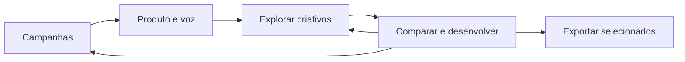

# Compor: direção criativa e telas para Mavi

> Atualização de 23/10/2026: a [spec consolidada](specs/compor-reestruturado-2026-10-23.md) passa a orientar promessa, qualificação, jornada por intenção, quantidade de rotas, ativação e hipótese comercial. Este documento preserva a proposta anterior e seus contratos técnicos não alterados. Três rotas + duas variantes deixam de ser obrigação; não há implementação ou validação humana demonstrada.

20/10/2026. Matheus definiu criar criativos do zero e explorar temas preservando voz e produto. Esta direção substitui a atualização de preço como exemplo principal. O desenho abaixo orienta a proposta para Mavi; esta entrega contém apenas documentação.

## Proposta de valor

O founder, pessoa que criou o negócio, parte de um produto e explora maneiras diferentes de apresentá-lo. Compor ajuda a criar conceitos, desenvolver as artes e comparar variações. A base interna preserva voz, fatos, recursos e decisões.

O caso inicial proposto continua sendo um curso digital. A pessoa precisa de caminhos para uma divulgação próxima, mesmo sem uma arte pronta. Editar data ou preço permanece uma necessidade secundária.

## Exemplo de campanha

Ana divulga o curso fictício Organize Sua Semana. A voz é calma, prática e acolhedora. A base descreve um método de planejamento semanal, sem prometer resultados garantidos.

Propor três caminhos: Caos cotidiano, Rotina desejada e Método em ação. Eles diferem em gancho, argumento e direção visual. Produto e voz continuam iguais. Depois, Ana seleciona Método em ação e pede duas variantes de gancho.

Três rotas e duas variantes são quantidades propostas para o primeiro recorte. A pessoa precisa ver a razão de cada caminho e a arte correspondente. Trocar somente cor ou uma palavra deixa de representar diversidade de conceito.

## Fluxo proposto

Começar com produto, objetivo e materiais opcionais. A pessoa escolhe uma direção e acompanha texto, formas, cores e imagens durante o desenvolvimento. A comparação permite voltar e ramificar uma rota sem perder as demais.

## Tela 1: Campanhas

Mostrar produto, objetivo, última alteração e estados Rascunho, Em exploração e Seleção aprovada. Cada campanha contém rotas e variantes. Publicação e resultado de vendas exigem evidência externa.

Oferecer criar, abrir, duplicar e restaurar. O vazio apresenta um exemplo e Criar campanha. Duplicar preserva a origem. O usuário consegue retomar o conjunto sem montar novamente o contexto.

## Tela 2: Produto e voz

Separar base reutilizável de objetivo e público da campanha atual. A base contém produto, benefícios confirmados, fatos, restrições e exemplos de linguagem. Usar Confirmado por você, A confirmar e Omitido por escolha.

Perguntar como a marca fala e quais expressões evita. Mostrar exemplos aprovados e a versão de voz escolhida, com nomes comuns. Atualizar a base exige uma ação distinta de experimentar uma campanha.

## Tela 3: Explorar criativos

Mostrar propostas de conceito, editor e prévia visual no mesmo fluxo. Cada rota apresenta tema, gancho, argumento e direção visual. O usuário pode sugerir um tema, pedir alternativas e editar desde o rascunho.

A arte contém texto, formas, cores e imagens opcionais. A legenda acompanha a composição. Ações propostas: Explorar outro tema, Desenvolver este caminho, Experimentar gancho e Ajustar composição.

Antes de gerar, mostrar chamadas previstas e limites conhecidos. Uma fila visível identifica o que concluiu, segue em curso ou falhou. Cancelar preserva os rascunhos concluídos. Repetir exige decisão explícita.

## Tela 4: Comparar e desenvolver

Exibir rotas lado a lado, com artes e legendas legíveis. Separar avaliações: tema distinto, mensagem útil, voz preservada e fatos corretos. A pessoa compara e edita, sem depender de uma nota automática.

Ao ramificar, perguntar qual dimensão variar: gancho, tema, chamada ou composição. A variante mostra sua origem e a diferença pedida. A base e as rotas irmãs permanecem preservadas. Alterações além da dimensão escolhida exigem revisão.

A seleção aprovada pode incluir várias rotas e variantes. O painel de exportação apresenta cada par de arte e legenda. Oferecer formato de imagem (PNG) e texto simples (TXT). A dimensão candidata é 1080 × 1350 pixels, sujeita a teste.

## Artes finais e dependências

Criar do zero dispensa uma arte pronta. O compositor pode produzir uma composição original com tipografia, formas, cores e recursos autorizados opcionais. Uma descrição de conceito ou um prompt serve ao rascunho, sem substituir a arte final utilizável.

Direções que precisam de fotografia ou ilustração inédita por modelo mostram a dependência visual pendente. O usuário pode escolher outra direção ou fornecer um recurso autorizado. Identificar imagens provisórias e impedir sua apresentação como arte final aprovada.

## Painéis e recuperação

O painel de envio apresenta tarefa, dados, fornecedor e limite ou custo conhecido. Autorizar processamento difere de aprovar divulgação. Conteúdo somente local permanece fora de chamadas externas. A edição manual continua disponível.

O painel de exportação distingue criativos públicos da cópia privada. A cópia guarda base, recursos, rotas, variantes e histórico. Credenciais ficam separadas. Reabrir e restaurar recupera o conjunto mesmo após mover imagens originais.

Desenhar estados de geração parcial, falha por rota, cancelamento, limite, comparação pendente e conflito de versão da base. Manter também disco cheio, arquivo corrompido, imagem ausente e restauração falha. O trabalho íntegro permanece acessível.

## O que observar

- Consegue partir do produto e chegar a conceitos visuais distintos.
- Reconhece sua voz e os fatos em todas as alternativas.
- Explica a diferença de tema ou argumento entre rotas.
- Ramifica uma rota sem perder a origem ou alterar as irmãs.
- Seleciona e exporta mais de um criativo utilizável.
- Reabre e recupera o conjunto com imagens e decisões.

Usar rótulos junto das cores, foco visível e navegação por teclado. A interface mostra arte, propósito e escolhas. Detalhes de skills e identificadores internos permanecem nos bastidores.

## Design, preço e teste

Mavi reforça hierarquia, comparação e desenvolvimento visual. O [roteiro de demo](compor/demo-e-testes.md) apresenta exploração e seleção em cinco minutos. A mudança de preço fica no teste secundário de consistência.

Matheus indicou 10 a 15 dólares americanos como referência percebida de preço, sem escolher valor ou plano. R$199 deixa de ser candidato da oferta atual. A comparação gratuita e paga da v0 mantém a mesma entrega criativa. Testes externos dos criativos constituem outra investigação.

Método: **Revenue-Centric Design, Richard (@richardrx)**, com [termos próprios](debate/2026-10-20-rcd/RCD-LICENSE.txt). Geração, adequação, acesso e desempenho continuam sujeitos às verificações da [spec](specs/compor-macos-v1.md).
