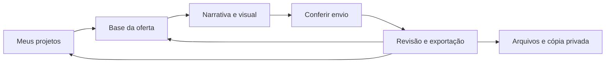

# Compor: briefing atualizado para Mavi

20/10/2026. Este documento aplica a adaptação da designer ao recorte proposto de primeira versão. Ele substitui o [caso-guia de fotografia](briefing-designer-primeira-versao.md). A entrega atual descreve telas; o desenho e a implementação seguem futuros.

## Valor e público

Compor ajuda o dono de um produto digital a criar e atualizar sua divulgação, preservando informações e escolhas visuais.

O primeiro público para testar é o dono solo de um curso gravado já vendido. Ele usa Mac e prepara uma divulgação em até 14 dias. Tem imagens autorizadas e duas mudanças recentes de preço, data ou condição para mostrar. Esses filtros orientam a pesquisa proposta.

A diferença precisa aparecer ao atualizar o preço sem refazer a composição. O teste compara com ChatGPT, Canva e os modelos que a pessoa já usa. A hipótese de compra depende de ganho observado após instalação, aprendizado e revisão.

## Caso de desenho

Ana vende o curso fictício Organize Sua Semana. Ela informa preço de R$97, data e endereço de compra de exemplo. Ela escreve a mensagem, escolhe uma imagem e ajusta cores e formas.

Depois, Ana muda para R$127. Compor mostra diferenças na arte e na legenda. Ela preserva um título editado e aprova os ajustes por bloco. A versão anterior continua acessível.

R$97 e R$127 são preços fictícios do curso. O preço do Compor permanece aberto. Usar dados sintéticos no desenho e nos primeiros testes.

## Fluxo de uso

A criação manual começa antes da conexão. A geração exige autorização e acesso válido. Ao reabrir, a pessoa recupera base, imagens, decisões e versões. Trabalho existente continua editável e exportável com a rede desligada.

## Tela 1: Meus projetos

Mostrar nome, produto, última alteração e estado: Rascunho, Revisão pendente ou Versão aprovada. Publicação e venda dependem de confirmação externa.

Oferecer criar, abrir, duplicar e restaurar cópia. No vazio, mostrar exemplo fictício e Criar projeto. A duplicação preserva o original. Explicar local e tamanho do projeto em uma área de detalhes.

## Tela 2: Base da oferta

Separar negócio e produto da divulgação atual. Permitir colar notas e completar público, benefício, preço, datas, condições e endereço de compra. Marcar campos opcionais e explicar sua utilidade.

Usar os estados Confirmado por você, A confirmar e Omitido por escolha. Uma omissão escolhida permanece nas próximas sugestões. Atualizar a base reutilizável exige ação distinta de editar uma divulgação.

## Tela 3: Narrativa e visual

Mostrar blocos, prévia e ajustes durante a escrita. A disposição em três áreas é uma proposta, sujeita ao trabalho de Mavi. Texto e composição aparecem juntos.

Os blocos incluem título, benefício, imagem, condições e chamada para ação. Exemplo da chamada: Conheça o curso. A pessoa reorganiza blocos, edita texto, importa imagens e experimenta formas e cores.

A legenda fica junto da prévia. As ações sugeridas são Encurtar texto, Sugerir título e Experimentar composição. Cada sugestão conserva o trabalho atual e oferece aceitar, rejeitar ou editar.

## Tela 4: Revisão e exportação

Mostrar arte, legenda e fatos de origem em linguagem comum. Uma mudança apresenta antes, depois e escolhas preservadas. Oferecer aplicar, rejeitar e desfazer por bloco.

A pessoa confere o conjunto mesmo quando o aplicativo aponta possíveis impactos. Essa conferência cobre relações que a detecção perdeu. Salvar versão preserva a anterior.

No painel de exportação, propor formato de imagem (PNG) de 1080 × 1350 pixels e legenda em texto simples (TXT). Mostrar os limites de edição externa e permitir conferir os arquivos.

A cópia privada proposta agrupa base, imagens e versões num pacote de arquivos (ZIP). Ela serve para restaurar a edição e contém informações privadas legíveis. Separar essa ação da exportação pública.

## Painel de envio à inteligência artificial

Antes da chamada, mostrar tarefa, dados, fornecedor e uso ou limite conhecido. O usuário autoriza aquela tarefa. Uma nova tarefa ou fornecedor exige nova conferência.

Separar autorização de processamento da aprovação para divulgar. Conteúdo Somente neste computador permanece local. Credenciais ficam fora de projetos, cópias e registros. A política cobre também suporte e diagnóstico.

A conexão ChatGPT/Codex permanece condicionada à elegibilidade oficial. Seu uso precisa existir sem pagamento obrigatório ao aplicativo. O desenho deve identificar a dependência pendente; cobrança de editor ou assistência exige confirmação própria.

## Estados e recuperação

Desenhar vazio, lacuna, sugestão, geração em curso, limite, revogação, falha e cancelamento. Nova tentativa exige ação explícita. A versão aprovada permanece disponível.

Desenhar mudança pendente, exportação falha, disco cheio, imagem ausente, restauração falha e esquema incompatível. A pessoa vê a última cópia íntegra e consegue recuperá-la. A falha preserva o original.

Usar rótulos junto das cores, foco visível e navegação por teclado. A leitura acompanha a tarefa. A interface apresenta produto e material; skill e detalhes internos ficam nos bastidores.

## Entrega de design e critérios

- Quatro telas em baixa fidelidade e os dois painéis.
- Estados de espera, mudança, falha, reabertura e restauração.
- Um roteiro cria, altera preço, exporta e recupera o projeto.
- Anotações sobre escolhas preservadas, dúvidas e ajuda necessária.
- Revisão de dimensões, legibilidade, contraste, ordem e uso por teclado.

O [roteiro de demo](compor/demo-e-testes.md) dura cinco minutos. Protótipo de conceito identifica qualquer resultado preparado. A prova técnica real exige executar os testes da [spec](specs/compor-macos-v1.md).

Mavi reforça hierarquia, composição e navegação. Matheus conduz a construção futura. Elegibilidade, exportação, recuperação, capacidade e economia também exigem verificação; o design fica separado dessas provas.

Método: **Revenue-Centric Design, Richard (@richardrx)**, com [termos próprios](debate/2026-10-20-rcd/RCD-LICENSE.txt). Público, ganho e pagamento permanecem hipóteses.
