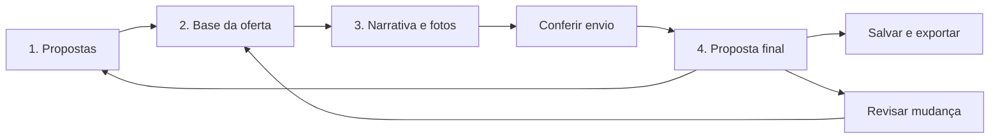

# Briefing para designer: primeira versão proposta

> Histórico em 20/10/2026. O [recorte Compor](briefing-designer-compor-v1.md) substitui este caso-guia. O texto abaixo preserva decisões e propostas anteriores.

**Data: 20/10/2026. Entrega atual: documentação.** Este documento transforma a explicação do produto em um fluxo para desenhar e testar. A construção do aplicativo fica fora desta tarefa.

## Proposta de valor

O produto ajuda um pequeno negócio a transformar sua oferta em materiais de venda claros, visuais e fáceis de atualizar.

A pessoa reúne suas informações e constrói a mensagem com textos, imagens, formas e cores. O aplicativo guarda as escolhas aprovadas. Essa base permite preparar e revisar um material sem começar do zero a cada mudança.

O produto será um aplicativo para computador, em Electron, que a pessoa poderá baixar e usar internamente. O conteúdo surge dentro do aplicativo. O contexto e as instruções de geração ficam internos; a pessoa trabalha com sua oferta e seu material.

O nome Oficina em Prancha permanece provisório. Este documento usa fotografia comercial como caso-guia da primeira versão a explorar. A escolha definitiva do público depende de pesquisa e testes.

## Público, ocasião e dor

| Papel | Caso-guia |
| --- | --- |
| Usuário | Fotógrafo independente de alimentos, com fotos próprias e serviço definido |
| Pagador | O próprio fotógrafo ou seu pequeno negócio |
| Comprador do serviço dele | Restaurante ou café que precisa contratar um ensaio |
| Ocasião | Pedido real de orçamento, com uma data para responder |
| Trabalho principal | Preparar uma proposta visual e revisar as condições durante a negociação |

A dor candidata é preparar e revisar essa oferta sem repetir o trabalho em cada negociação. O fotógrafo precisa selecionar exemplos e explicar entregas, preço, prazo e uso das imagens. Quando o pedido muda, ele precisa conferir o que continua válido.

Um relato de [Brent Herrig](https://brentherrig.com/insights/articles/how-to-brief-food-photographer) descreve pedidos com entregas e orçamento indefinidos. O texto sustenta a dificuldade para esclarecer o pedido. O retrabalho entre propostas semelhantes continua como hipótese específica a testar.

Um [relato no Reddit](https://www.reddit.com/r/photography/comments/165hd5f/) descreve propostas urgentes que consomem tempo. O caso trata de agências, fora do recorte de restaurantes. Esses relatos individuais ajudam a formular perguntas; a frequência da dor no Brasil continua desconhecida.

## Motivo de compra e prova necessária

A hipótese é que o fotógrafo pague para responder a pedidos com menos retrabalho e manter seu padrão de apresentação. A compra faz sentido quando a tarefa ocupa tempo recorrente ou exige ajuda paga.

Proposta comercial a testar: pagamento por proposta concluída, com revisão e ajuda definidas antes da contratação. O cliente mantém acesso ao projeto e aos arquivos. Assinatura só entra em avaliação quando houver frequência de uso observada.

O preço permanece em aberto. Para o usuário, o benefício precisa superar o preço e o esforço de instalar, aprender e revisar. Para o negócio, a cobrança precisa cobrir desenvolvimento, geração, aquisição, entrega e suporte.

O [Pixieset](https://pixieset.com/studio-manager/) já oferece documentos e orçamentos para fotógrafos. Comparar o produto com o fluxo habitual, incluindo modelos prontos. A vantagem precisa aparecer no trabalho observado. A venda do ensaio também depende de preço, qualidade, demanda e relacionamento.

## Pessoas para uma avaliação futura

O diretório da [ABRAFOTO](https://www.abrafoto.com.br/Portfolio) ajuda a localizar profissionais de alimentos e fotografia de produtos. Sites profissionais e redes locais também podem indicar candidatos. A seleção deve partir de um episódio recente.

- Recebeu um pedido de orçamento e tem uma data para responder.
- Adapta fotos, escopo ou condições em propostas semelhantes.
- Pode mostrar um material autorizado e explicar o que precisou refazer.
- Aceita comparar a tarefa com o fluxo que já usa.

O diretório mostra atuação profissional. Conversas e observação ajudam a avaliar o peso do problema. Essa etapa é futura; a entrega atual mantém o trabalho no documento.

## Limite da primeira versão a desenhar

O caso mínimo é um fotógrafo, um serviço, um pedido e uma proposta visual. A seleção de portfólio pode integrar essa proposta. Uma alteração de quantidade ou prazo deve permitir revisar o material preservando as decisões anteriores.

Documento portátil (PDF) é o alvo proposto para compartilhar a proposta. A equipe precisa verificar a exportação antes de prometer esse formato. Edição dentro do aplicativo e cópia recuperável do projeto fazem parte do desenho proposto.

O fluxo inicial cobre criar, salvar, reabrir, revisar e exportar. A pessoa pode aproveitar uma base anterior, preservando o projeto original. Conta compartilhada e sincronização entre computadores ficam fora desse recorte.

O caso de oficinas permanece como controle de comparação. Este documento propõe uma experiência para fotografia; seus materiais, custos e testes exigem avaliação própria. Preços e estimativas do caso de oficinas ficam no histórico daquele caso.

## Situação de exemplo

Usar dados fictícios no desenho e nos testes iniciais. Exemplo: Restaurante Azul pede uma proposta para fotografar seu cardápio. O fotógrafo começa com um pacote de 20 imagens e seleciona fotos autorizadas de trabalhos anteriores.

Depois, o restaurante pede 30 imagens. O aplicativo mostra a mudança e os trechos que podem precisar de revisão. O fotógrafo confirma quantidade, preço e prazo. A aprovação dele define a próxima versão.

Quantidade, preço e prazo vêm do profissional. O aplicativo ajuda a organizar e revisar esses fatos. A geração pode sugerir uma redação, mantendo as lacunas visíveis.

## Fluxo de uso

1. Abre o aplicativo e cria uma proposta ou reabre um projeto salvo.
2. Reúne informações do serviço, condições e fotos autorizadas.
3. Registra o pedido do restaurante e a data para responder.
4. Organiza a mensagem enquanto escolhe imagens, formas e cores.
5. Confere fatos, lacunas e o que cada destino pode receber.
6. Autoriza o envio necessário ao serviço de inteligência artificial e acompanha a geração.
7. Revisa texto, imagens e condições dentro do aplicativo.
8. Salva uma versão e exporta o material para encaminhar por conta própria.
9. Quando o pedido muda, compara versões e aprova os ajustes por trecho.
10. Fecha e reabre o projeto para retomar o trabalho.

## Quatro telas da primeira versão

As telas agrupam tarefas. A designer pode combinar painéis na mesma janela para reduzir passos. Evitar repetir perguntas que a base já responde.

| Tela | Objetivo | Ação principal | Resultado esperado |
| --- | --- | --- | --- |
| 1. Propostas | Começar ou retomar um trabalho | Criar proposta ou abrir projeto | Projeto certo aberto, com seu estado visível |
| 2. Base da oferta | Entender o serviço e o pedido atual | Completar e confirmar informações | Fatos, lacunas e condições claros |
| 3. Narrativa e fotos | Construir a mensagem com apoio visual | Editar blocos e escolher referências | Texto e composição sob controle do usuário |
| 4. Proposta final | Revisar e preparar o material | Aprovar versão e exportar | Material recuperável e pronto para conferir no destino |

### Tela 1 — Propostas

Mostrar projetos salvos com nome, cliente, última alteração e estado. Os estados podem ser rascunho, revisão pendente e versão aprovada. São rótulos de trabalho, sem indicar envio ou venda realizada.

Oferecer as ações criar, abrir e restaurar cópia. Ao aproveitar uma base anterior, preservar o projeto original. No primeiro acesso, explicar a tarefa com um exemplo fictício e uma ação clara para começar.

Mostrar compatibilidade e requisitos de conexão antes de começar uma geração. Sistema operacional, fornecedor de geração e funcionamento sem rede continuam abertos. O desenho deve marcar essas definições como pendentes.

### Tela 2 — Base da oferta

Separar o serviço habitual do pedido atual. Uma alteração para um restaurante vale primeiro para aquela proposta. Uma mudança na base reutilizável exige uma ação explícita do usuário.

| Grupo | Conteúdo proposto |
| --- | --- |
| Serviço | Tipo de ensaio, entregas, estilo e condições habituais |
| Pedido atual | Cliente, objetivo, quantidade, uso pretendido das fotos e prazo para responder |
| Condições da proposta | Preço, prazo de entrega, limites e informações fornecidas pelo fotógrafo |
| Revisão | Fatos confirmados, pontos a confirmar e omissões intencionais |

Permitir colar notas existentes e preencher somente as lacunas. Mostrar rótulos como Confirmado por você e A confirmar. Se uma informação ficar ausente por escolha, registrar essa decisão para preservar a omissão.

O usuário decide quais condições precisam aparecer na proposta final. Antes da aprovação, destacar lacunas relevantes para essa decisão. A designer deve testar se a pessoa distingue um rascunho de uma proposta pronta para encaminhar.

### Tela 3 — Narrativa e fotos

O usuário constrói a mensagem enquanto vê as referências visuais. Oferecer blocos editáveis para abertura, serviço, exemplos, entregas e próximo passo. Permitir reorganizar blocos e experimentar formas e cores.

As fotos vêm do próprio profissional, com autorização de uso. A seleção de portfólio mantém uma relação clara com a proposta. A pessoa pode escolher uma imagem, trocar sua posição e revisar a legenda.

Sugestões possíveis: explorar uma abertura, encurtar um trecho ou comparar outra composição. Preservar a versão atual ao apresentar uma alternativa. A pessoa aceita, rejeita ou edita a sugestão.

Como ponto de partida, testar três áreas: base e blocos, prévia visual e ajustes. A designer pode alterar essa organização após observar o uso. A prévia deve acompanhar a criação desde esta tela.

### Tela 4 — Proposta final

Mostrar a proposta em uma prévia editável. A pessoa confere texto, fotos, condições e ordem de leitura. Mostrar a versão da base que originou o material em linguagem comum.

Oferecer salvar versão, comparar, revisar mudança e exportar. Uma nova geração preserva a versão anterior. Quando o pedido muda, mostrar o conteúdo anterior e a sugestão de ajuste.

Permitir aplicar, rejeitar ou desfazer cada ajuste. Preservar escolhas deliberadas, como omitir preço de uma seleção pública de portfólio. Mostrar o conjunto da proposta durante a revisão; a marcação automática de impacto pode falhar.

O painel de exportação mostra destino, formato e limitações de edição. Depois de exportar, permitir conferir o arquivo fora do aplicativo. Ao fechar e reabrir, recuperar a versão aprovada e seus recursos.

Abrir, editar e exportar trabalho existente dispensa nova geração, renovação ou conexão de cobrança. Novas gerações podem exigir conexão e condições de custo próprias.

## Painéis e estados comuns

### Conferir envio e divulgação

Separar duas decisões: enviar dados para o serviço de inteligência artificial e divulgar informações em um material. Uma autorização vale para a tarefa e o destino apresentados. Mudança de tarefa ou fornecedor exige nova conferência do escopo.

Antes de qualquer envio, mostrar dados e imagens incluídos, fornecedor e custo ou limite aplicável. Isso vale para a preparação da narrativa e para a proposta final. Conteúdo marcado como somente local permanece fora das chamadas externas.

Se faltar autorização, manter a edição local disponível e bloquear o envio. Definir fornecedor, retenção e acesso do suporte antes de usar dados reais. Até essas definições, trabalhar com exemplos fictícios.

A política de dados também cobre registros, atendimento, cópias e exportação. O arquivo enviado ao restaurante leva apenas o material aprovado. O projeto privado guarda a base completa. Senhas e chaves de acesso ficam fora do conteúdo, das cópias e dos registros.

### Estados que precisam aparecer no desenho

| Estado | Comportamento esperado |
| --- | --- |
| Projeto vazio | Exemplo fictício e ação para criar ou abrir |
| Informação pendente | Lacuna visível; opção de completar ou registrar omissão intencional |
| Geração em curso | Indicar a tarefa e oferecer cancelamento |
| Falha de geração | Preservar trabalho; oferecer nova tentativa com custo e envio claros |
| Cancelamento | Manter base, edições e versões anteriores |
| Mudança pendente | Mostrar diferenças e preservar a versão aprovada |
| Exportação falha | Manter material e permitir corrigir o destino ou tentar novamente |
| Reabertura | Retomar o projeto com imagens e decisões recuperadas |
| Restauração falha | Explicar o impedimento e preservar a cópia original |

Usar texto além da cor para distinguir estados. Manter ações acessíveis por teclado e rótulos claros nos campos. A ordem de leitura deve acompanhar a tarefa.

## Critérios para revisar o design

- Uma pessoa de fora entende quem usa o produto e qual material recebe.
- O usuário distingue serviço habitual, pedido atual e proposta final.
- A criação mostra imagens, formas e cores junto do texto.
- A pessoa reconhece fatos confirmados, lacunas e omissões intencionais.
- O usuário entende o que envia à inteligência artificial e o que divulga em cada material.
- Uma mudança de quantidade preserva escolhas aprovadas e permite revisar seus efeitos.
- A pessoa salva, reabre e exporta uma proposta com seus recursos.
- O teste conta preparo, instalação, revisão, espera e ajuda recebida.

Comparar com o fluxo habitual completo, incluindo modelos e ferramentas existentes. Separar uso independente de entrega acompanhada. Metas de tempo e preço exigem dados próprios desse público.

## Extensões fora da primeira versão

Instagram, LinkedIn e apresentações pertencem à visão mais ampla do produto. Este caso-guia concentra o desenho em uma proposta visual; o portfólio pode integrar o mesmo arquivo.

Catálogo de cerâmica, editor visual genérico, colaboração simultânea e sincronização ficam para avaliação posterior. Publicação automática, busca de clientes, estoque, contratos automáticos e cobrança dentro do aplicativo também ficam fora desse recorte.

A geração de fotos de portfólio fica fora da proposta. O material usa imagens reais e autorizadas do profissional. Exportação para edição em outras ferramentas exige verificação própria.

## Entrega de design esperada

Preparar quatro telas em baixa fidelidade, com os painéis e estados descritos. Montar um roteiro de navegação com dados fictícios. Registrar dúvidas e perdas de contexto observadas durante a revisão.

O roteiro mínimo deve criar uma proposta, revisar uma mudança e recuperar o trabalho após reabrir. O design deve demonstrar onde o usuário decide e onde a ferramenta sugere.

Este documento pede desenho e avaliação futuros. A entrega atual contém estas orientações. Telas executáveis, dependências e código ficam fora desta tarefa.

## Fontes e relação com as specs

O pedido de Matheus em 20/10/2026 autoriza salvar estas orientações no repositório privado. Este documento propõe o caso-guia e as telas para revisão. A escolha definitiva do público, o preço e a viabilidade comercial continuam abertos.

- [Spec da experiência desktop](specs/experiencia-desktop-oficina.md): decisões do autor e contratos gerais.
- [Variações de usuário e material](servico/variacoes-escopo.md): fotografia como hipótese e oficinas como controle.
- [Análise das variações](debate/2026-10-20-rcd/variacoes/01-dna-usuario-e-trabalho.md): fontes, alternativas e critérios de descarte.
- [Explicação do pedido fotográfico](https://brentherrig.com/insights/articles/how-to-brief-food-photographer): relato profissional individual, de 11/06/2026.
- [Relato de fotografia para agências](https://www.reddit.com/r/photography/comments/165hd5f/): sinal de esforço em orçamentos; contexto diferente de restaurantes.
- [Pixieset](https://pixieset.com/studio-manager/): recursos anunciados pelo fornecedor; comparação prática ainda pendente.

Método comercial: **Revenue-Centric Design, de Richard (@richardrx)**. Aplicar nicho definido, prova antes da promessa e comparação entre custo e valor. A receita e a disposição a pagar continuam sem teste real.

[Fonte fixada](https://github.com/heliocosta-dev/revenue-centric-design/tree/1942760c2242f609bf63ce2c97204f5a1791bd68) e [termos integrais](debate/2026-10-20-rcd/RCD-LICENSE.txt) acompanham a adaptação. Os termos excluem apostas, cassinos e jogos de azar. A licença do código futuro permanece aberta.
