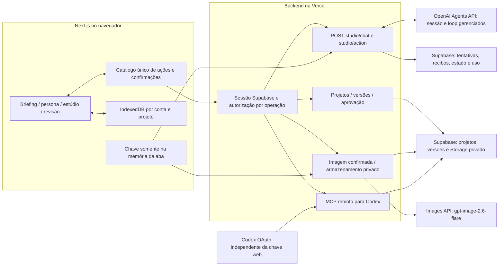

# Estúdio web: implementação e verificação

Em 5 de novembro de 2026, Matheus autorizou iniciar a implementação e a correção visual da experiência completa. O estúdio está publicado no [piloto de produção](https://compor-marco0.vercel.app): o deployment do commit `8ef318b8a6b4128486c7b3e99ef88314d3cdcfba` foi observado em `READY`, sem erro de alias, substituindo a publicação anterior `673b4787085a38f7e9d48795a8659d458e80d53f`. As migrações 00013, 00014 e 00015 foram aplicadas ao projeto Supabase de teste, cuja auditoria soma 16 entradas. `READY` comprova a conclusão do deployment, não a jornada completa com geração de imagem.

O registro anterior indicava 00013/00014 pendentes e o estúdio ainda não publicado. Essas pendências foram superadas; os testes locais e as limitações registradas abaixo continuam distintos das evidências reais obtidas depois.

`COMPOR_STUDIO_WEB_ENABLED=true` seleciona a experiência nova. Sem a flag, a entrada mantém o piloto anterior e a recuperação de suas tentativas; `COMPOR_STUDIO_CHAT_ENABLED=true` libera as rotas de chat somente depois das migrações. A separação permite publicar código e verificar esquema antes de ativar a jornada, e retornar à entrada anterior sem desfazer dados.

O novo chat usa funções da Agents API executadas na aba, pelo mesmo catálogo registrado em `document.modelContext` quando a API experimental WebMCP existe. Em navegadores sem essa API, o chat entrega a ação pelo backend ao mesmo executor. A [documentação do Chrome](https://developer.chrome.com/docs/modern-web-guidance/guides/webmcp/agentic-javascript-tools) descreve registro com `AbortSignal`. Além dos testes simulados do contrato local, o WebMCP foi verificado no navegador utilizado no piloto. Essa evidência não comprova suporte em outros navegadores ou clientes.

O chat novo não recebe o MCP delegado. Assim ele não pode salvar diretamente pelo RPC legado, que usa a versão mais recente como base. A ferramenta `compor_salvar_versao` exige peça, base e versão esperada, apresenta confirmação e verifica o efeito no banco antes de retomar o agente. O Codex e a rota legada preservam seus contratos.

## Conteúdo local e dados persistentes

`studio-state.mjs` valida e congela briefing, persona, conversa, seleção, rascunhos, marcações, referências, ajustes e eventos. Um pedido congela sua base e as marcas; trocar a seleção depois não reescreve esse contexto. Novas versões salvas preservam a base anterior e registram aprovação explícita ou herdada no servidor, conforme [versionamento e aprovação](versionamento-e-aprovacao.md).

IndexedDB usa o banco `compor-studio-v1`, versão 2. A atualização preserva os estados e referências da versão 1. As chaves incluem conta e projeto; imagens-base e prévias incluem também peça, versão-base e tipo. Essa separação evita misturar a interface entre contas, mas não transforma IndexedDB numa barreira contra scripts ou extensões da mesma origem. As barreiras remotas estão descritas em [isolamento e proteção de dados](isolamento-e-protecao-dados-marco0.md).

Limites: estado de até 512 KiB por projeto; até 20 referências; PNG/JPEG até 8 MiB por arquivo e 40 milhões de pixels; referências e imagens locais compartilham um teto de 256 MiB e 500 blobs entre projetos. Substituição e quota são transacionais e não apagam arquivos anteriores silenciosamente. O número de projetos locais ainda não tem teto global. Limpar os dados do site ou mudar de dispositivo pode perder rascunhos, conversa e arquivos locais.

A fila de gravação drena snapshots enfileirados enquanto uma gravação termina e aguarda o projeto anterior antes de fechar sua conexão. Conflito entre abas e falta de quota mantêm o trabalho na memória e mostram erro; não geram repetição infinita. Encerramento abrupto do navegador ainda pode impedir a última gravação assíncrona.

Até 200 recibos locais por projeto associam requestId, SHA-256 dos argumentos e resultado mínimo, sem chave. O executor preserva resultado incerto antes do efeito e confirmado antes do ACK; recriar a interface não autoriza executar novamente uma ação já registrada. Interrupção no intervalo anterior ao resultado confirmado continua incerta. Não há promessa de exatamente uma vez entre navegador, banco e OpenAI.

No Supabase, `studio_turns` e os recibos de ações guardam somente metadados técnicos. Os RPCs revalidam `auth.uid()` e o proprietário; uma reserva por projeto impede iniciar outro turno enquanto o anterior está ativo ou incerto. O HMAC vincula ator, projeto, pedido, sessão, turno, chamada e digest. Mensagens, referências, rascunhos e chave não são gravados nessas tabelas. A OpenAI recebe o contexto necessário, sob a retenção aceita pelo usuário.

## Chat, imagem e persona

Novas sessões são configuradas com `gpt-6.1-terra`, conforme a decisão de Matheus. A [migração de medição 00015](medicao-modelo-explicito-00015.md) permite registrar o modelo explícito por etapa; preserva as medições históricas de Astra e as RPCs anteriores. Retomar ou concluir uma sessão antiga não transforma seu modelo em Terra. O teste pago reconciliado neste registro usou Astra; ele não comprova uma execução paga de Terra.

O envio inclui histórico recente, conteúdo do post aberto, base, briefing, persona, marcas e metadados de referências. Miniaturas limitadas de referências e da imagem-base podem acompanhar o pedido como conteúdo visual; os originais permanecem locais. A consulta usa os identificadores do mesmo turno. Uma sessão pode ser reutilizada por até 280 segundos; pedido explícito posterior cria outra sessão com histórico local somente após reconciliar o turno anterior.

A reutilização também exige que o provedor confirme `session.agent.model=gpt-6.1-terra`. Uma sessão Astra concluída permanece no histórico e não recebe um novo turno Terra; o próximo envio cria uma sessão Terra com o histórico local. Modelo anterior ausente ou desconhecido impede o envio antes da chamada paga. A medição histórica não é reclassificada.

O botão “Consultar estado” recupera a referência anterior por conta e projeto e faz somente uma consulta `op: poll`. Esse caminho não passa pelo executor de tools, não repete a conclusão na conversa e não inicia sessão, ACK ou imagem. Mostra estado e uso; o diagnóstico opcional usa somente contagens e classes fechadas. Recarregar preserva a referência, mas elimina a chave da memória da aba, conforme a escolha de BYOK temporário.

A proposta de imagem conserva a peça e a versão do pedido, ou o destino criado/aberto/salvo por uma ação concluída do próprio chat. O marcador local preserva esse contexto antes do ACK. Navegação manual enquanto a resposta está em andamento não muda o destino da proposta. A confirmação conserva esse contexto e rejeita troca posterior de versão ou edição não salva. Recusar envia o resultado da mesma chamada ao agente sem chamar a Images API. Resultado incerto não inicia uma geração alternativa.

A composição local gera PNG 1080 × 1350 com enquadramento proporcional e textos editáveis. Download não aprova nem publica. Salvar o PNG final no Storage exige versão salva, autorização explícita e arquivo até 4 MiB. Um marcador precede o envio; falha de transporte permite consultar a mesma referência, sem upload automático duplicado. Imagens recuperadas têm origem desconhecida e exigem revisão visual e clique explícito para usar.

A persona representa quem compra o infoproduto, não a pessoa criadora. Campos desconhecidos são permitidos. Instruções versionadas orientam pesquisa pública quando útil e a ferramenta de afirmações preserva hipótese, relato da pessoa criadora, relato de comprador ou fonte pública. Uma URL não prova a afirmação nem o conhecimento do público. Os testes estruturais não comprovam qualidade cultural ou comercial da análise.

## Evidências e pendências

- Testes de navegador com serviços simulados demonstraram a jornada local, segregação entre contas, revalidação, referências, marcações, persistência e PNG decodificável 1080 × 1350. A chave não apareceu no armazenamento inspecionado.
- Testes SQL locais com duas identidades sintéticas verificaram isolamento e negação de escrita direta, reserva de turnos, linhagem e aprovação. PGlite não comprova concorrência entre conexões PostgreSQL independentes, JWTs reais nem Storage remoto.
- No Supabase de teste, a aplicação auditada chegou a 16 entradas, incluindo 00013/00014 e 00015. A prova SQL remota com identidades sintéticas e `ROLLBACK` não substitui autenticação com duas contas/JWTs reais. Os pacotes preservam o histórico e recusam reaplicação sem reconciliação.
- A interoperabilidade web↔MCP e o WebMCP foram verificados no ambiente do piloto. A conexão do Codex continua independente da chave OpenAI da aba. Essa verificação não demonstra, por si só, transferência e recuperação de imagem entre todos os clientes.
- Uma tentativa paga já enviada com `gpt-6-astra` foi reconciliada como `completed`, sem reenviar o pedido ou criar outra sessão para a reconciliação. O turno terminou sem efeitos observados na aplicação e sem geração de imagem; portanto, não completou a jornada criativa esperada. O provedor informou `161219` tokens de entrada e `656` de saída. Essa captura de uso é *best effort*, não fatura nem garantia de teto de gasto.
- O patch `1514f6ffe96b59a8c0d234100a2c469cc8d0f997` acrescentou trace técnico ao resultado concluído e foi publicado. A versão `8ef318b` acrescenta o botão de consulta e a verificação do modelo antes de reutilizar sessões. Ainda não há resultado observado desse trace registrado aqui; a consulta real aguarda reinserção da chave temporária, sem autorização implícita para um novo envio pago.
- Na versão `8ef318b`, passaram 114 testes da web, a build Next.js e 117 testes do pacote Agents. O novo teste de navegador verificou cinco estados de consulta, restauração após reload e ausência de tools, ACK, imagem, novo turno ou alteração da conversa. A revisão independente não observou bloqueadores no caminho de consulta.
- A revisão independente encontrou e corrigiu projeto ausente no contexto, escrita MCP contornando confirmação e base, consulta antiga afetada por outro turno, corrida de salvamento local e recibos perdidos ao recriar a interface.
- O quadro Figma `211:9859` forneceu contexto, screenshot e ativos originais para o shell. O arquivo principal `8nEzYvk8LCTQzbknMgEw1c`, quadro `2009:13865`, é referência adicional. Na consulta inicial, o limite Starter impediu novas consultas; não há afirmação de paridade das telas ainda não inspecionadas.

O [pacote de migrações 00013/00014](migracoes-estudio-00013-00014.md) e o [pacote 00015](medicao-modelo-explicito-00015.md) executam aplicação e prova no mesmo processo `psql`, com uma entrada de senha. Ambos já foram aplicados ao piloto; não devem ser repetidos para verificar estado.

Antes de declarar o marco completo, permanecem estas verificações:

- Reconciliar o trace da tentativa existente e verificar por que o turno concluído não produziu as ações esperadas, consultando o mesmo recurso sem novo envio.
- Executar a jornada real do novo chat: pedido, ação na interface, proposta e confirmação de imagem, geração, associação à versão, recuperação e retomada sem duplicação. A conclusão do turno Astra e a prova anterior de geração direta do modelo não comprovam esse fluxo.
- Comprovar isolamento remoto com duas contas/JWTs reais, incluindo negação cruzada de projetos, versões, metadados e objetos do Storage. Validar upload, leitura privada e recuperação de imagem na jornada publicada.
- Verificar concorrência e recuperação com conexões PostgreSQL independentes; identidades sintéticas numa transação não comprovam esse comportamento.
- Comparar as telas relevantes com as referências Figma e registrar as diferenças ainda existentes.

Uso acumulado informado pelo provedor e estimativas não são fatura; custo indisponível permanece desconhecido. O limite técnico agregado continua na SCRUM-68.
