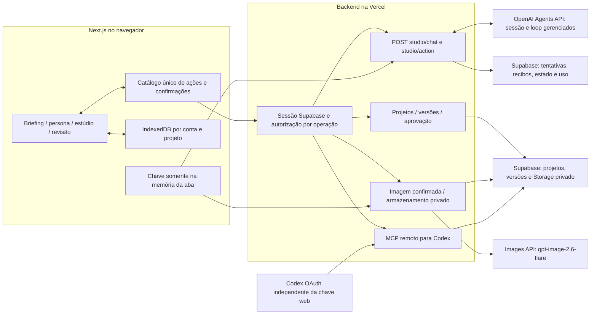

# Estúdio web: implementação e verificação

Em 5 de novembro de 2026, Matheus autorizou iniciar a implementação e a correção visual da experiência completa. Este registro distingue o código local do piloto já publicado. As migrações 00013 e 00014 ainda precisam ser aplicadas ao projeto de teste; o estúdio novo ainda não está publicado.

`COMPOR_STUDIO_WEB_ENABLED=true` seleciona a experiência nova. Sem a flag, a entrada mantém o piloto anterior e a recuperação de suas tentativas; `COMPOR_STUDIO_CHAT_ENABLED=true` libera as rotas de chat somente depois das migrações. A separação permite publicar código e verificar esquema antes de ativar a jornada, e retornar à entrada anterior sem desfazer dados.

O novo chat usa funções da Agents API executadas na aba, pelo mesmo catálogo registrado em `document.modelContext` quando a API experimental WebMCP existe. Em navegadores sem essa API, o chat entrega a ação pelo backend ao mesmo executor. A [documentação do Chrome](https://developer.chrome.com/docs/modern-web-guidance/guides/webmcp/agentic-javascript-tools) descreve registro com `AbortSignal`. Registro simulado comprova o contrato local, não descoberta por um agente real.

O chat novo não recebe o MCP delegado. Assim ele não pode salvar diretamente pelo RPC legado, que usa a versão mais recente como base. A ferramenta `compor_salvar_versao` exige peça, base e versão esperada, apresenta confirmação e verifica o efeito no banco antes de retomar o agente. O Codex e a rota legada preservam seus contratos.

## Conteúdo local e dados persistentes

`studio-state.mjs` valida e congela briefing, persona, conversa, seleção, rascunhos, marcações, referências, ajustes e eventos. Um pedido congela sua base e as marcas; trocar a seleção depois não reescreve esse contexto. Novas versões salvas preservam a base anterior e registram aprovação explícita ou herdada no servidor, conforme [versionamento e aprovação](versionamento-e-aprovacao.md).

IndexedDB usa o banco `compor-studio-v1`, versão 2. A atualização preserva os estados e referências da versão 1. As chaves incluem conta e projeto; imagens-base e prévias incluem também peça, versão-base e tipo. Essa separação evita misturar a interface entre contas, mas não transforma IndexedDB numa barreira contra scripts ou extensões da mesma origem. As barreiras remotas estão descritas em [isolamento e proteção de dados](isolamento-e-protecao-dados-marco0.md).

Limites: estado de até 512 KiB por projeto; até 20 referências; PNG/JPEG até 8 MiB por arquivo e 40 milhões de pixels; referências e imagens locais compartilham um teto de 256 MiB e 500 blobs entre projetos. Substituição e quota são transacionais e não apagam arquivos anteriores silenciosamente. O número de projetos locais ainda não tem teto global. Limpar os dados do site ou mudar de dispositivo pode perder rascunhos, conversa e arquivos locais.

A fila de gravação drena snapshots enfileirados enquanto uma gravação termina e aguarda o projeto anterior antes de fechar sua conexão. Conflito entre abas e falta de quota mantêm o trabalho na memória e mostram erro; não geram repetição infinita. Encerramento abrupto do navegador ainda pode impedir a última gravação assíncrona.

Até 200 recibos locais por projeto associam requestId, SHA-256 dos argumentos e resultado mínimo, sem chave. O executor preserva resultado incerto antes do efeito e confirmado antes do ACK; recriar a interface não autoriza executar novamente uma ação já registrada. Interrupção no intervalo anterior ao resultado confirmado continua incerta. Não há promessa de exatamente uma vez entre navegador, banco e OpenAI.

No Supabase, `studio_turns` e os recibos de ações guardam somente metadados técnicos. Os RPCs revalidam `auth.uid()` e o proprietário; uma reserva por projeto impede iniciar outro turno enquanto o anterior está ativo ou incerto. O HMAC vincula ator, projeto, pedido, sessão, turno, chamada e digest. Mensagens, referências, rascunhos e chave não são gravados nessas tabelas. A OpenAI recebe o contexto necessário, sob a retenção aceita pelo usuário.

## Chat, imagem e persona

O envio inclui histórico recente, conteúdo do post aberto, base, briefing, persona, marcas e metadados de referências. Miniaturas limitadas de referências e da imagem-base podem acompanhar o pedido como conteúdo visual; os originais permanecem locais. A consulta usa os identificadores do mesmo turno. Uma sessão pode ser reutilizada por até 280 segundos; pedido explícito posterior cria outra sessão com histórico local somente após reconciliar o turno anterior.

A proposta de imagem conserva a peça e a versão do pedido, ou o destino criado/aberto/salvo por uma ação concluída do próprio chat. O marcador local preserva esse contexto antes do ACK. Navegação manual enquanto a resposta está em andamento não muda o destino da proposta. A confirmação conserva esse contexto e rejeita troca posterior de versão ou edição não salva. Recusar envia o resultado da mesma chamada ao agente sem chamar a Images API. Resultado incerto não inicia uma geração alternativa.

A composição local gera PNG 1080 × 1350 com enquadramento proporcional e textos editáveis. Download não aprova nem publica. Salvar o PNG final no Storage exige versão salva, autorização explícita e arquivo até 4 MiB. Um marcador precede o envio; falha de transporte permite consultar a mesma referência, sem upload automático duplicado. Imagens recuperadas têm origem desconhecida e exigem revisão visual e clique explícito para usar.

A persona representa quem compra o infoproduto, não a pessoa criadora. Campos desconhecidos são permitidos. Instruções versionadas orientam pesquisa pública quando útil e a ferramenta de afirmações preserva hipótese, relato da pessoa criadora, relato de comprador ou fonte pública. Uma URL não prova a afirmação nem o conhecimento do público. Os testes estruturais não comprovam qualidade cultural ou comercial da análise.

## Evidências e pendências

- Testes de navegador com serviços simulados demonstraram a jornada local, segregação entre contas, revalidação, referências, marcações, persistência e PNG decodificável 1080 × 1350. A chave não apareceu no armazenamento inspecionado.
- Testes SQL locais com duas identidades sintéticas verificaram isolamento e negação de escrita direta, reserva de turnos, linhagem e aprovação. PGlite não comprova concorrência entre conexões PostgreSQL independentes, JWTs reais nem Storage remoto.
- A revisão independente encontrou e corrigiu projeto ausente no contexto, escrita MCP contornando confirmação e base, consulta antiga afetada por outro turno, corrida de salvamento local e recibos perdidos ao recriar a interface.
- O quadro Figma `211:9859` forneceu contexto, screenshot e ativos originais para o shell. O arquivo principal `8nEzYvk8LCTQzbknMgEw1c`, quadro `2009:13865`, é referência adicional. O limite Starter impediu novas consultas; não há afirmação de paridade das telas ainda não inspecionadas.

O [pacote de migrações 00013/00014](migracoes-estudio-00013-00014.md) aplica ambas e executa a prova de isolamento no mesmo processo psql, com uma entrada de senha. Antes de declarar o marco completo: aplicar as duas migrações auditadas, comprovar RLS/JWT e Storage com duas contas reais e conexões independentes, verificar a jornada integrada do novo chat com imagem e retomada, comparar as telas relevantes e publicar/verificar o deployment. A prova anterior de geração direta do modelo não comprova essa jornada. Uso acumulado informado pelo provedor e estimativas não são fatura; custo indisponível permanece desconhecido. O limite técnico agregado continua na SCRUM-68.
