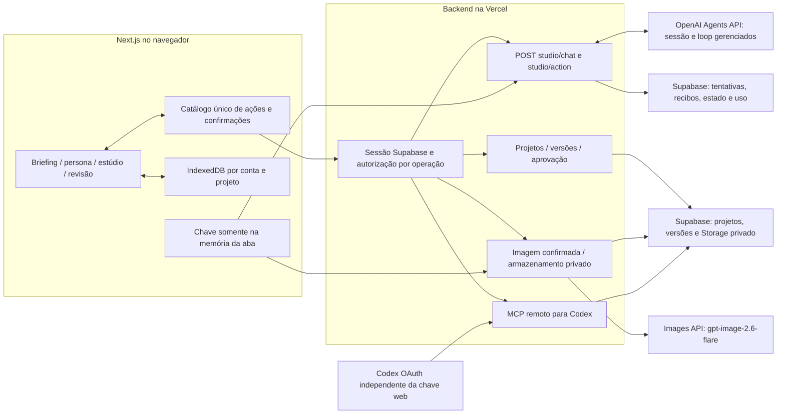

# Estúdio web: implementação e verificação

Em 5 de novembro de 2026, a jornada real de um projeto novo foi concluída no [piloto de produção](https://compor-marco0.vercel.app), commit `22e5400c041d6c68d6d08b2f21c7e12674a990ab`: uma sessão `gpt-6.1-terra`, quatro chamadas de ferramenta, uma geração `gpt-image-2.6-flare`, imagem exibida, composição baixada e PNG final salvo na versão 2. O projeto está pronto para revisão de design e interação; isso não encerra as pendências de operação do marco 0. O [roteiro de revisão](review-design-interacao-2026-11-05.md) usa os dados já salvos.

O deployment `22e5400` foi observado em `READY`, sem erro de alias, sucedendo `8ef318b`, `673b478` e o estado inicial de implementação local. A migração 00016 também foi aplicada: a auditoria própria do Supabase de teste soma **17 entradas**, com TLS 1.3, `COMMIT` e prova com `ROLLBACK`. As contagens e limitações anteriores permanecem como histórico, não como estado atual.

O código `5f0d3de` prepara três ajustes encontrados durante a validação: recusa de pedido novo por projeto ocupado antes do envio; salvamento independente da ordem das chaves JSONB; confirmação factual da imagem somente após aplicação local. Inclui o resultado de ferramenta `generated_and_stored`. Passaram 133 testes Agents, 119 da web e a build; 64 testes de imagens privadas já haviam passado. Esses ajustes foram publicados no deployment `dpl_bTiWXMxDyVDXMtgKwkXCyXKn3N7a`, commit `94d282fba39b00ee15772dd64c48e13db52dcb85`, observado em `READY`, com alias canônico e `aliasError=null`. A prova paga abaixo corresponde à produção anterior `22e5400`; `94d282f` acrescenta seu [registro de evidência](evidencia-e2e-2026-11-05.md), com o mesmo runtime de `5f0d3de`. A reabertura da revisão publicada é uma verificação separada, sem nova geração.

`COMPOR_STUDIO_WEB_ENABLED=true` seleciona a experiência nova. Sem a flag, a entrada mantém o piloto anterior e a recuperação de suas tentativas; `COMPOR_STUDIO_CHAT_ENABLED=true` libera as rotas de chat somente depois das migrações. A separação permite publicar código e verificar esquema antes de ativar a jornada, e retornar à entrada anterior sem desfazer dados.

O novo chat usa funções da Agents API executadas na aba, pelo mesmo catálogo registrado em `document.modelContext` quando a API experimental WebMCP existe. Em navegadores sem essa API, o chat entrega a ação pelo backend ao mesmo executor. A [documentação do Chrome](https://developer.chrome.com/docs/modern-web-guidance/guides/webmcp/agentic-javascript-tools) descreve registro com `AbortSignal`. Além dos testes simulados do contrato local, o WebMCP foi verificado no navegador utilizado no piloto. Essa evidência não comprova suporte em outros navegadores ou clientes.

O chat novo não recebe o MCP delegado. Assim ele não pode salvar diretamente pelo RPC legado, que usa a versão mais recente como base. A ferramenta `compor_salvar_versao` exige peça, base e versão esperada, apresenta confirmação e verifica o efeito no banco antes de retomar o agente. O Codex e a rota legada preservam seus contratos.

## Conteúdo local e dados persistentes

`studio-state.mjs` valida e congela briefing, persona, conversa, seleção, rascunhos, marcações, referências, ajustes e eventos. Um pedido congela sua base e as marcas; trocar a seleção depois não reescreve esse contexto. Novas versões salvas preservam a base anterior e registram aprovação explícita ou herdada no servidor, conforme [versionamento e aprovação](versionamento-e-aprovacao.md).

IndexedDB usa o banco `compor-studio-v1`, versão 2. A atualização preserva os estados e referências da versão 1. As chaves incluem conta e projeto; imagens-base e prévias incluem também peça, versão-base e tipo. Essa separação evita misturar a interface entre contas, mas não transforma IndexedDB numa barreira contra scripts ou extensões da mesma origem. As barreiras remotas estão descritas em [isolamento e proteção de dados](isolamento-e-protecao-dados-marco0.md).

Limites: estado de até 512 KiB por projeto; até 20 referências; PNG/JPEG até 8 MiB por arquivo e 40 milhões de pixels; referências e imagens locais compartilham um teto de 256 MiB e 500 blobs entre projetos. Substituição e quota são transacionais e não apagam arquivos anteriores silenciosamente. O número de projetos locais ainda não tem teto global. Limpar os dados do site ou mudar de dispositivo pode perder rascunhos, conversa e arquivos locais.

A fila de gravação drena snapshots enfileirados enquanto uma gravação termina e aguarda o projeto anterior antes de fechar sua conexão. Conflito entre abas e falta de quota mantêm o trabalho na memória e mostram erro; não geram repetição infinita. Encerramento abrupto do navegador ainda pode impedir a última gravação assíncrona.

Até 200 recibos locais por projeto associam requestId, SHA-256 dos argumentos e resultado mínimo, sem chave. O executor preserva resultado incerto antes do efeito e confirmado antes do ACK; recriar a interface não autoriza executar novamente uma ação já registrada. Interrupção no intervalo anterior ao resultado confirmado continua incerta. Não há promessa de exatamente uma vez entre navegador, banco e OpenAI.

No Supabase, `studio_turns` e os recibos de ações guardam somente metadados técnicos. Os RPCs revalidam `auth.uid()` e o proprietário; uma reserva por projeto impede iniciar outro turno enquanto o anterior está ativo ou incerto. O HMAC vincula ator, projeto, pedido, sessão, turno, chamada e digest. Mensagens, referências, rascunhos e chave não são gravados nessas tabelas. A OpenAI recebe o contexto necessário, sob a retenção aceita pelo usuário.

## Chat, imagem e persona

Novas sessões são configuradas com `gpt-6.1-terra`, conforme a decisão de Matheus. A [migração de medição 00015](medicao-modelo-explicito-00015.md) permite registrar o modelo explícito por etapa; preserva as medições históricas de Astra e as RPCs anteriores. Retomar ou concluir uma sessão antiga não transforma seu modelo em Terra. A execução real mais recente confirmou Terra no provedor e nos eventos da Vercel; o teste Astra anterior permanece separado no histórico.

O envio inclui histórico recente, conteúdo do post aberto, base, briefing, persona, marcas e metadados de referências. Miniaturas limitadas de referências e da imagem-base podem acompanhar o pedido como conteúdo visual; os originais permanecem locais. A consulta usa os identificadores do mesmo turno. Uma sessão pode ser reutilizada por até 280 segundos; pedido explícito posterior cria outra sessão com histórico local somente após reconciliar o turno anterior.

A reutilização também exige que o provedor confirme `session.agent.model=gpt-6.1-terra`. Uma sessão Astra concluída permanece no histórico e não recebe um novo turno Terra; o próximo envio cria uma sessão Terra com o histórico local. Modelo anterior ausente ou desconhecido impede o envio antes da chamada paga. A medição histórica não é reclassificada.

O botão “Consultar estado” recupera a referência anterior por conta e projeto e faz somente uma consulta `op: poll`. Esse caminho não passa pelo executor de tools, não repete a conclusão na conversa e não inicia sessão, ACK ou imagem. Mostra estado e uso; o diagnóstico opcional usa somente contagens e classes fechadas. Recarregar preserva a referência, mas elimina a chave da memória da aba, conforme a escolha de BYOK temporário.

A proposta de imagem conserva a peça e a versão do pedido, ou o destino criado/aberto/salvo por uma ação concluída do próprio chat. O marcador local preserva esse contexto antes do ACK. Navegação manual enquanto a resposta está em andamento não muda o destino da proposta. A confirmação conserva esse contexto e rejeita troca posterior de versão ou edição não salva. Recusar envia o resultado da mesma chamada ao agente sem chamar a Images API. Resultado incerto não inicia uma geração alternativa.

Na prova real, o texto final do agente ainda dizia que a proposta aguardava confirmação, embora a imagem já estivesse gerada, armazenada e exibida. A revisão publicada em `94d282f` mantém esse texto histórico e acrescenta uma confirmação determinística após recuperar o blob privado e aguardar `onUseImage=true`. Seu recibo local contém somente conta, projeto, pedido, peça, versão e asset; só aparece na peça/versão correspondentes. Falha ao aplicar não confirma sucesso nem regenera. O resultado enviado ao agente passa a distinguir `generated_and_stored` da aplicação no navegador.

A composição local gera PNG 1080 × 1350 com enquadramento proporcional e textos editáveis. Download não aprova nem publica. Salvar o PNG final no Storage exige versão salva, autorização explícita e arquivo até 4 MiB. Um marcador precede o envio; falha de transporte permite consultar a mesma referência, sem upload automático duplicado. Imagens recuperadas têm origem desconhecida e exigem revisão visual e clique explícito para usar.

A persona representa quem compra o infoproduto, não a pessoa criadora. Campos desconhecidos são permitidos. Instruções versionadas orientam pesquisa pública quando útil e a ferramenta de afirmações preserva hipótese, relato da pessoa criadora, relato de comprador ou fonte pública. Uma URL não prova a afirmação nem o conhecimento do público. Os testes estruturais não comprovam qualidade cultural ou comercial da análise.

## Jornada real pronta para revisão

O projeto **Demo de revisão — aula de composição visual** foi criado pela interface com a sessão Google existente. Briefing e persona foram preenchidos com hipóteses, a chave foi usada somente na memória e a primeira versão foi salva. Foi encontrada uma diferença de ordem das chaves JSONB no retorno do salvamento; a versão 1 foi aberta manualmente na validação e a correção semântica foi preparada em `3b7ef12`.

Depois da marcação do elemento de título, uma única sessão Terra executou `compor_contexto`, edição, salvamento e `generate_image`, com quatro outputs concluídos e nenhum erro no trace. O salvamento da versão 2 e a geração da imagem tiveram confirmação explícita. A imagem-base foi exibida, a composição foi baixada e o PNG final recebeu resposta `201` ao ser salvo na versão 2. O Codex leu as versões 1 e 2 pelo MCP; preço R$ 49, data 12 de novembro e legenda foram preservados, e a versão 1 permaneceu intacta.

| Evidência técnica | Identificador ou resultado |
| --- | --- |
| Projeto | `fb453fa4-c643-4c24-bffe-b2757b4c2405` |
| Peça / versão final | `ba94b18c-1aa3-4108-9965-568748244365` / `2` |
| Pedido / tentativa | `d7853ea9-a320-468c-92ab-5e27de362fe5` / `b06a29ab-1836-4341-ab4f-ec833c92f347` |
| Imagem gerada | API `202 accepted`, asset `39c79fa4-856b-456d-bc74-7b30298a430c`, `usageRecorded=true` |
| PNG composto | `1080 × 1350`, `1.471.172` bytes |
| SHA-256 do download | `387f446a59148d7db94c274da68b5b54f67fb92f511855e0478fa93cb5f42849` |
| PNG final no projeto | API `201`, asset `7c21b800-a787-429a-acb7-5ce6ef3d9914`, versão `2` |
| Recuperação do PNG final | API privada `200`, imagem decodificada em `1080 × 1350` |

O uso final do agente veio `null`: custo permanece desconhecido. `usageRecorded=true` registra a medição disponível da imagem, sem comprovar fatura ou teto agregado. Capturas e download são artefatos privados da execução; não foram publicados como assets públicos.

## Evidências complementares e histórico

- Testes de navegador com serviços simulados demonstraram a jornada local, segregação entre contas, revalidação, referências, marcações, persistência e PNG decodificável 1080 × 1350. A chave não apareceu no armazenamento inspecionado.
- Testes SQL locais com duas identidades sintéticas verificaram isolamento e negação de escrita direta, reserva de turnos, linhagem e aprovação. PGlite não comprova concorrência entre conexões PostgreSQL independentes, JWTs reais nem Storage remoto.
- No Supabase de teste, a aplicação auditada chegou a 17 entradas, incluindo 00016, que aceita `exec_` sem normalizar o ID ou ampliar autorização. A prova remota terminou com `PROVIDER_CALL_IDS_RLS_CHECKS_PASSED_AND_ROLLED_BACK`; a evidência privada termina em `TyqNLuJu`. Claims sintéticas e `ROLLBACK` não substituem duas contas/JWTs reais. Os pacotes preservam o histórico e recusam reaplicação sem reconciliação.
- A interoperabilidade web↔MCP e o WebMCP foram verificados no ambiente do piloto. A conexão do Codex continua independente da chave OpenAI da aba. Essa verificação não demonstra, por si só, transferência e recuperação de imagem entre todos os clientes.
- Uma tentativa paga já enviada com `gpt-6-astra` foi reconciliada como `completed`, sem reenviar o pedido ou criar outra sessão para a reconciliação. O turno terminou sem efeitos observados na aplicação e sem geração de imagem; portanto, não completou a jornada criativa esperada. O provedor informou `161219` tokens de entrada e `656` de saída. Essa captura de uso é *best effort*, não fatura nem garantia de teto de gasto.
- O patch `1514f6f` acrescentou trace técnico ao resultado concluído; `8ef318b` acrescentou consulta sem efeitos e verificação do modelo antes da reutilização. A consulta posterior identificou uma chamada `compor_contexto` falha com ID `exec_`, recusado pelo contrato local antigo `call_`. A correção foi aplicada em runtime e na migração 00016. A consulta do turno Astra e a execução Terra posterior são evidências distintas; nenhuma reconciliação reenviou o pedido antigo.
- Na versão `8ef318b`, passaram 114 testes da web, a build Next.js e 117 testes do pacote Agents. O novo teste de navegador verificou cinco estados de consulta, restauração após reload e ausência de tools, ACK, imagem, novo turno ou alteração da conversa. A revisão independente não observou bloqueadores no caminho de consulta.
- A revisão independente encontrou e corrigiu projeto ausente no contexto, escrita MCP contornando confirmação e base, consulta antiga afetada por outro turno, corrida de salvamento local e recibos perdidos ao recriar a interface.
- Na revisão atual passaram 133 testes do pacote Agents, 119 da web, a build e 64 de imagens privadas. São testes locais; os ajustes posteriores à prova real foram revisados e publicados em `94d282f`, sem uma segunda geração paga.
- O quadro Figma `211:9859` forneceu contexto, screenshot e ativos originais para o shell. O arquivo principal `8nEzYvk8LCTQzbknMgEw1c`, quadro `2009:13865`, é referência adicional. Na consulta inicial, o limite Starter impediu novas consultas; não há afirmação de paridade das telas ainda não inspecionadas.

Os pacotes [00013/00014](migracoes-estudio-00013-00014.md), [00015](medicao-modelo-explicito-00015.md) e [00016](identificadores-chamadas-00016.md) executam aplicação e prova no mesmo processo `psql`, com uma entrada de senha. Já foram aplicados ao piloto; não devem ser repetidos para verificar estado.

Antes de declarar o marco completo, permanecem estas verificações:

- Identificar e reconciliar a tentativa ativa antiga do projeto `597711db-66bd-4170-ac78-377a497e1411`, preservado sem limpeza ou expiração forçada. O novo pedido `39e586fe-2fb1-429c-93ff-3116cf772df5` recebeu `busy` antes de inserir tentativa, medir uso ou chamar o provedor; esse pedido não consumiu uma nova geração. Ver [tratamento de projeto ocupado](pedido-recusado-projeto-ocupado.md).
- Verificar a reabertura dos ajustes de salvamento, `busy` e confirmação da imagem publicados em `94d282f`; revisar sua interação com Matheus. A jornada nova já foi comprovada, mas isso não testa todas as falhas, interrupções ou retomadas sem duplicação.
- Comprovar isolamento remoto com duas contas/JWTs reais, incluindo negação cruzada de projetos, versões, metadados e objetos do Storage. Upload e leitura da própria imagem foram exercitados; isolamento cruzado e recuperação após interrupção continuam separados.
- Verificar concorrência e recuperação com conexões PostgreSQL independentes; identidades sintéticas numa transação não comprovam esse comportamento.
- Comparar as telas relevantes com as referências Figma e registrar as diferenças ainda existentes.

Uso acumulado informado pelo provedor e estimativas não são fatura; custo indisponível permanece desconhecido. O limite técnico agregado continua na SCRUM-68.
