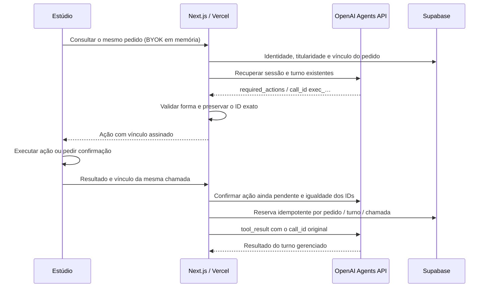

# Observabilidade e compatibilidade de chamadas da Agents API

Registro de 5 de novembro de 2026, a partir do trace fornecido por Matheus e da inspeção do piloto. O diagnóstico consultou a sessão já existente, sem novo envio pago. Depois da correção e de autorização explícita, uma nova jornada usou uma sessão Terra e uma geração de imagem; seus resultados estão separados abaixo.

## Falha identificada

A OpenAI registrou uma chamada `compor_contexto` com identificador `exec_…`. Os argumentos continham os UUIDs esperados e uma revisão inteira; o trace técnico confirmou uma única chamada com esquema válido. O código anterior exigia `call_…` antes de entregar a ação à interface. A mesma restrição existia em assinaturas, no fluxo de imagem e em três pontos do SQL.

Essa incompatibilidade bloqueava o identificador observado. O resultado genérico `Dynamic tool call failed` e a duração do span, isoladamente, não demonstram um timeout específico nem garantem que não existam outros defeitos de integração. A jornada corrigida foi comprovada posteriormente no projeto novo, sem repetir a tentativa antiga.

`isAgentCallId` centraliza o limite do aplicativo: famílias observadas `call_` e `exec_`, sufixo de 1 a 128 caracteres alfanuméricos, `_` ou `-`. Não se troca um prefixo pelo outro. A forma não autoriza acesso: assinatura, identidade, titularidade, estado e igualdade com `required_actions` continuam obrigatórios. Outros formatos futuros exigem revisão; a API documenta esses IDs como strings, sem prometer esse limite local. Ver [Functions](https://developers.openai.com/api/docs/guides/agents-api/tools/functions) e [Retrieve session](https://developers.openai.com/api/reference/resources/beta/subresources/agents/subresources/sessions/methods/retrieve).

## Mecanismo escolhido nesta etapa

Usar Runtime Logs da Vercel para eventos técnicos estruturados, correlacionados com o trace da OpenAI pelos identificadores de sessão, turno e chamada. Os metadados de tentativas e a medição continuam no Supabase. Não foi provisionado um serviço externo de analytics.

O evento JSON `compor.studio` admite somente:

- Nome fechado: reserva, criação ou reutilização de sessão, observação de turno, recebimento ou aceite de ação, resultado desconhecido.
- UUIDs técnicos de pedido e tentativa; IDs validados de sessão, turno e chamada.
- Fase, modelo e estado de turno reconhecidos; código HTTP numérico, duração e contagens limitadas.
- Indicador de compatibilidade do identificador, para distinguir recusa de forma de falha posterior.

Não são serializados objetos recebidos, argumentos, mensagens, rascunhos, imagens, corpo de erro do provedor, cookies, tokens, chave, identidade da pessoa ou projeto. Exceção do coletor não muda o resultado nem provoca repetição. Nenhum replay de navegador ou captura de campos foi habilitado.

`session_created` registra a configuração enviada. `turn_observed` registra o modelo retornado pelo provedor, quando reconhecido, e uso acumulado da sessão. Uma consulta repetida pode produzir outra observação: não se somam essas linhas para calcular consumo. A medição persistida, os recibos e a fatura são referências distintas.

## Investigação na Vercel

1. Selecionar projeto `compor-marco0`, ambiente e intervalo recente.
2. Buscar `compor.studio` e o UUID do pedido. O registro da plataforma fornece também deployment e request ID da Vercel.
3. Seguir os IDs de sessão/turno/chamada até o trace da OpenAI. Para um resultado incerto, consultar a mesma referência, sem criar uma sessão substituta.
4. Distinguir `action_received`, recibo/aceite e resultado final. Turno concluído não garante sucesso da tool ou persistência da imagem.
5. Se não houver eventos no intervalo, verificar retenção e falha da própria consulta antes de concluir ausência de execução.

Na inspeção real, a Vercel retornou o evento `unknown_session_lookup_provider_http_401` da consulta com autenticação recusada. A mesma sessão foi consultada depois com a chave reinserida, retornando `completed`, uma chamada falha e os mesmos contadores de uso, sem novo envio pago. A consulta do período original foi recusada pela API de logs porque o plano Hobby retém somente uma hora, de acordo com o retorno da conta e a [documentação de Runtime Logs](https://vercel.com/docs/logs/runtime). Essa recusa não significa ausência de logs naquele período.

A busca de um trace distribuído da Vercel pelo request ID dessa consulta retornou `Trace not found`. Eventos correlacionados e o trace OpenAI são o mecanismo implementado; não há prova de spans OpenTelemetry distribuídos completos. Não se deve apresentar um link vazio como observabilidade validada.

## Eventos reais após a correção

Na produção `22e5400c041d6c68d6d08b2f21c7e12674a990ab`, a consulta do pedido antigo `b92339c8-c750-43f0-9b61-120002d9f342` produziu `compor.studio / turn_observed`, modelo `gpt-6-astra`, estado `completed` e contagens `161219 / 656`. Foi uma consulta do mesmo recurso, sem nova sessão ou geração. O histórico da chamada falha permaneceu intacto.

A jornada autorizada seguinte usou o pedido `d7853ea9-a320-468c-92ab-5e27de362fe5` e a tentativa `b06a29ab-1836-4341-ab4f-ec833c92f347`. Nos logs da Vercel foram observados:

- `session_created` com `gpt-6.1-terra` e sessão `sess_0534752176ecd773006aeca56cbf5881999b6b888e41d24b7d`.
- `action_received` com chamadas `exec_` e `callIdAccepted=true`; as três ações de contexto, edição e salvamento tiveram `action_accepted`.
- `turn_observed` em `waiting`, depois `completed`, para o turno `turn_0534752176ecd773006aeca57240988199a77301d176084184`. Nenhum evento `unknown` foi observado nas 19 linhas consultadas dessa execução.

O trace da OpenAI mostrou 12 itens, quatro chamadas de ferramenta e outputs concluídos, sem erro: contexto, edição, salvamento e imagem. A confirmação da imagem usa seu fluxo próprio, não deve ser contada como um quarto `action_accepted` genérico. A API retornou `202 accepted` para o asset `39c79fa4-856b-456d-bc74-7b30298a430c` e a UI exibiu a imagem-base. O PNG final da versão 2 foi salvo com `201`, asset `7c21b800-a787-429a-acb7-5ce6ef3d9914`, depois lido com `200` e decodificado em `1080 × 1350`. A leitura MCP encontrou v1 e v2, com v1 preservada. Ver [evidência da jornada](evidencia-e2e-2026-11-05.md) e [roteiro de revisão](review-design-interacao-2026-11-05.md).

O uso final do agente retornou `null`. Isso significa uso/custo desconhecido, não consumo zero. `usageRecorded=true` na resposta da imagem confirma o registro da medição disponível, sem atestar o total faturado. Não se somam observações repetidas do mesmo turno.

## Auditoria e ajustes posteriores

A migração 00016 foi aplicada ao Supabase de teste, totalizando **17 entradas** na auditoria própria. A evidência privada terminada em `TyqNLuJu` contém TLS 1.3, as 17 linhas, `COMMIT`, `ROLLBACK` e `PROVIDER_CALL_IDS_RLS_CHECKS_PASSED_AND_ROLLED_BACK`. A prova usa identidades sintéticas e preserva dados por checksums; não equivale a duas contas com JWTs reais ou Storage cruzado. Ver [contrato SQL dos identificadores](identificadores-chamadas-00016.md).

O código `5f0d3de` contém ajustes posteriores à prova real: `busy` encerra somente o pedido novo comprovadamente recusado antes do envio; conteúdo salvo é comparado por campos, sem depender da ordem JSONB; o recibo de imagem aguarda a aplicação local confirmada. O resultado de ferramenta passa a informar `generated_and_stored`, sem afirmar aplicação no navegador. A revisão final passou em 133 testes Agents, 119 da web e build; 64 testes de imagens privadas já haviam passado. Esses resultados locais não são um segundo E2E pago. A publicação posterior foi confirmada como `READY` no deployment `dpl_bTiWXMxDyVDXMtgKwkXCyXKn3N7a`, commit `94d282fba39b00ee15772dd64c48e13db52dcb85`, com alias canônico e `aliasError=null`. A reabertura da versão publicada não exige outra geração; a prova paga permanece ligada a `22e5400`.

O projeto antigo `597711db-66bd-4170-ac78-377a497e1411` continua preservado com uma tentativa ativa a identificar. O novo pedido `39e586fe-2fb1-429c-93ff-3116cf772df5` foi recusado por `busy` antes de inserir tentativa, medir uso ou chamar o provedor. Não se limpa nem expira uma operação incerta para liberar o projeto. Essa recuperação continua pendente e não impede revisar o projeto novo já validado.

## Verificação e limites

Testes cobrem IDs `exec_` na entrega, assinatura, confirmação e retomada de imagem com serviços simulados; rejeitam mudança do ID, troca de ator, chaves e conteúdo nos logs. A migração incremental foi aplicada e comprovada no projeto de teste antes da nova jornada paga, preservando histórico e autorização.

Consulta de turno existente, execução real de `exec_`, geração, aplicação local e armazenamento final foram comprovados por evidências distintas. A segurança do marco 0 ainda exige duas contas/JWTs reais, negação cruzada no Storage, concorrência entre conexões e recuperação após interrupções; a revisão de fidelidade e interação com o Figma continua aberta. A prioridade atual é revisar a jornada de design e interação já funcional e depois refinar o marco 0.

Retenção maior, exportação de logs e OpenTelemetry exigem desenho e verificação adicionais. PostHog pode ser avaliado quando houver necessidade de análise da jornada do produto; não é necessário introduzi-lo para corrigir e diagnosticar esse bloqueio. Custos, acesso e retenção do serviço escolhido devem ficar explícitos antes de habilitar uma nova integração.
