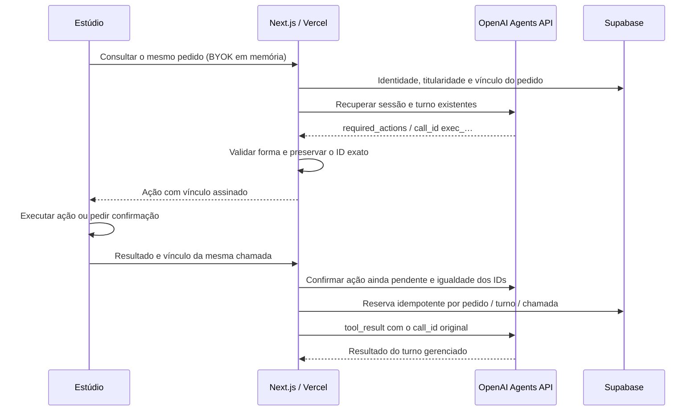

# Observabilidade e compatibilidade de chamadas da Agents API

Registro de 5 de novembro de 2026, a partir do trace fornecido por Matheus e da inspeção do piloto. Não houve nova sessão paga para diagnosticar esse incidente.

## Falha identificada

A OpenAI registrou uma chamada `compor_contexto` com identificador `exec_…`. Os argumentos continham os UUIDs esperados e uma revisão inteira; o trace técnico confirmou uma única chamada com esquema válido. O código anterior exigia `call_…` antes de entregar a ação à interface. A mesma restrição existia em assinaturas, no fluxo de imagem e em três pontos do SQL.

Essa incompatibilidade bloqueava o identificador observado. O resultado genérico `Dynamic tool call failed` e a duração do span, isoladamente, não demonstram um timeout específico nem garantem que não existam outros defeitos de integração. A jornada corrigida ainda precisa de uma prova real.

`isAgentCallId` centraliza o limite do aplicativo: famílias observadas `call_` e `exec_`, sufixo de 1 a 128 caracteres alfanuméricos, `_` ou `-`. Não se troca um prefixo pelo outro. A forma não autoriza acesso: assinatura, identidade, titularidade, estado e igualdade com `required_actions` continuam obrigatórios. Outros formatos futuros exigem revisão; a API documenta esses IDs como strings, sem prometer esse limite local. Ver [Functions](https://developers.openai.com/api/docs/guides/agents-api/tools/functions) e [Retrieve session](https://developers.openai.com/api/reference/resources/beta/subresources/agents/subresources/sessions/methods/retrieve).

## Mecanismo escolhido nesta etapa

Usar Runtime Logs da Vercel para eventos técnicos estruturados, correlacionados com o trace da OpenAI pelos identificadores de sessão, turno e chamada. Os metadados de tentativas e a medição continuam no Supabase. Não foi provisionado um serviço externo de analytics.

O evento JSON `compor.studio` admite somente:

- Nome fechado: reserva, criação ou reutilização de sessão, observação de turno, recebimento ou aceite de ação, resultado desconhecido.
- UUIDs técnicos de pedido e tentativa; IDs validados de sessão, turno e chamada.
- Fase, modelo e estado de turno reconhecidos; código HTTP numérico, duração e contagens limitadas.
- Indicador de compatibilidade do identificador, para distinguir recusa de forma de falha posterior.

Não são serializados objetos recebidos, argumentos, mensagens, rascunhos, imagens, corpo de erro do provedor, cookies, tokens, chave, identidade da pessoa ou projeto. Exceção do coletor não muda o resultado nem provoca repetição. Nenhum replay de navegador ou captura de campos foi habilitado.

`session_created` registra a configuração enviada. `turn_observed` registra o modelo retornado pelo provedor, quando reconhecido, e uso acumulado da sessão. Uma consulta repetida pode produzir outra observação: não se somam essas linhas para calcular consumo. A medição persistida, os recibos e a fatura são referências distintas.

## Investigação na Vercel

1. Selecionar projeto `compor-marco0`, ambiente e intervalo recente.
2. Buscar `compor.studio` e o UUID do pedido. O registro da plataforma fornece também deployment e request ID da Vercel.
3. Seguir os IDs de sessão/turno/chamada até o trace da OpenAI. Para um resultado incerto, consultar a mesma referência, sem criar uma sessão substituta.
4. Distinguir `action_received`, recibo/aceite e resultado final. Turno concluído não garante sucesso da tool ou persistência da imagem.
5. Se não houver eventos no intervalo, verificar retenção e falha da própria consulta antes de concluir ausência de execução.

Na inspeção real, a Vercel retornou o evento `unknown_session_lookup_provider_http_401` da consulta com autenticação recusada. A mesma sessão foi consultada depois com a chave reinserida, retornando `completed`, uma chamada falha e os mesmos contadores de uso, sem novo envio pago. A consulta do período original foi recusada pela API de logs porque o plano Hobby retém somente uma hora, de acordo com o retorno da conta e a [documentação de Runtime Logs](https://vercel.com/docs/logs/runtime). Essa recusa não significa ausência de logs naquele período.

A busca de um trace distribuído da Vercel pelo request ID dessa consulta retornou `Trace not found`. Eventos correlacionados e o trace OpenAI são o mecanismo implementado; não há prova de spans OpenTelemetry distribuídos completos. Não se deve apresentar um link vazio como observabilidade validada.

## Verificação e limites

Testes cobrem IDs `exec_` na entrega, assinatura, confirmação e retomada de imagem com serviços simulados; rejeitam mudança do ID, troca de ator, chaves e conteúdo nos logs. A migração incremental preserva histórico e autorização e precisa ser aplicada e comprovada no projeto de teste antes do novo E2E pago.

Depois do deploy, a consulta de um turno existente deve produzir uma linha estruturada recuperável na Vercel. Essa prova não inicia nova sessão nem gera imagem. A execução real de uma ação `exec_` e a jornada Terra → imagem → Storage permanecem critérios separados.

Retenção maior, exportação de logs e OpenTelemetry exigem desenho e verificação adicionais. PostHog pode ser avaliado quando houver necessidade de análise da jornada do produto; não é necessário introduzi-lo para corrigir e diagnosticar esse bloqueio. Custos, acesso e retenção do serviço escolhido devem ficar explícitos antes de habilitar uma nova integração.
