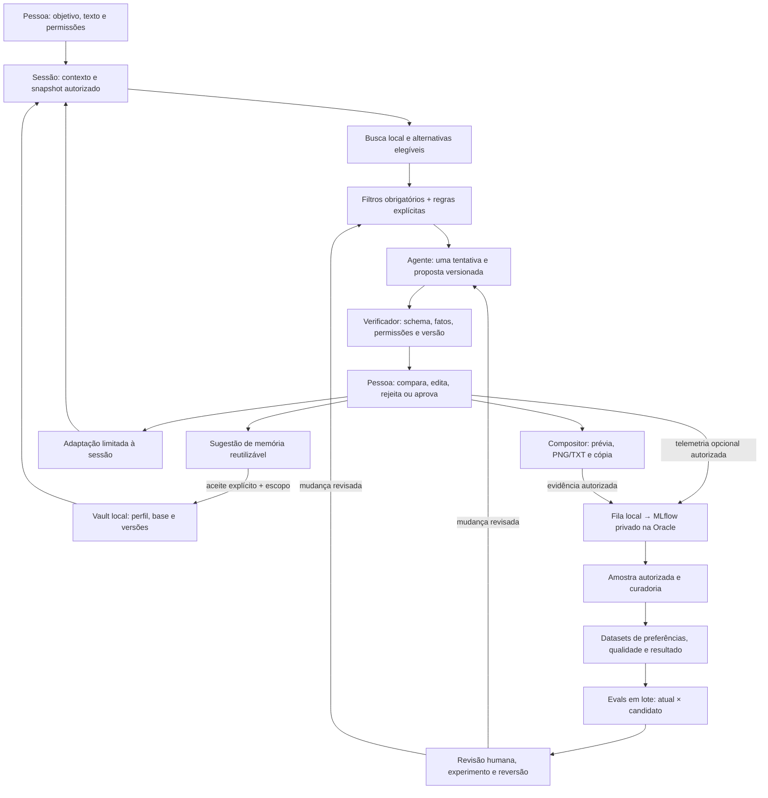

# Compor: personalização e melhoria do harness pelo uso

> **Proposta para discussão no chat, 26/10/2026.** Q25 foi aprovada como base de seleção da v0; Q26 mantém a régua de promoção como hipótese revisável. Matheus também definiu reforço positivo para tarefas concluídas e negativo para não concluídas, investigando o motivo. Pontos, limiares, detalhes de ordenação e interfaces marcados como **hipótese** são candidatos, não requisitos aprovados nem resultados observados. Este documento não demonstra implementação, avaliação com pessoas ou implantação. As decisões coletivas fechadas ficam no [Confluence](https://compor-mathai.atlassian.net/wiki/spaces/COMPOR/pages/1376258); o [Jira](https://compor-mathai.atlassian.net/issues/?jql=project%20%3D%20SCRUM) acompanha execução.

## 1. Objetivo, público e evidência

- **Público inicial da spec:** quem divulga cursos, mentorias ou ebooks. A necessidade e o benefício incremental continuam hipóteses; o piloto técnico começa com uma pessoa e uma organização, não representa a população.
- **Tarefa principal:** chegar a uma peça com arte e legenda para uma divulgação, a partir de texto próprio ou da exploração de abordagens. O autor revisa fatos, voz e composição antes de aprovar.
- **Resultado esperado:** PNG e TXT exportáveis, com projeto local restaurável; abrir os arquivos fora do app e restaurar a peça são evidências adicionais, cada uma observada ou declarada com sua origem. Exportação não prova publicação, venda ou benefício econômico.
- **Métrica principal desta proposta:** tarefas elegíveis com aprovação e exportação de PNG e TXT confirmadas dentro da janela / **todas as tarefas elegíveis maduras**. Elegibilidade é fixada antes do resultado: tarefa real atribuída ou assumida pela pessoa; excluir demonstrações sintéticas e duplicatas, sem excluir falhas ou cancelamentos. Janela proposta: 14 dias após a atribuição **e a disponibilização geral da versão à coorte**, o que vier por último; falhas individuais de instalação, rede ou fornecedor após essa liberação permanecem no denominador. Se a versão ainda não foi disponibilizada à coorte, a janela ainda não começa. Tarefas com janela aberta ficam pendentes. Resultado ausente após a janela é desconhecido, não fracasso observado.
- **Métrica da spec preservada:** pessoas qualificadas atribuídas que aprovaram e exportaram / todas as pessoas qualificadas atribuídas, na janela de 14 dias. Pessoas e tarefas são unidades diferentes; esta proposta não substitui formalmente a ativação da spec.
- **Hipóteses de produto:** comparação proporcional à intenção, contexto reutilizável controlado e correções menos repetidas podem ajudar a concluir a peça. A validação depende de comparação com o processo anterior, de tarefas reais e do relato da pessoa; likes não comprovam esses benefícios.

## 2. Dois ciclos, responsáveis e estados



**Individual:** objetivo e sessão → opções → escolha/correção → efeito apenas na sessão. A pessoa pode adotar uma hipótese como memória no escopo certo; a campanha só usa nova base/skill depois de atualização explícita. A correção de uma peça, a reação ou a escolha A/B não promovem memória automaticamente.

**Coletivo:** eventos e feedback autorizados → amostra → seleção e revisão → dataset fixado → comparação de versões de prompts, tools e trajetórias → decisão humana sobre um candidato → implantação controlada e possibilidade de reversão. O objetivo é aprimorar o harness; **não há treinamento de modelo** nesta v0.

**Estados da tentativa:** `rascunho → preparada → autorizada → em_curso → proposta | falha | cancelada`. Uma proposta validada pode ser revisada, aplicada ou rejeitada; aplicar, aprovar e exportar são decisões diferentes. Resposta atrasada de uma versão antiga não sobrescreve edição posterior. Ao falhar, manter o trabalho e mostrar recuperação; uma nova chamada de IA exige nova tentativa explícita, sem repetir geração porque a telemetria falhou.

**Estados do sinal:** `observado → interpretado → hipótese_de_sessão → sugerido → adotado | rejeitado`. Sem fonte ou consentimento necessários, o sinal permanece não utilizável. A pessoa consulta, corrige e apaga o perfil ativo; ausências e sinais ambíguos não são convertidos em fatos.

**Recuperação:** Oracle ou rede indisponíveis não bloqueiam abrir, editar, restaurar e exportar trabalho salvo. A fila de telemetria é limitada; perda de eventos gera contagem de lacunas quando possível, nunca sucesso inventado. Conflito GitHub preserva versões e pausa a integração afetada. Se um trace sem avaliação já tiver sido expurgado, feedback tardio permanece ligado à versão e a trajetória é marcada indisponível, sem reconstrução fictícia.

## 3. Componentes e contratos

| Responsável / componente | Entrada → saída | Limite e falha |
|---|---|---|
| Pessoa e interface Electron | Objetivo atual, intenção, texto próprio ou notas e condições de uso → tarefa versionada | Não exigir formulário longo; permitir resposta desconhecida, rejeitar opções, editar diretamente e continuar sem feedback. |
| Perfil e vault da organização | Contexto por escopo + permissões → snapshot das referências adotadas e suas versões | Arquivos legíveis/versionáveis são a fonte de verdade. A sincronização GitHub é opcional e inclui toda memória da organização, inclusive pessoal; eventos, traces, segredos e caches ficam fora do repositório. |
| Busca e seleção locais | Intenção + referências autorizadas + versões → candidatos com IDs, razão e posições | V0 busca em base/recursos locais; seguir tema/fonte externa é hipótese futura, não dependência. Filtros de permissão e fatos confirmados precedem qualquer ordenação. |
| Agente/harness | Snapshot + tarefa → tentativa e proposta estruturada | Uma tentativa por vez, sem efeitos externos não autorizados. BYOK pessoal e chave de teste usam o adaptador oficial; proxy Codex é laboratório. Codex nativo e imagem no proxy mantêm seus gates existentes. |
| Verificador | Proposta + fatos confirmados + versões → válida, revisável com pendências ou rejeitada | Validar schema, autorização, fatos e obsolescência. Uma checagem automática não garante verdade; humano revisa a saída. |
| Compositor | Recursos permitidos + blocos editáveis → prévia e cópia recuperável durante a edição; peça aprovada → PNG/TXT finais | Salvar/restaurar trabalho em andamento não depende de aprovação. Texto, preço e datas continuam editáveis; geração não é aprovação. Edição/exportação de salvo funciona sem Oracle. |
| Eventos e telemetria | Exposições e sinais permitidos → fila limitada → gateway autenticado → MLflow | Não há envio central sem adesão. Metadados por padrão; texto/imagem somente em casos/sessões de teste ou eval autorizados. Não registrar credenciais, cabeçalhos brutos ou o vault inteiro. |
| Curadoria e evals | Casos autorizados + versão da rubrica → avaliação e candidato versionado | Sampling seleciona, não executa juiz pago. Lotes sob comando; modelo avaliador com limite de gasto e credencial/custeio explícitos. Não repetir efeitos externos de tools. |

**Armazenamento proposto, não decidido:** manter perfil e memória como arquivos locais no vault existente; pequenas listas de relações `pessoa–organização–marca–produto–campanha–referência` podem ser consultadas por escopo em memória. Se a busca ou o volume exigir, criar índice local reconstruível, por exemplo SQLite, fora do Git e sem torná-lo autoridade. Não há requisito atual de banco de grafos. Logs/filas locais de telemetria não integram a sincronização GitHub. MLflow e a capacidade da Oracle ainda precisam de validação técnica.

**Tradeoffs:** o app instalado facilita manter o vault, o cofre e o trabalho editável junto da pessoa, mas exige instaladores, assinatura, atualizações e suporte para Windows e macOS. Uma experiência web simplificaria acesso por URL, porém precisaria redesenhar acesso a arquivos, credenciais e integração com o Codex local; não é a plataforma escolhida para a v0. O MLflow central facilita comparar execuções e revisões, mas traz operação, armazenamento crescente para traces avaliados e um limite de consentimento que o fluxo local precisa respeitar.

## 4. Perfil: modelo e política de atualização

**Primeira entrega:** pedir objetivo da divulgação, intenção `usar texto próprio | explorar`, oferta/público/ação desejada quando necessários. Experiência prévia e condição de uso podem ser declaradas ou ficar desconhecidas; um exemplo fictício permite conhecer o fluxo. Depois, uma escolha entre propostas concretas pode informar a sessão, sem cadastro extenso.

Cada registro tem: `id`, `categoria` (`objetivo | conhecimento | preferência | restrição | contexto_sessão`), `valor`, `origem`, `escopo`, `confiança`, `registrado_em`, `válido_de`, `válido_até`, `evidências` e `estado` (`hipótese | sugerido | adotado | revogado | substituído`). A origem identifica a natureza da evidência (`declarado`, `observado`, `inferido`); confiança é um juízo separado com nível `não_estimada | baixa | média | alta` e justificativa. Por padrão, a confiança é `não_estimada`: uma declaração expressa a vontade da pessoa, mas não prova que um fato esteja correto. Regra candidata: `baixa` para evidência indireta ou conflitante; `média` para uma observação verificável no escopo; `alta` apenas para evidências convergentes sobre a afirmação específica, revisadas e sem conflito. A classificação nunca amplia consentimento e registra quem/quais critérios a atribuíram; não transformar nível qualitativo em probabilidade inventada. Uma evidência inclui referência e disponibilidade; se o evento de origem expirar, não criar cópia clandestina nem fingir que existe.

```json
{
  "id": "exemplo-sintetico-pref-01",
  "categoria": "preferência",
  "valor": "tom direto",
  "origem": {"tipo": "declarado", "ato": "adoção explícita", "ref": "exemplo-decisao-01"},
  "escopo": {"tipo": "marca", "id": "marca-exemplo"},
  "confiança": {"nível": "não_estimada", "justificativa": "preferência declarada; efeito ainda não avaliado"},
  "registrado_em": "2026-10-26T12:00:00Z",
  "válido_de": "2026-10-26T12:00:00Z",
  "válido_até": null,
  "evidências": [{"ref": "exemplo-decisao-01", "estado": "disponível"}],
  "estado": "adotado"
}
```

**Regras:** interesse declarado não é conhecimento demonstrado; “já conheço” reduz repetição na sessão e pode ser confirmado com uma escolha, sem prova de domínio. Um pedido temporário de texto curto não substitui a preferência da marca. Nas preferências compatíveis, usar o escopo mais específico aplicável; fatos confirmados, restrições e proibições não são sobrepostos silenciosamente por uma preferência. Conflito entre instruções explícitas relevantes pede escolha ou sinaliza pendência, sem inventar uma verdade. Adoção/substituição registra origem, data e vínculo com o item anterior; remover ou corrigir não altera secretamente uma campanha fixada.

**Exclusão — decisão Q24:** apagar o perfil ativo, mantendo traces avaliados e datasets até outra decisão, inclusive dados que ainda permitam associação à pessoa ou conteúdo autorizado que contenha valores do perfil antigo. O app apresenta esse alcance antes de apagar. Invalidar índices, caches e contexto de sessão do perfil e impedir que traces/datasets preservados o reconstruam automaticamente; tarefas e projetos permanecem. Permissões/classificações são controles separados: se uma autorização ficar desconhecida após a exclusão, não ampliar o acesso sem escolha explícita. Uma requisição já enviada a um provedor não é considerada retraída.

Uma mudança no vault segue a sincronização GitHub já escolhida; histórico Git, cópias de colaboradores, backups e snapshots anteriores não são apagados automaticamente. Em falha de sync, manter exclusão local, mostrar remoto pendente e impedir que cópia antiga ressuscite o perfil silenciosamente. Não prometer exclusão integral dessas cópias. A autorização de processamento é distinta da existência do dado: sem consentimento de uso válido e verificável, não reprocessar um registro preservado.

## 5. Catálogo de microinterações

Limite inicial **hipotético**: no máximo um convite opcional de feedback por tarefa, após uso de uma proposta; dispensar o convite não bloqueia o trabalho. O pedido não aparece com elogio pré-selecionado. A regra concreta precisa ser ensaiada, não é uma taxa validada de fadiga.

| Interação e momento | Interpretação / força | Efeito inicial e condição |
|---|---|---|
| Selecionar uma referência local ou foco ao preparar a campanha | Interesse explícito **naquela tarefa**; seguir tema/fonte externa é futuro | Incluir candidatos autorizados no contexto, sem inferir domínio ou permissão para outras fontes. |
| Escolher A em vez de B quando ambas foram exibidas | Preferência relativa no contexto, sinal moderado | Ajustar a sessão; B não vira rejeição absoluta. Só propor memória de marca se houver algo concreto a adotar. |
| Pedir mais/menos detalhe na edição | Pedido explícito para a sessão | Ajustar próximas respostas daquele contexto; sugerir preferência durável só com escolha e escopo. |
| Salvar para depois | Intenção declarada, resultado ainda desconhecido | Preservar projeto e oferecer retomada; não contar como peça concluída. |
| Dizer “já conheço” ou “já tenho texto” | Conhecimento ou material **declarado**, não domínio demonstrado | Evitar repetição; preservar texto próprio. Confirmar nível apenas quando mudar a próxima entrega. |
| Rejeitar opção com motivo | Desalinhamento explícito de tema, voz, nível, fato ou repetição | Ajustar a próxima proposta no mesmo escopo; não propagar regra global nem punir a pessoa. |
| Apontar erro | Possível falha; a correção também requer verificação | Manter proposta original, revisar fato e, quando autorizado/validado, selecionar caso de qualidade. Não atualizar base automaticamente. |
| 👍 útil / 👏 muito útil / 👎 não ajudou na proposta | Utilidade percebida, opcional, vinculada à versão; não é corretude nem aceite | Registrar feedback permitido; corretude/completude são critérios opcionais próprios com “não sei”. Silêncio é desconhecido. |
| Aprovar, exportar ou confirmar aplicação/uso externo | São atos e evidências distintos; aprovação + exportação é conclusão do produto | Registrar cada etapa quando permitida; confirmação de publicação/uso é relato ou observação separada, sem inventar venda. |
| Encerrar a tarefa sem concluir o resultado desejado | Não conclusão observada é sinal negativo; o motivo pode não ser conhecido | Oferecer pergunta opcional e neutra sobre o que atrapalhou; investigar a causa com a pessoa e com evidências autorizadas, sem bloquear nem culpar. |

Tempo de leitura, abandono, opções não mostradas e ausência de reação são ambíguos. Falta de resposta não muda memória, não significa satisfação e não é avaliação negativa. Permissão, preferência, dificuldade e qualidade têm campos distintos.

## 6. Eventos, datasets e qualidade dos dados

Registrar exposição **efetiva** e alternativas realmente mostradas; um candidato buscado mas não apresentado não recebe rótulo. O evento é idempotente, com tempo da ocorrência e do registro, e inclui exatamente os campos abaixo. IDs são pseudônimos vinculáveis, não dados anônimos. Por padrão `task_goal` é código/ID e `shown_options` contém IDs, versões e posições, não texto nem imagens.

```json
{
  "event_id": "sintetico-evt-002",
  "event_type": "option_chosen",
  "occurred_at": "2026-10-26T12:00:04Z",
  "recorded_at": "2026-10-26T12:00:05Z",
  "user_ref": "pseudonimo-exemplo",
  "session_ref": "sessao-exemplo",
  "task_ref": "tarefa-exemplo",
  "task_goal": "compose_own_message",
  "impression_id": "exposicao-exemplo",
  "shown_options": [
    {"option_ref": "rota-a-v1", "position": 1},
    {"option_ref": "rota-b-v1", "position": 2}
  ],
  "positions": [1, 2],
  "exposure_propensity": null,
  "curation_selection_probability": null,
  "chosen_option": "rota-a-v1",
  "feedback_type": "relative_choice",
  "feedback_reason": null,
  "scope": "session",
  "system_version": "app-exemplo-1",
  "prompt_version": "prompt-exemplo-1",
  "model_version": "model-exemplo-1",
  "policy_version": "policy-exemplo-1",
  "outcome": "not_observed",
  "reinforcement_direction": null,
  "outcome_reason": null,
  "reason_source": null,
  "outcome_evidence": null,
  "source_event_ids": ["sintetico-evt-exposicao-001"],
  "data_permission": {"telemetry_metadata": "allowed", "eval_content": "not_allowed", "consent_ref": "consentimento-exemplo"}
}
```

Esse evento é sintético, não é uso real. O evento anterior de exposição usa o mesmo `impression_id` e `chosen_option: null`; uma correção, exportação ou avaliação gera outro evento com sua própria data e vínculos, sem sobrescrever a história. `exposure_propensity` só é preenchida quando a probabilidade de exposição e posição é conhecida, por exemplo em uma alocação aleatória registrada; `curation_selection_probability` é outra probabilidade, relativa à posterior amostragem para dataset. `null` significa desconhecida ou não aplicável, nunca zero. IDs estáveis, versões e fonte HUMAN/CODE/LLM_JUDGE permitem deduplicação e revisões sem multiplicar votos. Falha de entrega, relógio inconsistente ou fonte expirada é registrada como limitação; não preencher campos por inferência.

**Três datasets distintos:** (1) preferências relativas: apenas opções exibidas, escolha, posição e contexto autorizado; (2) qualidade: fatos/referências e correções validadas com critério, autor e versão; (3) resultados: aprovação, exportação, retomada ou aplicação com fonte e evidência. No dataset de resultados, conclusão observada gera sinal positivo e não conclusão observada gera negativo; pendente ou desconhecido não gera sinal. Registrar motivo, origem e evidência separadamente, sem inventar uma causa. Reação não vira automaticamente rótulo de qualidade ou conclusão. A amostra pode incluir sucesso, erro, rejeição e ausência de reação; registrar população elegível, filtros e probabilidade de seleção se aleatória. Cada exemplo aponta para origem e versão imutável ou identificável do conjunto; remover/revisar fonte ou permissão marca versões derivadas afetadas e pode tornar comparação não reproduzível.

**Exemplo de motivo, não de rótulo automático:** a pessoa pode indicar dificuldade técnica, resultado fora do esperado, fato ou recurso ausente, custo/tempo, mudança de objetivo ou outro motivo. Categorias e explicação livre são opcionais; guardar conteúdo livre em casos de eval só com a autorização aplicável. Um motivo declarado pela pessoa, um erro observado e uma causa inferida são origens diferentes. Uma tentativa de exportar que falha e depois é recuperada pode gerar incidente da trajetória, mas a tarefa concluída recebe um único desfecho positivo; revisões preservam evidência e evitam contagem duplicada. Conclusão técnica não prova satisfação. Nenhum sinal autoriza ultrapassar revisão, permissões ou proteção de fatos para obter uma exportação.

Quando um desfecho autorizado for associado como avaliação formal a um trace no MLflow, a proteção contra expurgo automático cobre esse trace e seu contexto autorizado, mesmo fora de dataset. Um status técnico isolado não é avaliação silenciosa. Com telemetria recusada ou trace já expurgado, o feedback permitido pode permanecer local e ligado à versão; não criar trajetória nem transmitir dados à Oracle sem autorização. Pesos quantitativos dos sinais não foram definidos.

**Acesso, retenção e reprocessamento:** vault local sob controle da pessoa; repositório opcional da organização pode ser lido por colaboradores e mantém histórico. MLflow privado e datasets têm acesso restrito conforme operação. Traces **sem avaliação**: cinco dias; traces **com avaliação**: preservados com avaliações, spans e contexto autorizado, sem expurgo automático e independentemente de curadoria. Proteger expurgo e gravação de avaliação de corrida, inclusive artefatos e índices. Datasets selecionados têm finalidade, origem/consentimento e prazo declarados. Q24 apaga o perfil ativo, preservando traces avaliados e datasets até outra decisão. Reprocessar somente com permissão específica ainda válida; retenção não é consentimento novo.

## 7. Métricas, pesos e limites

**Métrica por tarefa e cobertura:** para uma coorte, `N = todas as tarefas elegíveis cuja janela de 14 dias terminou`, incluindo falhas/cancelamentos observados e pessoas que recusaram telemetria, quando enumeráveis. `C ⊆ N` contém tarefas com aprovação + PNG/TXT exportados confirmados **dentro da janela**; `U ⊆ N` contém tarefas de resultado desconhecido. `C` e `U` são disjuntos; os demais casos de N são não concluídos na janela quando isso for observado. Mostrar `C/N` como conclusão confirmada e, se `U > 0`, como **limite inferior**; `(C+U)/N` é limite superior. Informar `C`, falhas/cancelamentos, `U`, pendentes e fonte. Se opt-outs não podem ser enumerados por uma fonte autorizada, N global e taxa global são **não estimáveis**; mostrar cobertura da coorte observável, sem usá-la como taxa de todos. Observação autorizada do ensaio pode complementar telemetria, sem tornar sua adesão obrigatória.

Exemplo **sintético**: quatro tarefas maduras elegíveis incluem uma conclusão confirmada, um cancelamento, uma falha de instalação e um resultado desconhecido. Então `N=4`, `C=1`, `U=1`: conclusão confirmada de 25% e intervalo possível de 25% a 50%. Uma quinta tarefa ainda dentro da janela aparece como pendente e não entra em N; nenhum desses números é observação do produto.

**Indicadores auxiliares:** conclusão por pessoa na métrica da spec; tempo ativo da pessoa; custo de geração e de avaliação por titular/provedor; retrabalho (edições relevantes e voltas, interpretadas com a pessoa); erros factuais confirmados, vazamento de conteúdo ou segredo e perda de trabalho; esforço das microinterações (convites mostrados/respondidos/dispensados); preservação/restauração e intervenções humanas. Custo ausente permanece desconhecido; proxy e preço não mapeado não são gratuitos por definição. Um like não comprova utilidade ou correção.

**Seleção v0 — Q25 aprovada:** filtrar permissões e fatos primeiro; priorizar a intenção da pessoa e o contexto adotado; quando ela quiser explorar, apresentar duas rotas contrastantes. A escolha ajusta a sessão; memória reutilizável continua exigindo aceite explícito. Não atribuir uma probabilidade de sucesso nem escolher uma única rota para ocultar a outra.

**Detalhe de ordenação ainda proposto:** uma possível implementação ordena lexicograficamente por (1) atendimento à intenção explícita e às referências autorizadas; (2) compatibilidade com contexto adotado; (3) variedade entre as duas rotas quando a intenção for explorar; (4) reduzir repetição recente na mesma sessão. Empates teriam regra estável e registrável. Essa sequência exata e seu desempate não foram fechados em Q25. Uma rejeição ou pedido temporário só atua no seu contexto.

**Pesos para uma possível decisão futura — exemplo sintético, não operacional.** Se houvesse probabilidades e impactos calibrados, expressar todos os termos em *minutos equivalentes*:

`V = 30 × P(conclusão confirmada) − 10 × P(não conclusão) − 120 × P(erro factual grave) − E[tempo ativo, min] − E[custo, R$] / (1 R$/min)`.

Os valores `30`, `−10`, `−120` e `1 R$/min` são hipóteses para discussão: 30 minutos de trabalho manual equivalente em caso de conclusão; 10 minutos equivalentes de impacto adicional por não conclusão; erro grave com impacto maior; conversão monetária arbitrária. O impacto adicional da não conclusão deve excluir tempo/custo já contados e a parcela já atribuída ao erro grave, para não somar a mesma perda duas vezes. Exemplificando apenas para ilustrar, com `P(conclusão)=0,60`, `P(não conclusão)=0,40`, `P(erro)=0,01`, 8 minutos ativos e custo de R$1,50, `V = 18 − 4 − 1,2 − 8 − 1,5 = 3,3` minutos equivalentes. Conclusão e não conclusão são estados finais distintos para a mesma janela; erro pode coexistir com qualquer um. Resultados observados desconhecidos não são classificados como não conclusão. A soma representa valores esperados, não contagens; nenhum peso ou probabilidade foi medido ou aprovado para o Compor. Mesmo com um V alto, permissões, preservação de dados e apresentação fiel dos fatos permanecem **filtros obrigatórios**, sem compensação financeira.

Probabilidade só entra em produção depois de avaliação em casos independentes por tempo e pessoa, cobertura por categoria, comparação com taxa-base e calibração/erro, com incerteza e eventos raros explicitados. Um único usuário não permite calibrar ou medir generalização populacional. Pontos e coeficientes do X não são importados.

Na revisão fixa do X, o código soma pesos × **previsões**, incluindo termos contínuos como tempo previsto × peso, e aplica outros ajustes de ordenação. Os valores publicados para curtida são 0,66 no `home-mixer` e 0,5 no `vm-ranker`; denúncia é −234 nos dois arquivos. As configurações/experimentos podem mudar valores efetivos, portanto esses defaults não comprovam o tratamento de todo o tráfego. Exemplo puramente sintético: `P(curtida)=0,5 × 0,66 = +0,33` e `P(denúncia)=0,001 × (−234) = −0,234`; subtotal `+0,096`, antes dos demais sinais e ajustes. Não são probabilidades observadas, nem minutos, nem pesos do Compor. Fontes: [pontuação](https://github.com/xai-org/x-algorithm/blob/6258a1549ef808be88fba83d3b2d58364b587ee0/xai-value-model/scoring.rs), [home-mixer](https://github.com/xai-org/x-algorithm/blob/6258a1549ef808be88fba83d3b2d58364b587ee0/home-mixer/params/param.rs), [vm-ranker](https://github.com/xai-org/x-algorithm/blob/6258a1549ef808be88fba83d3b2d58364b587ee0/vm-ranker/params.rs), [arquitetura e experimentos](https://github.com/xai-org/x-algorithm/blob/6258a1549ef808be88fba83d3b2d58364b587ee0/README.md). O post indicado retornou 403 e não foi verificado diretamente.

## 8. Avaliação, promoção, interrupção e reversão

1. **Fixar caso e referência.** Preparar testes sintéticos rotulados e casos reais expressamente autorizados. Registrar origem, permissões, versão de app/harness/prompt/modelo/política/rubrica e revisão do dataset. O caso não vira verdade de referência sem validação; “não sei” continua desconhecido.
2. **Separar dados.** Dividir por tempo e pessoa quando houver pessoas suficientes, mantendo campanhas/variantes correlacionadas no mesmo grupo. Reservar casos não usados para ajustar o candidato. Com uma pessoa, usar separação temporal e por campanhas para exploração e declarar a separação por pessoa/generalização impossíveis. Nunca chamar casos sintéticos de comportamento humano.
3. **Avaliar fora de produção.** Comparar versão atual e candidata nos mesmos casos e critérios de corretude, completude, preservação de fatos, ferramenta/trajetória e custo/tempo; registrar origem HUMAN/CODE/LLM_JUDGE. Uma escolha histórica A/B só avalia as opções e posições efetivamente exibidas: a preferência por uma opção nova permanece desconhecida até nova revisão humana. Replay pode testar regras e saídas observáveis, sem inferir escolhas contrafactuais. Estimativas de políticas alternativas exigem propensões de exposição registradas e suporte suficiente; seleção posterior para dataset não supre essa ausência. Não reexecutar tools com efeitos externos. Modelo avaliador só roda sob comando explícito e limite de gasto; comparação não altera o prompt ativo.
4. **Critérios mínimos propostos.** Zero violações nos casos críticos de autorização, credenciais, fato pendente e perda de trabalho; nenhuma regressão nesses casos contra a versão atual; aprovação de todos os testes de estado/versão e retenção. Exemplo de envelope para protótipo: acréscimo de custo de geração **até 10%**, ou exceção justificada; overhead local de telemetria p95 **até 200 ms** na diferença entre os mesmos casos com coleta ligada/desligada, em pelo menos 50 execuções sintéticas, com host e carga registrados. São alvos hipotéticos, não resultados nem garantias.
5. **Experimento com uso real.** Antes do ensaio, registrar baseline, candidato, janela, orçamento, todos os elegíveis e regra de atribuição/ordem por campanha, usando uma versão por campanha e preservando seu snapshot de contexto. Uma possível regra é atribuição alternada com ordem inicial sorteada; registrar diferenças de tarefa, alterações voluntárias do perfil e possível influência da campanha anterior. Não gerar respostas duplicadas ou repetir efeitos para medir. Depois da autorização aplicável, registrar exposição, versões e resultado; recusa de telemetria não retira a entrega. Com uma pessoa e poucas campanhas, a comparação é descritiva, sem afirmar causalidade ou generalização.
6. **Promover ou interromper — Q26:** manter a régua conservadora como hipótese revisável: nenhum erro crítico, comparação em tarefas equivalentes e evidência mínima antes de promover; amostra insuficiente é `inconclusivo`. Exemplo numérico **hipotético a pré-registrar**, não aprovado como limite fixo: no mínimo 10 tarefas elegíveis maduras por versão, não mais de 20% de resultados desconhecidos em cada grupo e limite inferior de conclusão confirmada do candidato pelo menos 10 pontos percentuais acima do limite superior do baseline; além dos critérios críticos e do envelope de custo. É uma regra conservadora de triagem para discussão, não um teste estatístico nem prova populacional. Evidência ou cobertura insuficiente: `inconclusivo`, não promover. A promoção ainda depende de revisão humana. Interromper ante violação de permissão, exposição de segredo, perda de trabalho, fato grave ou extrapolação do orçamento. Conservar baseline, versões, manifestos e dataset autorizado; reverter para a última versão válida sem alterar peças/memórias já salvas ou atualizar campanhas fixadas silenciosamente.

**Casos de aceitação sintéticos mínimos:** (A) escolher uma das duas rotas altera só a sessão até adoção explícita e não muda campanha fixada; (B) fato pendente não aparece como confirmado; (C) proposta tardia não sobrescreve edição, e salvar/restaurar rascunho não exige aprovação; (D) sem adesão, não há envio central e a tarefa continua; conteúdo só sai em casos autorizados; (E) trace sem avaliação expira em cinco dias, enquanto trace avaliado, spans e artefatos autorizados permanecem protegidos inclusive sob corrida com a limpeza; (F) timeout/fila cheia não repetem a geração; (G) apagar perfil invalida caches/contexto sem apagar traces avaliados nem restaurar perfil antigo por sync; (H) opções não exibidas, “não sei”, silêncio e resultados sem evidência ficam desconhecidos; (I) execução de eval não repete efeitos externos de tools; (J) denominador inclui tarefa elegível cancelada e não é inventado para opt-outs não enumeráveis; (K) conclusão observada produz sinal positivo, não conclusão observada produz negativo com motivo quando houver, e resultado pendente/desconhecido não gera sinal; (L) falha de exportação recuperada produz um único desfecho final, sem recompensar saída que burle os filtros. Cada caso precisa de preparação, passos, resultado observado e versão; nesta proposta nenhum foi executado.

## 9. Escopo inicial e decisões em aberto

**Fazer primeiro:** perfil editável por escopo com promoção explícita; captura de exposição e reações opcionais; verificadores e regras simples de seleção; fila autorizada; traces e avaliações no MLflow; casos sintéticos e datasets curados separados; comparação manual de candidatos. Reutilizar o app local, repositório opcional e os três perfis já planejados. Seguir fontes/temas externos, grafos dedicados e agentes offline não são pré-requisitos.

**Ampliar só com evidência:** busca mais sofisticada se consultas locais ficarem insuficientes; ordenação probabilística após calibração no contexto; experimentos com mais pessoas quando houver consentimento e capacidade de medir; treinamento de modelo somente se uma nova decisão o autorizar e dados mostrarem padrão recorrente que regras, prompts ou ferramentas resolvem pior. A decisão vigente é não treinar modelos.

**Hipóteses a responder:** (H1) referência adotada no escopo correto reduz correções repetidas; (H2) comparação de duas rotas ajuda a decidir sem aumentar a desistência; (H3) reações rápidas fornecem casos úteis sem fatigar a pessoa; (H4) resultados de evals e melhorias no harness aumentam conclusão ou reduzem retrabalho, com qualidade/custo aceitáveis. Para cada H: comparar baseline e candidato nos mesmos casos; observar uma tarefa real quando autorizado; definir evidência, janela e critério antes. Até lá são hipóteses, não fatos.

Fontes de produto e decisões: [spec](../specs/compor-reestruturado-2026-10-23.md), [glossário](../../GLOSSARY.md), [memória da organização](../adr/0003-memoria-integral-da-organizacao.md), [observabilidade](../adr/0005-observabilidade-centralizada-mlflow.md), [feedback e harness](../adr/0006-feedback-e-evolucao-do-harness.md) e [arquitetura no Confluence](https://compor-mathai.atlassian.net/wiki/spaces/COMPOR/pages/1376258).
