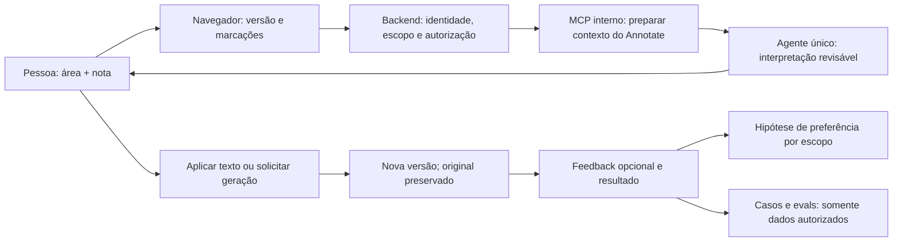

# Annotate no Compor — proposta para crítica (SCRUM-51)

**Estado:** proposta de 27/10/2026 em revisão. Matheus aprovou o uso de recorte e visão geral e pediu que o MCP prepare criativos em camadas desde o início, com seleção por área ou clique de camada; o contrato, o editor e as demais decisões ainda precisam de validação. A SCRUM-51 prevê Annotate na v0; os contratos e decisões abaixo são candidatos. Base: [arquitetura v0](../arquitetura-v0.md), [ADR MCP](../adr/0009-mcp-capacidades-compor.md), [moodboard](2026-10-27-moodboard-estruturado-proposta.md) e [SCRUM-51](https://compor-mathai.atlassian.net/browse/SCRUM-51). A proposta foi criticada por dois subagentes: designer/engenheiro de criativos e persona solo founder. São simulações, não entrevistas ou evidência de mercado. Nenhum teste com usuários, modelo ou gerador foi executado neste trabalho.

## Resultado desejado

Uma pessoa aponta algo em uma referência, imagem ou peça, descreve o que quer e recebe uma interpretação vinculada àquela versão e àquele alvo. Ela consegue corrigi-la e, quando apropriado, solicitar uma alteração. **Hipótese:** preservar alvo local e composição global reduz ambiguidades e retrabalho em comparação a um comentário sem marcação. Viralização, desempenho de campanha e melhor alinhamento não estão demonstrados.

## Experiência proposta

1. Partir de uma peça com elementos em camadas identificáveis e versionadas. Selecionar a imagem visível, clicar numa camada ou arrastar um retângulo, e escrever uma nota curta; adicionar mais marcações é opcional. O conjunto de alternativas efetivamente exibidas e a alternativa escolhida são preservados quando disponíveis, sem presumir que imagens não vistas foram avaliadas.
2. Ver um resumo do lote com miniatura, regiões, notas, versão e os dados destinados à IA. Se envolver envio à IA, informar custo possível e obter a autorização apropriada antes de enviar. Sem autorização, manter as marcações para edição/revisão no app, sem envio à IA. Não exigir classificação por tipo nem feedback para continuar.
3. O agente interpreta alvo, pedido e restrições usando contexto autorizado; retorna proposta revisável e aponta incertezas. Perguntar apenas se a ambiguidade afetar o alvo, um fato ou a ação; exemplo: “aumente o preço” pode ser tamanho da fonte ou valor.
4. A pessoa revisa e decide aplicar ou gerar. Uma alteração de camada de texto tem caminho próprio, sem precisar gerar imagem. Se for necessário gerar, mostrar custo possível e efeito conhecido. Se não houver edição regional comprovada, oferecer geração da imagem inteira como alternativa explícita, com aviso de que outras áreas podem mudar; preservar a versão original. Texto, preços e datas seguem editáveis e separados da imagem conforme v0.
5. Em falha, cancelamento ou divergência de versão, manter a peça e as marcações, indicar estado e permitir retomar ou reancorar. Não repetir geração paga automaticamente ao ocorrer timeout: resultado desconhecido exige reconciliação antes de tentar novamente.

**Tensão a validar:** o agente pode precisar de uma chamada paga para interpretar uma nota antes de saber se a geração é necessária. O primeiro consentimento precisa explicar o possível custo dessa análise; uma segunda decisão é necessária quando a geração integral, seu custo ou efeito não estavam claramente autorizados. Uma única confirmação por lote só é segura se o que ela autoriza, inclusive custo e possível alteração integral, for conhecido e apresentado antes.

## Fluxo de arquitetura candidato

O navegador representa seleção, marcações e prévia. O backend verifica identidade, organização, acesso ao ativo e versão, limites e consentimentos; resolve referências privadas e decide que dados a IA pode receber. O MCP é uma fronteira de ferramentas, não uma autorização; recebe apenas o contexto mínimo fornecido pelo backend. A BYOK fica no backend e não entra em argumentos, retorno da tool ou traces. Agente, ferramentas, memória e geração seguem distintos. Não há MCP Apps nem subagentes no produto v0.

## Contrato mínimo para experimentar

O spike testa duas tools puras: **`prepare_layered_creative`** para organizar elementos em camadas e **`prepare_annotation_context`** para preparar o contexto da crítica, paralelas a `prepare_moodboard`. Nome e schema são hipóteses para um spike, não API aprovada. A tool organiza e valida dados; não busca ativos, renderiza, edita, chama modelo, gera imagem, grava memória ou comprova autoria. O backend, não o modelo, vincula a ação autenticada e resolve permissões. O protótipo MCP agora prepara anotações e camadas sintéticas, mas não tem autorização, armazenamento, editor ou interpretação da crítica; só admite dados fictícios.

| Parte | Campos e interpretação |
|---|---|
| Alvo | ID opaco do ativo, versão imutável da peça/imagem, anotação e, se disponível, ID da camada. A origem real deve ser verificada pelo backend, não pela alegação do cliente. |
| Região | Retângulo `(x, y, largura, altura)` normalizado de 0 a 1, relativo à imagem já orientada; registrar dimensões/orientação e transformação entre viewport e imagem. Confirmar limites, zoom e corte. Camada sem geometria e imagem inteira são alvos distintos. |
| Pedido | Texto da pessoa; aspecto, reação e explicação são opcionais. Texto de usuário, imagem e OCR são dados não confiáveis, nunca instruções de sistema. |
| Contexto | Versão do moodboard/direção, objetivo, canal, restrições e camadas disponíveis apenas quando existirem e forem necessários. Retornar ausente como desconhecido; não inventar público, formato ou preferências. |
| Referência visual | Proposta: vista geral reduzida e recorte quando necessários, para preservar hierarquia sem perder alvo. IDs não são URLs públicas; backend autoriza e entrega os bytes apropriados ao adaptador. Não transmitir uma imagem inteira ou EXIF automaticamente sem justificar e informar o conteúdo enviado. |
| Resultado | Snapshot com lote, região, versão, referências e avisos; indicar origem não verificada e incertezas. A interpretação do agente é proposta, não fato ou preferência confirmada. |

Versão imutável é requisito de integridade: se a peça mudar entre marcação e aplicação, não aplicar coordenadas antigas à imagem nova; mostrar a versão anterior e pedir reancoragem ou nova seleção. Várias marcas são ordenadas e preservadas individualmente. Se conflitam, mostrar o conflito; não resolver silenciosamente por peso. Uma marca sobre áreas de várias camadas não determina sozinha qual camada será editada. O formato e a proteção do restante da imagem dependem das capacidades reais do gerador e de verificação posterior; inpainting e preservação de pixels não estão comprovados.

## Sinais e aprendizado

| Ação | Significado inicial | Uso permitido |
|---|---|---|
| “Troque a cor do botão” | Pedido local de alteração | Orienta essa tarefa; não é automaticamente uma preferência negativa. |
| “Não gostei” na peça | Rejeição da versão ou região, sem motivo determinado | Investigar opcionalmente; não inferir a tipografia, o resultado da tarefa ou uma falha geral. |
| “Não gosto desta fonte” | Evidência negativa contextual da característica indicada | Pode gerar hipótese reversível por escopo e evidência, sem sobrepor preferência confirmada; duas rejeições distintas do mesmo aspecto no mesmo escopo são hipótese inicial de recorrência, ainda não validada. |
| “Gostei desta composição” ou 👍 | Evidência positiva contextual / reação da versão indicada | Pode orientar a próxima proposta; não comprova correção, conclusão ou sucesso da campanha. |
| Confirmação explícita de resultado ou não conclusão observada | Sinal separado de desfecho, com motivo conhecido ou desconhecido | Apoia avaliação da tarefa; sem evidência, o resultado é desconhecido. |

A pessoa pode revisar, confirmar, corrigir ou remover preferências e não preferências. Evidência contrária pode justificar sugestão de revisão; a preferência confirmada não muda sem ação da pessoa. Hipóteses começam na tarefa/campanha; em 28/10/2026 Matheus confirmou que ampliar para produto exige confirmação da pessoa, sem promoção automática de escopo. Avaliar e melhorar o harness, prompts e tools não significa treinar o modelo. Evals e curadoria usam somente dados com permissão específica para melhoria, com origem, escopo, versões e evidências; dados de interações anteriores à revogação permanecem elegíveis à finalidade antes autorizada, e posteriores não entram. Conteúdo em MLflow depende de autorização específica, separada de armazenamento e uso da IA; metadados não implicam conteúdo autorizado. Não colocar segredos em traces.

## Decisões e trade-offs para Matheus

1. **Interação mínima:** área/camada + nota e lote opcional; uma revisão conjunta, com perguntas somente por ambiguidade material. A vantagem é velocidade; o risco é interpretar mal sinais sem confirmação.
2. **Contexto visual aprovado:** visão geral reduzida + região quando necessário e autorizado. A visão geral ajuda a entender hierarquia, mas aumenta dados enviados, custo e exposição em comparação ao recorte sozinho.
3. **MCP:** testar duas tools puras para preparar camadas e contexto; camadas de edição, geração, persistência e feedback ficam sob responsabilidades explícitas do backend e agente. É mais simples testar, mas funções separadas podem ser necessárias após evidência.
4. **Imagem:** tratar edição localizada como capacidade a verificar, não garantia; fallback integral depende de escolha explícita. Conserva confiança e evita prometer preservação que o modelo talvez não ofereça, mas pode aumentar custo e retrabalho.

## Spike e avaliação propostos

Antes de implementar o fluxo, registrar condições, orçamento, versões, exemplos e critérios. A SCRUM-51 requer três casos: (1) preço em camada editável; (2) crítica ao fundo com contexto de peça inteira; (3) lote com duas marcações, incluindo conflito ou alvos distintos. Acrescentar testes de versão desatualizada, coordenadas com zoom/crop, camada ambígua, autorização ausente e falha durante geração. Primeiro usar fixtures sintéticas e chamadas reais MCP para verificar schema, alvo, acesso e ausência de efeitos; uma chamada direta à função não prova protocolo. Não declarar edição de imagem funcional sem ensaio próprio do provedor.

Para benefício ao usuário, comparar tarefas equivalentes com comentário textual sem marcação versus Annotate, mantendo imagem, briefing e modelo comparáveis. Registrar acerto de alvo e de intenção por revisão humana, restrições respeitadas, retrabalho, tempo ativo, custo, conclusões confirmadas, não conclusões e desconhecidos. Uma nota ou reação não é avaliação da campanha. Determinar antecipadamente a régua e amostra; se insuficiente, resultado inconclusivo. O spike sintético dos três casos está registrado nos [resultados](../spikes/2026-10-27-scrum-51-camadas-resultados.md); a comparação de benefício com pessoas ou modelo não foi executada. Chamada paga exige orçamento e autorização prévios.

**Estado da tarefa:** Em andamento. O [plano prévio](../spikes/2026-10-27-scrum-51-camadas-plano.md) e os [resultados](../spikes/2026-10-27-scrum-51-camadas-resultados.md) registram o spike sintético. A conclusão da SCRUM-51 exige revisão de Matheus e spike pré-registrado com os três casos e resultados observados; esta proposta, isoladamente, não satisfaz esse aceite.
