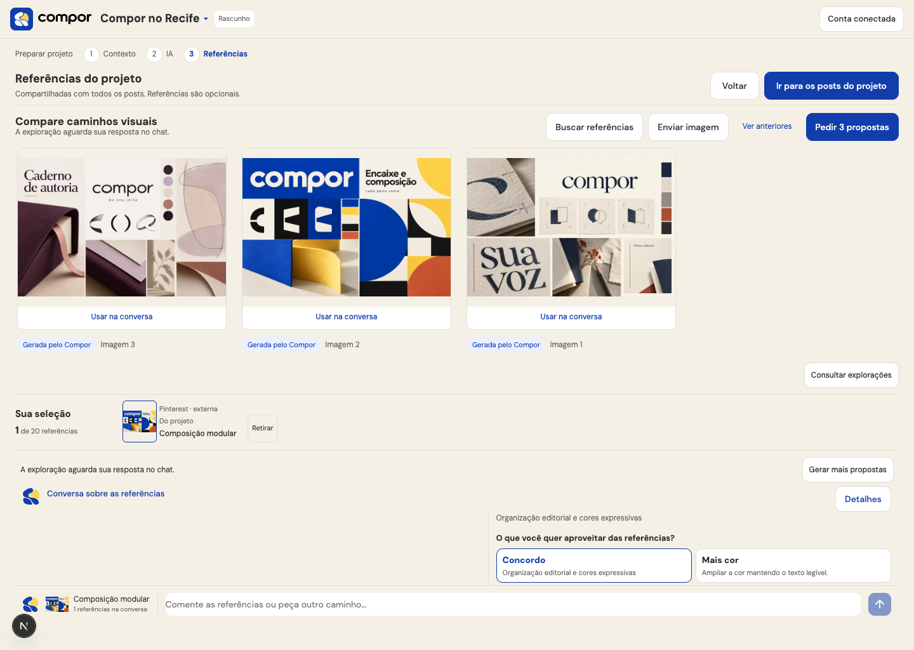
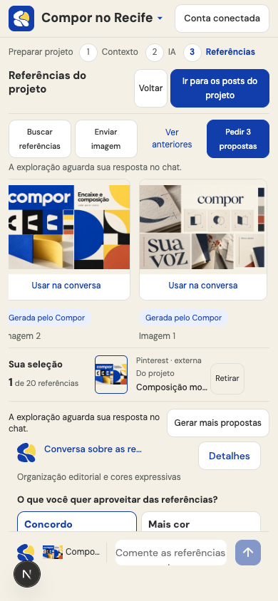
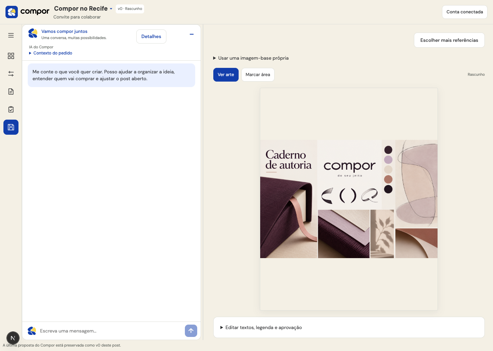

# Exemplo 3 e implementação

A estrutura aprovada mantém exploração horizontal em cima, seleção compacta ao centro e conversa embaixo. Capturas reais de 15/11/2026, com serviços e imagens de teste: não representam geração ou dados de uma conta real.

| Exemplo 3 escolhido | Aplicação em 1440 × 1024 |
| --- | --- |
|  |  |

As artes de teste diferem das artes ilustrativas do mockup. Os controles conservam o contrato atual: respostas rápidas de gosto; remoção centralizada; referências do projeto ou post; três propostas por pedido; consulta sem geração. A preparação inicial usa a saída para a lista de posts, pois o PR 52 exige nome e confirmação antes de registrar a peça. O retorno de um post existente continua sendo **Voltar ao post**.

| Celular 390 × 844 | Retorno às referências do post |
| --- | --- |
|  |  |

O histórico e as imagens têm rolagens próprias. No celular, a pergunta atual vem antes do histórico. A última proposta concluída só vira a imagem-base da v0 depois da confirmação humana do nome:

