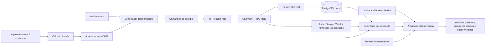

# Issue 51 — Arquitetura de execução e evidência por Goal

16/11/2026. Desenho aprovado em Q10 após as decisões Q1–Q9 do [ADR 0057](../adr/0057-verificacao-por-goals-em-tres-camadas.md). Este documento conserva a arquitetura alvo; o [guia do spike](../../scripts/verification/README.md) distingue os comandos implementados das capacidades ainda propostas. A autorização abrange implementação e testes locais, sem publicação nem ativação de gate obrigatório.

## Resultado pretendido

Um agente de desenvolvimento/QA recebe um Goal, descobre as ações disponíveis, conduz uma jornada do Compor em ambiente sintético, observa esperas e efeitos e entrega evidências que outro executor consegue reproduzir. Regressões conhecidas rodam sem modelo. A exploração usa o modelo do cliente existente, com orçamento e limites separados do sandbox.

O mesmo identificador de critério liga a prova offline, a interação no navegador e a integração real. O relatório diz qual perfil foi executado e quais propriedades continuam sem prova. Sucesso do perfil offline não significa sucesso dos demais perfis, satisfação humana ou qualidade criativa.

## Componentes e responsabilidades



| Parte | Responsabilidade e limite |
| --- | --- |
| Controlador compartilhado em `apps/web/lib` | Possuir transições, escopo, espera, retomada e tratamento de incerteza atualmente espalhados entre hooks/callbacks. A UI continua adaptando eventos e apresentando estado |
| Portas do controlador | Relógio/scheduler, IDs, persistência local, exclusão mútua, ciclo de vida e transporte. A implementação web preserva o comportamento existente; a implementação offline declara o que simula |
| `createStudioTools` e handlers reais | Manter schemas, revisão, recibos e autorização. Um comando do agente não substitui identidade ou consentimento |
| Driver sem DOM | Converter operações declaradas em ações do controlador; atravessar HTTP real nos efeitos duráveis. Não gravar diretamente no banco para cumprir critérios |
| Supervisor da verificação | Preparar recursos efêmeros, impor limites, controlar falhas sintéticas e produzir manifesto; não atuar como usuário por uma rota administrativa |
| Avaliadores | Consultar efeitos independentemente do valor retornado pelo executor. Comparar com critérios fixos e registrar lacunas |
| Adaptador de navegador | Executar os critérios de paridade/UX/A11y pela interface real; preserva o gate Chromium existente |

A primeira extração cobre apenas a fatia necessária aos pilotos. Não requer uma refatoração geral do estúdio, novo runtime de agentes, SDK de orquestração ou framework de testes. Scripts e fixtures do ambiente ficam propostos em `scripts/verification/`; código do produto permanece nas camadas atuais. O runner não entra no bundle cliente.

## Dois papéis de agentes; agregação em código

O **executor/explorador** opera uma execução isolada, propõe hipóteses e pode preparar uma revisão local do app. Os caminhos novos geram trajetórias e candidatos a regressão. O **revisor independente** recebe Goal, revisão da candidata e evidências, obtém a suíte fixada e reproduz a prova sem aceitar o relato do primeiro agente como resultado. A **CLI determinística** agrega critérios e cobertura; não precisa de um terceiro LLM nem de votação entre modelos.

Cada instância mutável tem um condutor. Divisão paralela ocorre entre cenários ou instâncias independentes, nunca entre agentes disputando a mesma sessão. O spike começa com uma candidata e um cenário por vez; o paralelismo do runner só aumenta depois de medir. Isso não impede pesquisa e revisão somente de leitura em paralelo.

## Contrato candidato `goal/v1`

O texto natural do objetivo acompanha um contrato validado em runtime. Uma proposta criada pelo agente não vira critério aprovado por existir no filesystem.

| Campo | Significado |
| --- | --- |
| `schemaVersion`, `id`, `revision`, `objective` | Identidade versionada do Goal e resultado desejado |
| `requiredProfiles`, `criteria` | Perfis exigidos para a afirmação pretendida; critérios com ID, observação esperada, avaliador e evidências necessárias |
| `preconditions`, `initialState` | Baseline, dados sintéticos, identidades, escopos e estado inicial |
| `authorizedIntents`, `allowedEffects`, `forbiddenEffects` | Decisões sintéticas que o cenário pode representar e efeitos delimitados; nenhuma autorização real é inferida |
| `obstacles`, `faults` | Falhas a injetar, momento em relação ao efeito e observação esperada |
| `clockPolicy`, `seed` | Relógios virtualizados, relógios reais, sequência determinística e origem dos IDs |
| `budgets` | Limites finitos de ações/requisições, tempo real, ciclos, candidatas e concorrência; uso/teto do cliente externo em campos distintos |
| `suiteRevision`, `fixtureDigests`, `migrationDigests` | Fontes imutáveis da avaliação e do ambiente |

O manifesto de uma execução acrescenta `runId`, `appRevision`, hash do snapshot exato, `goalDigest`, versões dos processos, perfil, limites resolvidos, timestamps reais e virtuais e resultados por critério. A árvore do app deve estar limpa ou ser capturada num snapshot imutável identificado por conteúdo; evidência de um snapshot local não é apresentada como evidência de um commit diferente.

Exemplo semântico do primeiro Goal: “a conta sintética A prepara um projeto, faz um pedido explícito para um post, salva e reabre uma versão preservando fatos, escopo, imagem e origem; a conta B não acessa seus dados; confirmação perdida não autoriza novo despacho”. Os três cenários abaixo refinam esse Goal, com critérios positivos e negativos.

## Comandos e AX

Interface alvo. O spike implementa `prepare`, `doctor`, `list-goals`, `run`, `open`, `inspect`, `act`, `close`, avaliação e replay de regressão via `node scripts/verification/cli.mjs`. `wait` por condição, cursor incremental e replay de trajetória exploratória continuam propostas:

```text
compor-verify doctor
compor-verify list-goals
compor-verify run <goal> --profile offline
compor-verify open <goal> --mode explore --budget <manifest>
compor-verify inspect <run-id> [--after <cursor>]
compor-verify act <run-id> --request <json>
compor-verify wait <run-id> --until <condition> --deadline <value>
compor-verify replay <run-id>
compor-verify evaluate <run-id>
compor-verify close <run-id>
```

Uma execução de regressão exige apenas `run`, depois da preparação de dependências. `doctor` informa ausências de forma verificável; `run` também faz esse preflight. Não há download ou instalação como fallback silencioso da execução offline. O explorador usa o mesmo contrato, escolhendo ações em vez de seguir uma sequência previamente gravada.

As respostas pequenas e estruturadas trazem: estado, revisão, ações admissíveis, resultado conhecido/incerto, motivo de espera, próximo instante elegível, condição humana pendente, possibilidade de interrupção, cursor de eventos e caminhos/hashes das evidências grandes. Mensagens destinadas a pessoas permanecem legíveis. Um erro distingue entrada inválida, contexto alterado, indisponibilidade e efeito incerto, e informa se repetir é permitido.

`requestId` e revisão esperada protegem reentregas. O mesmo ID com conteúdo diferente falha. `inspect` e `wait` não concedem permissão para gerar. Acesso de observação também tem limite/cursor para evitar polling ilimitado e consumo de contexto desnecessário. `wait` aguarda transição, com deadline e diagnóstico; não mantém um modelo ativo repetindo consultas.

## Ambiente offline e fidelidade

| Porta | Perfil integrado offline | O que não prova |
| --- | --- | --- |
| Controlador e handlers Next | Implementação real local | DOM, layout e startup da página real |
| PostgREST e PostgreSQL | Implementações reais locais; transações e conexões independentes | Infraestrutura gerenciada e configuração remota |
| Migrations Compor | Bytes exatos, em ordem e com hashes | Paridade da baseline externa por mera aplicação bem-sucedida |
| Schemas/roles Supabase | Baseline externa versionada e declarada | Auth/Storage gerenciados completos |
| Auth/OAuth | Tokens, sessão e respostas sintéticos aceitos apenas no ambiente de teste | Login Google, PKCE e sessão real de usuário |
| Vault | Contrato sintético da leitura restrita | Criptografia/infraestrutura real do Vault |
| Storage | Contrato HTTP sintético, metadados e arquivos efêmeros verificáveis | Serviço gerenciado completo; linha de metadado não basta para provar bytes |
| Agents/Images e fontes externas | Fixtures versionadas e falhas injetáveis, com contador de efeitos | Qualidade, disponibilidade, preço ou latência real do fornecedor |
| Persistência local do cliente | Adaptador explícito sem DOM que permite fechar e reabrir estado | IndexedDB real, quota, eventos entre abas e ciclo de vida do navegador |

PostgREST recebe os JWTs sintéticos e executa as operações no papel correspondente; o app não recebe credenciais administrativas para dados da pessoa. As credenciais do supervisor e do avaliador não viram capacidades do driver. O gateway HTTPS encaminha `/rest/v1` ao PostgREST e compõe as fixtures externas; não reimplementa RPCs, filtros ou autorização SQL. A CA de teste é específica da execução e não se desativa a verificação TLS.

O spike injeta o transporte pelo bootstrap Node exclusivo do harness (`provider-transport.mjs`): reconhece as URLs fixas dos contratos e encaminha ao gateway local. Nenhum import de produção ou configuração do navegador ativa esse transporte. Rotas e handlers permanecem reais. Destino não previsto falha antes do efeito; a contenção efetiva de rede é `--network none`, verificada no preflight. A fixture implementa sessões/turnos e geração de imagem; edição de imagem ainda não é uma jornada coberta.

A cadeia completa de migrations e a baseline externa serão conferidas antes de alegar cobertura. Uma extensão indispensável ausente deve falhar e declarar a lacuna; não se comenta SQL nem se substitui uma migration para obter sucesso. Inicializar fixtures como administrador é preparação, separada da jornada autenticada.

Proposta de isolamento: executar os processos do cenário numa fronteira local com egress negado no nível do sistema/contêiner, permitindo somente comunicação interna necessária. O agente externo fica fora dessa fronteira e pode usar seu cliente; “offline” se refere ao cenário, não ao funcionamento do modelo externo. `fetch` falso sozinho não bloqueia subprocessos, DNS ou outros clientes HTTP.

Não montar credenciais, diretório pessoal, socket Docker ou rede do host no cenário. Dependências são fixadas/preparadas separadamente; a execução recebe ambiente por lista permitida e somente fontes/artefatos necessários. O spike deve testar a negativa de rede efetivamente. A escolha operacional entre uma rede interna e um namespace com apenas loopback é detalhe a validar; se o isolamento não puder ser demonstrado, o perfil não é aprovado como offline.

No Mac, a implementação segue o procedimento vigente do proprietário para Colima, mantendo 2 CPUs/2 GiB e Kubernetes desligado, com registro de uso e responsabilidade de encerramento. Se o conjunto não couber, isso é resultado do spike; não se amplia recurso nem se troca por serviço pago automaticamente. No Linux/CI, a mesma fronteira deve ser verificada separadamente.

## Tempo, retomada e UX

O controlador publica estado de espera, razão e condição de saída para ambos os adaptadores. A UI informa o que está acontecendo e permite as ações já autorizadas; o agente lê os mesmos fatos, sem inferir que a ausência de resposta autoriza continuar. Teclado, foco, anúncios acessíveis e efeito visual serão exercitados no navegador, não presumidos pelo JSON.

| Relógio/limite | Tratamento |
| --- | --- |
| Estabilização da seleção: 5 s | Tempo virtual no teste, mesma regra do produto e demais condições de elegibilidade |
| Intervalo entre lotes: 15 s | Tempo virtual; testar limite, congelamento ao sair e restante ao voltar |
| Cadência de observação/polling | Scheduler explícito; limite de consultas; aguardar eventos quando possível |
| Deadline de operações | Contrato por porta; timeout preserva incerteza quando o efeito pode ter ocorrido |
| Validade de JWT, relógio SQL e vínculos assinados | Permanecem reais por padrão; só virtualizar com contrato explícito de cada componente e testes próprios |
| Watchdog do processo e orçamento total | Sempre tempo real, independente do relógio virtual |

Controles temporais verificam 4.999/5.000 ms e 14.999/15.000 ms sob as demais condições satisfeitas, troca de seleção durante debounce, saída da tela, troca de post, perguntas pendentes, cancelamento e limite de rodadas. Avançar o relógio não libera uma operação incerta.

Retomar não é repetir: consulta estado/recibos e decide a partir do que foi confirmado. Encerrar a tela impede novos despachos, mas não promete cancelar um efeito já enviado. O relatório distingue `interrupted`, `completed` e `unknown` sem transformar timeout em sucesso. Um reset de fixtures é uma execução nova, nunca continuação silenciosa da anterior.

## Três cenários piloto e controles negativos

| Cenário | Ações e prova principal | O que deve tornar a prova vermelha |
| --- | --- | --- |
| G01 — jornada e retomada | A cria projeto com preferência pela IA do Compor; abrir/recarregar não chama geração. Prepara o post, fornece nome e confirma a criação; depois envia um pedido explícito. Referências compartilhadas e locais mantêm alcance; versão salva é reaberta com fatos, origem e hashes preservados | Preparar/cancelar criando catálogo ou versão; omitir a persistência numa candidata de teste; arquivo ausente/hash diferente; fato pendente confirmado por inferência; geração antes da intenção; aplicação de resultado no post errado |
| G02 — isolamento e disputa | B tenta ler/alterar projeto e ativo de A. Dois pedidos reais disputam a mesma reserva por conexões independentes. Avaliador lê linhas, recibos e arquivos após a disputa | Acesso cruzado aceito; efeito adicional com ID conflitante; duas reservas/efeitos indevidos; metadados corretos apontando para bytes alheios |
| G03 — efeito com confirmação perdida | Dois pontos de falha: após persistência no Compor, recuperar prova disponível ao reabrir; após execução do provedor mas antes de receber/persistir seu resultado, preservar `unknown`. Nos dois casos, não há segundo despacho; avaliador consulta o registro por canal independente | Tratar como falha sem efeito; gerar novamente por timeout/reload/avanço de relógio; declarar sucesso usando conhecimento privilegiado do avaliador que o produto não tem |

Asserções de tempo, saída e retomada atravessam os cenários. Um 503 anterior ao efeito pode existir como caso auxiliar, mas não satisfaz G03. O caminho feliz também exige prova de ausência dos efeitos proibidos, não apenas uma resposta HTTP positiva.

Preparação e criação confirmada de post são ações diferentes: `compor_novo_post` atualmente abre a preparação e devolve `declined`; o driver deve representar a confirmação sintética pelo mesmo controlador, sem conceder uma capacidade maior à ferramenta do agente. Em G03, o critério de segurança pode estar `atendido` enquanto a tentativa do produto permanece `unknown`: provar que não houve repetição é diferente de recuperar uma imagem perdida. Nenhum oráculo privilegiado entrega silenciosamente o resultado ao produto.

Controles do próprio ambiente: dependência ausente, egress deliberado, CA inválida, serviço não permitido, fixture divergente, avaliador ausente, cenário pulado, evidência removida e relatório antigo devem impedir aprovação. As perturbações de controle rodam em cópias isoladas; não enfraquecem código ou gates da candidata entregue.

## Independência da avaliação

Cada resultado fixa `appRevision + snapshotDigest + suiteRevision + goalDigest + fixture/migration digests`. Critérios e avaliadores vêm de uma revisão confiável separada do checkout editável; o revisor os obtém novamente e verifica integridade. Uma nova revisão do app exige nova execução, conservando as evidências anteriores.

O autor pode acrescentar uma regressão candidata, mas não substitui os critérios usados para julgar a execução corrente. Promoção de um critério novo ou alteração de expectativa é uma revisão separada; nunca reescreve o veredito histórico. A validação precisa impedir que uma suíte alterada pelo próprio executor apareça como a baseline fixada.

Hashes e uma pasta fora do checkout detectam deriva; não são isolamento contra um processo que pode alterar ambos ou controlar o host. No spike, o supervisor controla as entradas de confiança e os processos do produto têm acesso restrito. O nível demonstrado será registrado sem alegar proteção contra um agente com shell irrestrito e controle total do mesmo host.

O avaliador combina HTTP, ledger de chamadas, leitura SQL por conexão independente, arquivos e estado reaberto. Logs escritos pelo app são evidência complementar, não único oráculo de seus efeitos. A fonte de cada evidência e seu grau de simulação aparecem no relatório.

Por critério: `atendido`, `violado` ou `inconclusivo`. Um perfil só passa se todos os critérios obrigatórios dele forem atendidos e seu manifesto estiver íntegro. Falha comprovada permanece violada mesmo se um orçamento esgotar depois; falta de prova fica inconclusiva. O Goal completo só é atendido quando todos os perfis exigidos para sua afirmação têm evidência, e isso não se confunde com o sucesso do comando offline.

## Economia e encerramento

Limites são finitos e resolvidos antes de iniciar: ações, requisições/observações, tempo real, ciclos exploratórios, revisões candidatas e concorrência. Um ciclo é uma hipótese, uma sequência limitada e sua reprodução. O primeiro experimento mede uma candidata por vez; números de ações e deadlines devem comportar a jornada publicada e são registrados como configuração do ensaio, não como orçamento de CI já calibrado.

O supervisor impõe limites às operações que controla. O cliente do agente controla sua própria execução e informa quais limites de modelo consegue impor. Sem suporte do cliente, a CLI pode negar novas ações, mas não pode prometer interromper raciocínio ou faturamento externo. Q9 admite essa limitação quando uso desconhecido é explícito e não foi exigido teto de tokens/dinheiro.

Esgotamento bloqueia novos efeitos e registra o motivo. Há apenas uma janela limitada, predefinida, de observação/reconciliação de operações em andamento; nunca um novo despacho para “terminar” o Goal. Os critérios pendentes ficam inconclusivos. Continuar requer novo orçamento/autorização com vínculo à execução anterior e preservação dos contadores acumulados.

O supervisor fecha somente processos, bancos, arquivos efêmeros e recursos da própria execução; conserva o pacote de evidências fora do diretório de teardown. Falha de limpeza aparece separadamente e impede declarar encerramento limpo. O relatório contém recibos de preparação/encerramento e não reutiliza a saída de uma execução anterior.

Medir separadamente: preparação de dependências, startup frio, execução quente, CPU, pico de memória, bytes de artefatos, ações/requisições, cobertura e custo conhecido/desconhecido do agente. No replay offline, chamadas reais ao fornecedor são proibidas. Baseline e candidata usam as mesmas condições, critérios e contagens; execução rápida que pulou trabalho é falha.

## Sequência de entrega e gate

1. Congelar o contrato candidato e os três cenários, inventariar baseline/migrations e preparar o ambiente isolado. Provar preflight, TLS, negativa de rede e limpeza antes de dirigir a jornada.
2. Extrair a menor parte do controlador necessária; ligar driver, ferramentas e HTTP reais. G01 deve falhar quando um controle negativo elimina a gravação.
3. Acrescentar G02/G03, relógio virtual e protocolo de observação/retomada; produzir manifesto, provas e relatório por critério.
4. Reproduzir com avaliador fixado e revisor independente; executar checks das áreas alteradas e contratos de paridade no navegador. Medir o custo e as limitações no Mac e, quando executado, no Linux/CI separadamente.
5. Propor frequência, orçamento e manutenção das fixtures com base nas medições. O novo perfil não remove nem reduz os gates existentes. A ativação como gate obrigatório é uma decisão posterior ao spike; alterações nas proteções externas também não são implícitas.

A issue 51 só pode ser concluída após o comando reproduzível, os três cenários, falhas controladas que reprovem o avaliador, métricas e matriz de cobertura estarem demonstrados. Este documento sozinho não a conclui. Implementação local não autoriza push, PR, merge, migrations remotas ou deploy.

## Revisão do desenho

Uma revisão independente de leitura identificou três lacunas corrigidas antes da confirmação: composição do transporte sintético para URLs fixas dos fornecedores; distinção entre preparar e confirmar um post; e separação entre recuperar resultado persistido e manter desconhecido um resultado que não chegou ao produto. Após Q10, a implementação ganhou revisão independente, testes e execução integrada; os resultados e limites pertencem ao registro do spike em `docs/quality`, sem reescrever o histórico da entrevista.
