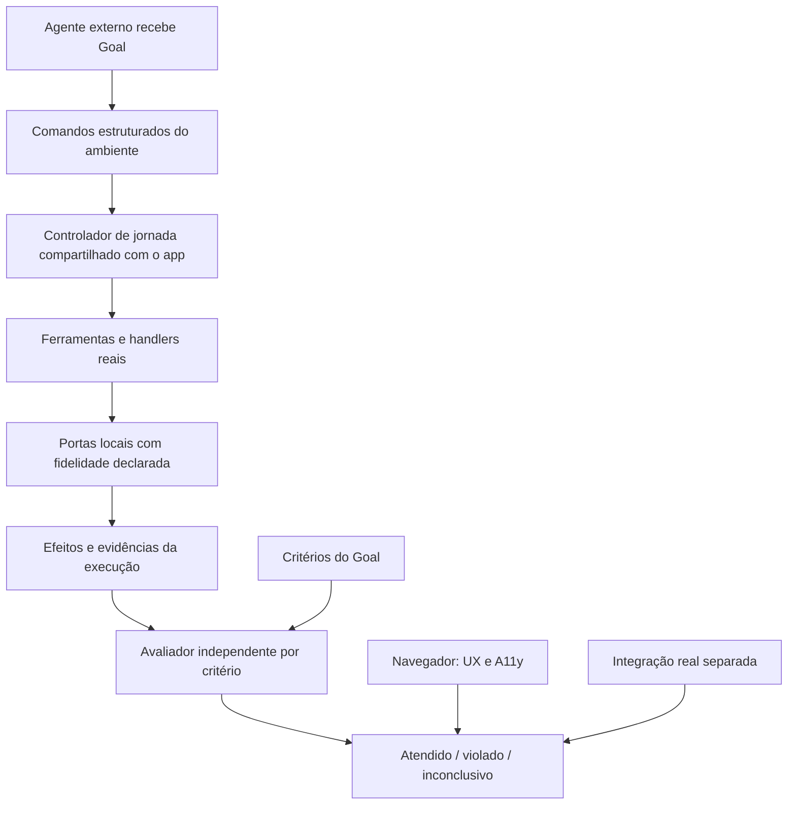

# Issue 51 — Descoberta da arquitetura de verificação por Goals

16/11/2026. Pesquisa e entrevista em andamento; não é resultado de um spike executado.

## Pedido e decisões

Matheus pediu resolver a [issue 51](https://github.com/MathBorgess/compor/issues/51), permitindo agentes com Goals percorrerem a experiência do Compor de maneira econômica e verificável, com gates determinísticos melhores, delays explícitos e melhorias de UX/AX. Pediu inspirações no pstack e no uso de múltiplos agentes por Lauren Tan (`poteto`).

Respostas explícitas registradas nesta entrevista:

| Pergunta | Decisão de Matheus |
| --- | --- |
| Q1 — destinatário | Agentes de desenvolvimento/QA; autonomia criativa dos agentes do produto é outro escopo |
| Q2 — vocabulário | AX de agentes; UX e A11y humanas explícitas |
| Q3 — prova de experiência | Três camadas ligadas ao mesmo Goal: offline, navegador e integração real separada; começar offline |
| Q4 — operação | Ambiente portátil para agentes existentes; comandos estruturados, sem novo serviço de orquestração |
| Q5 — tempo | Preservar 5 s/15 s, explicitar as condições e verificar com tempo virtual; valores serão reavaliados depois de medição e decisão UX |
| Q6 — fidelidade | PostgreSQL/PostgREST reais no cenário integrado offline; PGlite permanece nos testes rápidos; custo medido antes de gate obrigatório |
| Q7 — modos | Regressão determinística e exploração por agente; achados ganham reprodução determinística antes de virar gate |
| Q8 — critérios | Critérios/avaliadores fixados; alteração de critério ou enfraquecimento do avaliador requer revisão separada do dono |
| Q9 — orçamento | Limites explícitos de ações/tempo/ciclos; tokens/custo desconhecidos são admitidos e identificados; esgotamento exige nova autorização; teto financeiro/tokens solicitado exige cliente capaz de impô-lo |

O [ADR 0057](../adr/0057-verificacao-por-goals-em-tres-camadas.md) registra as decisões. Os termos resolvidos estão no [glossário](../../GLOSSARY.md). As propostas abaixo não são decisões implícitas.

## Base observada

- Checkout: `d2b97904623da015b1ae6ac71b26eceb9ebbcde8`, após PR 53; limpo antes desta documentação.
- Host observado: Darwin arm64, macOS 27.2.1; cliente Codex desktop. Identificador exato do modelo não exposto neste registro.
- Política instalada declarada: `mathai-agent-config` revisão `3b095b1e008e6bfd6af49351b12af544c3c295cc`; SHA-256 do `AGENTS.md` aplicado: `8c3b24688e08cb2478d35a12e914b29c51cc8c1fa4321be78f57e57e2e5c95e5`. Leitura de instruções não comprova obediência de outros clientes.
- Inspeção estática em paralelo por três agentes: fronteiras do Compor, pstack e referências complementares da Poteto. O levantamento não iniciou serviços, builds ou benchmarks; os checks documentais posteriores estão registrados abaixo.
- Contratos atuais: [arquitetura](../architecture.md), [ADRs](../adr/README.md), [gates](../quality/gates.md). O experimento [de 28/10](../evals/2026-10-28-harness/README.md) já distingue julgamento criativo, contratos, réplicas e limitações; não comprova a jornada web atual.

## Fronteiras atuais e evidências

| Fronteira | Evidência atual | Limite para a jornada proposta |
| --- | --- | --- |
| Comandos do estúdio | [`createStudioTools`](../../apps/web/lib/studio-tools.ts) é compartilhado pelo WebMCP e fallback do chat; valida argumentos, escopo, revisão e recibos | Handlers concretos fecham sobre React em [`studio-app.tsx`](../../apps/web/app/studio-app.tsx); expor uma nova API não extrai esse comportamento automaticamente |
| Estado e retomada | [`studio-state.ts`](../../apps/web/lib/studio-state.ts), [`studio-state-writer.ts`](../../apps/web/lib/studio-state-writer.ts) e [`studio-storage.ts`](../../apps/web/lib/studio-storage.ts) | IndexedDB, decodificação de imagem, storage e ciclo de vida do navegador precisam de adaptadores; simulação em memória não prova durabilidade real do IndexedDB |
| Exploração | [`use-exploration-loop.ts`](../../apps/web/app/use-exploration-loop.ts) e [`exploration-batch.ts`](../../apps/web/lib/exploration-batch.ts) | Loop ainda acoplado a hooks, locks, storage, IDs, relógio e eventos da página |
| HTTP Next | [`projects-next-http.test.mjs`](../../apps/web/test/projects-next-http.test.mjs) inicia Next real contra Supabase HTTPS simulado | Conta escritas e valida contratos; o fake não executa as mesmas políticas RLS da jornada |
| SQL/RLS | Testes PGlite de [catálogo](../../scripts/quality/post-catalog.test.mjs), [escopo](../../scripts/quality/post-reference-scope.test.mjs) e [exploração](../../scripts/quality/exploration-rejection-proof.test.mjs) aplicam migrations e provas reais | Baseline parcial, `auth.uid` e schemas sintéticos; não provam Auth/PostgREST/Storage nem toda a cadeia integrada |
| Turno gerenciado | [`studio-chat.mjs`](../../packages/agents-api/src/studio-chat.mjs) permite injetar fetch, relógio, identidade, stores e bindings | Testes com respostas simuladas não demonstram disponibilidade ou comportamento do fornecedor real |
| UX/A11y | Testes de [seleção](../../apps/web/test/reference-selection-browser.test.mjs) e [conversa](../../apps/web/test/brief-interview-browser.test.mjs) exercitam teclado, foco e geometria | Lighthouse de acessibilidade é diagnóstico da entrada sem sessão; não há prova de acessibilidade completa |

Não classificar RLS como ausente: há SQL e políticas efetivamente exercitados. A lacuna central é integrar as provas, declarar a fidelidade de cada porta e impedir que o resultado de uma camada seja promovido ao significado de outra.

## Inspirações verificadas

As referências são fontes de pesquisa, não instruções instaladas no Compor. Nenhuma pilha externa foi executada ou copiada.

| Fonte primária fixada | Mecanismo observado | Aplicação candidata ao Compor |
| --- | --- | --- |
| pstack [`create-verification-skill`](https://github.com/cursor/plugins/blob/bf0c7cd80abdbf7fe47b634978a7d1b4071f71a7/pstack/skills/create-verification-skill/SKILL.md) | Preparar, verificar instância, conduzir comportamento, capturar prova e limpar; mapa por funcionalidade | Contrato pequeno que um agente sem histórico consegue operar; evidência que sobrevive ao encerramento |
| pstack [`swarm`](https://github.com/cursor/plugins/blob/bf0c7cd80abdbf7fe47b634978a7d1b4071f71a7/pstack/skills/swarm/SKILL.md) | Predicado de conclusão, escopo próprio, revisão e método por worker | Dividir cenários independentes; agregador exige todas as evidências obrigatórias |
| pstack [`interrogate`](https://github.com/cursor/plugins/blob/bf0c7cd80abdbf7fe47b634978a7d1b4071f71a7/pstack/skills/interrogate/SKILL.md) | Achado precisa de reprodução, reexecutada pelo coordenador | Exploração adversarial gera casos de regressão, sem transformar opinião em falha comprovada |
| pstack [`orchestrate`](https://github.com/cursor/plugins/blob/bf0c7cd80abdbf7fe47b634978a7d1b4071f71a7/pstack/skills/poteto-mode/playbooks/orchestrate.md) | Validar a primeira unidade antes de ampliar; conferir artefato e revisão | Provar uma fatia inteira antes de paralelizar jornadas |
| Poteto [`verification-skill-example`](https://github.com/poteto/verification-skill-example/blob/d5abe70d0d8c671672b6cef4069363f26c488feb/README.md) | Exemplo Atlas fictício, drivers omitidos | Inspiração para organização do contrato, não dependência pronta ou benchmark |
| Atlas [`live-replies`](https://github.com/poteto/verification-skill-example/blob/d5abe70d0d8c671672b6cef4069363f26c488feb/.cursor/skills/verify-atlas/references/features/live-replies.md) | Aguardar estado estável e conferir cancelamento | Esperas condicionais com deadline e diagnóstico; não sleeps arbitrários |
| Atlas [`multi-surface-journeys`](https://github.com/poteto/verification-skill-example/blob/d5abe70d0d8c671672b6cef4069363f26c488feb/.cursor/skills/verify-atlas/references/features/multi-surface-journeys.md) | Persistência, troca entre conversas e provas além da superfície | Verificar retomada, isolamento de posts e confirmação perdida |

pstack consultado na revisão `bf0c7cd80abdbf7fe47b634978a7d1b4071f71a7`, de 15/11/2026, versão 0.15.42; [licença MIT de Lauren Tan](https://github.com/cursor/plugins/blob/bf0c7cd80abdbf7fe47b634978a7d1b4071f71a7/pstack/LICENSE). O [setup](https://github.com/cursor/plugins/blob/bf0c7cd80abdbf7fe47b634978a7d1b4071f71a7/pstack/skills/setup-pstack/SKILL.md) chama de budget um nível de esforço de raciocínio: isso não é um limite financeiro imposto. Nenhum ganho quantitativo de custo/produtividade foi demonstrado para o Compor.

## Arquitetura candidata

Recomendação técnica: extrair o controlador existente, mantendo os adaptadores web. Não construir um segundo produto que simplesmente simule o que a UI deveria fazer. O teste de paridade precisa detectar quando UI e caminho sem DOM deixam de conduzir as mesmas transições. Chamadas diretas a factories não substituem a verificação da composição real das rotas Next.

O relatório candidato associa Goal, revisão, hashes de fixtures/migrations, identidade sintética, seed, efeitos autorizados, relógio virtual, tempo real, evidências por critério e lacunas. A avaliação lê respostas HTTP, recibos, chamadas externas contadas, linhas/versões/ativos, bytes e estado após reabertura. Avaliador ausente, execução pulada ou prova ilegível não equivalem a sucesso.

Proposta econômica: código determinístico executa e avalia o que já tem critério exato; modelos investigam falhas, caminhos novos e aspectos qualitativos. Token/custo do agente externo e custo das operações simuladas são métricas diferentes. Zero chamadas ao fornecedor no sandbox não significa que o cliente que executa o agente não consumiu tokens. Uso indisponível deve aparecer como desconhecido.

## Catálogo inicial de tempo

| Valor no checkout | Tipo | Origem e significado |
| --- | --- | --- |
| 3 imagens / 15 s | Regra do produto | [`exploration-batch.ts`](../../apps/web/lib/exploration-batch.ts): lote sequencial; o intervalo restante congela ao sair e retoma ao voltar |
| 5 s | Estabilização do produto | [`studio-chat.tsx`](../../apps/web/app/studio-chat.tsx): leitura automática da seleção sob suas condições/lock |
| Até 1 s | Atualização da interface | [`use-exploration-loop.ts`](../../apps/web/app/use-exploration-loop.ts): contagem visível do intervalo |
| 2 s / contador 60 | Observação técnica | Polling de turno em `studio-chat.tsx`; o contador também passa pela sequência de ações, não é SLA simples de 120 s |
| 3 s / 1,5 s | Reconsulta técnica | Geração ocupada; `image_busy` só permite reconsulta quando o servidor confirmou que não houve despacho; `image_blocked` interrompe |
| 5 s | Deadline de infraestrutura | Stores/Supabase e leituras externas, conforme a porta |
| 10 s / 15 s | Deadline do fornecedor | Leitura/submissão de turno em [`studio-chat.mjs`](../../packages/agents-api/src/studio-chat.mjs) |
| 120 s | Deadline do fornecedor | [`images-api`](../../packages/images-api/src/index.mjs); timeout não autoriza repetir a operação |
| 280 s | Validade de vínculo | Sessão criada em `studio-chat.mjs` |
| 90 s / dois arquivos | Limite do teste | [`runner web`](../../apps/web/test/run.mjs); independente do tempo do produto |

Proposta: injetar relógio e scheduler; provar limites imediatamente antes/depois do prazo, cancelamento, troca de conta/post, saída da tela, retomada e resultado incerto. Deadline, cadência de observação e espera intencional têm propósitos distintos. A UI e o agente precisam observar o motivo da espera e o que pode encerrá-la. Os números de produção permanecem os aprovados.

## Fidelidade do banco — decisão Q6

PGlite já é dependência do repo e executa PostgreSQL em WASM. Sua [conexão exclusiva](https://pglite.dev/docs/) e o [socket por multiplexação](https://pglite.dev/docs/pglite-socket) limitam o significado de concorrência entre sessões. É útil para manter o retorno rápido atual.

PostgREST acrescenta comportamento próprio de [JWT/papel](https://docs.postgrest.org/en/stable/references/auth.html), [transação por requisição](https://docs.postgrest.org/en/stable/references/transactions.html), [erros HTTP](https://docs.postgrest.org/en/stable/references/errors.html) e [schema cache](https://docs.postgrest.org/en/stable/references/schema_cache.html). Criar um tradutor falso HTTP→SQL exigiria reproduzir essas regras.

Matheus aceitou em Q6 PostgreSQL + PostgREST locais no cenário integrado, preservando PGlite nos testes rápidos. O catálogo de posts usa `FOR UPDATE`; reservas usam `pg_advisory_xact_lock`. A confirmação perdida deve ocorrer depois do efeito e ser examinada por outra conexão. Essa fidelidade não torna Auth, Storage e Vault reais: a baseline externa, os bytes dos arquivos e a view sintética do Vault devem ser declarados separadamente.

O app exige Supabase HTTPS; o ambiente local precisará de TLS como a fixture HTTP atual. Versões fixadas, baseline, cadeia de migrations, isolamento de rede, consumo, inicialização e limpeza ainda precisam ser demonstrados. Dependências preparadas e execução offline são fases diferentes. Não há medição para prometer duração ou RAM, nem orçamento de gate definido.

## Árvore de decisões e próximos entregáveis

- Resolvido: Q1–Q9, conforme a tabela de decisões acima. Q6–Q8 estavam pendentes na primeira entrega desta nota; foram explicitamente aceitas na resposta seguinte. Q9 foi aceita depois da revisão documental.
- Fronteira: confirmar o entendimento do [desenho concreto](2026-11-16-issue-51-goals-arquitetura.md) antes do spike, conforme a skill invocada. Detalhes reversíveis serão resolvidos na implementação; limites de desempenho/frequência serão propostos após medir.
- Entrega da issue ainda pendente: esquema versionado, 2–3 cenários, spike de um comando, controles negativos que façam o gate falhar, métricas e proposta de manutenção/frequência do gate. Os cenários de sucesso, isolamento e resultado incerto vêm da issue; espera/cancelamento entram como critérios transversais.
- Não há mudança nos gates existentes, evidência de CI, implantação ou experiência real completa nesta descoberta.

## Verificação desta documentação

- `git diff --check`: aprovado.
- `npm run quality:lint`: aprovado.
- `npm run quality:test`: 25/25 aprovados, zero falhas/pulos; duração reportada 5.009,7 ms. São os testes existentes dos avaliadores e SQL/PGlite, não o novo cenário integrado nem um benchmark do Goal.
- Revisão independente somente de leitura confirmou as atribuições pstack e a separação entre Q1–Q5 decididas e Q6–Q8 pendentes. Identificou a necessidade de fechar limites do agente externo e comportamento ao esgotá-los; orçamento/frequência do gate dependem do spike medido.
- Registro cronológico: a revisão acima antecede as respostas Q6–Q9; as decisões posteriores estão incorporadas sem transformar a revisão anterior em validação do desenho novo.
- Navegador, build, produção, PostgreSQL/PostgREST integrados e fornecedores reais não foram executados nesta rodada.
