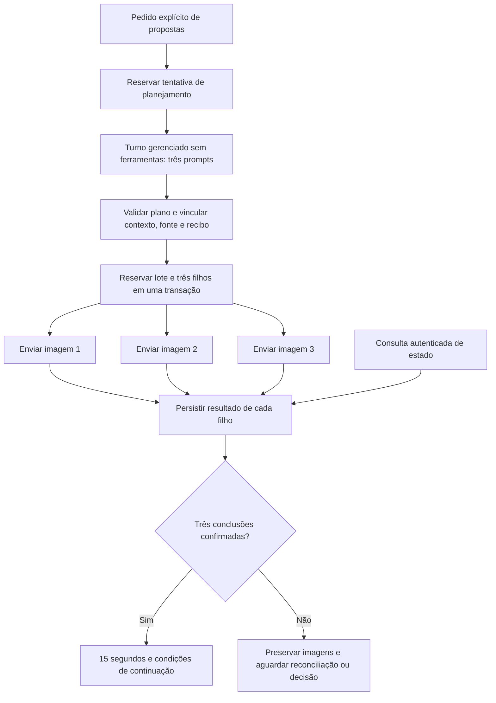

# Três propostas paralelas com planejamento do agente

**Proposta para revisão de Matheus; não implementada.** O pedido é planejar três caminhos visuais distintos com o agente e iniciar as três gerações do lote juntas. A recomendação é um planejamento separado, seguido de uma reserva atômica do lote e de três chamadas de imagem concorrentes coordenadas pelo servidor. Cada imagem conserva seu recibo, resultado e recuperação. O próximo lote só fica elegível após três conclusões confirmadas e os 15 segundos de intervalo, além das demais condições de autorização e interação.

Data: 17/11/2026. Fonte das decisões: conversa desta tarefa no Codex. Código inspecionado: `148d26a81851d5812d3f9b0f5187211321e02b9b`. Alterações locais não commitadas na worktree de integração não fazem parte desse snapshot. Este documento não autoriza implementação, chamada paga, migration remota, push ou deploy. A aprovação do desenho é a próxima etapa.

## 1. Decisões recebidas e pontos em aberto

| Item | Estado e consequência |
| --- | --- |
| Três imagens por lote iniciadas juntas | Decisão de Matheus em 17/11. Significa concorrência de até três envios, sem espera deliberada entre eles; não promete simultaneidade no fornecedor. |
| Cada prompt divergente gerado pelo agente | Decisão de Matheus. A heurística atual não atende esse requisito. Propõe-se um único turno do agente que produza três prompts completos, distintos e identificados. |
| Espera de 15 segundos após o lote inteiro | Decisão preservada. Proposta conservadora: o lote automático termina com sucesso quando suas três imagens estão confirmadas; falha parcial ou incerteza não libera outra rodada por tempo. |
| Intervalo de 20 segundos entre inícios | **Descartado por esclarecimento posterior de Matheus:** as três começam juntas; permanece apenas o intervalo após o lote. Nenhum limiar de 20 segundos foi implementado. |
| Contexto, fatos, seleção, consentimento e fonte de IA | Contratos existentes permanecem. Propor paralelismo não amplia consentimento, acesso a referências externas ou permissão para usar outra credencial. |
| Tratamento de um lote parcialmente recusado | Proposta abaixo: preservar os sucessos e aguardar decisão explícita; sem reposição ou novo lote automáticos. A experiência de reposição precisa de revisão. |
| Planejamento, persistência e implantação | Arquitetura proposta, sujeita à revisão. Nenhuma capacidade externa foi validada por este documento. |

A sessão informou uma geração observada em **15,2 segundos**, uma única amostra coletada em outra etapa. Não foi reproduzida nesta análise e não é média, percentil ou SLA. A troca da estratégia pode reduzir o tempo do lote em algumas condições, mas acrescenta planejamento e pode atrasar a primeira imagem.

## 2. Evidência da implementação atual

Os links apontam para fontes locais do snapshot, não para prova de produção.

| Área | Fato observado | Impacto no desenho |
| --- | --- | --- |
| Planejador | [exploration.js](../../packages/agile-deliberation/src/exploration.js), linhas 27–36 e 53–98, escolhe composição/contraste por `sequence` e concatena contexto. | Não há chamada ao agente para escrever esses prompts. Diversidade atual é uma heurística de catálogo. |
| Loop | [use-exploration-loop.ts](../../apps/web/app/use-exploration-loop.ts) aguarda cada POST, usa um Web Lock por conta e um único marcador `compor-exploration-pending:<userId>`. | Substituir `await` por `Promise.all` perderia recibos e violaria o modelo de recuperação. |
| Progresso | [exploration-batch.ts](../../apps/web/lib/exploration-batch.ts), `recordBatchCompletion`, exige sequência/posição crescente e cria o prazo após a terceira conclusão. | Respostas 3,1,2 exigem estrutura por membro e conclusão idempotente fora de ordem. |
| Reserva SQL | [migration 18](../../supabase/migrations/20261106000018_exploration_images.sql), linha 11, tem índice único para uma imagem `running/unknown` por conta. A [migration 23](../../supabase/migrations/20261106000023_exploration_review_gate.sql), linhas 43–54, bloqueia qualquer nova reserva enquanto existir outra em execução. | O banco impede o paralelismo hoje. Remover o índice isoladamente enfraqueceria as garantias existentes. |
| Prioridade de edição | [migration 18](../../supabase/migrations/20261106000018_exploration_images.sql), `reserve_image_tool_execution`, verifica exploração ativa/incerta e `foreground_image_waits`. | A exceção deve admitir somente os três filhos do mesmo lote, preservando exclusão com edição da peça e prioridade de trabalho foreground. |
| Provas por imagem | [migration 25](../../supabase/migrations/20261106000025_exploration_rejection_proof.sql) e [handler](../../apps/web/lib/exploration-image-route.ts) usam capacidade efêmera no servidor, com compromisso no banco. Só reserva nova despacha; concluir exige prova e objeto salvo. | Cada filho precisa de prova independente. Recusa de um não prova o resultado dos outros. |
| Duas rodadas | A finalização na [migration 25](../../supabase/migrations/20261106000025_exploration_rejection_proof.sql), linhas 89–100, incrementa o gate a cada terceira conclusão, pela ordem de chegada. | Deve contar um lote real completo uma única vez, e não agrupar arbitrariamente três callbacks. |
| Transporte de imagem | [runtime](../../apps/web/lib/exploration-image-runtime.ts) chama [images-api](../../packages/images-api/src/index.mjs) diretamente; uma imagem por chamada, timeout de 120s. A [rota](../../apps/web/app/api/studio/explorations/route.ts) configura `maxDuration=300`. | Os tempos são limites configurados, não estimativas. Um lote concorrente aumenta memória e pressão no fornecedor. |
| Uso/custo | `decodeExplorationImage` devolve bytes e não propaga o uso retornado pelo adaptador. | A tela atual não oferece medição completa de custo por exploração; não somar dados ausentes como zero. |
| Agente existente | [studio-chat.mjs](../../packages/agents-api/src/studio-chat.mjs) já reserva tentativas, usa sessões gerenciadas, valida leitura estruturada e oferece turnos sem ferramentas. [agent-model.mjs](../../packages/agents-api/src/agent-model.mjs) fixa o modelo ao abrir a sessão. | Reaproveitar padrões de contrato e recuperação; não usar Agents SDK nem fingir que o evento `reference_selection` já representa planejamento. |
| Credencial | [withWebOpenAiCredential](../../apps/web/lib/web-openai-credential.ts), [prepareOpenAiRequest](../../apps/web/lib/openai-credential.ts) e [ADR 0038](../adr/0038-chave-padrao-openai-no-vault.md). | Resolver identidade/propriedade antes do Vault; BYOK não tem fallback. Vincular plano e execução à mesma fonte/credencial. |
| Exclusão | [projeto](../../supabase/migrations/20261115000030_project_deletion.sql) e [post](../../supabase/migrations/20261115000031_project_posts.sql) são removidos logicamente. A UI bloqueia certas ações durante geração, mas as RPCs não verificam lote ativo. `ownsSupabaseProject` verifica titularidade, sem filtrar `deleted_at`. | É necessário contrato explícito para corrida com outra aba/dispositivo: impedir novos despachos no escopo excluído e preservar finalizações/recibos já iniciados. |
| Retorno à v0 | [exploration-draft.ts](../../apps/web/lib/exploration-draft.ts) mantém a candidata com maior ordinal confirmado e protege a origem da conversa. | Ordem de chegada não deve decidir a candidata nem trocar o post de destino. |
| MCP | [remote-mcp](../../packages/remote-mcp/src/index.js) expõe geração individual, BYOK efêmera e retomada explícita. | Não recebe automaticamente autorização ou contrato para gerar três. Ainda precisa respeitar o gate global enquanto houver lote web ativo. |

O [mapa de arquitetura](../architecture.md) continua sendo a descrição do produto implementado. Este desenho ainda não o substitui.

## 3. Alternativas e recomendação

| Alternativa | Vantagem | Limite/riscos | Posição proposta |
| --- | --- | --- | --- |
| Três POSTs atuais disparados pela UI | Pouca mudança aparente | Índice/reservas recusam paralelismo; marcador único, ordenação e recuperação quebram | Rejeitar |
| Três POSTs novos, com manifesto e autorização de lote | Cada requisição possui seu ciclo; chave continua efêmera | Reservar três e despachar parcialmente pelo navegador cria estados de slots não enviados e maior dependência da aba | Alternativa válida, mas mais complexa para este recorte |
| **Um comando de lote no servidor, três chamadas de imagem concorrentes** | Reserva única atômica, mesma credencial em memória e estado individual durável; retorno progressivo por leitura | Processo concentra três respostas e pode morrer; exige reconciliação por filho e ensaio do ambiente serverless | **Recomendação para revisão** |
| Fila/workers duráveis | Execução desacoplada da aba e melhor controle de longa duração | Exigiria mecanismo para usar BYOK fora da requisição, contrariando seu armazenamento apenas em memória; acrescenta serviço, custo e operação | Fora do primeiro recorte |
| Uma chamada de imagem com `n=3` | Menos requisições | Um único prompt não satisfaz três prompts distintos, e muda o contrato de efeitos/recibos | Não usar como substituto |

O coordenador proposto **aguarda** as três tarefas (`allSettled` ou equivalente) e finaliza cada uma independentemente. Não retorna `202` e deixa promises soltas como suposto trabalho durável. O navegador pode consultar o estado persistido enquanto o comando está aberto. Se o host encerrar o processo, os registros pendentes permanecem bloqueantes; não se inventa um worker que continuará executando.

## 4. Planejamento realmente feito pelo agente

Propõe-se um tipo de operação próprio, `exploration_plan`, em `packages/agents-api`, com schema, declarações e testes próprios. Um turno gerenciado, sem ferramentas, produz exatamente três entradas: `position`, `creativePrompt`, `composition`, `contrast` e `differenceFromOthers`. O servidor escolhe IDs, quantidade, modelo/configuração permitida e escopo; o modelo não concede autorização, não define concorrência e não executa imagens.

Entrada: snapshot da ideia, público resolvido, fatos declarados, critérios e sinais permitidos da conversa. Preservar distinção entre fatos confirmados, hipóteses e sugestões. Sinais externos só entram conforme consentimento e escolha já existentes; o plano inicial continua textual. **Esta proposta não passa a enviar bytes das referências selecionadas.** Incorporar esses bytes seria uma mudança separada com vínculos e validação próprios.

Validação de saída: objeto estrito versionado, exatamente três posições únicas, limites de tamanho compatíveis com o envelope e prompt final, texto válido, ausência de credencial, nenhuma tool call e nenhum campo de autoridade. Duplicatas exatas/normalizadas e diferenças vazias são recusadas. O prompt final é o texto criativo produzido pelo agente mais um envelope determinístico que preserva os fatos e as instruções obrigatórias; o catálogo heurístico não substitui silenciosamente um plano inválido.

Diferença textual não prova diversidade visual nem fidelidade factual dos pixels. `differenceFromOthers` permite revisão e avaliação semântica; não constitui um certificado. Deve haver conjunto fixo de casos de gosto/fatos e avaliação humana das imagens quando um teste real for autorizado. Uma regra automática consegue verificar estrutura e duplicação, mas não garantir originalidade ou adequação estética.

Plano inválido, falha do turno ou resultado incerto interrompem a etapa sem gerar imagens e **sem reparo pago automático**. Consultar a mesma tentativa é leitura/recuperação; refazer o planejamento é uma ação paga nova e precisa de pedido explícito. Uma nova sessão paga não substitui uma tentativa cujo resultado se perdeu.

Separar o planejamento da conversa normal evita reutilizar uma sessão com ferramentas ou um resultado de outro post. Identidade, `projectId`, `conversationId`, `batchId`, `planRequestId`, hash do snapshot e versão do contrato fazem parte do vínculo. Uma mudança de contexto ou credencial antes do envio invalida a prontidão do plano e pausa; não dispara replanejamento automaticamente.

## 5. Contratos propostos e persistência

Os nomes seguintes são candidatos de implementação, não endpoints existentes:

| Operação | Efeito permitido | Resposta e recuperação |
| --- | --- | --- |
| `POST /api/studio/exploration-batches/plan` | Reservar uma tentativa e abrir um turno de planejamento | `planning`, plano validado, falha confirmada ou resultado incerto; IDs e vínculo da tentativa. Reentrega do mesmo ID consulta o existente. |
| Consulta da tentativa de planejamento | Ler estado/resultado da mesma sessão comprovada | Sem criar turno, enviar eventos ou gerar imagem. Credencial original pode continuar necessária conforme contrato de provas. |
| `POST /api/studio/exploration-batches/execute` | Consumir uma autorização de execução de um plano e iniciar até três chamadas já delimitadas | Manifesto e estados individuais. Mesmo ID/conteúdo nunca abre outro lote; conteúdo diferente conflita. |
| `GET /api/studio/exploration-batches/:id` | Ler lote e filhos da conta/projeto | IDs estáveis, posição, ordinal, estado, horários e revisão; sem credencial do fornecedor e sem conteúdo sensível nos metadados operacionais. |
| Pausar continuação | Impedir próximo lote e novos despachos ainda não iniciados | Não equivale a cancelar trabalho enviado nem libera recibos incertos. |

Antes de qualquer planejamento pago, verificar autorização, conflito de público, pergunta pendente e gates aplicáveis. Revalidar antes de reservar as imagens, pois o planejamento pode demorar. A intenção de geração é específica do projeto/sessão e do lote; consulta, recarga, disponibilidade do Vault e plano produzido não a substituem.

**Dados operacionais propostos:** registro de lote com proprietário, projeto, conversa de origem, versão, IDs, digests do plano/contexto, origem da credencial vinculada sem segredo/fingerprint exposto, estado agregado, revisão, horários e epoch de revisão. Filhos com `imageRequestId`, posição 1–3, ordinal imutável, digest do prompt, estado e referência ao lote. Manter tentativas anteriores e supersessões; não reescrever uma tentativa desconhecida para parecer nova.

**Conteúdo criativo:** recomendar inicialmente o plano completo e o contexto no journal local da pessoa, com manifesto/digests e os planos resumidos já suportados no servidor. O comando de execução recebe o plano e verifica o vínculo assinado do resultado validado. A recuperação pode reler o turno gerenciado com a prova/credencial original, quando disponível. Perder o plano local e a capacidade de recuperar o turno deixa a operação inconclusiva; não autoriza replanejar sozinho. Guardar prompts completos no Supabase facilitaria retomada em outro dispositivo, mas mudaria a persistência atual de contexto criativo local: precisa de decisão explícita no review, incluindo retenção e isolamento. Prompts não são telemetria.

O journal local passa de um marcador por imagem a um manifesto de lote com três filhos. Deve ser escrito antes do comando de execução e atualizado sem perder resultados fora de ordem. Migração de marcador antigo preserva o ID e o bloqueio existentes; não o transforma em três novos pedidos. A leitura de um lote por ID evita depender da primeira página das últimas cem imagens para recuperar uma tentativa antiga.

## 6. Reserva, exclusão mútua e provas

Proposta de invariantes no banco:

1. No máximo um grupo ativo de efeitos de imagem por conta: uma edição foreground ou um lote exploratório. O lote permite somente seus três membros previamente vinculados; não permite três chamadas arbitrárias, outro projeto ou outro lote.
2. Um advisory lock transacional por conta continua serializando decisões de reserva e finalização. Não fica aberto durante HTTP. Verificações de projeto/post ativo, prioridade foreground, desconhecidos, gate e epoch ocorrem sob a mesma decisão atômica.
3. Uma RPC reserva o manifesto e os três slots de forma indivisível, com posições/IDs/digests únicos. Ou confirma todos, ou não concede despacho. Resposta perdida da reserva não concede licença para tentar outro lote.
4. Capacidade efêmera por filho, criada no servidor, compromisso no banco. O cliente não recebe segredo de conclusão. Reentrega ou recuperação não reemite capacidade para reserva já existente. A posse de um objeto no Storage, um booleano do navegador ou uma afirmação do modelo não provam conclusão.
5. Marcar a possibilidade de despacho antes da chamada externa. Uma queda entre commit e envio pode deixar falso positivo de incerteza; é preferível a duplicar efeito pago. Não existe transação atômica envolvendo Postgres e fornecedor, nem promessa de cobrança exatamente uma vez.
6. `completed` exige a prova daquele filho e seus bytes confirmados. `rejected` exige recusa definitiva reconhecida pelo adaptador e persistência confirmada. Timeout, erro de rede, 429 genérico, resposta inválida ou falha de gravação ficam incertos conforme o contrato atual; não inferir ausência de cobrança.

Uma implementação não pode apenas remover `exploration_one_unresolved_per_owner`. A nova exclusividade de lote deve estar instalada e testada junto das RPCs, dos fluxos foreground e das entradas legadas/MCP. Todas as entradas que hoje geram ou reservam precisam observar o mesmo grupo ativo e bloquear `unknown`.

O contrato atual de capacidades protege despachos do servidor, mas não torna dados escritos pelo próprio titular uma trilha de auditoria inviolável. Não apresentar a mudança como sistema de cobrança resistente ao titular da conta sem projetar essa autoridade separadamente.

## 7. Estados individuais e significado de lote terminado

| Condição do lote | Exibição e consequência proposta |
| --- | --- |
| Planejamento em andamento | “Planejando três caminhos”; nenhuma imagem iniciada. Perda de resposta mantém o recibo do planejamento. |
| Três chamadas despachadas | Três posições visíveis, cada qual com estado e tempo de espera. “Iniciadas juntas” significa sem intervalo intencional; o fornecedor pode enfileirar. |
| Uma ou duas concluídas, outras pendentes | Mostrar imediatamente as concluídas, sem reorganizar posições. Não iniciar contagem para outro lote. |
| Três `completed` confirmadas | Lote completo. Registrar `completedAt` como a última conclusão confirmada, uma única vez. A espera de 15s passa a ser elegível, condicionada aos gates. |
| `completed` + recusa definitiva ou slot comprovadamente não despachado | Lote parcial com resultados preservados. Sem próximo lote automático; informar a falha e aguardar ação explícita. Não preencher slots faltantes automaticamente. |
| Qualquer `unknown` ou despacho sem desfecho comprovado | Bloquear novos efeitos de imagem, mesmo se os outros dois tiverem acabado. Continuar observando/reconciliando cada filho já enviado. Nenhum cronômetro resolve isso. |
| Falha do navegador ou coordenador | Ler manifesto e recibos por IDs. `running` antigo significa registro ainda não resolvido; não é prova de atividade remota atual nem licença para repetir. |

“Todas as promises terminaram” não basta. `allSettled` é controle do processo; sucesso do lote exige três recibos duráveis de conclusão. Uma rejeição do transporte pode corresponder a uma imagem paga; o estado agregado não esconde esse filho.

Recusa de uma credencial em um filho não presume recusa dos outros dois, que já podem ter sido aceitos. Conservar respostas tardias e processar cada prova. Para um slot definitivamente recusado, uma eventual reposição deve usar novo ID, vínculo explícito à tentativa anterior e ação humana própria; o comportamento exato está nas decisões para revisão abaixo. Para `unknown`, nem nova credencial nem nova autorização removem a necessidade de resolver o efeito anterior.

O intervalo de 15 segundos deriva de uma conclusão confirmada do lote inteiro. Persistir o prazo/saldo e manter a semântica atual de congelar durante pausa/saída. Se a terceira conclusão ocorrer fora da tela, começar a espera visível na retomada, sem gerar nada em segundo plano por causa de um timer. A leitura do servidor também deve impedir outro dispositivo ou cliente novo de ultrapassar o prazo. Sua expiração torna o lote seguinte apenas **elegível**, nunca autorizado por si só.

## 8. Duas rodadas, interação e ciclo da tela

Substituir a contagem por ordem de callbacks por fechamento de `batchId` real, idempotente. Um lote só contribui uma vez quando seus três filhos estão concluídos. Seleção/comentário de qualquer membro atualiza o mesmo epoch e lote, sob serialização com a conclusão. Uma interação anterior ao limite reinicia a janela conforme a regra existente; depois da pausa, selecionar por si só não retoma. Lote parcial fica parado, portanto não cria caminho automático para contornar o limite.

Depois de duas rodadas completas sem seleção/comentário, preservar a pergunta e aguardar pedido explícito. A pergunta da leitura de referências continua uma condição separada: cinco segundos para estabilização da seleção, nenhuma geração de novo lote até resposta/seleção/comentário/pedido permitido pelo ADR 0029. Não deixar um plano terminado contornar uma pergunta que surgiu enquanto ele rodava.

Pausar, sair de referências, encerrar sessão ou trocar fonte impede planejamento/execução ainda não despachados e os lotes seguintes. Com as três imagens já enviadas, pode haver três efeitos em conclusão; selecionar a primeira não economiza automaticamente as outras duas. A UI precisa explicar essa consequência antes do pedido, sem adicionar confirmação por imagem. Interromper HTTP não é prova de cancelamento no fornecedor.

O Web Lock continua coordenando abas da mesma conta. A autoridade de exclusividade permanece no servidor para outros dispositivos, clientes antigos, MCP e edições foreground. Mudança de fonte pausa; plano/provas da anterior não migram para a nova. BYOK permanece em memória, e a padrão é resolvida no servidor depois de origem/identidade/propriedade. Não persistir chave para recuperar um worker e não usar service role para acesso geral aos dados.

Proposta para exclusão: serializar exclusão de projeto/post com a admissão do lote e recusar nova geração em escopo removido. Enquanto existir lote ativo/incerto, a opção conservadora é a RPC devolver pendência e manter a exclusão lógica para depois da resolução, em vez de confiar só no botão desabilitado. Resultados já iniciados precisam continuar finalizáveis mesmo diante de uma exclusão legada concorrente; não apagar recibos nem remontar a v0 em outro post. Isso é mudança revisável de contrato, não regra já implementada.

Para a v0, manter a candidata confirmada de maior ordinal/posição estável, não “a última resposta que chegou”. Uma seleção explícita tem prioridade conforme o contrato da edição; nenhuma chegada tardia sobrescreve criação, versão ou conversa. A galeria mostra progresso e sucessos parciais, mas conserva IDs e numeração definidos na reserva.

## 9. Carregamento, observação e latência

O painel atual já oferece posição, tempo decorrido, aviso após um minuto e distinção de resultado incerto. No lote paralelo, migrar para estado por cartão e um resumo: “1 de 3 imagens confirmadas”. Mostrar a primeira conclusão quando seu recibo estiver confirmado, sem aguardar o corpo final do POST do lote.

Recomendação inicial: consultas autenticadas e limitadas ao lote enquanto a tela observa o comando; o GET não chama o fornecedor e não inicia trabalho. Usar revisões/cursor para evitar atualizar a UI com estado antigo; limitar a cadência e reduzir consultas quando a tela não estiver observando. A cadência de leitura será parâmetro de implementação e teste, não prazo de geração. SSE é alternativa posterior, com a mesma reconciliação por GET; reconectar a observação nunca repete o POST.

Um eventual heartbeat do coordenador prova somente que ele conseguiu registrar atividade naquele instante. Não prova que o fornecedor está processando, progresso percentual, conclusão futura ou ausência de custo. Separar `updatedAt` do estado persistido, horário da última consulta bem-sucedida e duração local do pedido. Se o executor parar de atualizar, mostrar “sem confirmação recente”; não liberar o lote por expiração de heartbeat.

Relação qualitativa: no modelo sequencial, tempo do lote inclui a soma das três gerações e seus trabalhos locais; no concorrente, tende a depender do planejamento mais a geração mais lenta e os trabalhos de coordenação. O ganho pode desaparecer com fila/rate limit, prompts maiores, armazenamento, contenção de CPU/memória ou maior duração de cada imagem. A primeira imagem pode ficar mais lenta por aguardar o planejamento. Medir separadamente tempo até primeira imagem confirmada, até terceira, até primeira imagem exibida, planejamento, armazenamento, taxa de incerteza e percepção humana. O limite de 120s do fornecedor e `maxDuration=300` não são promessa de duração nem prova de que a hospedagem sustentará três chamadas.

## 10. Custo, observabilidade e limites

A proposta acrescenta **um turno de planejamento** por lote e permite **até três chamadas de imagem concorrentes**. Isso descreve operações lógicas, não quatro cobranças fixas. Mesmo sem aumentar a quantidade nominal de imagens do lote, aumenta a exposição simultânea e reduz a oportunidade de parar após a primeira. Prompts novos podem mudar consumo. Não prometer mesmo custo, gratuidade ou um teto financeiro que não existe.

Limites propostos: um lote ativo por conta, três slots identificados, nenhum quarto filho, um plano validado por execução, nenhum loop de reparo pago, nenhum fallback de credencial e nenhum retry de imagem incerta. O servidor verifica esses limites; declarações do modelo não contam como autorização. Limites financeiros adicionais dependem de decisão do dono e de dados confiáveis; o gate de duas rodadas não é orçamento.

Registrar apenas metadados permitidos: IDs de correlação, versões, modelo/configuração efetivos, estados/fases, tempos e uso normalizado quando disponível. Conteúdo, imagens e chaves ficam fora dos logs. Uso desconhecido permanece desconhecido por filho; somar somente valores conhecidos não produz total completo. Uma estimativa futura deve discriminar planejamento e imagens, tabela/versionamento e lacunas; recibo e fatura continuam evidências diferentes. A implementação precisa propagar o uso hoje descartado no runtime antes de afirmar cobertura de medição.

## 11. Migrações, compatibilidade e rollout propostos

Não alterar migrations aplicadas. Criar evolução aditiva para lote, filhos, estados e fechamento idempotente; substituir a exclusividade antiga apenas na implantação coordenada das novas RPCs. Preservar linhas sem `batch_id`, ordinais, sinais, epochs, planos históricos e provas. Nenhuma migration libera `running/unknown`, inventa conclusão ou reemite segredo para pedido antigo.

As entradas legadas devem continuar com capacidade individual e respeitar lote ativo. Enquanto o lote paralelo existir, chamadas de edição, exploração individual e MCP retornam bloqueio/ocupação conforme o estado. Não permitir que o MCP obtenha um slot paralelo apenas escolhendo um `batchId`; o manifesto e a admissão são autoridade do servidor. Expor lotes paralelos como ferramenta MCP é expansão separada do contrato externo, fora desta primeira entrega.

Sequência candidata: migration compatível e testes de transação → backend novo desativado → UI capaz de ler ambos os formatos → ativação explícita. A flag deve ser específica do recurso; ausência de configuração ou incompatibilidade retorna indisponibilidade antes de efeito pago, sem fallback silencioso ao planejador heurístico. Drenar ou conservar como pendentes as operações antigas antes de alterar o mecanismo de exclusão. Versões antigas não podem voltar a reservar ignorando os novos grupos.

Rollback começa desativando **novas admissões**, mantendo leitura e finalização das operações já iniciadas. Não recolocar o índice de uma imagem pendente por conta enquanto houver três filhos pendentes, nem apagar a tabela de lotes para voltar à UI anterior. Guardar backup e procedimento de recuperação testados no ambiente isolado. Restrições e locks precisam ter uma ordem uniforme entre lote, filhos, gate, foreground e exclusão para evitar deadlocks.

Após aprovação do desenho, registrar ADR que substitua somente a execução sequencial e o planejador heurístico, preservando o restante dos ADRs 0021/0024/0025/0029/0038/0044. Atualizar arquitetura/contratos/testes juntos. Migrations remotas, push, PR, merge e deploy exigem sua autorização própria. A integração Git da Vercel e o check `Apply migrations or initialize baseline` permanecem conforme ADR 0043; alteração local não prova gate, migration ou deployment.

## 12. Plano incremental e critérios de aceitação

| Etapa, após aprovação | Entrega revisável | Evidência necessária antes de avançar |
| --- | --- | --- |
| 1. Contratos e máquina de estados | Schemas, manifesto, estados por filho e regra de fechamento, sem fornecedor | Testes puros de todas as ordens 1–2–3, duplicatas, lote parcial, pausa, dois lotes e relógio virtual |
| 2. Reserva/SQL | Gate de lote, provas por filho, compatibilidade e exclusão | PGlite/RLS mais transações concorrentes independentes em PostgreSQL local; nenhuma execução remota |
| 3. Planejador gerenciado | Tipo de operação isolado, saída de três prompts e recibo recuperável | Provedor simulado, prompt inválido/duplicado, fatos, fonte/prova errada, falha antes/depois do envio, nenhuma imagem antes do plano validado |
| 4. Coordenador de imagens | Três tarefas aguardadas e finalizadas independentemente | Barreiras na fixture provando três envios antes de liberar qualquer resposta; ausência de quarto envio e de retry após incerteza |
| 5. UI e recuperação | Três cartões, consulta por lote, journal migrado e cronômetro correto | Chromium desktop/mobile, recarga/abas, resposta fora de ordem, troca de fonte, saída, conexão perdida, v0 e post preservados |
| 6. Integração/rollout | Flags, migração compatível, docs/ADR e rollback | Gates locais/CI e ensaio da hospedagem com serviços falsos; teste real só com autorização de gasto separada |

Casos obrigatórios da matriz de falhas:

- Dois dispositivos, dois projetos, duplo clique e reentrega do mesmo lote: somente uma admissão e os mesmos IDs. Mesmo ID com plano diferente conflita; outro titular não consulta nem muta.
- Três chamadas observadas simultaneamente na fixture, não apenas três promises criadas. Respostas 3→1→2; a galeria mantém posições e só inicia 15s após a última confirmação. Em 14.999ms, nenhum lote; após 15s, somente se todos os gates ainda permitirem.
- Uma conclusão, uma recusa definitiva e uma chamada sem resposta: preservar a primeira, informar a segunda e bloquear pela terceira. Nova chave, recarga, 15s, 20s ou horas decorridas não repetem a terceira.
- Processo encerrado antes/depois da reserva, antes de cada despacho, após bytes, após conclusão no banco e antes da resposta. Cada ponto distingue desfecho comprovado de incerteza; consulta não cria efeitos.
- Falha de persistência de um filho não descarta resultados dos outros; prova de uma posição não conclui outra. Resposta perdida da reserva não gera novo manifesto automático.
- Pergunta de seleção, pausa, saída, troca de credencial e edição foreground durante planejamento/execução/intervalo. Nenhuma etapa nova começa com intenção expirada; chamadas já enviadas podem concluir e não contaminam outro post.
- Segunda rodada e comentário simultâneo à última conclusão: uma única atualização do gate por lote; feedback de outro epoch não reabre automaticamente a janela.
- Projeto/post excluído por outra aba, cliente legado, MCP individual e rollback com lote pendente. Não perder evidências nem oferecer bypass para nova geração.
- Métricas ausentes/parciais, heartbeat atrasado e falha de GET: nenhum zero inventado, percentual fictício ou texto afirmando processamento remoto sem evidência.

As mudanças previstas ligam áreas `web` e `unit`: lint, tipos, contratos/SQL, suíte Chromium, build, avaliadores e performance conforme [gates](../quality/gates.md). Novo código compartilhado/cliente e dependências devem seguir ADR 0033 e análise de bundle quando aplicável. Lighthouse da entrada não mede a geração. PGlite não prova disputa entre conexões; fixtures não provam latência, qualidade visual, quota, custo ou isolamento entre contas reais. Nenhum desses testes foi executado por esta entrega documental.

## 13. Decisões para a revisão

1. **Arquitetura recomendada:** um turno gera três prompts, seguido por um comando de lote com três filhos concorrentes, mesma credencial efêmera e consultas de estado por filho. Aceitar esta proposta ou preferir o cliente como coordenador explícito.
2. **Lote parcial:** manter sucessos e pausar; após uma recusa comprovada e credencial corrigida, oferecer reposição explícita apenas dos slots recusados, com novos IDs, ou encerrar o lote parcial e aguardar um pedido novo. Em ambos, `unknown` continua bloqueando até reconciliação. Não escolher silenciosamente uma destas experiências.
3. **Plano recuperável:** manter conteúdo completo no journal local e depender da sessão original para recuperação, ou aprovar persistência do plano completo no servidor sob RLS com retenção definida. A proposta inicial favorece a primeira opção para conservar o contrato atual de contexto local.
4. **Exclusão com pendência:** adotar recusa temporária no servidor enquanto lote/filho estiver ativo ou incerto, preservando a finalização tardia. Isso fecha uma corrida hoje não coberta pela UI, mas precisa ser revisado como mudança de contrato.

As decisões já esclarecidas — três iniciadas juntas, sem 20s entre inícios, e 15s após lote completo — não precisam ser perguntadas novamente. O escopo desta entrega termina no desenho revisável; implementação aguarda a avaliação de Matheus.

## 14. Proveniência desta análise

Leitura local do código e dos ADRs do snapshot indicado, com revisão independente das reservas/SQL por outro agente, sem achado material nessa revisão estática. Nenhuma chave, dado real de conta ou fornecedor foi consultado. Ambiente observado: Codex em macOS; a seleção de modelo solicitada na tarefa não foi usada como prova do runtime executante. A versão do contrato pessoal fornecida no chat é `3b095b1e008e6bfd6af49351b12af544c3c295cc`; SHA-256 do `AGENTS.md` local lido: `8c3b24688e08cb2478d35a12e914b29c51cc8c1fa4321be78f57e57e2e5c95e5`. A validação desta entrega restringe-se aos 23 links locais, coerência do desenho com as fontes e `git diff --check`.
