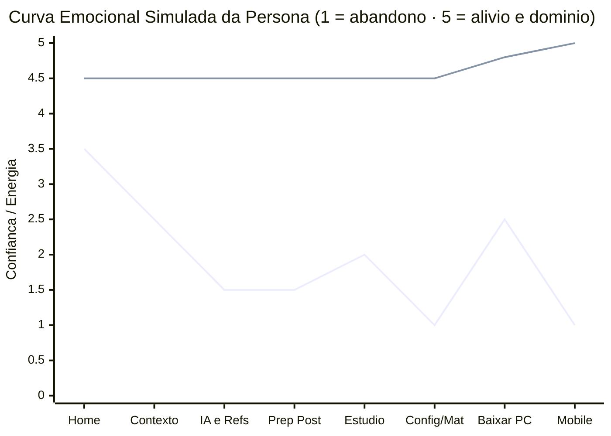
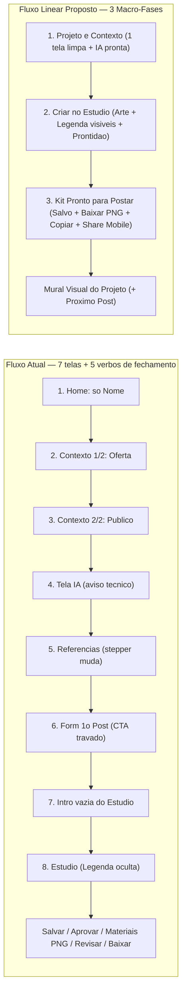

# Dossiê de UX, UX Writing & Gamificação — Fluxo Linear do Compor

**Escopo avaliado:** Criação de projeto → Preparação → Criação/Edição de post → Salvar, Revisar e Baixar para postar (Desktop `1440×960` e Mobile `390×844`).  
**Evidências inspecionadas:** 17 capturas reais da interface em execução (`01` a `17`), dump estruturado de DOM/copy ([dom-audit.json](file:///Users/matheusborges/.gemini/antigravity/brain/9ed385c8-1c6b-475d-9b51-461abd300968/scratch/dom-audit.json)), código-fonte real em `apps/web/studio/` e `apps/web/pages/_app.tsx`, e ADRs vigentes (`0029`, `0030`, `0031`, `0037`, `0038`, `0044`, `0045`, `0051`, `0052`, `0055`, `0056`, `0058`, `0059`, `0073`, `0075`, `0077`, `0079`).  
**Agentes participantes:** Subagente **Persona** ([Camila Rocha — Eu-gência](conversation://d9ec58a6-cf13-4562-8d5f-e1168dc90730)) × Subagente **Designer** ([Staff Product Designer & Gamification Architect](conversation://6b4f06e6-d71b-49de-b4a0-bc96757144a6)), incluindo rodada cruzada de validação da persona sobre os mockups propostos.

> [!NOTE]
> **Rigor epistemológico (contrato do Compor):** As percepções da persona Camila Rocha (nutricionista/mentora solo criando divulgação de uma oficina de R\$ 47 à noite, alternando notebook e celular) constituem uma **simulação estruturada de persona (hipótese de pesquisa)** ancorada em [persona-e-posicionamento.md](file:///Users/matheusborges/github/compor/docs/persona-e-posicionamento.md). Todas as fricções de interface, textos literais, seletores HTML, bugs de CSS e capturas de tela são **evidências factuais observadas diretamente no aplicativo atual**.

---

## 1. Resumo Executivo & Curva Emocional (Antes vs. Depois)

O Compor já possui fundação arquitetural sólida (autoridade por operação, vínculo canônico de versão→imagem do ADR 0077, geração explícita sem disparos automáticos do ADR 0044 e uma paleta editorial calma em creme papel `#f4f0e5`, cobalto `#123eab` e amarelo-sol `#f6d550`). **Contudo, a camada de experiência hoje expõe a mecânica interna de banco de dados, segurança e estado de sessão diretamente para uma criadora leiga**, fragmentando uma jornada que deveria ser linear em **7 telas de preparação** e **5 verbos concorrentes para fechar e baixar um único post**.



### Transformação Estrutural: do Labirinto ao Funil Linear



| Dimensão | Estado Atual (Evidência Real) | Proposta — Bloco 1 `[Compatível com ADRs]` | Proposta — Bloco 2 `[Requer adendo de ADR]` |
| --- | --- | --- | --- |
| **Telas até a 1ª arte** | **7 telas** (6 se preencher Objetivo oculto) | **4 telas** limpas com stepper único | **2 telas** (Projeto+Contexto+IA inline → Estúdio) |
| **Steppers distintos na jornada** | **3 formatos** (`5` → `3` → `4` → `0`) | **1 único `<JourneyStepper>`** | **1 único `<JourneyStepper>`** (`Projeto → Criar → Postar`) |
| **Ações concorrentes no fechamento** | **5** (`Salvar`, `Aprovar` em Textos, `Salvar PNG final` em Materiais, `Revisar`, `Baixar/Copiar`) | **2 momentos limpos** (`Salvo ✓` vivo → `Baixar e postar →`) | **1 ritual linear** (`Kit Pronto para Postar` + fim da duplicidade em `StudioAssets`) |
| **Repetições de `imageReviewDisclosure`** | **4×** em texto corrido sem padding no chat | **1×** na IA + padding corrigido | **Selo expansível** `ⓘ Revisão de qualidade ativa` |
| **Largura útil no Mobile (`390px`)** | **270px** (`120px` perdidos em 2 trilhos fixos) | **390px (100%)** com drawer + abas `Conversa \| Arte e legenda` | **390px (100%)** + Web Share API (`Compartilhar / Salvar nas Fotos`) |

---

## 2. Evidência Visual: Antes (Real) vs. Depois (Proposta)

Explore nos carrosséis abaixo as capturas reais obtidas do aplicativo rodando localmente lado a lado com os mockups visuais gerados para guiar os próximos agentes (respeitando integralmente a paleta real do Compor: `#f4f0e5`, `#123eab`, `#f6d550`, `#2c2d2f`).

### Comparativo 1 — Entrada e Preparação do Projeto (6–7 telas → 1 tela calma)

````carousel

<!-- slide -->

<!-- slide -->

<!-- slide -->

<!-- slide -->

<!-- slide -->

````

### Comparativo 2 — Estúdio do Post (Dupla barra + Legenda oculta → Estúdio Unificado)

````carousel

<!-- slide -->

<!-- slide -->

<!-- slide -->

````

### Comparativo 3 — Salvar, Revisar e Baixar para Postar (Desktop + Mobile)

````carousel

<!-- slide -->

<!-- slide -->

<!-- slide -->

<!-- slide -->

````

### Comparativo 4 — Lista de Posts e Continuidade da Campanha

````carousel

<!-- slide -->

<!-- slide -->

````

> [!IMPORTANT]
> **Refinamentos obrigatórios anotados na validação da Persona sobre os 4 mockups acima (aplicar na implementação!):**
> 1. **Unificar vocabulário de status (zero sinônimos competindo):** Usar apenas 3 estados em todo o produto — **`Em criação`** → **`Pronto para postar`** *(mapeado ao `approval.status === 'approved'`)* → **`Postado ✓`** *(marcador local opcional)*. Não misturar *"Marcar como versão oficial"*, *"Aprovar versão oficial"* e *"Aprovado"*.
> 2. **Na Proposta 04 (Mural):** Remover o prefixo em inglês `"Active Memory Card ·"` (usar *"Continue sua divulgação"*), remover o selo não-verificável `"Direção visual consistente"` (rigor epistemológico do Compor) e substituir a barra multicolorida sem legenda por contagem textual clara + barra de 2 tons (`Prontos` vs. `Em criação`).
> 3. **Na Proposta 01 (Preparação):** Informar em 3 palavras se a IA do Compor está **incluída** (tira medo de cobrança) e garantir que **`Ir para o primeiro post →`** abra direto no Estúdio (sem tela intermediária extra).
> 4. **Na Proposta 03 (Conferência de Fatos):** Nunca exibir `✓` automático para um fato na arte sem verificação humana — usar checkboxes interativos de conferência silenciosa (veja **Spec C**).

---

## 3. Catálogo Exato de Fricções (F01–F15 · Código, HTML & ADR)

Legenda de governança:
- **`[Compatível com ADRs]`** — Implementação direta sem alterar decisões arquiteturais vigentes.
- **`[Requer decisão/adendo de ADR]`** — Envolve ajuste em fluxo/gate explicitamente registrado em ADR; exige aprovação de Matheus antes de alterar.

### Severidade P0 — Bloqueadores Críticos

| ID | Fricção & Impacto Real | Arquivo(s) & Linhas | Telas | Causa Raiz Técnica / HTML | Governança ADR |
| --- | --- | --- | --- | --- | --- |
| **F01** | **Catástrofe semântica e visual no fechamento do post (5 ações sobrepostas + tela Revisar quebrada):** `Salvar`, `Aprovar` (em Textos), `Salvar PNG final no projeto` (com checkbox em Materiais), `Revisar` e `Baixar PNG` / `Copiar legenda`. Botões sem CSS nativo, legenda perde quebras de linha, download sem confirmação e com nome do *projeto* (`-v0.png`), título duplicado e alerta pânico `"Nenhuma imagem encontrada nesta versão"`. | [studio-review.tsx](file:///Users/matheusborges/github/compor/apps/web/studio/studio-review.tsx#L22-L59), [studio-app.tsx](file:///Users/matheusborges/github/compor/apps/web/studio/studio-app.tsx#L1529-L1530), [studio-app.tsx](file:///Users/matheusborges/github/compor/apps/web/studio/studio-app.tsx#L1755-L1770), [studio-assets.tsx](file:///Users/matheusborges/github/compor/apps/web/studio/studio-assets.tsx#L100-L128) | `09`, `10`, `11`, `13`, `17` | `<button>` em `studio-review.tsx:57` e `studio-app.tsx:1766` sem classe `.studio-button-secondary`; `<p>` da legenda sem `white-space: pre-wrap`; `download()` não chama `setNotice`; `StudioReview` recebe `title={projectDetails.title}` em vez de `postTitle`; `StudioAssets` ainda expõe upload manual legado apesar do vínculo automático do ADR 0077. | UI/CSS/feedback/nome do PNG/Web Share: **`[Compatível com ADRs]`** · Ocultar fluxo manual legado em `StudioAssets` e permitir aprovar na revisão: **`[Requer adendo ADR 0031/0077]`** |
| **F02** | **Colapso ergonômico no Mobile (`390×844`):** 2 trilhos laterais fixos (`64px + 56px = 120px`, **31% da tela**) sufocam o workspace em `270px`. No Estúdio, 6 linhas de botões empurram a arte para fora da tela, `● Abrir conversa` cobre o CTA da imagem e o chat manda *"Veja como ficou ao lado"* enquanto a arte está invisível atrás de um `−` sem rótulo. | [studio-shell.css](file:///Users/matheusborges/github/compor/apps/web/studio/studio-shell.css#L43-L49), [studio-shell.css](file:///Users/matheusborges/github/compor/apps/web/studio/studio-shell.css#L104-L112), [studio-navigation.css](file:///Users/matheusborges/github/compor/apps/web/studio/studio-navigation.css#L24-L28), [studio-guided.css](file:///Users/matheusborges/github/compor/apps/web/studio/studio-guided.css#L47-L50), [studio-guided.css](file:///Users/matheusborges/github/compor/apps/web/studio/studio-guided.css#L91-L102) | `15`, `16`, `17` | `.studio-project-rail` e `.studio-navigation-shell` não colapsam em `<= 800px`; `.studio-panel-toggle:nth-child(3)` aplica `margin-left: auto` mesmo quebrando linha; `.guided-chat-area` sobrepõe 100% da arte sem aba explícita `Conversa \| Arte`. | **`[Compatível com ADRs 0044/0052/0056]`** |
| **F03** | **Funil de entrada hiperfragmentado (7 telas antes da 1ª arte):** Nome → Oferta → Público → IA → Referências → Formulário 1º Post (com `Gerar primeiro post` desabilitado sem aviso de campo obrigatório) → Intro vazia do Estúdio pedindo de novo para descrever a arte. | [studio-app.tsx](file:///Users/matheusborges/github/compor/apps/web/studio/studio-app.tsx#L376-L391), [studio-app.tsx](file:///Users/matheusborges/github/compor/apps/web/studio/studio-app.tsx#L1641-L1666), [studio-guided.tsx](file:///Users/matheusborges/github/compor/apps/web/studio/studio-guided.tsx#L10-L28), [studio-chat.tsx](file:///Users/matheusborges/github/compor/apps/web/studio/studio-chat.tsx#L1510-L1701) | `01`–`07` | Separação artificial de `contextStep` 0/1 sem placeholders; `data-view="intro"` cria uma 7ª caixa de texto quando a usuária clica `Continuar para criação`; botão primário desabilitado por `objective.trim()` vazio sem indicação visual. | Unir Contexto 1+2 + placeholders + aviso de campo: **`[Compatível com ADRs]`** · Embutir IA inline e eliminar tela isolada: **`[Requer adendo ADR 0044/0058]`** |
| **F04** | **Legenda sugerida pela IA nasce escondida e `Aprovar esta versão` está enterrado em `Textos`:** O chat avisa *"já sugeri a legenda. Veja como ficou ao lado"*, mas `openPanels` inicia `[]`. Ao abrir `Textos`, a legenda tem só `rows={3}`, divide espaço com 3 campos vazios que *"não modificam os pixels da arte atual"* e enterra `Aprovar` no rodapé. | [studio-editor.tsx](file:///Users/matheusborges/github/compor/apps/web/studio/studio-editor.tsx#L34), [studio-editor.tsx](file:///Users/matheusborges/github/compor/apps/web/studio/studio-editor.tsx#L92), [studio-editor.tsx](file:///Users/matheusborges/github/compor/apps/web/studio/studio-editor.tsx#L197-L266), [studio-editor.tsx](file:///Users/matheusborges/github/compor/apps/web/studio/studio-editor.tsx#L354-L367) | `08`, `09`, `10` | `useState<string[]>([])` fecha todos os painéis por padrão; único painel agrupa 3 modelos mentais distintos (legenda pronta vs. instruções da próxima geração vs. ciclo de aprovação). | **`[Compatível com ADRs 0031/0044/0056]`** |
| **F05** | **Feedback de salvamento invisível + botão `Salvar` sem estado `Salvo ✓`:** `"Nova versão salva."` renderiza em `11px` no canto inferior esquerdo (a 1.300px do botão clicado), contradizendo o badge `Rascunho` quando edita a legenda. O botão `Salvar` permanece azul sólido mesmo sem alterações, induzindo versões duplicadas (`v2`, `v3`…). | [studio-app.tsx](file:///Users/matheusborges/github/compor/apps/web/studio/studio-app.tsx#L1022), [studio-app.tsx](file:///Users/matheusborges/github/compor/apps/web/studio/studio-app.tsx#L1530), [studio-app.tsx](file:///Users/matheusborges/github/compor/apps/web/studio/studio-app.tsx#L1748-L1753), [studio-shell.css](file:///Users/matheusborges/github/compor/apps/web/studio/studio-shell.css#L239) | `08`, `09`, `10` | `disabled={saving \|\| view==='prepare-post'}` ignora `!draft?.dirty && draft?.baseVersion >= 1`; `notice` vai para `.studio-footer` fora do foco visual. | **`[Compatível com ADRs 0044/0077]`** |

### Severidade P1 — Fricções Estruturais de Navegação, Consistência e Confiança

| ID | Fricção & Impacto Real | Arquivo(s) & Linhas | Telas | Causa Raiz Técnica / HTML | Governança ADR |
| --- | --- | --- | --- | --- | --- |
| **F06** | **Stepper inconsistente:** 5 passos na Home → 3 numerados em Contexto/IA → 4 textos sem círculos em Referências → desaparece em Preparar 1º post. | [studio-app.tsx](file:///Users/matheusborges/github/compor/apps/web/studio/studio-app.tsx#L87), [studio-guided.tsx](file:///Users/matheusborges/github/compor/apps/web/studio/studio-guided.tsx#L10-L14), [studio-reference-panel.tsx](file:///Users/matheusborges/github/compor/apps/web/studio/studio-reference-panel.tsx#L44) | `01`–`06` | 3 implementações independentes de `<nav>` de progresso em vez de um componente único `<JourneyStepper>`. | **`[Compatível com ADRs]`** |
| **F07** | **Repetição alarmista de `imageReviewDisclosure` 4× + erro de padding CSS:** *"envia o PNG gerado e o prompt à OpenAI com a chave de revisão do Compor. A imagem pode ser retida antes da entrega."* assusta a persona, ocupa 4 linhas sem padding no chat mobile e gera fadiga de alerta. | [image-review-disclosure.ts](file:///Users/matheusborges/github/compor/apps/web/studio/image-review-disclosure.ts#L1), [studio-guided.tsx](file:///Users/matheusborges/github/compor/apps/web/studio/studio-guided.tsx#L27), [studio-app.tsx](file:///Users/matheusborges/github/compor/apps/web/studio/studio-app.tsx#L1618-L1651), [studio-chat.tsx](file:///Users/matheusborges/github/compor/apps/web/studio/studio-chat.tsx#L1675) | `04`–`10`, `15` | `<p className="studio-hint">` filho direto de `.studio-chat-panel` sem padding horizontal; texto jurídico repetido integralmente em 4 pontos. | Padding + clareza factual: **`[Compatível]`** · Modo compacto expansível `ⓘ`: **`[Requer adendo ADR 0075]`** |
| **F08** | **Lista de posts sem miniaturas + nome clonado do projeto:** Em uma ferramenta visual, `Posts do projeto` mostra uma barra de texto puro sem thumbnail da arte, sem selo de aprovação e repetindo o nome do projeto (`Mentoria Nutrição Real — Turma Novembro`). | [studio-guided.tsx](file:///Users/matheusborges/github/compor/apps/web/studio/studio-guided.tsx#L29-L37), [studio-app.tsx](file:///Users/matheusborges/github/compor/apps/web/studio/studio-app.tsx#L1566) | `06`, `11`, `14` | `ProjectPosts` não carrega miniatura do IndexedDB/vínculo canônico; preparação inicial copia `projectDetails.title` para `pendingPost.name`. | Miniaturas + selos: **`[Compatível]`** · Diferenciar nome sugerido do 1º post: **`[Requer adendo ADR 0073]`** |
| **F09** | **Dupla barra de ferramentas no Estúdio (9 controles + 2 botões azuis + ícones duplicados):** `Ver arte` (azul, `aria-pressed`) abre modal de zoom competindo com `Salvar` (azul); ícone de sliders repete-se para `Configurações do projeto` (lateral) e `Configurações do Post` (topo). | [studio-app.tsx](file:///Users/matheusborges/github/compor/apps/web/studio/studio-app.tsx#L1525-L1531), [studio-editor.tsx](file:///Users/matheusborges/github/compor/apps/web/studio/studio-editor.tsx#L110-L149), [studio-navigation.tsx](file:///Users/matheusborges/github/compor/apps/web/studio/studio-navigation.tsx#L15) | `08`, `09`, `10`, `16` | Ações de ciclo de vida do post e ferramentas de canvas empilhadas sem hierarquia única; `onViewArt` acoplado ao toggle `mode === "select"`. | **`[Compatível com ADRs 0044/0056]`** |
| **F10** | **Bug CSS deixa aba ativa do Modal de Configurações invisível + abas desnecessárias:** Todas as 6 abas ficam brancas idênticas; `Histórico anterior` aparece mesmo vazio; `Ideia inicial:` exibe o prompt do 1º post e `Fatos da oferta` diz `"Nenhum fato informado"`. | [_app.tsx](file:///Users/matheusborges/github/compor/apps/web/pages/_app.tsx#L7-L11), [studio-guided.css](file:///Users/matheusborges/github/compor/apps/web/studio/studio-guided.css#L22), [studio-shell.css](file:///Users/matheusborges/github/compor/apps/web/studio/studio-shell.css#L99), [studio-app.tsx](file:///Users/matheusborges/github/compor/apps/web/studio/studio-app.tsx#L104) | `12`, `13` | `studio-guided.css` é importado antes de `studio-shell.css`; ambos têm especificidade `(0,2,0)`, fazendo `.compor-studio .studio-button-secondary` sobrescrever `.guided-settings-tabs [aria-pressed='true']`. | **`[Compatível com ADRs 0055/0059]`** |
| **F11** | **Bancada de Referências quebra continuidade visual, duplica `<h1>`, esconde uploads e usa termo `"alcance"`:** Oculta o rail esquerdo, troca fundo creme por branco, põe busca Pinterest desabilitada *acima* do botão `Permitir nesta sessão`, esconde envios num `<details>` fechado chamado `"Revisar seleção e alcance"` (que para criadoras significa *reach* no Instagram!). | [studio-reference-panel.tsx](file:///Users/matheusborges/github/compor/apps/web/studio/studio-reference-panel.tsx#L42-L84), [reference-workbench.css](file:///Users/matheusborges/github/compor/apps/web/studio/reference-workbench.css#L1-L36) | `05` | Dois `<h1>` simultâneos (WCAG); `order: 0 / order: 1` inverte busca vs. consentimento; `<div hidden={source!=='upload'}>` só renderiza texto apontando para o `<details>` no rodapé. | **`[Compatível com ADRs 0037/0058/0073]`** |
| **F12** | **Chat exibe `"Post sem título"` mesmo com o post nomeado:** Quebra imediata de consistência entre coluna esquerda e direita. | [studio-chat.tsx](file:///Users/matheusborges/github/compor/apps/web/studio/studio-chat.tsx#L1529-L1531) | `08`, `09`, `10`, `15` | Lê `currentDraft?.content.headline` em vez de priorizar `state.posts[pieceId]?.name`. | **`[Compatível com ADRs]`** |

### Severidade P2 — Polimento, Acessibilidade e Micro-Fricções

| ID | Fricção | Arquivo(s) & Linhas | Telas | Correção Direta | Governança ADR |
| --- | --- | --- | --- | --- | --- |
| **F13** | Textareas vazias sem placeholders/exemplos; `"Escolher depois"` na verdade desliga a IA (`aiPreference: 'none'`); `"A chamada para ação é opcional."` repete o label imediatamente acima. | [studio-guided.tsx](file:///Users/matheusborges/github/compor/apps/web/studio/studio-guided.tsx#L15-L28), [studio-app.tsx](file:///Users/matheusborges/github/compor/apps/web/studio/studio-app.tsx#L1650-L1655) | `02`, `03`, `04`, `06` | Adicionar exemplos clicáveis/placeholders; renomear para `"Continuar sem IA por enquanto"`; explicar inline quando `Gerar primeira arte` estiver desabilitado. | **`[Compatível]`** |
| **F14** | Home vazia com botão azul `"Novo projeto"` redundante no topo + ordem DOM invertida vs. visual (`grid-area` joga `.studio-starter` acima, mas no DOM `.studio-recent-projects` vem primeiro com `"acima"`). | [studio-app.tsx](file:///Users/matheusborges/github/compor/apps/web/studio/studio-app.tsx#L353-L391), [studio-shell.css](file:///Users/matheusborges/github/compor/apps/web/studio/studio-shell.css#L354-L356) | `01` | Ocultar botão `Novo projeto` na topbar quando `!hasProjects`; alinhar ordem do DOM à ordem visual. | **`[Compatível]`** |
| **F15** | Painel de Versões exibe 2 controles redundantes por card (`Abrir variante 1` + `<select>`) e mensagem alarmista `"Imagem da versão X ainda não disponível neste navegador"` durante o lazy-load. | [studio-variant-cards.tsx](file:///Users/matheusborges/github/compor/apps/web/studio/studio-variant-cards.tsx#L26-L36), [studio-variant-cards.tsx](file:///Users/matheusborges/github/compor/apps/web/studio/studio-variant-cards.tsx#L89-L95) | `10` | Skeleton suave durante carregamento; simplificar para histórico linear quando houver 1 única direção. | **`[Compatível]`** |

---

## 4. Auditoria Cirúrgica de UX Writing ("De → Para")

**Voz do Compor:** calma, humana, direta e autoral — como uma diretora de arte parceira, nunca como log de banco de dados ou termo jurídico.

| # | Onde (`apps/web/studio/...`) | Texto Atual ("De") | Por que trava a usuária | Texto Proposto ("Para") | ADR |
| --- | --- | --- | --- | --- | --- |
| **W01** | `studio-app.tsx:371` | `Seus projetos aparecerão aqui. Comece com uma ideia acima.` | Referência espacial quebra acessibilidade e contradiz o rótulo `Nome do projeto`. | `Seus projetos vão aparecer aqui assim que você criar o primeiro.` | `[Compatível]` |
| **W02** | `studio-guided.tsx:15` | `O que vamos divulgar?` *(sem placeholder)* | Folha em branco; dúvida se coloca data/preço aqui ou no post. | `O que você vai divulgar neste projeto?` + placeholder concreto com oferta, data e preço. | `[Compatível]` |
| **W03** | `studio-guided.tsx:15` | `Quem você quer alcançar?` *(sem placeholder)* | Vago demais para quem não é de marketing. | `Para quem é essa divulgação?` + chips sugeridos clicáveis. | `[Compatível]` |
| **W04** | `studio-guided.tsx:27` | `Escolher depois` | Enganoso: desativa a IA (`aiPreference: 'none'`). | `Continuar sem IA por enquanto` | `[Compatível]` |
| **W05** | `image-review-disclosure.ts:1` (4×) | `Quando a revisão está ativa, o Compor envia o PNG gerado e o prompt à OpenAI com a chave de revisão do Compor. A imagem pode ser retida antes da entrega.` | Jargão técnico ("prompt", "chave de revisão"), tom alarmista ("retida") repetido 4×. | **Resumo:** `Revisão automática de qualidade ativa · Como funciona ⓘ` · **Expandido:** `Antes de entregar sua arte, o Compor faz uma checagem automática de qualidade usando a OpenAI (enviando a imagem gerada e o pedido). Imagens com erro grave de texto ou formato podem ser retidas para você tentar outro caminho.` | `[Adendo ADR 0075 p/ modo colapsável]` |
| **W06** | `studio-reference-panel.tsx:83` | `Revisar seleção e alcance` / `Aplicar referências a` | **"Alcance"** no universo do Instagram significa *reach* (quantas pessoas veem o post)! | `Ver imagens escolhidas ({n}) e onde usar` / `Onde estas inspirações valem` (`Só neste post` \| `Em todos os posts deste projeto`). | `[Compatível]` |
| **W07** | `studio-reference-panel.tsx:71` | `As imagens enviadas aparecem em “Revisar seleção e alcance”.` | Manda caçar o próprio upload num accordion fechado. | Exibir as miniaturas direto na aba: `Suas imagens enviadas (já incluídas aqui)`. | `[Compatível]` |
| **W08** | `studio-app.tsx:1654-1655` | `Continuar para criação` vs. `Gerar primeiro post` | Não explica a diferença nem por que o azul está travado. | Secundário: `Abrir estúdio sem gerar ainda` · Primário: `Gerar primeira arte →` (+ dica se faltar objetivo). | `[Compatível]` |
| **W09** | `studio-chat.tsx:1530` | `Post sem título` | Bug quando o post já tem nome organizacional. | Exibir `postTitle` (`s.posts[pieceId]?.name \|\| headline \|\| "Novo post"`). | `[Compatível]` |
| **W10** | `studio-editor.tsx:92, 198` | `Editar textos, legenda e aprovação` / `Alterá-los não modifica os pixels da arte atual.` | Mistura 3 conceitos; jargão `"pixels"`; dúvida se a legenda também não atualiza. | Separar aba **`Legenda`** (atualiza na hora) de **`Textos da próxima arte`** (*"Mudar estes campos prepara o próximo pedido — a arte atual só muda quando você pedir uma nova geração."*). | `[Compatível]` |
| **W11** | `studio-editor.tsx:120` | `Ver arte` *(botão azul que abre modal de zoom)* | Conflita com modo `Marcar área` e compete com `Salvar`. | Ícone discreto `Ampliar` no canto da arte (fora da hierarquia primária azul). | `[Compatível]` |
| **W12** | `studio-app.tsx:1530` | `Salvar` *(estático)* / `Nova versão salva.` *(11px no rodapé)* | Não mostra se já salvou; induz cliques duplicados. | Estados vivos: `Salvar versão` → `Salvando…` → `Salvo · v2 ✓` + toast próximo ao cabeçalho: `Versão 2 salva com arte e legenda.` | `[Compatível]` |
| **W13** | `studio-app.tsx:1529` | `Revisar` *(ícone de olho)* | Invisível que o **download PNG e cópia da legenda** moram aqui! | **`Baixar e postar →`** (`aria-label="Revisar, baixar PNG e copiar legenda"`). | `[Compatível]` |
| **W14** | `studio-editor.tsx:361` | `Aprovar esta versão` | Burocracia de agência para quem trabalha só; 4 termos diferentes no app. | Vocabulário unificado em 3 estados: **`Em criação`** → **`Pronto para postar`** (botão `★ Marcar como pronto para postar`) → **`Postado ✓`**. | `[Compatível]` |
| **W15** | `studio-review.tsx:56-57` | `Baixar PNG` / `Copiar legenda` *(sem confirmação de download)* | Silêncio pós-clique gera cliques repetidos. | `Baixar arte (PNG)` → **`Arte baixada ✓`** · `Copiar legenda` → **`Legenda copiada ✓`** · Mobile: **`Compartilhar / Salvar nas Fotos`**. | `[Compatível]` |
| **W16** | `studio-app.tsx:1766` | `Pedir ajuste no estúdio` *(botão cinza nativo)* | Visual quebrado e tom passivo. | **`← Voltar para ajustar`** (`.studio-button-secondary`). | `[Compatível]` |
| **W17** | `studio-assets.tsx:101-105` | `O PNG final só é guardado quando você confirma o envio para esta versão.` / `Tenho autorização para guardar esta imagem no projeto` / `Salvar PNG final no projeto` | **Momento de pânico:** contradiz o botão `Salvar` e faz a usuária achar que vai perder a arte. | Com ADR 0077 ativo: status calmo `Arte da versão {v} salva automaticamente com este post.` + accordion discreto `Recuperação avançada de arquivos`. | `[Adendo ADR 0031/0077]` |
| **W18** | `studio-app.tsx:1356` | `Imagem-base` | Termo técnico de engenharia/3D. | **`Usar minha foto`** (ex.: foto sua ou do produto como base da arte). | `[Compatível]` |
| **W19** | `studio-guided.tsx:35` | `Alterações neste navegador` / `Rascunho neste navegador` / `Abrir post e conversa` | Jargão de IndexedDB/storage. | `Alterações não salvas` · `Em criação` · `Salvo · v2` · `★ Pronto para postar` · CTA: `Abrir post →`. | `[Compatível]` |
| **W20** | `studio-variant-cards.tsx:90` | `Imagem da versão 2 ainda não disponível neste navegador.` | Alarmista durante carregamento normal. | Skeleton calmo `Carregando miniatura…`; só mostrar erro se falhar de verdade. | `[Compatível]` |

---

## 5. Arquitetura de Gamificação Editorial & Referências de Sites e Jogos

**Princípio orientador (*Craft & Closure* — Self-Determination Theory):** Nada de confete neon, pontos de XP artificiais ou streaks punitivos. O público do Compor responde a **Autonomia** (controle explícito sem custos surpresa), **Competência** (progresso tátil sem ansiedade de erro) e **Orgulho Autoral** (ver sua campanha tomando forma visualmente). A cor `#f6d550` (amarelo-sol da marca) vira o **sinal de conquista/prontidão**, enquanto `#165c36` / `#e7f4ec` (verde folha editorial) sinaliza **segurança/conclusão**.

| # | Mecânica Editorial no Compor | Fricção que Resolve | Referência de Site / App (Mecanismo Concreto) | Referência de Jogo (Mecanismo Concreto) | ADR |
| --- | --- | --- | --- | --- | --- |
| **G1** | **DNA Vivo do Projeto + Exemplos Clicáveis:** Pills `✓ Oferta · ✓ Público` acendem em tempo real ao digitar na tela unificada; 3 chips de exemplo vencem a síndrome da folha em branco em 1 clique. | F03, F13 | **Notion & Stripe Onboarding:** prévia viva/estrutural de progresso + starter presets que zeram a paralisia da página em branco e cortam o *Time-to-First-Value*. | **The Legend of Zelda: Breath of the Wild (*Great Plateau*):** ensina ferramentas no momento exato de uso, sem parede de 6 menus de configuração antes de agir no mundo. | `[Compatível]` (Contexto) · `[Adendo ADR 0044]` (IA inline) |
| **G2** | **Trilha Linear Única com Marcos Vencidos (`✓`) e Opcionais Claros:** Um único `<JourneyStepper>` consistente atravessa toda a preparação, transformando passos concluídos em `✓` preenchidos e marcando `Referências` claramente como `opcional`. | F06, F11 | **Linear (Project Wizard) & Typeform:** progressão sequencial imutável sem trocar o número de passos no meio da travessia. | **Super Mario Bros. Wonder:** mapa de rota onde o jogador vê quantos marcos faltam para o objetivo central e distingue imediatamente fases opcionais sem perder o rumo. | `[Compatível]` |
| **G3** | **Tríade de Prontidão Diegética (`✓ Arte · ✓ Legenda · ✓ Salvo`):** Micro-pills periféricos no cabeçalho do post acendem conforme a peça amadurece; quando `Arte + Legenda` estão prontos, o botão **`Baixar e postar →`** recebe um anel sutil em `#f6d550`. | F04, F05, F09 | **Buffer (Composer) & Figma (Sync dot):** leitura periférica em 200ms de completude e sincronização sem popups intrusivos. | **Hades (*God Gauge* / *Boons HUD*):** HUD lateral comunica prontidão na visão periférica — quando o recurso principal carrega, um brilho dourado discreto convida à ação sem interromper a arena. | `[Compatível]` |
| **G4** | **Botão `Salvar` com Estado Vivo + Toast Ancorado no Olhar:** Alterna `Salvar versão` → `Salvando…` → `Salvo · v2 ✓` no próprio botão, com toast discreto perto do foco visual em vez de texto `11px` no rodapé oposto. | F05 | **Notion & Linear (`Saved ✓` inline):** elimina cliques duplicados e ansiedade de *"será que gravou?"*. | **Hollow Knight / Dark Souls (*Bench / Bonfire*):** pulso calmo e instantâneo no exato ponto da interação comunicando tranquilidade psicológica: *"seu progresso está seguro"*. | `[Compatível]` |
| **G5** | **Ritual "Kit Pronto para Postar" (Checklist Tátil + Micro-Celebração):** Fechamento linear em 3 passos marcados ao clicar (`1. Salvo na nuvem ✓` → `2. Baixar PNG ✓` → `3. Copiar legenda ✓`), conferência silenciosa de fatos por checkbox, Web Share API no celular e faixa editorial `#f6d550` ao concluir o par (*"✦ Kit pronto! Agora é só abrir o Instagram e colar"* + `+ Criar próximo post`). | F01, F02 | **Canva / Photoroom (Export Done) & Loom (Share Page):** `Copiar` vira `Copiado ✓` instantaneamente; entrega final celebra a conclusão e aponta o próximo passo natural (*Peak-End Rule*). | **Animal Crossing: New Horizons & Astro Bot:** micro-ritual satisfatório de 1 segundo ao terminar uma peça na bancada DIY (*"pronto, fiz isso!"*) dando fechamento emocional real à tarefa. | `[Compatível]` |
| **G6** | **Selo `★ Pronto para postar` + Sinal `"Arte pronta"` no Mobile:** Marcar a versão final acende uma moldura suave `#f6d550` na arte 4:5 (800ms, respeitando `prefers-reduced-motion`) e fixa o selo no Mural; no celular, o switcher `Conversa \| Arte e legenda` acende o badge **`Arte pronta`** assim que a IA entrega. | F01, F02, F04 | **Figma (*Ready for Dev*) & WhatsApp/Messenger Preview Card:** transforma rascunho exploratório em peça finalizada e cria ponte de 1 toque quando o resultado nasce em outra aba. | **Balatro / Slay the Spire (selo dourado) & Zelda: TotK (*Purah Pad ping*):** selo tátil de carta oficial + pulso calmo sinalizando novidade pronta para inspecionar. | `[Compatível]` (Estúdio/Mobile) · `[Adendo ADR 0031]` (se também no Kit) |
| **G7** | **Mural Visual da Campanha (Grade 3× Feed) + Memória Ativa no Post 2+:** Lista de posts vira galeria visual 4:5 com alternância `Cartões \| Grade do feed (3×)`, resumo factual (`2 prontos · 1 em criação`) e chips clicáveis de próximo ângulo (`+ Bastidores`, `+ Quebrar objeção`, `+ Benefício prático`, `+ Últimas vagas`) que pré-preenchem rascunho editável sem gerar nada sozinho. | F08, F03 | **Canva Projects, Planoly/Later (3× Feed Grid) & Notion Templates:** reconhecimento visual instantâneo, orgulho pela harmonia estética do feed e atalho contra a folha em branco às 22h30. | **Animal Crossing Museum & Slay the Spire (mão inicial de cartas):** satisfação intrínseca de ver a coleção crescer + começar o próximo turno escolhendo 1 de 4 caminhos concretos. | `[Compatível]` |

---

## 6. Especificações de HTML / TSX & CSS para Próximos Agentes

> [!TIP]
> **Contrato de implementação:** Todos os trechos abaixo usam TypeScript estrito (zero `any`), **zero novas dependências npm** (preservando o orçamento Turbopack do [ADR 0033](file:///Users/matheusborges/github/compor/docs/adr/0033-turbopack-e-analise-do-bundle.md)), tokens existentes de [studio-shell.css](file:///Users/matheusborges/github/compor/apps/web/studio/studio-shell.css#L12-L29), alvos mínimos de `44px` em telas de toque e suporte integral a `prefers-reduced-motion`.

### Spec A — `<JourneyStepper>` Único + `<ProjectContextUnified>` (F03, F06, F13, F14)
**Arquivos-alvo:** [studio-guided.tsx](file:///Users/matheusborges/github/compor/apps/web/studio/studio-guided.tsx), [studio-guided.css](file:///Users/matheusborges/github/compor/apps/web/studio/studio-guided.css), [studio-reference-panel.tsx](file:///Users/matheusborges/github/compor/apps/web/studio/studio-reference-panel.tsx), [studio-app.tsx](file:///Users/matheusborges/github/compor/apps/web/studio/studio-app.tsx).

```tsx
// apps/web/studio/studio-guided.tsx — Stepper único compartilhado por TODA a preparação
export type JourneyStepId = 'project' | 'context' | 'ai' | 'references' | 'post';

const JOURNEY_STEPS: readonly { id: JourneyStepId; label: string; optional?: boolean }[] = [
  { id: 'project', label: 'Projeto' },
  { id: 'context', label: 'Contexto' },
  { id: 'ai', label: 'IA' },
  { id: 'references', label: 'Referências', optional: true },
  { id: 'post', label: 'Primeiro post' },
];
// Se Matheus aprovar Bloco 2 (adendo ADR 0044/0058), simplificar para 3 passos:
// ['Projeto e contexto', 'Criar no estúdio', 'Salvar e postar'].

export function JourneyStepper({ current, projectTitle }: { current: JourneyStepId; projectTitle?: string }) {
  const currentIndex = JOURNEY_STEPS.findIndex((step) => step.id === current);
  return (
    <header className="journey-header">
      {projectTitle && (
        <p className="journey-project-context">
          <span className="studio-visually-hidden">Projeto atual: </span>
          {projectTitle}
        </p>
      )}
      <nav className="journey-stepper" aria-label="Etapas de preparação do projeto">
        <ol>
          {JOURNEY_STEPS.map((step, index) => {
            const state = index < currentIndex ? 'done' : index === currentIndex ? 'current' : 'upcoming';
            return (
              <li key={step.id} data-state={state} aria-current={state === 'current' ? 'step' : undefined}>
                <span className="journey-step-dot" aria-hidden="true">{state === 'done' ? '✓' : index + 1}</span>
                <span className="journey-step-label">
                  {step.label}
                  {step.optional && <small> opcional</small>}
                </span>
              </li>
            );
          })}
        </ol>
      </nav>
    </header>
  );
}
```

```tsx
// apps/web/studio/studio-guided.tsx — Contexto Unificado (substitui as 2 telas vazias de ProjectQuestions)
// [Compatível com ADRs atuais (0044, 0048)]
const CONTEXT_EXAMPLES = [
  {
    label: 'Mentoria / Oficina',
    offer: 'Oficina prática ao vivo de planejamento alimentar semanal sem culpa, dia 28/11 às 19h, por R$ 47.',
    audience: 'Mulheres de 28 a 45 anos com rotina corrida que querem comer melhor sem dietas restritivas.',
  },
  {
    label: 'Serviço local',
    offer: 'Agenda aberta de novembro para consultoria personalizada presencial e online.',
    audience: 'Profissionais autônomos que buscam atendimento próximo e sem burocracia.',
  },
  {
    label: 'Produto autoral',
    offer: 'Coleção cápsula de cerâmica feita à mão — tiragem limitada de 30 peças.',
    audience: 'Pessoas que valorizam objetos autorais e decoração acolhedora para casa.',
  },
] as const;

export function ProjectContextUnified({
  projectTitle,
  brief,
  onChange,
  onContinue,
}: {
  projectTitle: string;
  brief: Brief;
  onChange: (patch: Partial<Brief>) => void;
  onContinue: () => void;
}) {
  const offerId = useId();
  const audienceId = useId();
  const hasOffer = brief.offer.trim().length > 0;
  const hasAudience = brief.audience.trim().length > 0;

  return (
    <section className="studio-panel guided-question" aria-labelledby="context-unified-title">
      <p className="studio-eyebrow">CONTEXTO DO PROJETO · VALE PARA TODOS OS POSTS</p>
      <h2 id="context-unified-title">Conte sobre {projectTitle}</h2>
      <p className="studio-panel-description">
        Você preenche uma vez e o Compor lembra em todos os posts. Nenhuma imagem é gerada nesta etapa.
      </p>

      <div className="context-dna-pills" aria-live="polite">
        <span data-filled={hasOffer ? 'true' : 'false'}>{hasOffer ? '✓' : '○'} Oferta</span>
        <span data-filled={hasAudience ? 'true' : 'false'}>{hasAudience ? '✓' : '○'} Público</span>
      </div>

      {!hasOffer && !hasAudience && (
        <div className="context-examples" aria-label="Exemplos para se inspirar">
          <span>Ver exemplo:</span>
          {CONTEXT_EXAMPLES.map((item) => (
            <button
              key={item.label}
              type="button"
              className="studio-chip-subtle"
              onClick={() => onChange({ offer: item.offer, audience: item.audience })}
            >
              {item.label}
            </button>
          ))}
        </div>
      )}

      <form onSubmit={(e) => { e.preventDefault(); onContinue(); }}>
        <div className="guided-field">
          <label htmlFor={offerId}>O que você vai divulgar neste projeto?</label>
          <textarea
            id={offerId}
            rows={3}
            maxLength={4000}
            placeholder="Ex.: Oficina prática ao vivo de planejamento alimentar semanal, dia 28/11 às 19h, por R$ 47."
            value={brief.offer}
            onChange={(e) => onChange({ offer: e.target.value })}
          />
        </div>
        <div className="guided-field">
          <label htmlFor={audienceId}>Para quem é essa divulgação?</label>
          <textarea
            id={audienceId}
            rows={3}
            maxLength={4000}
            placeholder="Ex.: Mulheres de 28 a 45 anos com rotina corrida que querem comer melhor sem dietas restritivas."
            value={brief.audience}
            onChange={(e) => onChange({ audience: e.target.value })}
          />
        </div>
        <div className="guided-actions guided-actions-end">
          <button type="submit" className="studio-button">Continuar →</button>
        </div>
      </form>
      <p className="studio-hint">Você pode ajustar qualquer detalhe depois em Configurações do projeto.</p>
    </section>
  );
}
```

### Spec B — Cabeçalho Unificado do Estúdio, Prontidão, Mobile Full-Width & Fix de `"alcance"` (F02, F04, F05, F09, F11, F12)
**Arquivos-alvo:** [studio-app.tsx](file:///Users/matheusborges/github/compor/apps/web/studio/studio-app.tsx), [studio-editor.tsx](file:///Users/matheusborges/github/compor/apps/web/studio/studio-editor.tsx), [studio-guided.tsx](file:///Users/matheusborges/github/compor/apps/web/studio/studio-guided.tsx), [studio-chat.tsx](file:///Users/matheusborges/github/compor/apps/web/studio/studio-chat.tsx), [studio-reference-panel.tsx](file:///Users/matheusborges/github/compor/apps/web/studio/studio-reference-panel.tsx), [studio-guided.css](file:///Users/matheusborges/github/compor/apps/web/studio/studio-guided.css).

```tsx
// 1) Cabeçalho único do post — substitui a dupla toolbar competindo (studio-app.tsx:1525-1531)
type SaveVisualState = 'unsaved' | 'saving' | 'saved';

function PostWorkspaceHeader({
  postTitle, versionLabel, readyToPublish, hasArt, hasCaption, saveState, disableActions,
  onSave, onReviewExport, onOpenReferences, onOpenPostSettings,
}: {
  postTitle: string; versionLabel: string; readyToPublish: boolean;
  hasArt: boolean; hasCaption: boolean; saveState: SaveVisualState; disableActions: boolean;
  onSave: () => void; onReviewExport: () => void; onOpenReferences: () => void; onOpenPostSettings: () => void;
}) {
  const readyKit = hasArt && hasCaption;
  return (
    <header className="post-header-bar">
      <div className="post-header-identity">
        <h2 title={postTitle}>{postTitle}</h2>
        <span className="studio-badge" data-status={readyToPublish ? 'approved' : saveState}>
          {readyToPublish ? `★ Pronto para postar · ${versionLabel}` : versionLabel}
        </span>
      </div>

      <ul className="post-readiness-pills" aria-label="Prontidão deste post">
        <li data-done={hasArt ? 'true' : 'false'}>{hasArt ? '✓' : '○'} Arte</li>
        <li data-done={hasCaption ? 'true' : 'false'}>{hasCaption ? '✓' : '○'} Legenda</li>
        <li data-done={saveState === 'saved' ? 'true' : 'false'}>
          {saveState === 'saved' ? '✓ Salvo' : saveState === 'saving' ? 'Salvando…' : '● Não salvo'}
        </li>
      </ul>

      <div className="post-header-actions" role="toolbar" aria-label="Ações deste post">
        <button type="button" className="studio-button-secondary" onClick={onOpenReferences}>Referências</button>
        <button type="button" className="studio-button-secondary" onClick={onOpenPostSettings}>Briefing</button>
        <button
          type="button"
          className="studio-button-secondary post-save-btn"
          data-save-state={saveState}
          disabled={disableActions || saveState !== 'unsaved'}
          aria-label={saveState === 'saved' ? 'Versão salva' : 'Salvar versão'}
          onClick={onSave}
        >
          {saveState === 'saving' ? 'Salvando…' : saveState === 'saved' ? 'Salvo ✓' : 'Salvar versão'}
        </button>
        <button
          type="button"
          className={readyKit ? 'studio-button post-deliver-cta is-ready' : 'studio-button post-deliver-cta'}
          disabled={disableActions || !hasArt}
          aria-label="Revisar, baixar PNG e copiar legenda"
          onClick={onReviewExport}
        >
          Baixar e postar →
        </button>
      </div>
    </header>
  );
}

// 2) Switcher Mobile claro (Conversa | Arte e legenda) + badge "Arte pronta" (studio-guided.tsx)
// Mantém ambos montados no DOM sem recriar rascunho ou conversa (ADR 0052).
export function MobileStudioTabs({
  activeTab, hasUnreadArt, onSelect,
}: {
  activeTab: 'chat' | 'art'; hasUnreadArt: boolean; onSelect: (tab: 'chat' | 'art') => void;
}) {
  return (
    <div className="mobile-studio-switcher" role="tablist" aria-label="Alternar entre conversa e post">
      <button type="button" role="tab" aria-selected={activeTab === 'chat'} onClick={() => onSelect('chat')}>
        Conversa
      </button>
      <button type="button" role="tab" aria-selected={activeTab === 'art'} onClick={() => onSelect('art')}>
        <span>Arte e legenda</span>
        {hasUnreadArt && activeTab !== 'art' && (
          <span className="mobile-tab-badge" aria-live="polite">Arte pronta</span>
        )}
      </button>
    </div>
  );
}

// 3) Ponte inline no chat mobile quando a imagem chega (studio-chat.tsx:1596-1598)
{imageReceipt && state.selection?.pieceId === imageReceipt.pieceId && state.selection?.baseVersion === imageReceipt.version && (
  <div className="studio-chat-art-ready" role="status">
    <span>Arte adicionada · versão {imageReceipt.version}.</span>
    {onFocusArt && (
      <button type="button" className="studio-button-secondary studio-mobile-view-art" onClick={onFocusArt}>
        Ver arte pronta →
      </button>
    )}
  </div>
)}

// 4) Correção semântica de "alcance" em Referências (studio-reference-panel.tsx:79-83)
<details className="reference-workbench-selection">
  <summary>Ver imagens escolhidas ({selectionCount}) e onde usar</summary>
  {onScope && (
    <label className="guided-reference-scope">
      Onde estas inspirações valem
      <select value={projectWide ? 'project' : 'post'} disabled={continueDisabled} onChange={(e) => onScope(e.target.value === 'project')}>
        <option value="post">Só neste post</option>
        <option value="project">Em todos os posts deste projeto</option>
      </select>
    </label>
  )}
  {selection}
</details>
```

```css
/* apps/web/studio/studio-guided.css — Regras essenciais de Prontidão + Mobile 100% Full-Width */
.post-header-bar { display: flex; flex-wrap: wrap; align-items: center; gap: 8px 14px; padding-bottom: 10px; border-bottom: 1px solid var(--studio-line); }
.post-readiness-pills { display: flex; align-items: center; gap: 6px; list-style: none; margin: 0; padding: 0; font-size: 12px; }
.post-readiness-pills li { padding: 3px 8px; border-radius: 999px; background: rgba(44, 45, 47, 0.05); color: var(--studio-muted); }
.post-readiness-pills li[data-done='true'] { background: #e7f4ec; color: #165c36; font-weight: 600; }
.post-save-btn[data-save-state='saved'] { border-color: #c5e3d1; background: #f2faf5; color: #165c36; opacity: 1; }
.compor-studio .post-deliver-cta.is-ready { box-shadow: 0 0 0 2px var(--studio-yellow); }
.studio-toast-floating { position: fixed; z-index: 60; right: 20px; bottom: max(20px, env(safe-area-inset-bottom)); padding: 10px 16px; border: 1px solid var(--studio-cobalt); border-radius: 12px; background: var(--studio-ink); color: white; font-size: 13px; box-shadow: 0 12px 30px rgba(18, 33, 67, 0.22); }
.mobile-studio-switcher, .studio-mobile-view-art { display: none; }

@media (max-width: 800px) {
  /* Recupera os 120px (31%) roubados pelos 2 trilhos fixos em 390×844! */
  .studio-project-rail, .studio-navigation-shell[data-expanded='false'] { display: none; }
  .studio-navigation-shell[data-expanded='true'] { position: fixed; inset: var(--studio-bar) auto 0 0; z-index: 50; width: min(300px, 86vw); background: var(--studio-cream); box-shadow: 12px 0 32px rgba(18, 33, 67, 0.2); }
  .mobile-studio-switcher { display: grid; grid-template-columns: 1fr 1fr; gap: 6px; padding: 8px 12px; border-bottom: 1px solid var(--studio-line); background: var(--studio-cream); }
  .mobile-studio-switcher [role='tab'] { min-height: 44px; border: 1px solid var(--studio-line); border-radius: 10px; background: white; color: var(--studio-ink); font-size: 14px; font-weight: 600; }
  .mobile-studio-switcher [role='tab'][aria-selected='true'] { border-color: var(--studio-cobalt); background: var(--studio-cobalt); color: white; }
  .mobile-tab-badge { display: inline-flex; margin-left: 6px; padding: 2px 7px; border-radius: 999px; background: var(--studio-yellow); color: var(--studio-ink); font-size: 11px; font-weight: 700; }
  .studio-mobile-view-art { display: inline-flex; min-height: 36px; padding: 4px 12px; font-size: 13px; }
  .guided-chat-launcher, .guided-chat-minimize, .post-readiness-pills { display: none; }
  .studio-editor.is-guided .studio-canvas-tools .studio-panel-toggle:nth-child(3) { margin-left: 0; }
}
```

### Spec C — `<StudioReview>` / Kit Pronto para Postar (F01, F02, G5, G6)
**Arquivos-alvo:** [studio-review.tsx](file:///Users/matheusborges/github/compor/apps/web/studio/studio-review.tsx), [studio-app.tsx](file:///Users/matheusborges/github/compor/apps/web/studio/studio-app.tsx#L1755-L1770), novo `apps/web/studio/studio-review.css` (importado em [_app.tsx](file:///Users/matheusborges/github/compor/apps/web/pages/_app.tsx)).

```tsx
// apps/web/studio/studio-review.tsx — Ritual "Kit Pronto para Postar" (Desktop + Mobile)
"use client";
import { useEffect, useRef, useState } from "react";
import type { StudioDraft } from "../lib/studio-domain";
import { composeStudioPng } from "../lib/studio-compose";
import { errorMessage } from "./studio-ui-types";
import { useObjectUrl } from "./use-object-url.ts";

export type ConfirmedFact = { id: string; label: string; value: string };
type Props = {
  postTitle: string;              // FIX F01: usa postTitle, não projectDetails.title
  projectTitle: string;
  postUrl?: string;               // URL autenticada /projetos/<id>/posts/<pieceId> (ADR 0056, sem segredos)
  confirmedFacts?: ConfirmedFact[];
  draft: StudioDraft | null;
  base: Blob | null;
  saving?: boolean;
  onSaveVersion?: () => Promise<unknown>;
  onEditCaption?: (value: string) => void;
  onApprove?: () => Promise<void>; // habilitar após adendo ADR 0031
  onBackToStudio: () => void;
  onCreateNextPost?: () => void;
};

const IG_CAPTION_LIMIT = 2200;

export default function StudioReview({
  postTitle, projectTitle, postUrl, confirmedFacts = [], draft, base, saving = false,
  onSaveVersion, onEditCaption, onApprove, onBackToStudio, onCreateNextPost,
}: Props) {
  const [busyDownload, setBusyDownload] = useState(false);
  const [downloaded, setDownloaded] = useState(false);
  const [copied, setCopied] = useState(false);
  const [shared, setShared] = useState(false);
  const [linkCopied, setLinkCopied] = useState(false);
  const [editingCaption, setEditingCaption] = useState(false);
  const [notice, setNotice] = useState("");
  const generation = useRef(0), locked = useRef(false);
  const url = useObjectUrl(base);

  const isSaved = Boolean(draft && !draft.dirty && draft.baseVersion >= 1);
  const isApproved = draft?.approval.status === "approved";
  const caption = draft?.content.caption ?? "";
  const paragraphCount = caption.split(/\n\s*\n/).map((b) => b.trim()).filter(Boolean).length;
  const fileName = `${postTitle.trim().replace(/[\\/<>:"|?*\u0000-\u001f]/g, "-") || "post"}-v${draft?.baseVersion ?? 0}.png`;
  const canNativeShare = typeof navigator !== "undefined" && typeof navigator.share === "function";

  useEffect(() => {
    generation.current++; locked.current = false;
    setBusyDownload(false); setDownloaded(false); setCopied(false); setShared(false);
    setLinkCopied(false); setEditingCaption(false); setNotice("");
    return () => { generation.current++; };
  }, [base, draft?.pieceId, draft?.baseVersion, postTitle]);

  async function downloadPng() {
    if (!base || !draft || locked.current) return;
    const current = generation.current;
    locked.current = true; setBusyDownload(true); setNotice("");
    try {
      const png = await composeStudioPng({ base });
      if (current !== generation.current) return;
      const objectUrl = URL.createObjectURL(png);
      const anchor = document.createElement("a");
      anchor.href = objectUrl; anchor.download = fileName; anchor.click();
      setTimeout(() => URL.revokeObjectURL(objectUrl), 1000);
      setDownloaded(true);
      setNotice(`Arte baixada como ${fileName}.`);
    } catch (error) {
      if (current === generation.current) setNotice(errorMessage(error));
    } finally {
      if (current === generation.current) { locked.current = false; setBusyDownload(false); }
    }
  }

  async function copyCaption() {
    const current = generation.current;
    try {
      await navigator.clipboard.writeText(caption);
      if (current === generation.current) { setCopied(true); setNotice("Legenda copiada. É só colar no Instagram."); }
    } catch {
      if (current === generation.current) setNotice("Selecione e copie o texto da legenda manualmente.");
    }
  }

  async function shareNative() {
    if (!base || !draft || !canNativeShare) return;
    try {
      const png = await composeStudioPng({ base });
      const file = new File([png], fileName, { type: "image/png" });
      if (navigator.canShare?.({ files: [file] })) {
        await navigator.share({ files: [file], title: postTitle, text: caption });
        setDownloaded(true); setCopied(true); setShared(true);
        setNotice("Kit enviado para o aplicativo escolhido.");
        return;
      }
    } catch (error) {
      if (error instanceof DOMException && error.name === "AbortError") return;
    }
    await downloadPng();
  }

  const kitReady = (downloaded && (!caption || copied)) || shared;

  return (
    <section className="delivery-kit" aria-labelledby="delivery-kit-title">
      <header className="delivery-kit-header">
        <div>
          <p className="studio-eyebrow">{projectTitle !== postTitle ? `${projectTitle} · ` : ""}KIT DE PUBLICAÇÃO</p>
          <h2 id="delivery-kit-title">{postTitle}</h2>
        </div>
        <span className="studio-badge" data-status={isApproved ? "approved" : isSaved ? "saved" : "unsaved"}>
          {isApproved ? `★ Pronto para postar · v${draft?.baseVersion}` : isSaved ? `Salvo · v${draft?.baseVersion}` : "Rascunho não salvo"}
        </span>
      </header>

      {draft && !isSaved && onSaveVersion && (
        <div className="delivery-unsaved-banner" role="status">
          <p><strong>Há alterações ainda não salvas.</strong> Baixe agora ou salve uma versão antes para guardar no histórico.</p>
          <button type="button" className="studio-button-secondary" disabled={saving} onClick={() => { void onSaveVersion(); }}>
            {saving ? "Salvando…" : `Salvar versão ${(draft.expectedLatestVersion ?? draft.baseVersion) + 1}`}
          </button>
        </div>
      )}

      <div className="delivery-kit-grid">
        <figure className="delivery-art-card" data-approved={isApproved ? "true" : "false"}>
          {url ? (
            
          ) : (
            <p className="delivery-art-empty">A imagem deste post ainda não está disponível. Volte ao estúdio para gerar ou recuperar a arte.</p>
          )}
          <figcaption>Formato retrato 4:5 · PNG integral</figcaption>
        </figure>

        <div className="delivery-checklist-column">
          {/* Conferência silenciosa e honesta de fatos declarados (checkbox humano — zero check inventado) */}
          {confirmedFacts.length > 0 && (
            <aside className="delivery-facts-check" aria-label="Fatos confirmados para conferir na arte">
              <p className="delivery-facts-title">Confira estes dados na arte antes de postar:</p>
              <ul className="delivery-facts-pills">
                {confirmedFacts.map((fact) => (
                  <li key={fact.id}>
                    <label className="delivery-fact-toggle">
                      <input type="checkbox" />
                      <span><strong>{fact.label}:</strong> {fact.value}</span>
                    </label>
                  </li>
                ))}
              </ul>
            </aside>
          )}

          <ol className="delivery-steps" aria-label="Passos para postar">
            <li className="delivery-step" data-done={isSaved ? "true" : "false"}>
              <span className="delivery-step-check" aria-hidden="true">{isSaved ? "✓" : "1"}</span>
              <div className="delivery-step-body">
                <strong>{isSaved ? `Versão ${draft?.baseVersion} salva na nuvem` : "Salvar versão na nuvem"}</strong>
                <p>{isSaved ? "Arte e legenda preservadas neste projeto." : "Recomendado para abrir depois em qualquer dispositivo."}</p>
              </div>
            </li>

            <li className="delivery-step" data-done={downloaded ? "true" : "false"}>
              <span className="delivery-step-check" aria-hidden="true">{downloaded ? "✓" : "2"}</span>
              <div className="delivery-step-body">
                <strong>Baixar arte (PNG)</strong>
                <p className="delivery-filename">{fileName}</p>
                <div className="delivery-step-actions">
                  <button type="button" className={downloaded ? "studio-button-secondary is-confirmed" : "studio-button"} disabled={busyDownload || !base || !draft} onClick={() => { void downloadPng(); }}>
                    {busyDownload ? "Preparando PNG…" : downloaded ? "Arte baixada ✓ · Baixar de novo" : "Baixar arte (PNG)"}
                  </button>
                  {canNativeShare && (
                    <button type="button" className="studio-button-secondary" disabled={busyDownload || !base || !draft} onClick={() => { void shareNative(); }}>
                      Compartilhar / Salvar nas Fotos
                    </button>
                  )}
                </div>
              </div>
            </li>

            <li className="delivery-step" data-done={copied ? "true" : "false"}>
              <span className="delivery-step-check" aria-hidden="true">{copied ? "✓" : "3"}</span>
              <div className="delivery-step-body">
                <div className="delivery-caption-head">
                  <strong>Legenda pronta para colar</strong>
                  <span className="delivery-char-count" data-over={caption.length > IG_CAPTION_LIMIT ? "true" : "false"}>
                    {paragraphCount} {paragraphCount === 1 ? "parágrafo" : "parágrafos"} · {caption.length.toLocaleString("pt-BR")} / {IG_CAPTION_LIMIT.toLocaleString("pt-BR")}
                  </span>
                </div>
                {editingCaption && onEditCaption ? (
                  <textarea className="delivery-caption-editor" rows={5} maxLength={4000} value={caption} onChange={(e) => onEditCaption(e.target.value)} />
                ) : (
                  <div className="delivery-caption-box">{caption || <span className="studio-hint">Nenhuma legenda escrita ainda.</span>}</div>
                )}
                <div className="delivery-step-actions">
                  <button type="button" className={copied ? "studio-button-secondary is-confirmed" : "studio-button-secondary"} disabled={!caption} onClick={() => { void copyCaption(); }}>
                    {copied ? "Legenda copiada ✓" : "Copiar legenda"}
                  </button>
                  {onEditCaption && (
                    <button type="button" className="studio-button-quiet" onClick={() => setEditingCaption((v) => !v)}>
                      {editingCaption ? "Concluir edição" : "Ajustar texto"}
                    </button>
                  )}
                </div>
              </div>
            </li>
          </ol>

          {kitReady && (
            <div className="delivery-celebration" role="status" aria-live="polite">
              <span aria-hidden="true">✦</span>
              <div>
                <strong>Kit pronto para postar!</strong>
                <p>Agora é só abrir o Instagram, escolher o PNG salvo e colar a legenda.</p>
              </div>
            </div>
          )}

          {!canNativeShare && postUrl && (
            <details className="delivery-mobile-handoff">
              <summary>Vai postar pelo celular? Abra este post no telefone</summary>
              <div className="delivery-mobile-handoff-body">
                <p>Copie o link autenticado deste post (sem senhas ou chaves) e abra no celular para salvar a arte nas Fotos e colar a legenda no Instagram.</p>
                <button type="button" className="studio-button-secondary" onClick={() => { void navigator.clipboard.writeText(postUrl).then(() => { setLinkCopied(true); setNotice("Link do post copiado."); }); }}>
                  {linkCopied ? "Link copiado ✓" : "Copiar link deste post"}
                </button>
              </div>
            </details>
          )}

          {onApprove && isSaved && !isApproved && (
            <div className="delivery-approve-card">
              <p>Finalizou os ajustes da versão {draft?.baseVersion}?</p>
              <button type="button" className="studio-button-secondary" onClick={() => { void onApprove(); }}>
                ★ Marcar como pronto para postar
              </button>
            </div>
          )}

          {notice && <p className="delivery-live-notice" role="status" aria-live="polite">{notice}</p>}

          <footer className="delivery-kit-footer">
            <button type="button" className="studio-button-secondary" onClick={onBackToStudio}>← Voltar para ajustar</button>
            {onCreateNextPost && <button type="button" className="studio-button-quiet" onClick={onCreateNextPost}>+ Criar próximo post</button>}
          </footer>
        </div>
      </div>
    </section>
  );
}
```

```css
/* apps/web/studio/studio-review.css — Destaques críticos (white-space: pre-wrap + 2 colunas + checklist) */
.delivery-kit { width: min(100%, 1040px); margin: 0 auto; padding: clamp(20px, 3vw, 36px); border: 1px solid var(--studio-line); border-radius: 20px; background: white; display: grid; gap: 24px; }
.delivery-kit-grid { display: grid; grid-template-columns: minmax(260px, 380px) minmax(0, 1fr); gap: 28px; align-items: start; }
.delivery-art-preview { display: block; width: 100%; aspect-ratio: 4 / 5; object-fit: contain; border: 1px solid var(--studio-line); border-radius: 14px; background: var(--studio-cream); }
.delivery-art-card[data-approved='true'] .delivery-art-preview { border-color: var(--studio-yellow); box-shadow: 0 0 0 3px var(--studio-yellow); }
.delivery-steps { list-style: none; margin: 0; padding: 0; display: grid; gap: 14px; }
.delivery-step { display: grid; grid-template-columns: 28px minmax(0, 1fr); gap: 12px; padding: 16px; border: 1px solid var(--studio-line); border-radius: 14px; background: #fcfbf7; }
.delivery-step[data-done='true'] { border-color: #b7dec7; background: #f5fbf7; }
.delivery-step-check { display: grid; place-items: center; width: 28px; height: 28px; border-radius: 50%; border: 1.5px solid var(--studio-line); background: white; font-size: 13px; font-weight: 700; }
.delivery-step[data-done='true'] .delivery-step-check { border-color: #165c36; background: #165c36; color: white; }
.delivery-caption-box { white-space: pre-wrap; overflow-wrap: anywhere; padding: 12px 14px; border: 1px solid var(--studio-line); border-radius: 10px; background: white; font-size: 14px; line-height: 1.55; max-height: 220px; overflow-y: auto; }
.compor-studio .is-confirmed { border-color: #165c36; background: #e7f4ec; color: #165c36; font-weight: 600; }
.delivery-celebration { display: flex; gap: 12px; margin-top: 14px; padding: 14px 16px; border-radius: 14px; background: var(--studio-yellow); color: var(--studio-ink); }
.delivery-fact-toggle { display: inline-flex; align-items: center; gap: 6px; min-height: 32px; padding: 4px 10px; border: 1px solid var(--studio-line); border-radius: 999px; background: white; font-size: 12.5px; cursor: pointer; }
.delivery-fact-toggle:has(input:checked) { border-color: #165c36; background: #e7f4ec; color: #165c36; text-decoration: line-through; }
@media (max-width: 820px) { .delivery-kit-grid { grid-template-columns: minmax(0, 1fr); gap: 20px; } .delivery-kit { padding: 18px 16px; } }
@media (prefers-reduced-motion: reduce) { .delivery-celebration, .delivery-art-preview, .delivery-step { animation: none; transition: none; } }
```

### Spec D — `<ProjectPostsGallery>` (Mural 3× Estilo Feed + Memória Ativa no Post 2+) (F08, G7)
**Arquivos-alvo:** [studio-guided.tsx](file:///Users/matheusborges/github/compor/apps/web/studio/studio-guided.tsx#L29-L37), [studio-app.tsx](file:///Users/matheusborges/github/compor/apps/web/studio/studio-app.tsx#L1641-L1660), [studio-guided.css](file:///Users/matheusborges/github/compor/apps/web/studio/studio-guided.css).

```tsx
// 1) Alternância Cartões | Grade do feed (3×) no Mural de Posts com miniaturas 4:5 (studio-guided.tsx)
const [layoutMode, setLayoutMode] = useState<'cards' | 'feed'>('cards');
// Grade: <div className="post-gallery-grid" data-layout={layoutMode}>
// Card exibe <PostThumb pieceId={id} version={...} loadThumbnail={loadThumbnail} /> em aspect-ratio: 4/5
// + selo unificado: "★ Pronto para postar" | "Salvo · v2" | "Em criação"
// + card pontilhado "+ Criar novo post" no fim da grade.

// 2) Chips de ângulo clicáveis na preparação do Post 2+ (studio-app.tsx:1641-1660 — zero geração automática!)
const POST_ANGLE_STARTERS = [
  { id: 'objection', label: 'Quebrar objeção', objective: 'Quebrar uma objeção comum antes da compra', messageHint: 'Mostre por que funciona mesmo para quem tem rotina corrida.' },
  { id: 'behind', label: 'Bastidores', objective: 'Gerar proximidade mostrando bastidores reais', messageHint: 'Compartilhe um detalhe real do preparo e convide o público.' },
  { id: 'proof', label: 'Benefício prático', objective: 'Educar com um exemplo aplicável hoje', messageHint: 'Destaque 1 passo simples que a pessoa já consegue aplicar.' },
  { id: 'urgency', label: 'Últimas vagas', objective: 'Lembrete direto de data e inscrição', messageHint: 'Reforce data, horário, benefício central e chamada para inscrição.' },
] as const;
```

```css
/* apps/web/studio/studio-guided.css — Grade 4:5 + Modo Feed 3× */
.post-gallery-grid { display: grid; grid-template-columns: repeat(auto-fill, minmax(220px, 1fr)); gap: 20px; }
.post-gallery-grid[data-layout='feed'] { max-width: 780px; margin-inline: auto; grid-template-columns: repeat(3, minmax(0, 1fr)); gap: 6px; }
.post-gallery-thumb { aspect-ratio: 4 / 5; width: 100%; background: var(--studio-cream); display: grid; place-items: center; overflow: hidden; }
.post-gallery-thumb img { width: 100%; height: 100%; object-fit: cover; display: block; }
.post-gallery-add-card { display: grid; place-content: center; justify-items: center; gap: 8px; min-height: 280px; padding: 24px; border: 1.5px dashed var(--studio-line); border-radius: 16px; background: rgba(255, 255, 255, 0.5); color: var(--studio-cobalt); }
```

### Spec E — `<ReviewDisclosureBadge>` + Correção da Cascata CSS do Modal (F07, F10)
**Arquivos-alvo:** [image-review-disclosure.ts](file:///Users/matheusborges/github/compor/apps/web/studio/image-review-disclosure.ts), [studio-chat.tsx](file:///Users/matheusborges/github/compor/apps/web/studio/studio-chat.tsx#L1675), [studio-guided.css](file:///Users/matheusborges/github/compor/apps/web/studio/studio-guided.css#L22), [_app.tsx](file:///Users/matheusborges/github/compor/apps/web/pages/_app.tsx#L7-L11).

```tsx
// apps/web/studio/image-review-disclosure.tsx
export const imageReviewDisclosureSummary = 'Revisão automática de qualidade ativa';
export const imageReviewDisclosure =
  'Antes de entregar sua arte, o Compor envia a imagem gerada e o pedido à OpenAI com a chave de revisão do Compor. Imagens com erro grave podem ser retidas antes da entrega.';

export function ReviewDisclosureBadge({ compact = false }: { compact?: boolean }) {
  if (!compact) {
    return <p className="review-disclosure-inline"><strong>{imageReviewDisclosureSummary}:</strong> {imageReviewDisclosure}</p>;
  }
  // Versão colapsável no chat/referências — [Requer confirmação de adendo ADR 0075 pelo Matheus]
  return (
    <details className="review-disclosure-compact">
      <summary><span aria-hidden="true">ⓘ</span> {imageReviewDisclosureSummary} · <span>Como funciona</span></summary>
      <p>{imageReviewDisclosure}</p>
    </details>
  );
}
```

```css
/* apps/web/studio/studio-guided.css */
/* Fix F07: devolve padding correto dentro do chat (corrige texto colado nas bordas em 07, 08 e 15) */
.review-disclosure-inline, .review-disclosure-compact { margin: 0; padding: 6px 16px; font-size: 11.5px; line-height: 1.45; color: var(--studio-muted); border-top: 1px solid var(--studio-line); background: #faf8f2; }
.review-disclosure-compact summary { cursor: pointer; list-style: none; display: inline-flex; align-items: center; gap: 5px; }
.review-disclosure-compact summary > span:last-child { color: var(--studio-cobalt); text-decoration: underline; }

/* Fix F10: corrige bug de especificidade/cascata (_app.tsx:7 vs :11) onde studio-shell.css:99 apagava a aba ativa! */
.compor-studio .studio-modal .guided-settings-tabs button.studio-button-secondary[aria-pressed='true'] {
  border-color: var(--studio-cobalt);
  background: var(--studio-cobalt);
  color: white;
}
```

---

## 7. Roadmap de Implementação para Próximos Agentes

### Bloco 1 — Execução Direta `[Compatível com ADRs atuais]` (3 PRs cirúrgicos)

1. **PR 1 — Fechamento & Correções Críticas de Confiança (`F01`, `F05`, `F10`, `F12`, `F07-padding`):**
   - Implementar `<StudioReview>` (`Spec C`: `postTitle` no arquivo PNG, `white-space: pre-wrap`, botões estilizados, confirmação `Arte baixada ✓` / `Legenda copiada ✓`, banner de rascunho não salvo, checklist tátil de 3 passos, Web Share API mobile e ponte Desktop→Celular).
   - Atualizar botão `Salvar` para estado vivo (`Salvar versão` / `Salvando…` / `Salvo · v2 ✓`) + toast ancorado próximo ao foco visual.
   - Corrigir cascata CSS das abas no modal (`Spec E`), ocultar `Histórico anterior` quando vazio, corrigir `"Post sem título"` no chat e aplicar padding no `imageReviewDisclosure`.
2. **PR 2 — Mobile Full-Width `390×844` & Estúdio Unificado (`F02`, `F04`, `F09`):**
   - Colapsar `ProjectRail` + `StudioNavigation` em drawer sob demanda em `<= 800px` + `MobileStudioTabs` (`Conversa | Arte e legenda`) com badge `Arte pronta` e botão inline `Ver arte pronta →` no chat.
   - Unificar cabeçalho do post (`Spec B`: Tríade de Prontidão + `Baixar e postar →` + separar aba `Legenda` editável de `Textos da próxima arte` + separar ícone `Ampliar` do modo `Marcar área`).
3. **PR 3 — Preparação Coerente, Referências Sem "Alcance" & Mural Visual (`F03-contexto`, `F06`, `F08`, `F11`, `F13`, `F14`, `F15`):**
   - Implantar `<JourneyStepper>` único (`Spec A`), unir Contexto 1/2 + 2/2 com exemplos clicáveis, corrigir `<h1>` duplicado / ordem Pinterest / visibilidade de uploads e trocar `"alcance"` por `"onde usar"` em Referências.
   - Implantar `<ProjectPostsGallery>` (`Spec D`) com miniaturas 4:5, modo `Grade do feed (3×)` e chips de ângulo no Post 2+.

### Bloco 2 — Decisões / Adendos de ADR para Aprovação de Matheus

Antes de executar os itens abaixo, confirmar com Matheus o adendo correspondente em `docs/adr/`:
1. **Adendo aos ADRs `0044` / `0058` (Funil ultralinear de 2 telas):** Quando `defaultAvailable === true` (ADR 0052), exibir a IA como barra inline pré-pronta (*"IA do Compor pronta · incluída · Usar minha chave OpenAI"*) na tela única de preparação e levar direto ao Estúdio sem tela intermediária extra — **preservando 100% a regra de zero geração automática**.
2. **Adendo aos ADRs `0031` / `0077` (Aposentar fluxo manual redundante em `StudioAssets`):** Quando o vínculo canônico `piece_version_images` estiver ativo, substituir `"Salvar PNG final no projeto"` + checkbox por status passivo de confirmação, mantendo a recuperação manual em accordion avançado.
3. **Adendo ao ADR `0031` (Selo `★ Pronto para postar` + Conferência de Fatos no Kit Final):** Permitir acionar a aprovação explícita também dentro do `<StudioReview>` (mantendo contratos separados de salvar, aprovar e baixar) e exibir os fatos confirmados para conferência por checkbox na entrega.
4. **Adendo ao ADR `0075` (Disclosure compacto expansível):** Autorizar `<ReviewDisclosureBadge compact />` no compositor do chat e em Referências, mantendo o texto integral acessível em 1 clique.
5. **Adendo ao ADR `0073` (Nome sugerido do 1º post):** Diferenciar o nome inicial sugerido do 1º post em relação ao nome do projeto (ex.: `"Post 1 · Abertura"`), eliminando títulos duplicados na revisão e no mural.

### Checklist de Qualidade para Cada PR de Implementação
- [ ] Rodar `npm run quality:lint`, `npm run quality:typecheck`, `npm run quality:unit`, `npm run quality:browser`, `npm run quality:build` (e `next analyze` antes/depois conforme [ADR 0033](file:///Users/matheusborges/github/compor/docs/adr/0033-turbopack-e-analise-do-bundle.md)).
- [ ] Reexecutar capturas visuais em `1440×960` e `390×844` comparando diretamente contra `01`–`17`.
- [ ] Conduzir teste rápido com 3–5 criadoras reais ("Eu-gência") para validar em campo as hipóteses da persona (em especial: percepção de `Pronto para postar` vs. `Postado ✓` e uso do Share Sheet no celular para o Instagram).
