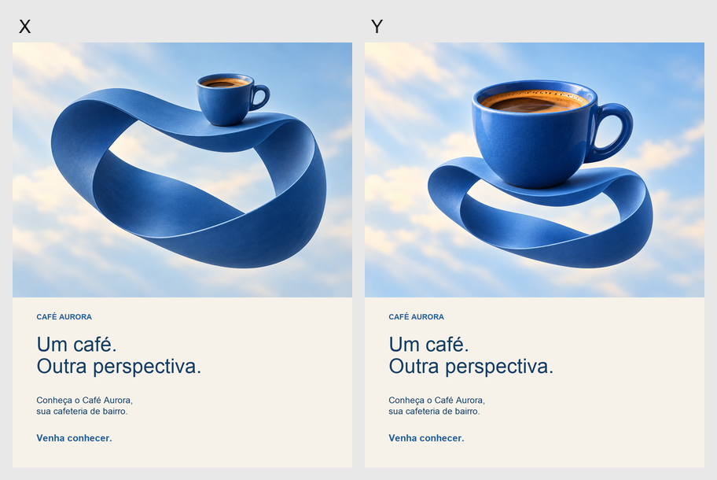
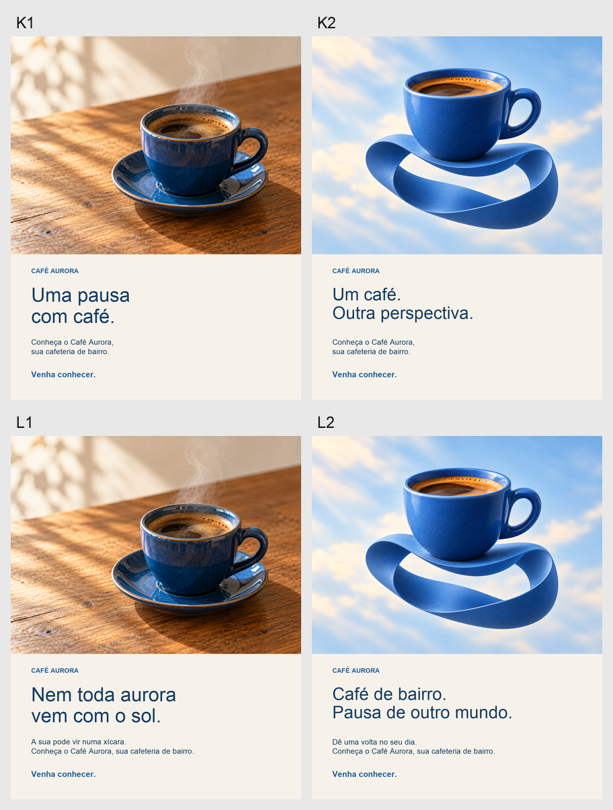
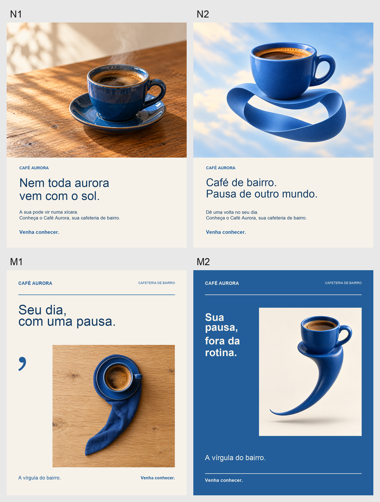

# SCRUM-51 — trajetórias, criativos e candidatos MCP

28/10/2026 · Experimento de desenvolvimento · Candidatos para revisão de Matheus.

**Objetivo:** testar a trajetória do Compor e buscar encantamento de uma persona avaliada por LLM Judge, preservando as limitações da arquitetura v0. A [régua definida antes dos ensaios](plan.md) usa 1–5: 4 significa “usaria com pequenos ajustes”; 5, “usaria e gostaria de explorar mais”. Testes de contrato, julgamento visual e resultado de uma pessoa são evidências distintas.

**Resultado desta rodada:** H4 foi preferido pelos dois avaliadores finais. Recebeu **5/5** em encantamento do Judge que acompanhou H2–H4 e **4/5** da réplica independente. A réplica deu **3/5 em diversidade**: duas execuções da mesma ideia. A meta de encantamento apareceu no conjunto de desenvolvimento, mas não foi replicada integralmente; a régua candidata de diversidade >=4 também não passou na réplica. **Não recomendar promoção geral do harness.** A principal proposta é distinguir exploração de direções e variação de uma direção escolhida.

## O que foi executado

```mermaid
flowchart LR
    B[Briefing fictício Café Aurora] --> H[H0 e H1: sessões LLM separadas]
    H --> M[MCP real: skills, moodboards, camadas e anotações]
    M --> I[Geração de ativos sem texto]
    I --> R[Compositor experimental: texto separado]
    R --> J[Judges com pares sem autoria]
    J --> C[Crítica: café pequeno diante da fita]
    C --> H2[H2: mudar apenas a imagem]
    H2 --> J2[Novo Judge e verificação de invariantes]
```

- H0/H1 escolheram chamadas reais via [bridge MCP](../../../prototypes/compor-mcp/evals/BRIDGE.md); não são sequências de tools predeterminadas pelo runner. Receberam os cinco turnos fictícios de uma vez, sem interação humana intermediária.
- Foram gerados quatro ativos pelo `image_gen` do ambiente, H2 editou um desses ativos e H4 gerou dois novos: sete imagens produzidas e nove composições PNG ao todo. Não houve chamada à API BYOK nem integração de geração dentro do MCP.
- Composição PNG por Pillow preservou copy em camadas separadas. A fonte Inter de H0 estava indisponível; o fallback Arial e os pesos efetivos estão registrados. Essa diferença limita a comparação H0/H1.
- C1/C2 corrigem contratos do protótipo. H0/H1 executaram C1; H2 e o ensaio de memória M1 executaram C2. Não atribuir os quatro PNGs iniciais ao contrato tipográfico novo.
- M1 exercita respostas a evidências repetidas/contrárias, não conclusão e rascunho com fato pendente. Não existe repositório de memória implementado neste protótipo.

## Candidatos e evidências

| Candidato | Mudança e observação | Estado |
|---|---|---|
| Baseline → C1 | Cinco critérios de contrato: 0/5 → 5/5 nos mesmos inputs. Geometria, pesos, ativo ausente, estado de seleção e confirmação para escopo produto. | Correções no protótipo; casos de desenvolvimento, não holdout. |
| C2 | Fonte opaca, peso, entrelinha e alinhamento preservados. Antes, campos novos eram rejeitados; depois, são transportados com aviso de fonte não resolvida. | 25/25 testes; replay independente de dez chamadas com saídas idênticas. |
| H0 | Orientação geral, acesso às mesmas skills; carregou quatro. 13 chamadas ao bridge, incluindo dois erros de referência corrigidos. | Par Q preferido por dois Judges: encantamento 4/5, diversidade 5/5. |
| H1 | Acrescenta orientação explícita sobre fatos/hipóteses, alvo, versão e escopos; carrega skills relevantes. Dez chamadas sem erro. | Par P: encantamento 3/5 em ambos; diversidade 2/5 e 3/5. Menos erros não demonstrou maior valor criativo. |
| H2 | [Skill candidata de refinamento](../../../prototypes/compor-mcp/evals/candidates/refinar-criativo.md); xícara maior, fita menor. Duas chamadas MCP, edição real e nova composição. | Novo Judge preferiu H2: encantamento 4/5 contra 3/5 do par anterior; diversidade 4/5. Ainda não encantou no sentido de 5. |
| H3 | [Skill candidata de direção de campanha](../../../prototypes/compor-mcp/evals/candidates/direcao-de-campanha.md); três rotas textuais propostas e uma escolhida antes do Judge. Três chamadas; mudam título e apoio, mesmas imagens/estilos. | Mesmo Judge preferiu H3 dentro da nota 4/5; H2 também 4/5. Metáfora de L2 melhorou, mas a ligação visual/verbal de L1 permaneceu parcial. |
| H4 | [Direção de arte candidata](../../../prototypes/compor-mcp/evals/candidates/art-direction-h4.md): mecanismo visual da vírgula, composição e copy definidos juntos. Quatro chamadas, dois ativos novos e dois planos C2. | Preferido pelos dois Judges finais: encantamento 5/5 e 4/5; diversidade 5/5 e 3/5. Muda várias variáveis; não isola efeito da skill. |
| M1 | Reentrega de rejeição, segunda rejeição, contexto diferente, evidência contrária, não conclusão e preço pendente. Dez chamadas, seis preparações textuais. | [Saída](../../../prototypes/compor-mcp/evals/sessions/M1-output.json) preserva causas/escopos; sem escrita de memória, alvo visual real ou download. |
| A1 | [Skill de crítica por aspecto](../../../prototypes/compor-mcp/evals/candidates/critica-por-aspecto.md) responde à mistura de elogio/rejeição observada em H1. Duas chamadas ao bridge, incluindo uma preparação de anotações. | [Saída](../../../prototypes/compor-mcp/evals/sessions/A1-output.json) separou tipografia e paleta, mantendo ambas as áreas como propostas ambíguas; nenhum clique foi inventado. |

H0/P não são nomes de versões de produto: o mapeamento cego foi **P = H1; Q = H0**. Na comparação H2, **X = H0_D2; Y = H2_D2**. Não há controle de seed, versão exata do gerador ou amostra suficiente para atribuir diferença causal ao prompt. H2 usa crítica do conjunto de desenvolvimento; não é resultado em caso reservado.

### Comparação visual H2

O [relatório do compositor](../../../prototypes/compor-mcp/evals/sessions/composites/H2-render-report.json) confirma **zero pixels alterados** na área de leitura 1080×540. A edição generativa alterou a camada inteira de imagem; não prova preservação dos demais pixels dessa camada, segmentação ou inpainting preciso.

O [Judge H2](judge-h2.md) preferiu Y pela saliência da xícara e do café, com surpresa preservada. Considerou ambos os pares fiéis aos requisitos visuais (5/5), mas o melhor ainda genérico (encantamento 4/5). Esse Judge deu 3 ao baseline, enquanto os anteriores deram 4: não combinar notas de avaliadores diferentes como uma evolução linear. A evidência comparativa válida aqui é **3 → 4 dentro desse julgamento**.

### H3 — hipótese de assinatura pela copy

H3 propôs “Nem toda aurora vem com o sol” e “Café de bairro. Pausa de outro mundo”. O [relatório](../../../prototypes/compor-mcp/evals/sessions/composites/H3-render-report.json) verifica zero pixels diferentes fora das caixas de título/apoio. Não houve nova imagem, alteração de fonte, marca ou CTA.

O [Judge H3](judge-h3.md), reaproveitado de H2, manteve **4/5 nos dois pares**, preferindo a nova copy. Em L1, a metáfora exige explicação e a fotografia não materializa a ideia; em L2, frase e imagem se conectam melhor, mas há expressão comum e redundância. O resultado não atingiu 5 nem demonstra que basta adicionar uma skill para encantar. O avaliador recebeu um aviso técnico de invariantes após seu primeiro salvamento, registrado no protocolo; esta rodada é desenvolvimento, sem independência de H2.

### H4 — mecanismo visual e composição

H4 testa “Uma vírgula no dia”: na cena cotidiana, o guardanapo prolonga a xícara; na surreal, um suporte cerâmico impossível cria a curva. A assinatura proposta é “A vírgula do bairro”. Azul, identificação, categoria e convite permanecem; layouts e imagens passam a variar junto do conceito. A legibilidade do mecanismo na imagem é hipótese verificável, não um benefício garantido pelo prompt.

O [compositor H4](../../../prototypes/compor-mcp/evals/RENDERING-H4.md) preservou os 11 textos sem redução, não recortou ativos e registrou fontes, geometria e encaixe. Há um pixel de bearing tipográfico fora da caixa de apoio D2, ainda visível dentro do canvas, e uma faixa de 1 px no encaixe da imagem D2. Esses detalhes estão no [relatório](../../../prototypes/compor-mcp/evals/sessions/composites/H4-render-report.json), sem mudança silenciosa dos inputs. Fontes locais e renderer seguem experimentais.

| Avaliador | H4 encantamento / diversidade | H3 encantamento / diversidade | Leitura |
|---|---|---|---|
| [Judge de desenvolvimento](judge-h4.md), reaproveitado | 5 / 5 | 4 / 4 | A ligação da vírgula com café e pausa criou vontade de explorar mais. |
| [Réplica independente](judge-h4-replica.md), contexto novo | 4 / 3 | 3 / 4 | Prefere a assinatura de H4, mas vê uma ideia em duas execuções; H3 oferece maior contraste conceitual. |

Ambos deram adequação profissional 4 e fidelidade visual 5 a H4. Ambos perceberam a metáfora da vírgula, admitindo leitura alternativa de cauda/chifre na cena surreal e repetição excessiva do símbolo na cotidiana. A réplica viu os arquivos em ordem contrabalanceada e não leu prompts, outputs ou avaliações anteriores. Isso reduz exposição à crítica anterior, mas não cria um caso reservado: o briefing e as imagens são os mesmos do desenvolvimento.

Não fazer média para ocultar o desacordo. H4 é candidato de **convergência/variações de campanha**; ainda não substitui a etapa de **divergência entre conceitos**. A métrica de encantamento deve ser acompanhada do objetivo da comparação e dos limites da trajetória.

### Qualidade do Judge

Os dois Judges iniciais alegaram que Q2 não tinha marca e CTA. A releitura confirmou ambos. Preservamos [primeira leitura](judge-v1-first-read.json), [réplica original](judge-replica.json), [correção do primeiro](judge-v1-corrected.json) e [correção da réplica](judge-replica-corrected.json). O encantamento 4 e a preferência por Q permaneceram. As correções foram solicitadas pelo coordenador; não devem ser apresentadas como resultados cegos sem intervenção.

Outra ressalva de interpretação: a solicitação de fonte leve no briefing se limita à **primeira peça**. Os comentários dos Judges sobre peso em P2 podem fundamentar gosto estético da persona, mas não comprovam violação de uma restrição global. As notas de fidelidade iniciais não são usadas como verificador desse requisito. O julgamento H2 recebeu o escopo explicitamente.

Consequência para o harness: conferir observações factuais do Judge contra pixels e dados estruturados antes de transformar crítica em ação. Não alterar a arte para corrigir uma ausência que o avaliador inventou. A nota agregada sozinha não autoriza promoção, memória de usuário ou rótulo de qualidade.

### Atribuição de feedback e memória

A revisão encontrou H1 unindo rejeição tipográfica e elogio da paleta na mesma nota vinculada ao título. H0 já havia separado as notas. A1, com a skill candidata, separou aspecto, polaridade proposta e região; ambas as seleções continuam ambíguas. A1 usa o snapshot revisado de H1, já com título de peso 400, e percebeu que não deveria diagnosticar “negrito” como causa. Não é comparação controlada com o estado inicial de H1, nem prova de efeito isolado da skill.

O ensaio melhora a rastreabilidade do feedback, mas sua resposta ficou longa para a persona que quer agilidade. Proposta de UX a validar: uma síntese curta do que mudar/preservar, com evidências e detalhes técnicos disponíveis sob demanda. A1 não realizou edição ou escrita de memória.

M1 preservou a não conclusão explícita como resultado negativo da tarefa, sem atribuir causa à fonte/cor; na ausência de conclusão observada, H0/H1 mantiveram desconhecido. Esses estados não devem ser fundidos. Reação positiva a um aspecto também não significa aprovação integral ou tarefa concluída.

## Propostas de adição à arquitetura v0

1. **Refinamento orientado por alvo e invariantes.** Candidatar a skill `refinar-criativo`: crítica com origem → camada/região e versão → aspectos preservados → mudança mínima → comparação completa. Funciona com o agente único e o MCP atual; não exige novo agente em produção. Critério: crítica localizada melhora o aspecto pedido sem mudar fatos, outras camadas ou escopo de preferência.
2. **Contrato tipográfico e resolução explícita de ativos.** C2 já transporta a intenção; o futuro renderer resolve fontes/ativos autorizados e relata substituições. Validar a imagem final, não apenas um plano JSON. Critério: fonte ausente não gera mudança silenciosa; textos permanecem editáveis no documento de camadas e legíveis no PNG.
3. **Contexto de Annotate com visão geral e alvo.** Manter snapshot/versão, referência à imagem completa, camada ou crop autorizado e evidências da crítica. Uma área ambígua precisa continuar ambígua até resolução; não adotar a primeira caixa automaticamente. Crop e autorização real continuam por implementar.
4. **Evidência de aprendizado separada do efeito.** Distinguir reação humana, inferência do agente e opinião de Judge. Representar cada aspecto/sinal separadamente nos eventos já previstos, com vínculo à fala original e ao alvo, em vez de tratar uma nota mista como um único voto. Deduplicar por evento, limitar recorrência ao mesmo aspecto/escopo, registrar evidência contrária e pedir confirmação para ampliar ao produto. Supabase/MLflow futuros recebem apenas dados permitidos; estes ensaios são locais e sintéticos.
5. **Intenção da comparação e direção visual.** Propor um campo/contexto explícito `comparison_goal`: `explore_directions` para comparar conceitos, `vary_selected_direction` para variar uma direção já adotada. O agente único pode usar as mesmas tools, mudando os critérios: contraste de mecanismo no primeiro caso; coerência e variedade de execução no segundo. Antes de gerar, definir mecanismo visual, invariantes e composição, sem fixar todo criativo no mesmo template. Essa adição de contrato ainda não foi implementada nem aprovada; H4 demonstra a necessidade de distinguir as duas avaliações, sem provar transferência a outras tarefas.

Nenhuma proposta adiciona multiagentes ao produto, MCP Apps, novo serviço ou treinamento do modelo. O aprendizado continua voltado a contexto, prompts, skills, tools e trajetórias. A skill candidata e qualquer promoção do harness dependem da avaliação de Matheus.

## Cobertura e limites

O [mapa de trajetórias](../2026-10-28-trajetorias-mcp.md) registra o que foi observado e o que falta. Os ensaios não cobrem todos os 23 casos, consentimento real, RAG, banco, isolamento, concorrência, Vercel, MLflow, exportação na UI ou sucesso de campanha. Download hipotético continua diferente de conclusão; falta de resposta é desconhecido. Não houve usuário real, memória gravada, campanha publicada ou medida de alcance/conversão.

A avaliação é um proxy de gosto de personas simuladas. Não garante profissionalismo para toda marca, originalidade universal, viralidade ou encantamento de Matheus. A nota 5, quando observada, deve ser atribuída àquele Judge e conjunto concreto.

O domínio deste lote é a cafeteria do caso C01. Não foi demonstrada transferência para campanhas de cursos, mentorias, ebooks ou outras startups. Próximas amostras precisam mudar marca, objetivo e contexto; reapresentar o mesmo café não constitui validação de generalização.

## Reproduzir e revisar

- [Inputs/outputs H0](../../../prototypes/compor-mcp/evals/sessions/H0-output.json), [H1](../../../prototypes/compor-mcp/evals/sessions/H1-output.json), [H2](../../../prototypes/compor-mcp/evals/sessions/H2-output.json), respectivos prompts e JSONL em `evals/sessions`.
- [Contratos antes/depois](../../../prototypes/compor-mcp/evals/contracts/README.md) e [C2 tipográfico](../../../prototypes/compor-mcp/evals/contracts/type-candidate.json).
- [Fonte e build C1 recuperados](../../../prototypes/compor-mcp/evals/contracts/snapshots/README.md): reconstrução em cópia, com hashes idênticos aos registrados nas sessões H0/H1; C2 preservado.
- [Composição](../../../prototypes/compor-mcp/evals/RENDERING.md): scripts reexecutáveis com assets congelados e fontes locais; reexecutar imagem generativa não promete os mesmos pixels.
- [Auditoria independente](audit-final.md), [testes](verification.txt) e [Codex app-server](verification-smoke.json). O smoke não iniciou modelo e encerrou o processo próprio.
- [Manifesto de evidência](manifest.json): hashes de arquivos, linhagem de candidatos, fonte/build e contagens das 44 operações MCP das sete sessões (H0–H4, M1 e A1). Duas chamadas H0 retornaram erro e foram corrigidas; erros permanecem no transcript.
- Preservar candidatos, falhas, julgamentos e correções. Novos casos, replicações e revisão humana precedem qualquer conclusão de generalização.
