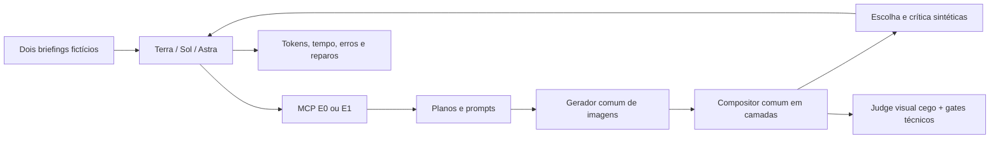

# Estudo de eficiência do MCP

**Em execução.** Compara Terra 6.1, Sol 6.1 e Astra 6 no processo de direção criativa, exploração, variação e crítica por camada. Ainda não há conclusão sobre o menor modelo/effort aceitável. O [protocolo](protocol.md) e a [rubrica](rubric.md) foram definidos antes das trajetórias.

- **E0:** catálogo original do PR #8; continua sendo o default.
- **E1:** descrições/exemplos mais explícitos, sem mudar validação, respostas ou skills. O catálogo cresce de 14 KB para 27 KB; o benefício ainda precisa ser demonstrado.
- **Effort inicial:** low para todos. Elevação condicionada a falha reproduzida, separando problemas de infraestrutura.
- **Critério:** artefatos completos, notas ≥4 em cada dimensão aplicável, sem erro crítico. A nota é preferência simulada, não validação de mercado.

## Evidências disponíveis

| Evidência | Estado |
|---|---|
| [Freeze dos inputs, MCP, skills e runtime](freeze.json) | Registrado antes da primeira trajetória |
| [Freeze do compositor](render-freeze.json) | Mesmo contrato para todos os braços |
| [Probes do runtime](../../../prototypes/compor-mcp/evals/model-efficiency/runtime/probes/summary.json) | Terra/Astra chamaram MCP; a falha inicial de isolamento de Sol foi preservada. Probes não medem qualidade. |
| Testes do protótipo | 31/31; incluem paridade E0/E1 e catálogo original |
| Testes do runner / compositor | 8/8 e 9/9; fixtures sintéticas, não uso de modelo |
| [Matriz planejada](../../../prototypes/compor-mcp/evals/model-efficiency/schedule.json) | 12 células de triagem, seguidas de réplica independente |
| Trajetórias e avaliação visual | Em execução |

Arquivos executáveis: [runner](../../../prototypes/compor-mcp/evals/model-efficiency/runtime/README.md), [compositor](../../../prototypes/compor-mcp/evals/model-efficiency/render/CONTRACT.md). Casos e expectativas ficam separados para evitar entregar a rubrica aos geradores. As limitações de acesso, cache, modelo observado e isolamento estão no protocolo e nos relatórios de execução.

Nenhum candidato foi promovido. A arquitetura continua v0 e a integração de produção permanece fora deste ensaio.
