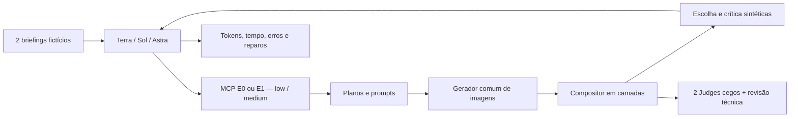

# Eficiência de modelos no MCP — rodada encerrada para revisão

**O menor modelo/effort aceitável não foi estabelecido.** Os 24 pacotes foram tentados; nenhum cumpriu integralmente a rubrica dos dois LLM Judges. Houve boas peças isoladas, mas acabamento, encantamento e revisão limitaram o conjunto. Isso encerra esta rodada de comparação; não demonstra que o objetivo maior de qualidade do Compor foi alcançado.

[Resultados por trajetória](results.md) · [Galeria low](gallery-low.md) · [Galeria medium](gallery-medium.md) · [Como reproduzir](reproduce.md)

## O que foi testado

- **E0:** catálogo original do PR8; continua sendo o default.
- **E1:** descrições e exemplos mais explícitos; mesmos validators, respostas e quatro skills. Catálogo: 14.091 → 26.953 bytes, aumento de 91%. Ativação explícita pelo host: `COMPOR_MCP_GUIDANCE=guided_v1`.
- **24 trajetórias:** três modelos × dois braços × dois casos × dois efforts. Uma execução por célula, não réplicas suficientes para estimar estabilidade. A segunda réplica low foi substituída por medium, com [decisão registrada antes dos novos runs](adaptation-01.md).
- **46 assets e 109 PNGs compostos:** T3 explora duas direções; T4 reutiliza o ativo selecionado em duas variações; T5 recebe crítica local e elogio de outro aspecto.
- **19 trajetórias com todos os PNGs.** Três interrupções por capacidade do serviço e dois overflows de texto preservados, sem correção criativa pelo coordenador.
- **110 testes automatizados passaram.** Eles verificam contratos e infraestrutura; não representam 110 usuários satisfeitos. [Validação](validation.md).

## O que a evidência sustenta

**Não promover E1 nem recomendar um modelo mínimo com estes dados.** As descrições maiores não eliminaram os erros de chamada nem produziram um pacote integralmente aceitável. Houve 91 chamadas MCP com argumentos inválidos ou erro de tool, recuperadas antes dos planos finais disponíveis. A contagem não inclui indisponibilidade do modelo.

Nos nove pares com cinco turnos nativos concluídos em ambos os braços, E1 consumiu mais tokens em oito, e menos em um (Astra medium/mentoria). Isso é observação de uma execução, não efeito causal nem economia de cobrança. Não há vencedor de eficiência entre entregas aceitáveis porque nenhuma atingiu esse critério. Cache, tokens e tempo ativo estão separados nas [métricas low corrigidas](metrics-low-v2.md) e [medium](metrics-medium.md); a primeira agregação low foi preservada.

A crítica por camada foi útil para auditar o alcance da edição. As revisões preservaram palavras, imagem e outras camadas nos casos verificados; Sol E0 medium/startup ampliou também a altura da caixa da headline, além de escala/quebra previstas. Essa exceção é uma falha do contrato estrito, não um novo critério crítico criado depois do teste. Feedback positivo/negativo e não conclusão são relatos fictícios; não houve gravação de memória de usuário ou comprovação de satisfação real.

## Continuação: candidato E2 em desenvolvimento

O [candidato E2 e seu replay diagnóstico](e2-development.md) foram implementados depois desta rodada. A [trajetória E2 completa](e2-result.md) também ficou abaixo da régua dos dois Judges; é um replay de desenvolvimento, fora da matriz de 24 runs. A [proposta E2](e2-proposal.md) concentra instruções curtas nos erros de coordenadas e `z_index`, com orientação visual carregada sob demanda. O resultado também sugere experimentar medição de texto/preview durante a composição, permitindo reparar overflow e rever hierarquia **dentro do alcance autorizado**. Isso é hipótese arquitetural: não foi testada nesta rodada e não faz parte de uma nova arquitetura aprovada.

Não é necessário ampliar o produto para multiagentes, MCP Apps, execução offline ou persistência neste ensaio. A arquitetura permanece v0. O PR entrega código experimental, evidências e propostas para crítica, sem promoção automática do harness.

## Evidência e limites

| Fonte | O que verifica |
|---|---|
| [Protocolo](protocol.md), [rubrica](rubric.md), [freeze](freeze.json), [medium freeze](medium-freeze.json), [renderer](render-freeze.json) | Critérios e inputs anteriores às respectivas execuções |
| [Resultados JSON](results.json) | Ligação dos 24 runs às métricas e notas, com hashes das fontes |
| [LOW T3](technical-screening-t3.md), [LOW revisões mentoria](technical-screening-followups.md), [LOW startup](technical-screening-startup.md) | Contratos, ferramentas, alcance e estado |
| [MEDIUM mentoria](technical-medium-mentoria.md), [MEDIUM startup](technical-medium-startup.md) | Mesma revisão técnica e desvios observados |
| [Revisão de código](code-review.md), [ocorrências](infrastructure-events.md) | Defeitos de orquestração, correções e tentativas preservadas |

Notas cegas: [A low/mentoria](judge-a-round1-mentoria.md), [B low/mentoria](judge-b-round1-mentoria.md), [A low/startup](judge-a-round1-startup.md), [B low/startup](judge-b-round1-startup.md), [A medium/mentoria](judge-a-medium-mentoria.md), [B medium/mentoria](judge-b-medium-mentoria.md), [A medium/startup](judge-a-medium-startup.md), [B medium/startup](judge-b-medium-startup.md). As divergências entre os Judges permanecem, sem adjudicação para produzir aprovação.

- Os casos são novos, mas não um holdout protegido; seu autor viu um apêndice anterior. Todos passam a ser corpus visível.
- Julgamento é sintético. Não estima gosto humano, conversão, viralização, receita, acessibilidade universal ou benefício de tempo real.
- Um gerador estocástico comum produziu os assets, com versão exata não exposta. Modelo/effort do agente foram observados no runtime; identidade retornada pelo provedor não foi exposta.
- O isolamento tem limite conhecido: respostas mencionam wiki apesar do escopo local. O guard busca apenas alguns marcadores em mensagens developer/system; hashes e flags negativas não provam ausência de política herdada nas instruções base. Nenhuma credencial ou instrução privada foi copiada para o estudo.
- Compositor usa fontes e paths locais; verificação exata requer os bytes registrados. Os tokens de exec/resume são cumulativos; somá-los por checkpoint inflaria consumo. Custos financeiros não foram medidos.
- Falhas de serviço permanecem no denominador e seus usos desconhecidos não viram zero. Os campos de estado autoritativos estão nos últimos `report-*.json` e `advance-*`, não no manifest inicial.
