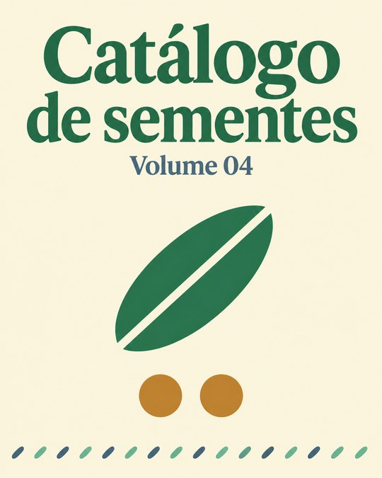
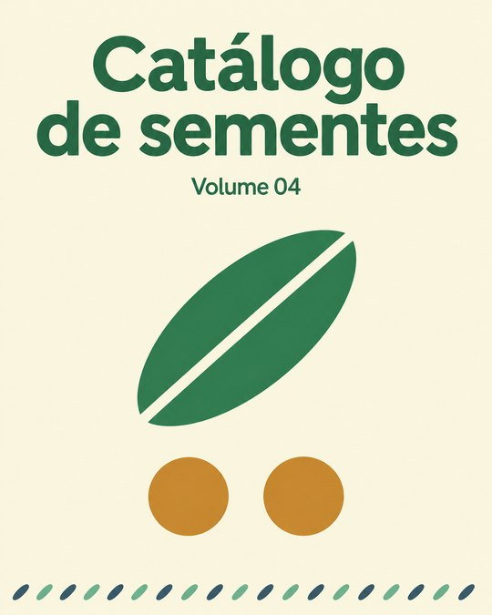

# Triagem e geração de propostas com uma referência opcional

O ensaio partiu da pergunta de Matheus sobre o que o agente entende ao receber várias referências e o que o GPT Image aproveita quando uma delas é opcional. A mesma oferta foi planejada em dois braços ao longo de seis rodadas. Nas comparações visuais, os dois braços receberam o mesmo prompt e os mesmos demais anexos. As referências e os briefings são sintéticos. [Protocolo](../../../scripts/evals/triagem-divergencia/README.md)

## Resultado

Dos 60 planejamentos, 59 atenderam ao contrato. Em Cais sem a opcional, o contraste da terceira proposta tinha 302 caracteres para um limite de 300. O executor preservou a recusa. Todas as 31 decisões de manter ou omitir uma referência observáveis em R5 coincidiram com o esperado. A recusa impediu observar as outras quatro. Na baseline, eram 35 de 35.

A cobertura da característica visual passou de 23/35 para 31/35. Nas 19 referências com nota nas duas rodadas, a média aumentou 0,26 ponto na escala de 0 a 2. Na revisão com acesso à seleção, os planos admitidos passaram de 2/10 na baseline para 9/10 na R5. A R4 tinha atingido 10/10. Nos cinco casos sintéticos, o ganho de compreensão foi mais consistente que a evolução de uma rodada para a seguinte.

A baseline gerou zero pares, inclusive no controle complementar com prompt fixo. Na final, quatro casos permitiram gerar 12 pares. O primeiro julgamento considerou utilizáveis 7/12 artes de cada braço. Um segundo julgamento dos mesmos arquivos chegou a 8/12 em cada braço. Nesse segundo parecer, a fidelidade ao atributo da opcional somou 15/24 pontos com o anexo e 19/24 sem ele. Os resultados sustentam manter a candidata em avaliação antes de promovê-la. A preferência de Matheus continua em aberto.

A estimativa de tabela foi de **US$ 1,542 a US$ 1,842** para o ensaio completo. Os 60 planejamentos representaram US$ 0,656–0,923, e as 24 imagens, US$ 0,886–0,919. A incerteza vem da precificação do cache. A cobertura foi de 84/84 operações. Os juízes usaram a assinatura ChatGPT, sem preço por turno disponível. A primeira leitura resultou em US$ 0,0831–0,0909 por arte utilizável com a opcional e US$ 0,0611–0,0645 sem ela, incluindo os planejamentos da R5.

## Um par de artes para inspecionar

Na primeira rota do *Catálogo de sementes*, o pedido reservava o azul-ardósia e o verde-água para o friso no rodapé. As duas artes conseguiram alternar as cores nos grãos. Na arte com a referência, o azul também apareceu na linha “Volume 04”. Na outra, essa linha ficou verde. Essa diferença visível explica por que uma instrução pode identificar a paleta e ainda aplicá-la no lugar errado. Cada versão teve uma geração, sujeita à variação do modelo.

| Com o arquivo opcional | Sem o arquivo opcional |
| --- | --- |
|  |  |

As duas prévias vêm dos PNGs da R5. O estudo confronta os hashes dos arquivos de entrada, das configurações e dos prompts dos 12 pares.

## O que consultar

- [Métricas das seis rodadas, cobertura, reserva e custos](resumo.md)
- [Horários dos oito lotes, custos por braço e diferenças entre os dois julgamentos](execucao.md)
- [Mudanças solicitadas pelos juízes em cada rodada de desenvolvimento](ciclos.md)
- [Instruções exatas, hipóteses e previsões das cinco candidatas](candidatas.md)
- [Mapa dos cinco marcos e três propostas de melhoria por marco](../pr61/propostas-por-marco.md)
- [Desenho para uma eventual adoção no estúdio](../triagem-divergencia-adocao.md)
