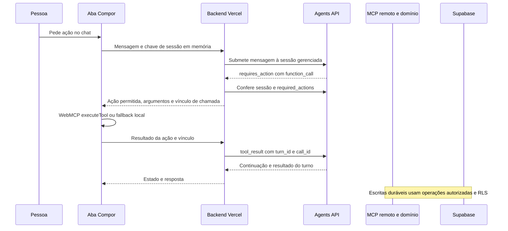

# Compor: chat e controle do fluxo com WebMCP

**Estado:** proposta para revisão de Matheus em 5 de novembro de 2026. Nenhuma interação descrita aqui está comprovada pela existência deste documento. Ele complementa o [desenho do estúdio](2026-11-05-experiencia-figma-marco-0.md), que deve incorporar estas decisões antes da implementação.

## Objetivo e decisões

A pessoa conversa com o Compor enquanto organiza o briefing, edita uma peça ou pede ajustes. O chat pode orientar e executar ações do fluxo, como atualizar um dado do projeto e iniciar um novo post. Marcações na arte e interações no chat fazem parte dos pedidos de ajuste. A Agents API continua responsável pela sessão, pelas decisões do agente e pelo ciclo de ferramentas; não se introduz um loop de agente próprio no backend.

- Há uma conversa por projeto, contextualizada pela peça e versão abertas. O Codex compartilha projetos, peças e versões pelo MCP remoto, mas a conversa da web não é compartilhada com ele.
- A conversa do produto, os rascunhos e demais conteúdos transitórios ficam apenas no navegador. Os conteúdos efetivamente enviados ao agente são processados pela OpenAI, cuja retenção já foi aceita para o produto; este documento não promete que deixem de existir no provedor. A chave OpenAI permanece apenas em memória e não integra histórico, ferramentas, argumentos, logs ou armazenamento do navegador.
- Metadados técnicos mínimos de tentativas, idempotência e uso podem ser guardados no Supabase, sem mensagens, prompts, texto do briefing ou conteúdo criativo. Isso permite controlar operações e investigar resultados incertos. Identificadores, estados, tempos e contagens não são conteúdo criativo, mas continuam associados a uma conta e exigem controle de acesso.
- Projetos, peças, versões e arquivos que a pessoa salvar são persistidos no Supabase e protegidos por RLS e autorização por operação. Não se deve gravar um rascunho criativo no Supabase apenas porque uma ação foi solicitada no chat.
- Uma alteração derivada de uma versão anterior cria uma nova versão atual, sem alterar a anterior. Se a origem estiver aprovada, a nova versão herda a aprovação com sua origem identificada; essa herança não representa uma nova revisão humana.
- A geração de imagem paga exige confirmação explícita. Quando não houver base confiável para a estimativa, o custo é desconhecido, não zero. O limite autorizado para os testes desta sessão não é uma garantia de teto agregado do produto.

A decisão de manter conversa e rascunhos apenas no navegador substitui qualquer sugestão anterior de persistir a conversa do produto no Supabase durante o marco 0. O vínculo gerenciado e os metadados técnicos não transformam a OpenAI ou o Supabase em armazenamento do histórico local do produto.

## Fatos e limites da plataforma

O [WebMCP](https://github.com/webmachinelearning/webmcp/blob/main/README.md) é uma proposta em evolução para que uma página registre ferramentas estruturadas em `document.modelContext`. A orientação do Chrome descreve `getTools()` e `executeTool()` para agentes embutidos na própria página. A página expõe comportamentos locais; WebMCP não é um endpoint HTTP ou um servidor MCP remoto.

O [estado das implementações](https://github.com/webmachinelearning/webmcp/blob/main/implementation-status.md) registra origin trials para Chrome e Edge e suporte no ChatGPT Desktop. Isso não prova disponibilidade em todos os navegadores nem no Codex Desktop do usuário. As [instruções do Chrome](https://developer.chrome.com/docs/ai/webmcp) descrevem origin trial e flag local de desenvolvimento. Verificar os métodos concretos, as permissões e o comportamento no navegador alvo; não inferir que a presença do navegador implica acesso à API.

A [Agents API](https://developers.openai.com/api/docs/guides/agents-api/tools/functions) executa a orquestração no serviço gerenciado. Quando uma function precisa de execução, a aplicação consulta `required_actions`, devolve o resultado para o mesmo `turn_id` e `call_id` e acompanha o turno. A documentação não comprova acesso automático do agente remoto ao registro WebMCP de uma aba da pessoa. Uma ponte precisa ser implementada e validada.

O [MCP remoto](https://developers.openai.com/api/docs/guides/agents-api/tools/mcp) é acessível pela Agents API ou pelo Codex como serviço autenticado. Ele não é o WebMCP da página. Uma chamada ao MCP não deve presumir que uma aba esteja aberta ou atualizada.

## Proposta de arquitetura

Essa sequência é uma proposta, não uma afirmação de que a ponte ou a atualização da interface já funcionem. O backend atende cada function necessária e encaminha eventos; quem decide a próxima ação e continua o turno é a Agents API. O tratamento de functions requer código de integração e reconciliação; não desaparece por usar uma API gerenciada.

Um catálogo único descreve cada ação, seu schema, executor e tipo de efeito. A aba registra no WebMCP somente as ações aplicáveis ao contexto atual. Um adaptador do chat usa `getTools()`/`executeTool()` quando disponíveis e, em navegadores sem suporte, chama diretamente os mesmos handlers locais. O fallback oferece a função do produto, mas não é uma invocação WebMCP nativa. Registrar e remover ferramentas conforme o contexto da página; não expor tokens, operações genéricas de código ou acesso arbitrário ao DOM.

Para capacidades duráveis, o MCP remoto e as rotas web devem compartilhar os mesmos comandos de domínio e verificações de autorização. A execução de uma alteração persistida pode ocorrer por um comando de domínio do MCP ou por um handler da aba que chama a API autenticada; a implementação deve escolher um único responsável por cada chamada e evitar executar ambos. O resultado deve atualizar a interface com o estado confirmado ou mostrar conflito. Um identificador de projeto nunca concede acesso por si só.

## Contrato inicial proposto

Os nomes são exemplos a validar; ainda não são tools implantadas. Schemas devem ser fechados, com campos obrigatórios, tipos, limites e `additionalProperties: false`. A operação não deve aceitar código, seletor DOM, URL de callback arbitrária, chave ou token como argumento.

| Ação | Efeito e destino | Contrato e precondições |
| --- | --- | --- |
| `mostrar_contexto` | Leitura da seleção e do estado local. | Retorna projeto, peça e versão selecionados e quais alterações estão pendentes, apenas com os dados necessários ao pedido. Deve distinguir conteúdo salvo de rascunho. |
| `editar_rascunho` | Altera somente o rascunho da aba ou do armazenamento do navegador. | Recebe peça, versão-base, campo permitido e valor. Rejeita contexto desatualizado ou campo fora da lista. A interface mostra a alteração e preserva a possibilidade de edição. |
| `editar_persona` | Atualiza o rascunho local da etapa Conhecendo quem vai comprar. | Aceita público, situação, necessidade, referências e informações com procedência. Não transforma hipóteses em fatos nem grava o rascunho no Supabase. A análise da skill chega como proposta revisável. |
| `abrir_etapa` | Navega entre briefing, persona compradora e estúdio sem descartar alterações locais. | Aceita somente uma etapa do fluxo conhecido e o projeto atual. A etapa de conexão da IA é apresentada quando uma operação exigir chave; a navegação não inicia chamada paga. |
| `iniciar_post` | Abre um novo rascunho local no projeto; não cria versão persistente automaticamente. | Recebe projeto e identificador idempotente do rascunho. Reutiliza o mesmo rascunho se a mesma chamada reaparecer. Salvar continua sendo operação própria. |
| `selecionar_versao` | Navega para uma versão existente, sem alterar a atual no servidor. | Verifica projeto, peça e versão acessíveis. A mudança não descarta silenciosamente rascunho não salvo. |
| `atualizar_projeto` | Altera dado persistido solicitado pela pessoa. | Aceita campos específicos e precondição de versão/revisão. Autenticação, propriedade e validação do valor são verificadas no servidor com RLS. Conflito não sobrescreve uma alteração concorrente. |
| `salvar_versao` | Persiste versão nova no projeto autorizado. | Exige peça, versão-base e versão esperada, uma chave de operação e conteúdo fornecido pela pessoa ou resultado revisável. A nova versão fica atual; uma aprovação herdada registra sua origem. |
| `propor_imagem` | Apresenta pedido e custo conhecido ou desconhecido, sem gerar. | A execução paga ocorre em ação posterior vinculada à conta, projeto, peça, versão e chamada; exige confirmação explícita independente do texto do modelo. |

Cada entrega à aba deve estar vinculada pelo backend à conta autenticada, ao projeto, à sessão, ao turno e à chamada que continuam pendentes no provedor. O vínculo deve ter prazo e integridade, e não deve embutir credenciais ou argumentos criativos persistidos; um digest autenticado dos argumentos pode relacionar o pedido ao resultado sem salvar o texto, sujeito à revisão de segurança. A aba confere o contexto ativo e valida os mesmos campos antes de executar. Ela retorna estado e dados mínimos necessários ao agente, nunca a chave.

Um resultado vindo da aba informa o que o cliente relata ter feito. O backend não pode tratá-lo, por si só, como prova de gravação no Supabase. Para uma escrita durável, verificar o efeito e a propriedade no servidor; para uma alteração local, mostrar que ela ocorreu no rascunho da aba e não afirmar que foi salva. O resultado pode conter conteúdo autorizado para o agente, mas esse conteúdo não deve entrar nos logs ou nos metadados persistidos pelo Compor.

## Estado, idempotência e falhas

- Persistir antes do efeito os identificadores técnicos necessários para correlacionar a operação, a conta, o projeto e `session_id`, `turn_id` e `call_id`, mais estado e contagens de uso. Não guardar a mensagem, o prompt, os argumentos ou o resultado criativo como metadados. A retenção e eventual hash dos argumentos precisam ser definidos sem permitir recuperação trivial de conteúdo.
- A identidade de uma ação é a chamada pendente, não apenas o nome da tool. Repetir o mesmo identificador com contexto ou argumentos divergentes deve falhar; verificar unicidade e concorrência no servidor. IDs de sessão e de tentativa não são autorização.
- Definir estado observável para preparada, pendente, executando, concluída, recusada, falha e resultado desconhecido. Serializar ações incompatíveis por projeto e conferir a revisão antes de gravar. A pessoa deve ver quando uma alteração ainda é local e quando foi efetivamente salva.
- Recarregar ou mudar de aba pode interromper a execução. Os rascunhos e a conversa podem ser retomados no mesmo navegador enquanto o armazenamento local existir, com separação por conta e projeto. Limpeza dos dados do navegador, navegação privada, fechamento quando for usado apenas `sessionStorage`, troca de dispositivo ou indisponibilidade do armazenamento podem provocar perda; o produto deve informar esse limite sem prometer recuperação universal.
- Se o efeito de uma chamada for incerto, consultar a mesma sessão e o estado da operação antes de qualquer reexecução. Se não houver prova suficiente, manter o resultado desconhecido e não repetir automaticamente geração paga, gravação ou criação. Não prometer execução exatamente uma vez entre navegador, Vercel e provedor. O [guia de functions](https://developers.openai.com/api/docs/guides/agents-api/tools/functions) recomenda reconciliar efeitos e guardar o resultado de chamadas com efeitos antes de reenviá-las; aqui os recibos devem obedecer à restrição de não persistir conteúdo criativo.
- A sessão da OpenAI pode sobreviver à desconexão; `idle`, HTTP 202, texto do agente ou fim do stream não provam sucesso. Acompanhar o turno e resultados reais. Se a chave for reapresentada e não acessar a sessão anterior, comunicar a indisponibilidade sem mudar de conversa silenciosamente.
- O envelope MCP delegado atual tem prazo limitado. A divergência documentada entre guia e referência da OpenAI sobre atualização de tools exige prova real de renovação; uma troca de sessão precisa carregar contexto explicitamente, sem repetir ação incerta.

## Autoridade e confirmação

Todas as operações duráveis usam o token da pessoa, RLS e verificação de projeto, peça e versão por operação. A ponte não concede ao agente mais direitos do que a pessoa tem. Um pedido no chat que descreve uma alteração específica pode autorizar essa alteração dentro dos direitos da conta; quando o pedido for ambíguo, o chat deve esclarecer antes de gravar. Troca de conta invalida contexto local e vínculos ativos para a conta anterior.

A [orientação de segurança do Chrome](https://developer.chrome.com/docs/ai/webmcp/secure-tools) trata conteúdo externo e texto gerado por usuário como não confiáveis. As anotações `readOnlyHint`, `untrustedContentHint` e `consequentialHint` ajudam o cliente a interpretar ferramentas; são sinais, não controles de autorização ou confirmação. A interface e o backend devem impor independentemente as confirmações exigidas, inclusive antes da geração paga. Uma imagem, referência ou texto de terceiro não pode ampliar permissões ou autorizar uma operação.

Não expor ferramentas entre origens ou iframes sem necessidade. Na configuração padrão, limitar o registro e o consumo à origem do Compor, removê-los ao trocar contexto ou desmontar a página e validar mensagens entre frames caso um iframe venha a ser adotado. A disponibilidade e a identidade das ferramentas podem mudar durante a sessão; o agente e a interface devem tratar ferramentas ausentes ou desatualizadas como erro recuperável.

## Verificação e critérios de aceite

1. Em navegador com WebMCP habilitado, provar descoberta e execução das ferramentas da aba por um cliente real; comparar com o fallback em navegador sem a API. Testes simulados do catálogo não substituem a prova no navegador e agente reais. Confirmar o que é suportado em Chrome, Edge, ChatGPT Desktop e no ambiente efetivo do usuário, sem estender evidência de um para outro.
2. Em uma conversa real, pedir alteração de um campo do projeto e início de outro post. Verificar o resultado na UI e no banco: atualização persistida autorizada, rascunho novo apenas no navegador até o salvamento e nenhuma alteração em outro projeto.
   A pessoa também pode voltar à etapa de persona e corrigir uma informação ou referência pelo chat; verificar a procedência e a atualização no rascunho local sem criar uma versão persistida ou executar pesquisa não solicitada.
3. Selecionar versão anterior, pedir ajuste por área e elemento editável e salvar. Comprovar nova versão atual, origem imutável, aprovação herdada quando aplicável e conflito recuperável em escrita concorrente.
4. Interromper a aba antes e depois do efeito, durante a confirmação e após o envio de resultado. Confirmar que nenhuma operação incerta é repetida automaticamente e que uma ação já concluída não cria outra peça, versão ou imagem. Testar colisão de IDs, argumentos diferentes e requisições concorrentes em conexões independentes.
5. Usar duas contas autenticadas reais para validar isolamento de comandos, rascunhos, sessões, referências e Storage. Testar troca de conta, projeto e versão durante a execução, expiração da credencial delegada e a ausência de acesso do Codex à conversa da web.
6. Inspecionar armazenamento, tráfego e logs de teste para confirmar que a chave nunca entra em tool, URL, log ou armazenamento persistente, e que Supabase contém apenas dados persistentes autorizados e metadados técnicos permitidos. Conferir que conteúdo transitório aparece apenas no navegador e, quando enviado, no provedor conforme suas regras.
7. Com a API e o modelo de imagem efetivamente disponíveis, executar uma jornada ponta a ponta com gasto autorizado e mensurado: pedido, confirmação, imagem, armazenamento privado e versão retornada. Registrar uso do provedor, estimativa e fatura separadamente; não atribuir ao produto efeitos que foram apenas simulados.

## Questões para revisão

- Qual prazo e comportamento de limpeza dos rascunhos locais devem ser adotados no piloto? A implementação precisa indicar claramente o risco de perda e separar contas sem gravar a chave.
- Quais campos persistentes o chat poderá alterar automaticamente por pedido explícito, e quais ações adicionais exigirão confirmação? As propostas da tabela ainda não constituem uma autorização genérica para qualquer escrita.
- Qual alternativa será usada se o navegador suportar registro de ferramentas, mas não os métodos de consumo de agente embutido, ou se a renovação MCP da sessão longa não for suportada? O fallback proposto requer prova e não elimina essas duas validações.
- O [contrato separado de ajustes e avaliação](../design/2026-11-05-avaliacao-ajustes-e-linhagem.md) descreve como comparar mensagens, base, marcações, referências, resultados e aprovação. A implementação dos casos, calibração da rubrica e limites de aceitação permanecem sujeitos à revisão, sem coletar conteúdo em metadados operacionais por padrão.
