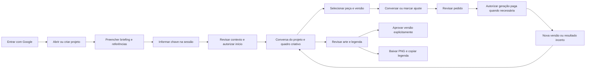

# Compor: desenho técnico da experiência web do marco 0

**Estado:** proposta para implementação e revisão. A decisão de 5 de novembro de 2026 inclui a experiência completa do Figma no marco 0, com quadro criativo e conversa contínua. Este documento registra o que foi observado, as decisões confirmadas e as propostas que ainda precisam ser implementadas ou validadas. Não comprova funcionamento em produção.

A especificação anterior do [backend e MCP](2026-11-02-marco-0-backend-agents-mcp.md) descrevia uma interface mínima. A decisão de 5 de novembro amplia aquele recorte para a experiência completa. As garantias de autenticação, autorização, preservação, confirmação de geração e medição continuam aplicáveis. Os detalhes de UX não definidos por aquela especificação continuam sujeitos às decisões abaixo.

## Referências e limites da observação

A referência é a página [Web v0, revisão 50 e 59](https://www.figma.com/design/KlGEjt2D3tQHsHb4RsDr6i/Compor-%C2%B7-90-%E2%80%94-Arquivo-original-e-revis%C3%A3o?node-id=22-1743). A inspeção de 5 de novembro de 2026 usou metadados do Figma e observação visual dos quadros no navegador. O conector do Figma atingiu o limite do plano Starter ao solicitar contexto de design e imagens. As telas observadas têm tamanho de referência 1440 × 960. Não há comparação pixel a pixel, verificação completa dos componentes ou evidência de comportamento responsivo.

O arquivo inclui telas e variações que não foram individualmente inspecionadas. Nome de camada, texto e imagem de um protótipo descrevem uma intenção de interface. Eles não provam que a interação, o backend ou a integração com um provedor funcionem. Para implementar cada tela, obter seu contexto de design completo e conferir componentes, estilos e recursos originais. Não recriar ou substituir ativos por aproximação sem verificar a fonte.

## Decisões confirmadas

- A experiência completa de criação apresentada no Figma, incluindo quadro criativo e conversa contínua, pertence ao marco 0. Ela amplia a interface mínima descrita anteriormente.
- Cada projeto tem uma conversa. O contexto da mensagem inclui a peça e a versão selecionadas. Abrir uma versão anterior e pedir alterações cria uma nova versão, sem alterar a anterior. Matheus confirmou essas duas regras em 5 de novembro de 2026.
- O acesso ao Compor usa Google por meio do Supabase. O acesso demonstrativo com senha mostrado no Figma não substitui essa decisão.
- A chave OpenAI é informada para a sessão web, permanece em memória e é reapresentada quando necessário. A chave é enviada por conexão protegida ao backend para operações autorizadas. O Codex autentica no MCP pela conta Compor e não depende da chave da sessão web.
- A OpenAI Agents API gerencia a sessão e o ciclo do agente. O backend atende às funções necessárias, inclusive imagem quando aplicável. Isso não introduz um loop de agente próprio com Agents SDK.
- A criação de imagem paga exige ação explícita. Uso e custo estimado são observados desde o marco 0, com dados indisponíveis apresentados como desconhecidos. O teto autorizado para a prova real desta sessão é US$ 5 no total; ele não é automaticamente um limite do produto nem prova de saldo remanescente.
- Projetos, versões e dados novos pertencem à conta autenticada. O Compor não importa os dados locais do protótipo. O perfil Phoenix e suas funções específicas permanecem para etapa posterior, conforme a especificação anterior.

## Jornada observada no Figma

| Quadro | Evidência observada | Consequência para o desenho |
| --- | --- | --- |
| [05. Seus projetos](https://www.figma.com/design/KlGEjt2D3tQHsHb4RsDr6i/Compor-%C2%B7-90-%E2%80%94-Arquivo-original-e-revis%C3%A3o?node-id=211-9688) | Navegação lateral, ação de novo projeto e cartão de projeto recente. | A pessoa precisa localizar e retomar seu projeto sem percorrer um formulário de edição. |
| [07. Conte a sua ideia](https://www.figma.com/design/KlGEjt2D3tQHsHb4RsDr6i/Compor-%C2%B7-90-%E2%80%94-Arquivo-original-e-revis%C3%A3o?node-id=211-9769) | Campos para oferta, público, ação esperada e direção. Há referência opcional. | O briefing precisa de campos identificáveis e retomáveis. A ausência de referência deve ser permitida. |
| [08. Conectar sua IA](https://www.figma.com/design/KlGEjt2D3tQHsHb4RsDr6i/Compor-%C2%B7-90-%E2%80%94-Arquivo-original-e-revis%C3%A3o?node-id=211-9818) | Etapa própria com chave mascarada, indicação de cobrança no provedor e uso na sessão. | O fluxo deve tornar a origem do consumo compreensível e obedecer à regra de chave em memória. |
| [09. Confirmar antes de começar](https://www.figma.com/design/KlGEjt2D3tQHsHb4RsDr6i/Compor-%C2%B7-90-%E2%80%94-Arquivo-original-e-revis%C3%A3o?node-id=211-10437) | Resumo da direção, botão de autorização e um valor de consumo identificado na própria tela como fictício. | O número do protótipo não é previsão de custo. O produto precisa mostrar uma estimativa fundamentada ou declarar que ela é desconhecida. |
| [10. Converse e componha](https://www.figma.com/design/KlGEjt2D3tQHsHb4RsDr6i/Compor-%C2%B7-90-%E2%80%94-Arquivo-original-e-revis%C3%A3o?node-id=211-9859) | Quadro central, conversa à direita, abas e controles de exploração. | O conteúdo do projeto e a conversa devem permanecer acessíveis durante a criação. |
| [13. Post atual](https://www.figma.com/design/KlGEjt2D3tQHsHb4RsDr6i/Compor-%C2%B7-90-%E2%80%94-Arquivo-original-e-revis%C3%A3o?node-id=211-10477) | Uma versão do post aparece no quadro e em um cartão na conversa. | A resposta, a peça e a versão exibida precisam de vínculos verificáveis. |
| [18. Marcar ajustes](https://www.figma.com/design/KlGEjt2D3tQHsHb4RsDr6i/Compor-%C2%B7-90-%E2%80%94-Arquivo-original-e-revis%C3%A3o?node-id=211-11468) e [19. Conferir o pedido](https://www.figma.com/design/KlGEjt2D3tQHsHb4RsDr6i/Compor-%C2%B7-90-%E2%80%94-Arquivo-original-e-revis%C3%A3o?node-id=211-11665) | Marcação sobre a arte, nota, resumo do pedido e ação para aplicar. | O ajuste precisa preservar a versão de origem e o contexto da marcação. |
| [Histórico completo](https://www.figma.com/design/KlGEjt2D3tQHsHb4RsDr6i/Compor-%C2%B7-90-%E2%80%94-Arquivo-original-e-revis%C3%A3o?node-id=211-16381) | Quatro versões lado a lado, uma marcada como atual, e conversa visível. | A navegação deve distinguir versão selecionada de versão atual sem sobrescrever histórico. |
| [Moodboard](https://www.figma.com/design/KlGEjt2D3tQHsHb4RsDr6i/Compor-%C2%B7-90-%E2%80%94-Arquivo-original-e-revis%C3%A3o?node-id=211-14036) | Referências, cores e direção no quadro, com a conversa à direita. | O projeto precisa guardar referências e as relações necessárias para exibi-las novamente. |
| [23. Revisar post e legenda](https://www.figma.com/design/KlGEjt2D3tQHsHb4RsDr6i/Compor-%C2%B7-90-%E2%80%94-Arquivo-original-e-revis%C3%A3o?node-id=211-12055) | Arte, legenda, revisão e ações de aprovar ou pedir ajuste. | Aprovação é um ato explícito e vinculado a uma versão. |
| [25. Exportar arte e legenda](https://www.figma.com/design/KlGEjt2D3tQHsHb4RsDr6i/Compor-%C2%B7-90-%E2%80%94-Arquivo-original-e-revis%C3%A3o?node-id=211-12852) | Ações de baixar PNG e copiar legenda. O cabeçalho do post indica 1080 × 1350. | A exportação precisa produzir e verificar o formato retrato. Baixar ou copiar não equivale a aprovar ou publicar. |

A identidade visual observada usa fundo creme, navegação lateral azul, acentos amarelos, cartões claros e a marca com símbolo e nome. A interface publicada em 5 de novembro usa outra organização visual. A tela conectada mantinha **Continuar** desabilitado com uma mensagem de conexão necessária. A investigação da interface ocorreu sobre um projeto sintético; não demonstra o fluxo completo de geração.

## Modelo de domínio proposto

Os nomes a seguir descrevem responsabilidades, não tabelas ou contratos já existentes. A escolha de esquema e migrações depende de revisão das políticas, concorrência e compatibilidade com clientes existentes.

| Conceito | Dados e relações a preservar | Evidência atual e lacuna |
| --- | --- | --- |
| Projeto | Proprietário, identificação e informações necessárias para retomar o trabalho. | `projects` existe. A conta dona já é verificada por RLS e por operação. |
| Briefing | Oferta, público, ação esperada, direção e estado dos fatos. Deve pertencer ao projeto e indicar sua revisão. | O objetivo livre existe na interface; não foi encontrada persistência dos campos estruturados. |
| Conversa | Uma conversa por projeto, com mensagens ordenadas, origem e estado. Cada solicitação deve registrar a peça e a versão que a contextualizam. | O fluxo atual apresenta uma resposta de tentativa. Ainda não há conversa contínua persistida do produto. |
| Sessão gerenciada | Vínculo recuperável entre a conversa do projeto e a sessão da Agents API, sem guardar a chave OpenAI. A identidade do projeto e o controle de acesso permanecem no Compor. | A retomada após desconexão requer prova real. A presença de ID ou estado `idle` não comprova sucesso do turno. |
| Peça e versão | Peça identificável dentro do projeto; versões imutáveis com conteúdo, origem, versão de base e artefatos associados. | `piece_versions` já existe com comparação de versão esperada. A linhagem explícita da versão anterior e o fluxo a partir de qualquer versão precisam ser verificados ou ampliados. |
| Referência e moodboard | Recurso, origem, autorização declarada quando aplicável, relação com projeto e elementos exibidos no quadro. | Há armazenamento privado de imagens por versão. O modelo de referências e seu quadro ainda não estão comprovados. |
| Marcação de ajuste | Região ou elemento escolhido, versão de origem e nota que forma o pedido. | Os quadros mostram a interação; representação, limites e persistência ainda precisam de desenho e testes. |
| Aprovação | Ação explícita, autor, data e versão a que se refere. | A interface atual distingue download de aprovação, mas não há prova de estado persistente de aprovação. |
| Tentativa e medição | Identidade da operação, contexto, estado, uso disponível e custo estimado quando fundamentado. Separar agente de imagem. | Há reservas e medições; não são fatura nem limite global comprovado. |

A versão selecionada para consulta não deve ser confundida com a versão mais recente gravada. Uma solicitação sobre versão anterior deve referenciar essa base e produzir uma nova versão. A gravação precisa também detectar uma alteração concorrente do estado relevante, sem reescrever silenciosamente o trabalho de outra sessão ou do Codex.

## Proposta de fluxo e estados

O diagrama propõe a ordem dos estados para discussão técnica. Ele não exige que toda edição ou mensagem gere imagem. A pessoa pode consultar o projeto e o histórico sem chave OpenAI; uma operação que chama a OpenAI exige a chave e a autorização aplicável. Ação de consultar, selecionar versão, baixar ou copiar não implica uma nova geração nem aprovação.

O sistema deve distinguir pelo menos os estados de envio, execução, espera de ação, conclusão verificada, falha e resultado desconhecido. Uma desconexão HTTP não cancela necessariamente o trabalho no provedor. A interface precisa preservar o contexto e oferecer reconciliação da mesma tentativa quando houver identificador e autorização válidos. Ela não deve iniciar outra chamada paga automaticamente ao recuperar a tela.

O resultado do agente precisa ser associado ao turno e ao contexto que o originaram. Uma imagem tardia deve continuar ligada à tentativa e à versão de origem. Ela não pode substituir silenciosamente a versão que a pessoa passou a editar enquanto aguardava. Se uma nova versão conflitar com escrita concorrente, preservar a proposta e apresentar o conflito.

## Fronteiras técnicas propostas

1. A interface Next.js organiza navegação, briefing, quadro, conversa e revisão. Estado recuperável do produto é persistido no Supabase. A chave fica apenas em memória da aba e pode precisar ser informada novamente após recarregar ou trocar de sessão.
2. Cada operação no backend confirma a sessão do Supabase e autoriza a conta, o projeto e os recursos associados. A RLS e as políticas do Storage também verificam o acesso. Um ID de projeto, peça ou imagem não concede autorização.
3. O backend mantém o vínculo autorizado da conversa com a sessão gerenciada da OpenAI. O envio de uma mensagem usa contexto explícito e um identificador de submissão para lidar com repetição e concorrência. Os limites e a validade da sessão precisam ser comprovados com a API real.
4. O agente recebe apenas as capacidades necessárias ao projeto por meio do MCP delegado. O Codex usa sua conexão OAuth própria e as ferramentas disponíveis, sem receber a chave web. A visibilidade das novas entidades pelo MCP ainda precisa de contrato e verificação.
5. A solicitação de imagem apresenta a ação paga antes de executá-la. O backend associa a solicitação à conta, ao projeto, à peça, à versão e à tentativa. A função de imagem não substitui a orquestração gerenciada do agente.
6. Imagens e referências autorizadas usam armazenamento privado. O produto registra metadados de origem e vínculos necessários para revisão. Textos, preço, data e legenda permanecem editáveis e identificam sua origem quando conhecida. O provedor pode retornar imagem com texto mesmo quando instruído a não fazê-lo; a pessoa precisa revisá-la.
7. A composição retrato precisa gerar um PNG com dimensões verificadas de 1080 × 1350 para o formato observado. A estratégia de geração, enquadramento ou redimensionamento deve preservar proporções e permitir revisar cortes. A qualidade final e a legibilidade precisam de verificação real; não decorrem apenas do tamanho do arquivo.
8. Logs operacionais não registram chave, prompts, mensagens, imagens ou conteúdo criativo. Métricas registram modelo, estado, duração e uso disponível. Valores estimados não representam cobrança confirmada.

A delegação MCP atualmente documentada usa uma credencial de cinco minutos. A continuidade de uma conversa além desse prazo ainda não está comprovada. O [guia de configuração da Agents API](https://developers.openai.com/api/docs/guides/agents-api/configuration) afirma que `tools` não pode ser atualizado na sessão existente, enquanto a [referência de atualização de sessão](https://developers.openai.com/api/reference/resources/beta/subresources/agents/subresources/sessions/methods/update) descreve a substituição de `agent.tools`. Essa divergência impede prometer renovação de credencial ou continuidade da mesma sessão até uma prova real com a configuração usada pelo Compor. Se uma nova sessão for necessária, ela deve receber contexto explícito e não repetir um turno cujo resultado permaneça desconhecido. O produto precisa informar quando a continuidade não puder ser verificada.

A proteção atualmente documentada e seus limites estão em [isolamento e proteção de dados](../compor/isolamento-e-protecao-dados-marco0.md). As novas entidades exigem políticas de leitura e escrita próprias, autorização por operação e ensaios entre contas. RLS não substitui autorização no backend nem políticas do Storage.

## Diferenças e dependências de implementação

- A interface atual organiza objetivo, projetos, peça, direção e composição em uma página longa. Ela não apresenta o quadro e a conversa contínua do Figma.
- O fluxo atual guarda rascunhos e estados transitórios no navegador e mostra um resultado de tentativa. Ele não demonstra persistência e retomada de uma conversa do projeto.
- O modelo atual de versão comporta conteúdo estruturado, mas a experiência completa precisa relacionar mensagens, base de cada ajuste, marcações, referências, resultados e aprovação.
- A geração de imagem atual usa base 1024 × 1024 e o compositor mantém as dimensões da base. Isso não satisfaz, por si só, o PNG retrato 1080 × 1350 observado.
- O histórico visual, zoom, exploração do quadro, seleção de versão, revisão da legenda e aprovação precisam ser implementados e testados como ações reais. A existência dos respectivos quadros no Figma não constitui implementação.
- O fluxo real já demonstrou login Google e operações de projeto e versão pelo Codex em um projeto sintético. A geração integrada de imagem, a transferência de imagem do Codex e o isolamento de Storage entre duas identidades reais ainda precisam de prova.
- O cadastro de novos usuários foi desativado temporariamente para o piloto, conforme registro operacional da sessão. O estado efetivo deve ser conferido antes de ampliar o acesso.

## Questões pendentes

As questões abaixo não foram resolvidas pelos quadros observados. As propostas não são decisões aprovadas.

1. **Versão atual após criar uma versão a partir de outra antiga.** A nova versão deve tornar-se automaticamente a versão atual ou permanecer como alternativa até escolha explícita? O histórico precisa indicar tanto a base quanto a versão atual.
2. **Referências e conteúdo do quadro.** Quais tipos e limites de arquivo, origem, permissão de uso e recursos de edição são necessários no marco 0? O Figma observado mostra referências e cores, mas não define todos esses contratos.
3. **Marcação.** A seleção deve operar sobre áreas livres da imagem, elementos editáveis identificados ou ambos? É necessário definir como preservar coordenadas diante de redimensionamento e recorte.
4. **Aprovação e alterações posteriores.** Uma nova versão deve ficar sem aprovação enquanto a aprovação anterior permanece registrada? Como a pessoa reconhece qual versão está aprovada?
5. **Responsividade e acessibilidade.** Não foram observadas telas móveis nem todos os estados de teclado, foco, leitor de tela ou erro no Figma. É necessário definir e validar comportamento utilizável sem inventar paridade visual.
6. **Custo antes da operação.** Quando a conta não fornecer dados suficientes para previsão confiável, qual texto e qual nível de detalhe a interface apresenta? Qual mecanismo efetivo limita o gasto agregado entre agente e imagem? A issue [SCRUM-68](https://compor-mathai.atlassian.net/browse/SCRUM-68) acompanha limites e observabilidade.
7. **Conversa entre clientes.** Quais operações de leitura, envio e contexto da conversa serão expostas no MCP para o Codex? A decisão de uma conversa por projeto não comprova que o contrato remoto atual já as oferece.

## Critérios de aceite

- A pessoa entra com Google, cria ou abre um projeto, preenche o briefing e retorna ao trabalho salvo em outra sessão. A ausência de referências não impede a jornada.
- A chave não aparece em banco, armazenamento do navegador, URL, logs ou resultados de tools. Reabrir a sessão sem a chave permite consultar o projeto e solicita a chave para nova chamada autorizada. O Codex funciona sem a chave da web.
- O projeto mantém uma conversa ordenada. Cada nova solicitação registra a peça e a versão selecionadas. Ao alternar peças ou versões, a interface mostra o contexto ativo antes do envio.
- Ao abrir uma versão anterior e solicitar alteração, o resultado bem-sucedido é salvo como nova versão ligada à base. A versão anterior continua consultável e inalterada. Escrita concorrente gera conflito recuperável, sem perda silenciosa.
- O quadro apresenta a peça atual e seu histórico; seleção, zoom e retorno à visão geral são utilizáveis. Referências e marcações sobrevivem à retomada conforme os contratos aprovados.
- O pedido de ajuste mostra a marcação e o resumo antes da aplicação. A operação paga tem confirmação explícita. Uma tentativa desconectada ou desconhecida não é reenviada automaticamente.
- O estado de aprovação identifica a versão aprovada. Baixar a arte e copiar a legenda não aprovam nem publicam conteúdo implicitamente.
- A exportação de retrato produz PNG decodificável de 1080 × 1350. A verificação inclui arte, texto, data, preço e legenda, quando presentes, além da inspeção dos cortes e da legibilidade.
- Duas contas autenticadas reais comprovam acesso próprio e negação cruzada às novas entidades e aos objetos do Storage. Testes de concorrência e de recuperação usam conexões independentes e verificam o efeito persistido.
- Uma prova integrada controlada demonstra web, Agents API, imagem, armazenamento privado e retorno ao projeto. Outra prova demonstra o acesso correspondente pelo Codex e a transferência de imagem quando suportada. Resultados parciais e custos incertos são registrados como tais.
- As telas implementadas são comparadas com os quadros corretos, componentes e ativos originais do Figma. Os testes incluem estados de carregamento, erro e teclado, além dos tamanhos de tela definidos para o produto.
