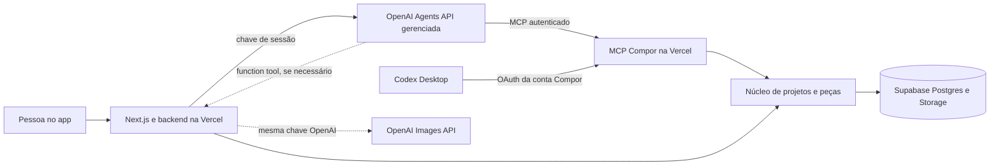
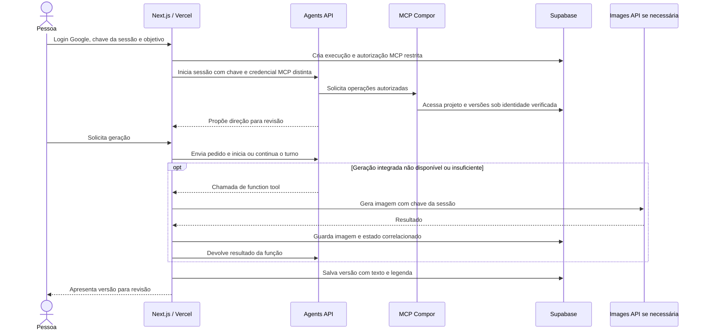

# Compor: system design web, Agents API e MCP remoto

**Estado:** proposta atualizada em 02/11/2026 para revisão de Matheus. A arquitetura integral ainda não foi aprovada. Nada neste documento comprova implementação, deploy, acesso a API, compatibilidade ou qualidade criativa.

## Objetivo e recorte

Entregar primeiro um fluxo criativo completo, online, para Matheus e equipe: a pessoa entra com Google, informa sua própria chave OpenAI para a sessão, descreve o objetivo, revisa uma direção, solicita a imagem e salva uma versão com imagem-base, texto editável e legenda. A pessoa pode compor e baixar o piloto em PNG e copiar a legenda, conforme a direção web anterior. App web e Codex Desktop acessam o mesmo projeto e peças. O Codex funciona sem a chave informada na sessão web.

O primeiro passo de implementação é o backend, seguido da interface mínima necessária à demonstração de ponta a ponta nos dois clientes. A pessoa pode fornecer referências ou seguir sem elas. A web começa com dados novos: perfis e peças locais existentes não são importados nem alterados.

**Marco 0:** fluxo completo acima, identidade e isolamento, MCP remoto, geração, persistência, recuperação possível, medição de custos e observabilidade operacional.

**Etapa 2:** perfil Phoenix persistente, sinais de preferência, personalização, avisos, desfazer e exclusão do perfil. Até lá, não afirmar que essas capacidades existem nem coletar sinais para personalização como se tivessem sido entregues. Permissões de acesso a projetos, autorização para ações e mensagens de erro continuam necessárias no marco 0. Busca externa e recomendador de boards também ficam para depois.

## Decisões confirmadas e histórico

- **Runtime:** OpenAI Agents API, com loop e sessão gerenciados pela OpenAI. Não usar Agents SDK para orquestrar o loop no backend do produto. Usar o cliente oficial da API, quando adequado, não equivale ao Agents SDK.
- **Infraestrutura:** Next.js e MCP remoto na Vercel; Supabase para autenticação, PostgreSQL e arquivos privados, sujeito a validação do plano e da integração. Google é o login inicial. Neste documento, “RKS” é interpretado como **RLS** (*Row Level Security*), aplicado junto à verificação de autorização por operação. Políticas específicas também são necessárias no Storage.
- **Chave:** BYOK sem armazenamento duradouro; chave fornecida para a sessão web, sem persistência em banco, `localStorage` ou `sessionStorage`. Não expor ao modelo, argumentos de tools, logs, URLs ou resultados. O backend a recebe temporariamente para operações autorizadas; o Codex não depende dela.
- **Imagem:** verificar se a Agents API disponibiliza geração equivalente à do Codex. Se não disponibilizar, uma function tool atendida pelo backend chama a **OpenAI Images API** usando a mesma chave OpenAI da sessão web. A function tool trata uma chamada pontual; não implementa o loop do agente. A chave precisa ter as permissões, acesso ao modelo e saldo necessários.
- **Codex:** conexão do MCP remoto à conta Compor por autorização explícita com Google. O cliente usa suas próprias capacidades de modelo e imagem; o resultado deve ser salvo no mesmo projeto sem a chave da web. A transferência da imagem e o fluxo real de autenticação precisam ser demonstrados.
- **Operação:** medir custo e observabilidade desde o marco 0. Diagnóstico mínimo sem chaves ou conteúdo criativo nos logs; avaliação e compartilhamento de conteúdo permanecem separados. MLflow/Oracle não é dependência inicial.
- **Dados na OpenAI:** Matheus aceita retenção na OpenAI e não exige mudança de região, migração de dados ou redistribuição de responsabilidades para este desenho. A residência EUA/UE não é um bloqueio escolhido para o piloto; condições efetivas dos serviços são características a registrar.
- **Retomada:** uma execução iniciada pode terminar após o fechamento do navegador e gerar custo. Ao retornar, a pessoa reapresenta a chave quando necessária; o produto tenta reconciliar resultados sem repetir automaticamente uma operação paga de resultado desconhecido.

**Supersessão explícita:** na rodada anterior Matheus havia incluído o perfil Phoenix, seus avisos e exclusão no primeiro marco. Em seguida, decidiu adiá-los para a etapa 2, para priorizar o fluxo funcional. A exigência anterior de acessar o mesmo *perfil* nos dois clientes passa a valer para a etapa 2; o mesmo *projeto e peças* continua exigido no marco 0. As regras previamente acordadas de consentimento, escopo, sinais por versão, aviso e desfazer ficam preservadas como insumo para o desenho da etapa 2. Esta proposta ainda não altera os ADRs aceitos.

## Arquitetura proposta

O MCP é uma interface compartilhada para as capacidades do Compor. A alternativa de converter todas as capacidades em funções do app mais um MCP separado para Codex não é necessária como ponto de partida. Para imagem, o handler específico é compatível com Agents API e mantém o loop gerenciado. O modelo e o protocolo não substituem a autorização do backend.

A Agents API pode operar sem sandbox e chamar MCP remoto; essa é a hipótese mais simples para começar. A [documentação oficial](https://developers.openai.com/api/docs/guides/agents-api/architecture) descreve o harness gerenciado, e a [documentação de MCP](https://developers.openai.com/api/docs/guides/agents-api/tools/mcp) descreve conexão HTTP e credenciais por sessão. A escolha de `environment: none` ainda precisa ser testada com as capacidades efetivas do fluxo.

### Imagem e diferença entre produtos OpenAI

O [Codex documenta geração integrada de imagem](https://learn.chatgpt.com/docs/image-generation), mas a documentação consultada não demonstra que a mesma tool esteja disponível na Agents API. Isso é uma lacuna de evidência, não prova de impossibilidade. A [Images API](https://developers.openai.com/api/docs/guides/image-generation) é o caminho definido se a capacidade nativa não atender. Uma chave de projeto OpenAI pode ser usada para Agents e Images quando tiver acesso e permissões para ambas; assinatura ChatGPT e API key não são equivalentes.

Se for usada function tool: a Agents API emite uma chamada; o backend a correlaciona à execução e à autorização da pessoa, recebe a chave da sessão ativa, chama Images API, salva o resultado privado e devolve o resultado correlacionado ao agente. Caso a pessoa feche o navegador, a chave deixe de estar disponível ou a execução expire, o backend não promete completar a chamada até que a chave seja reapresentada e o estado seja reconciliado. O fluxo detalhado depende de prova integrada. [Funções da Agents API](https://developers.openai.com/api/docs/guides/agents-api/tools/functions).

## Jornada e componentes

Diagrama conceitual; a ordem concreta de eventos e os pontos de espera serão verificados na integração. A sessão OpenAI não substitui o estado canônico dos projetos no Supabase.

## Dados e contratos do marco 0

| Conceito | Contrato proposto |
| --- | --- |
| Conta e cliente | Identidade autenticada pelo Google/Compor; vínculo revogável para o Codex. A chave OpenAI não identifica o usuário do Compor. |
| Projeto e peça | Pertencem ao escopo autorizado da conta. O mesmo projeto aparece na web e no Codex. Membros da equipe não ganham acesso automático aos dados de outras pessoas. |
| Versão | Identifica peça e origem; preserva direção, ativo-base, camadas editáveis e legenda com origem. Alterações criam nova versão e verificam a versão esperada. |
| Ativo | Objeto privado com vínculo ao projeto, tipo, integridade e origem declarada. Referências fornecidas pela pessoa não implicam licença ou direitos presumidos. |
| Execução | Correlaciona conta, projeto, identificador interno, sessão/turno/chamada OpenAI e estado; não contém a chave. Resultado externo incerto não é tratado como falha confirmada. |
| Observação operacional | Tipo da operação, duração, sucesso/falha/incerteza e uso/custo disponível, sem chave, prompt ou conteúdo criativo. |

Métodos de domínio a detalhar no código: abrir/criar projeto; ler versão; salvar nova versão com `expected_version_id`; autorizar e registrar geração; emitir acesso temporário ao ativo; consultar execução. Identificadores fornecidos por uma tool são dados, não prova de propriedade. Escritas concorrentes devolvem conflito recuperável; tentativas repetidas são deduplicadas pelo produto quando possível.

## Identidade, segurança e autorização

1. Supabase Auth autentica a pessoa por Google; verificar acesso a cada projeto, peça e ativo no backend. RLS e grants protegem dados por conta; Storage privado precisa de políticas próprias. Uma credencial administrativa pode contornar RLS e não deve ser tratada como identidade do usuário. [RLS](https://supabase.com/docs/guides/database/postgres/row-level-security), [controle de acesso ao Storage](https://supabase.com/docs/guides/storage/security/access-control).
2. Codex autoriza o MCP por OAuth vinculado à conta Compor. A integração precisa provar descoberta, registro, callback, escopos, renovação e revogação no Desktop. Não vincular contas apenas pela igualdade de e-mail ou copiar credenciais do Codex.
3. A Agents API recebe credencial MCP própria, distinta da chave OpenAI, restrita a usuário, projeto, operações e duração. Criar a execução e a credencial antes da sessão OpenAI, pois um turno pode começar imediatamente; associar o ID da sessão assim que disponível. Testar expiração, revogação e falhas parciais.
4. A geração paga depende de pedido verificável da pessoa; uma flag escolhida pelo modelo não constitui autorização. Validar conta, projeto, versão e chamada no backend; não deixar conteúdo da referência alterar permissões.
5. Uploads e downloads usam objetos privados, validação de tipo/tamanho e acesso temporário autorizado. A imagem gerada no Codex precisa chegar ao projeto por fluxo testado, sem depender de caminhos locais expostos ao servidor. Observar os [limites de payload da Vercel](https://vercel.com/docs/functions/limitations).

No marco 0, testes devem cobrir acesso cruzado, bypass de RLS e Storage, vazamento de segredos, prompt injection tentando acessar projetos ou gerar imagens, e revogação. Não habilitar perfil ou consentimentos de personalização antes da etapa 2.

## Falhas, concorrência e recuperação

- Registrar operações como pendente, autorizada, em execução, concluída, falha conhecida ou resultado incerto. Vincular chamada, conta, projeto e versão; persistir o resultado antes de responder à function tool quando o fluxo permitir.
- Na reconexão, usar uma chave válida para consultar sessão, itens e ações pendentes, reconstruindo o estado antes de reaplicar eventos. Stream interrompido não prova falha; `idle` não prova sucesso. Uma chave de outro projeto OpenAI pode não ter acesso à sessão. [Eventos e itens](https://developers.openai.com/api/docs/guides/agents-api/sessions/events).
- Após timeout em geração paga, o produto pode não saber se houve custo ou resultado. Bloquear repetição automática e informar a pessoa. Não prometer processamento ou cobrança exatamente uma vez.
- Conflito entre web e Codex não sobrescreve edição mais recente. Se banco e armazenamento ficarem inconsistentes, preservar ou identificar o resultado recuperável e reconciliar sem expor objetos de outra conta.
- Trabalho já salvo fica no Supabase; armazenamento transitório no navegador pode ajudar na recuperação, sem guardar a chave. Se não for possível recuperar um resultado, dizer isso claramente.

## Custos e observabilidade desde o marco 0

A conta da chave paga os usos OpenAI do app; Vercel e Supabase têm custos e limites próprios do operador. O Codex usa os recursos disponíveis na conta do cliente. O custo de uma peça depende das chamadas de modelo, tokens, imagem e falhas ou tentativas adicionais.

- Medir por execução e por peça, quando disponível: duração, chamadas, uso retornado, custo estimado do agente e custo estimado de imagem separados, estado de erro/incerteza e custos de infraestrutura observáveis.
- Identificar modelo, parâmetros de imagem e versão da tabela de preços usada na estimativa. Dados ausentes são **desconhecidos**, não zero. Uso da Agents API é *best effort* e pode não permitir determinar a cobrança exata. [Uso e observabilidade](https://developers.openai.com/api/docs/guides/agents-api/observability).
- Não solicitar chave administrativa para obter faturamento. Uma chave de projeto BYOK não garante acesso aos endpoints de custos administrativos; quando necessário, conferir o valor final no painel da OpenAI por quem tem acesso. Limite no app não é um teto absoluto da conta OpenAI.
- Para as primeiras provas pagas, definir previamente com Matheus a chave e um limite de gasto/volume; não disparar automaticamente avaliações pagas. Esses valores não precisam bloquear código local nem o desenho.
- Registrar metadados operacionais mínimos, sem chaves, tokens, prompts, imagens, conteúdo criativo ou URLs assinadas. Compartilhamento para avaliação permanece sujeito a autorização específica.

## Critérios de aceite do marco 0

1. Na web: login Google, chave de sessão, direção revisável, pedido explícito de imagem, texto editável e legenda; salvar e recuperar uma versão em projeto privado, compor e baixar o piloto em PNG e copiar a legenda.
2. No Codex Desktop: conectar à mesma conta, abrir o mesmo projeto, criar ou revisar e salvar uma versão, incluindo a imagem necessária, sem a chave da sessão web. Se autenticação, geração ou transferência não funcionar, o critério permanece não atendido.
3. Uma pessoa não acessa projetos, peças ou arquivos de outra por ID, URL, token MCP ou credencial administrativa mal empregada. RLS e autorização por operação são testados inclusive no Storage.
4. Medição e observabilidade funcionam desde a primeira execução; uso desconhecido é visível e não equivale a custo zero. Segredos e conteúdo criativo não aparecem em logs.
5. Concorrência e queda durante operação paga não causam sobrescrita silenciosa ou repetição automática cega. O resultado é recuperado quando possível ou apresentado como incerto.
6. A chave não é armazenada permanentemente, em logs ou ferramentas; ao abrir uma nova sessão, reapresentá-la quando necessário. O fluxo funciona sem perfil Phoenix.

## Etapa 2: Phoenix, avisos e exclusão

Levar adiante as decisões registradas no [ADR 0010](adr/0010-motor-recomendacao-phoenix-e-mcp-dual.md) e nas rodadas anteriores: perfil compartilhado entre web e Codex após autorização; escopo por tarefa/campanha e ampliação escolhida pela pessoa; sinais distintos ligados à versão e origem; fala separada de interpretação; mudanças comunicadas e reversíveis. Revogar personalização impede novas utilizações no escopo; exclusão do perfil ativo preserva projetos e peças, com alcance real de backups e dados de terceiros comunicado. A implementação e os critérios específicos dessa etapa serão detalhados depois do marco 0, sem apagamento de dados existentes.

## Aproveitamento e sequência de implementação

O [protótipo MCP](../prototypes/compor-mcp/README.md) não é um backend multiusuário: contém dependências de identidade local, filesystem e estado de processo. Reaproveitar contratos e lógica de direção/peças por extração seletiva; não publicar o servidor atual como está. O fallback Phoenix que inicia subprocesso `codex` local não é capacidade do servidor remoto. A etapa 2 adaptará o perfil, se aprovada.

Após revisão deste desenho: (1) verificar base e mudanças locais; (2) montar backend Next.js, Supabase e núcleo; (3) integrar MCP remoto, autenticação Codex e Agents API; (4) integrar imagem nativa ou Images API conforme teste, sem guardar a chave; (5) entregar interface mínima e verificar os critérios E2E, segurança, custos e recuperação. Deploy e lançamento dependem de decisão explícita de Matheus.

## Decisões, validações e artefatos para avançar

**Já decididos:** Agents API e não Agents SDK; MCP remoto compartilhado; Supabase com RLS e autorização por operação; BYOK de sessão; fallback Images API com a mesma chave; Codex sem chave web; observabilidade desde marco 0; Phoenix/perfil na etapa 2.

**Decisão de Matheus antes de implementar:** revisar e aprovar ou corrigir esta versão do system design. Antes de testes pagos, escolher chave e limite de gasto; antes de deploy, aprovar o deploy. Não é necessário escolher agora se a tool de imagem nativa existe: isso é uma verificação técnica com alternativa definida.

**Validações durante a implementação:** acesso da conta à Agents API e Images API; disponibilidade de imagem integrada; OAuth e transferência de imagem no Codex; expiração/revogação de credenciais; continuidade de sessão e limites reais dos serviços. Enquanto não testadas, são riscos, não decisões de produto nem garantias.

**Artefatos antes de implementar:** este documento já contém diagramas, domínio, autorização, ameaças, falhas e critérios de aceite. O [ADR 0011 proposto](adr/0011-agents-api-e-mcp-remoto.md) registra a troca Agents SDK → Agents API e MCP remoto sem sobrescrever os ADRs anteriores. Revisar os dois artefatos; o plano de testes e de medição deve acompanhar o trabalho. Valores concretos de custo e desempenho só existirão após medições. Não produzir novos documentos apenas para repetir o conteúdo existente.

## Referências de contexto

- [ADR 0007: web e BYOK](adr/0007-arquitetura-web-e-byok.md); [ADR 0009: MCP](adr/0009-mcp-capacidades-compor.md); [ADR 0010: Phoenix](adr/0010-motor-recomendacao-phoenix-e-mcp-dual.md).
- [Arquitetura coletiva no Confluence](https://compor-mathai.atlassian.net/wiki/spaces/COMPOR/pages/1376258): referência anterior; esta proposta ainda não a substitui.
- [Agents API — visão geral](https://developers.openai.com/api/docs/guides/agents-api/overview), [Agents — comparação de runtimes](https://developers.openai.com/api/docs/guides/agents), [Images API](https://developers.openai.com/api/docs/guides/image-generation), [Supabase RLS](https://supabase.com/docs/guides/database/postgres/row-level-security).
